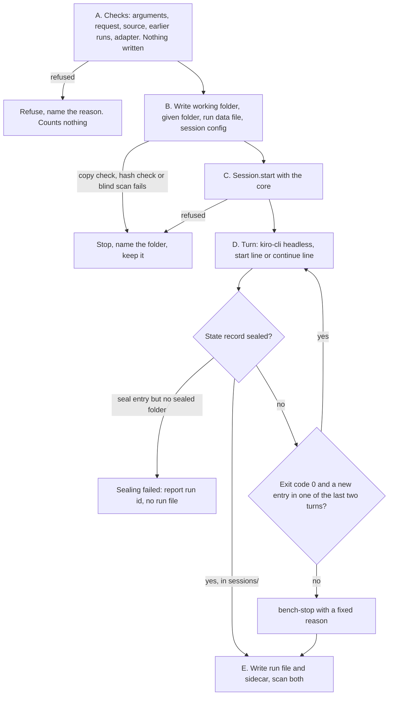

# Design: build-from-spec

Covers Requirements 1-19. Builds on `lab-bench` (core, front end F1-F12) and `dr-kiro`. Two conflicts between the
requirements and existing code, found while writing this design, are recorded in section 11 with how they were
resolved (K25, K26 of the requirements). Kiro's decisions are listed at the end.

## Overview

The run script prepares one working folder per run, starts a bench session for it with the core, runs the reader in
Kiro CLI headless (one start line, then fixed continue lines), and, once the record is sealed, writes the run file
next to it. A check command recomputes every run file from committed files only.

Most of the work is done by bench code that exists:

| Need | Reused |
|---|---|
| Verify a record, its entries and blobs | `bench.record.chain.verify`, `blob_refs`, `sha256_hex`, `BLOB_DIR`, `LOG_NAME` |
| The final spec of the source | `bench.record.spec_copy.read_end`, `final_spec` |
| Row ids of the discovered spec table | `bench.specfiles.discovered.parse_table` |
| Trial numbers | `bench.core.ids.parse_trial_id` |
| Session config file | `bench.frontend.config.load` (the same file `bench-mcp` and `bench-stop` read) |
| Starting a session | `bench.core.session.Session.start` |
| Stopping a session | `bench.frontend.stop.main` (`bench-stop`) |
| Tool descriptions | `bench.frontend.describe.descriptions`, with the setting of the amendment (section 3.14) |
| Hooks in the working folder | `bench.frontend.labhooks.install` (`bench-lab-hooks`) |
| The method steering | `bench/src/bench/drkiro/files/method.md`, read as package data |
| No session left open | `bench.drkiro.session.open_sessions` |
| Blind scan | `bench.scan.scan.Scanner` (`from_config`, `scan_text`, `scan_record`, `scan_file`) and the sidecar level source of `bench.scan.levels` |
| Confinement test | `decide` in `bench/src/bench/frontend/hooks/confine.py` |

New code is small and mostly pure: the request file, the wrapping adapter, the working folder, the reduced record
copy, the relied-on line, the result program, the turn loop, the run file and the checks.

## Architecture

### 2.1 Layout

```
build-from-spec/                       own uv project (Req 1.2)
  pyproject.toml, uv.lock, README.md
  requests/stop-ahead.toml             committed before any run (unchanged by this spec); the request run
  requests/straight-ahead.toml         committed, not run (Decision 18)
  requests/turn-right.toml             committed, not run (Decision 18)
  src/build_from_spec/
    apps.py        the application table: wrapped adapter, scan sources, reader budget
    request.py     request file: parse, print, check (bfs-check-request)
    wrap.py        the wrapping adapter and its factory names
    files/         the reader's builder files and templates, copied byte for byte
      reader.json  reader-prompt.md  reader.md  requirements.md  design.md  tasks.md
    folder.py      the working folder: builder files, given folder, hashes, blind scan
    reduced.py     reduced record copy and its check
    relied.py      the relied-on line and the allowed ids
    judge.py       the result program
    turns.py       the start and continue loop
    runs.py        run ids, earlier runs of a request, consistency
    runfile.py     run data file, run file, author sidecar (bfs-run-file)
    run.py         bfs-run
    check.py       bfs-check-runs
  tests/
```

`build-from-spec/` holds no copy of the method text (Req 1.1): `folder.py` reads it from the bench package when it
writes a working folder.

Builder side, git-ignored (`bench-run/` is ignored):

```
bench-run/build-from-spec/
  state/<run-id>/                bench state folder of the run (log, blobs, builder.log)
  <run-id>/                      the working folder (section 3.5)
  <run-id>.session.toml          session config, named by BENCH_SESSION_CONFIG
  <run-id>.run-data.json         run data file (Req 11.11)
  <run-id>.hook-log.jsonl        call log, named by BENCH_HOOK_LOG (Req 9.1)
  <run-id>.turn-<k>.log          Kiro CLI's stdout and stderr of turn k
```

Committed, each file added by name (Req 13.3):

```
sessions/build-from-spec/body-lab/<run-id>/                       sealed run record
sessions/build-from-spec/body-lab/<run-id>.run.json                run file
sessions/build-from-spec/body-lab/<run-id>.run.json.authors.json   its author sidecar (section 3.13)
```

The record path comes from the bench's existing rule `<sessions_dir>/<application>/<session-id>/`
(`Session._seal`), with `sessions_dir = sessions/build-from-spec` and `application = body-lab` (Req 13.1, K12).

### 2.2 Commands

All are run from the repository root with `uv run --project build-from-spec <command>`. Each refuses to start when
the current folder has no `.git`, so every repository path in this design is relative to the root.

| Command | What it does | Req |
|---|---|---|
| `bfs-check-request <request file> --source <record path>` | Format check, builder-level blind scan of `id` and `words`, and the source check: no counted trial of the source record has every named measurement inside its pass range. `--source` is required, with no default. Writes nothing. | 2, 3.1-3.5 |
| `bfs-run --request <file> --setup <setup> --source <record> --seed <n> --run <n> --model <m> --effort <e>` | Checks, prepares, starts the bench session, runs the turns, writes the run file. | 4-11, 13, 17 |
| `bfs-run-file <run-id>` | Writes the run file of a sealed run record. `bfs-run` calls the same function at its end; the command is for a run whose script was interrupted after sealing. | 14, 16.2 |
| `bfs-check-runs` | Checks every run file against its records and the committed request, checks runs of one request against each other, and derives what the notebook shows. | 14.3, 14.6, 16, 18 |

`bench-mcp` is started by Kiro CLI from `PATH`, as for Dr. Kiro. It must import the wrapping adapter, so the builder
installs the commands with `uv tool install --editable './bench[frontend]' --with-editable ./body-lab/adapter
--with-editable ./build-from-spec --reinstall` (README).

### 2.3 Flow of `bfs-run`



## Components and Interfaces

### 3.1 Application table (`apps.py`, Req 4.3, 4.7, 8.6)

```python
@dataclass(frozen=True)
class App:
    name: str           # the application name in records and request files
    adapter: str        # module:factory of the application's adapter
    scan_sources: str   # its scan_sources.toml, relative to the repository root
    budget: int         # the reader budget in trials

APPS = {"body-lab": App("body-lab", "body_lab.adapter:BodyAdapter", "body-lab/adapter/scan_sources.toml", 12)}
```

This is the only place a reader budget is written. Every function that needs the table takes it as an argument;
the commands pass `APPS`, the tests pass a table with the fake application (`bench.fake.adapter:FakeAdapter`,
`bench/src/bench/fake/scan_sources.toml`). An application missing from the table is refused with "no reader budget
is decided for <application>" (Req 4.7, 8.6). wind-tunnel gets an entry when its budget is decided (Open items).

### 3.2 Request file (`request.py`, Req 2, 3)

```python
@dataclass(frozen=True)
class PassRange:
    measurement: str
    low: float
    high: float

@dataclass(frozen=True)
class Request:
    id: str
    application: str
    words: str
    passes: tuple[PassRange, ...]

class RequestError(Exception): ...          # file, where (field or line), problem

def parse_request(path: Path, apps) -> Request
def print_request(request: Request) -> str
def inside(value: float, p: PassRange) -> bool   # p.low <= value <= p.high (Req 2.3)
def source_trials_inside(request: Request, record: Path) -> list[str]   # ids of counted trials inside every pass range (Req 3.5)
def check_request(path: Path, source: Path, apps, stop_list: Path) -> list[str]   # bfs-check-request
```

`parse_request` reads the file with `tomllib` and refuses, naming the file and the field (`id`, `words`,
`pass[2].range`, ...) or the TOML error's own text with its line, in the order of Req 2.2: not TOML; a missing
field; an extra top-level field or an extra field in a `[[pass]]` table; `id` not `[a-z0-9-]+` or not the file
stem; `application` not in the table; `words` empty or only white space; no `[[pass]]`; a bound that is not a
number (an int is taken as a float, a bool is refused) or not finite (TOML allows `inf` and `nan`); `low` not
strictly below `high`; a measurement named twice; a measurement that is not of kind `scalar` in the declaration of
the application's adapter (the adapter is built from `App.adapter` and asked for its declaration; for body-lab the
scalars are `x`, `y` and `heading`).

`print_request` writes `id`, `application`, `words`, then one `[[pass]]` table per range in order. Strings are
written with `json.dumps(..., ensure_ascii=False)`: every JSON escape is a valid TOML basic-string escape. Bounds are
written with `repr`, which reads back to the same float. The round trip is on values (Req 2.4): the printed text
need not equal the committed file's bytes.

`check_request` parses, then scans `id` and `words` with `Scanner.from_config([App.scan_sources], stop_list)` at the
builder level. The line of each finding is the line of the file that starts with `id =` or `words =`. It prints each
finding as `<file>:<line>: <kind>: <match>` and exits 1, or prints "no findings" and exits 0 (Req 3.2, 3.4). It
judges nothing else (Req 3.3) except the source check below.

`source_trials_inside(request, record)` is the source check (Req 3.5, Kiro decision K27). It verifies the record
with `verify(record, sealed=True)` (`bench.record.chain`), takes its counted trials with `counted_trials(entries)`
from `judge.py` (section 3.8), and returns the ids, in log order, of the trials where every measurement named in the
request is a number and `inside` holds. A not-measured value is outside, as in section 3.8. A named measurement
missing from a trial fails the command, as in section 3.8. `check_request` takes the source path as an argument with
no default, and it fails when the list is not empty, naming the request file and each trial id. A source that does
not verify fails, naming the path (rules.md 2). The run script calls `check_request` with the source of the run
(section 3.9, step A2), so the check runs on the same record as the one the run is tied to.

### 3.3 Wrapping adapter (`wrap.py`, Req 8)

The session config names the adapter as

```toml
adapter = "build_from_spec.wrap:reader/body-lab/stop-ahead/12"
```

`bench.frontend.config` imports `build_from_spec.wrap` and calls `getattr(module, "reader/body-lab/stop-ahead/12")`.
The module defines `__getattr__(name)` (PEP 562): for a name that does not start with `__` it returns a factory for
that name; dunder names raise `AttributeError` as usual. The factory, called with no arguments as the bench calls
every adapter factory:

1. Splits the name at `/`. It needs exactly four parts, the first `reader`. Otherwise it raises `WrapError`
   naming what is missing: the application, the request or the budget (Req 8.5).
2. Looks the application up in `APPS`; missing: `WrapError` "no reader budget is decided for <application>"
   (Req 8.6).
3. Requires the budget part to be the decimal form of `App.budget`; otherwise `WrapError` naming both.
4. Reads `build-from-spec/requests/<request-id>.toml`, found next to the package source
   (`Path(__file__).parents[2] / "requests"`), with `parse_request`, and requires its `application` to be the
   name's application.
5. Builds the wrapped adapter from `App.adapter`.

```python
class ReaderAdapter:
    def __init__(self, wrapped, budget: int, words: str) -> None
    def declaration(self) -> Declaration    # dataclasses.replace(wrapped.declaration(), budget=budget, goal=words)
    def run_trial(self, inputs, seed)        # return self.wrapped.run_trial(inputs, seed)
```

- Knobs, measurements, picture, `fake` and `measured_by` are the wrapped declaration's, unchanged (Req 8.1). The
  application's name is not part of a `Declaration`; it is the session config's `application`, which the run script
  sets to the request's application, and the run-file check compares it with the record's start entry.
- `run_trial` passes the same inputs and seed and returns the result unchanged. It catches nothing, so a raised
  error or a `TrialFailure` reaches the bench as from the wrapped adapter (Req 8.2).
- The optional methods `builder_versions` and `check_inputs` (`bench.adapter`) are set on the instance as the
  wrapped adapter's bound methods when, and only when, the wrapped adapter has them. body-lab has
  `builder_versions`, so the MuJoCo version still goes to `builder.log` only.
- `bench-mcp` builds the tool descriptions from this declaration and the session config's `discovered_table`
  setting only (`describe.descriptions`, section 3.14, Req 8.3, 12.9); for every run the setting is
  `"not-required"`, so the texts are the same in the three setups of a request. The goal
  and `request.md` are both the request's `words`, byte for byte (Req 8.4).
- `bench-mcp` reads the request file again whenever Kiro CLI starts it. `Session.open` compares the declaration
  with the start entry, so a request file changed during a run cannot reopen the session: the turn fails and the
  run is stopped (section 3.10).

### 3.4 Reader files (`files/`, Req 9)

**`reader.json`** is `dr-kiro.json` with three fields changed: `name` `reader`, a one-line `description`, and
`prompt` `file://./reader-prompt.md`. `resources`, `mcpServers` (the `bench` entry runs `bench-mcp` with no `env`
entry: `BENCH_SESSION_CONFIG` reaches it from the environment that Kiro CLI is started with, K31), `tools` (`read`,
`write`, `@bench`), `includeMcpJson`, `includePowers` and `permissions` are the same. No shell (Req 9.1). A test
compares the two files as JSON with those three fields removed and with the `env` entry of `bench` removed from
`dr-kiro.json`; that `env` entry is the only other difference (K31).

**`reader-prompt.md`**, about eight lines: you are the reader; you answer one request about a system you know
nothing about except what the bench tools describe and what is in `given/`; the request is in `request.md` and is
the goal in the bench tools; you work alone, never ask the user anything and never wait for an answer; keep going
until `end_session` has succeeded or the bench reports that the session has ended; follow your steering.

**`method.md`** is not in `files/`. `folder.py` copies the bench package file `bench/drkiro/files/method.md` byte for
byte; a test compares the SHA-256 of the working folder's copy with that file (Req 9.3). Dr. Kiro's `workflow.md` is
not copied. `method.md` names `.kiro/specs/lab/` as the place of the spec files, so the reader's spec files are
there too.

**`reader.md`** (steering, `inclusion: always`), short sections:

- **What you have.** `request.md` holds the request. `given/` holds material about the system, possibly nothing.
  Read all of it before your first hypothesis.
- **H1 names what you rely on.** The first line inside H1's `prediction` block is `# relies on: <ids>`: the ids, as
  they appear in `given/`, of what you rely on (a rule row such as `R<n>`, a hypothesis such as `H<n>`, an
  experiment such as `E<n>`), separated by commas; or `# relies on: none`. Register H1 before your first
  experiment. The line is frozen with H1.
- **Experiments.** Every experiment sets `PHASE = "best"`.
- **Your answer.** Your last trial is your answer: its measurements are judged against the request.
- **Ending.** Call `end_session` when your last trial is done and every experiment has a verdict. What ending
  needs is said by the `end_session` tool description, the one source for it; `reader.md` does not repeat it.
- One example of H1 in the method's hypothesis format, with the relied-on line and placeholders in angle brackets
  in place of every value (`rules.md`, Honest).

The text is the same for every setup (Req 4.2), so it names every kind of id and does not say which setup the run
has.

**Templates** (copied to `.kiro/specs/lab/`), no hypothesis, no experiment, no number, no table (Req 9.4):

```
requirements.md   # Requirements / ## Hypotheses
design.md         # Design / ## Notes
tasks.md          # Tasks / - [ ] Read what is given / - [ ] Answer the request
```

**Start line** `Begin the session.` and **continue line** `Continue the session.`, the same as Dr. Kiro's, are
written in `build-from-spec/README.md` and as constants in `turns.py` (Req 9.6).

### 3.5 Working folder (`folder.py`, Req 4, 7)

```python
def builder_files(request: Request) -> dict[str, bytes]      # every file outside given/, hooks excluded
def given_files(setup: str, source: Path) -> GivenFiles       # files under given/, and the removed entries
def write_folder(folder: Path, request: Request, given: GivenFiles) -> None
def file_hashes(folder: Path) -> dict[str, str]               # relative POSIX path -> SHA-256, outside given/
def tool_hashes(adapter) -> dict[str, str]                    # tool name -> SHA-256 of descriptions(decl, "not-required")
def scan_folder(scanner: Scanner, folder: Path) -> list[Finding]
```

Contents after `write_folder` (Req 7.2):

```
<run-id>/
  .kiro/agents/reader.json, reader-prompt.md
  .kiro/steering/method.md, reader.md
  .kiro/hooks/confine.py, calllog.py, confine-pre-tool.json, calllog-pre-tool.json, calllog-post-tool.json
  .kiro/specs/lab/requirements.md, design.md, tasks.md
  request.md                      the request words, exactly (no newline added)
  experiments/                    empty
  given/                          spec: requirements.md, design.md, tasks.md
                                  record: record/log.jsonl, record/blobs/<sha256>
                                  none: empty (Req 4.5)
```

- `write_folder` refuses an existing folder (`mkdir` without `exist_ok`). The hooks are written by
  `labhooks.install(folder)`, so they are the bench's own bytes, and the confinement hook confines to this folder
  (the hook takes the folder two levels above itself).
- Setup `spec`: the three files of `final_spec(source).files`, byte for byte (Req 5.3). Setup `record`: the reduced
  record copy (section 3.6).
- Nothing outside `given/` depends on the setup, the run number or the source: `builder_files` takes only the
  request. The session config is reached through `BENCH_SESSION_CONFIG` and the call log through `BENCH_HOOK_LOG`
  (Req 7.7).
- `file_hashes` covers every file outside `given/`; `tool_hashes` covers the four texts `bench-mcp` will register,
  built from the same declaration and the same `discovered_table` value (`"not-required"`, section 4.2) by the same
  function (Req 7.3).
- `scan_folder` applies the levels of Req 7.6 itself: `given/record/` with `scanner.scan_record` (each text by its
  recorded author), the three given spec files at the Dr. Kiro level, every other file at the builder level. The
  working folder is not a lab of any `scan_sources.toml`, so the scan's lab globs cannot give these levels. The tool
  texts are scanned at the builder level as well (as `bench-mcp` does at start).

### 3.6 Reduced record copy (`reduced.py`, Req 6)

```python
@dataclass(frozen=True)
class Removed:
    seq: int
    hash: str

def reduce(source: Path, target: Path) -> tuple[Removed, ...]
def check_reduced(copy: Path, source: Path) -> list[str]    # empty: the copy matches
```

`reduce`:

1. `entries = verify(source, sealed=True)`; the log's lines are its bytes split at `\n` (the last, empty piece
   dropped), one per entry.
2. Kept: every line whose entry is not of kind `snapshot`, in order, byte for byte. Removed: each snapshot entry's
   `seq` and `hash`, in log order (Req 6.4).
3. Kept blobs: every blob referenced by a kept entry (`blob_refs`). A sealed record holds only referenced blobs, so
   these are exactly the blobs not referenced only by removed entries (Req 6.1). Frozen hypothesis texts,
   experiment files and pictures are referenced by `register`, `experiment` and `trial` entries, so they stay
   (Req 6.2).
4. Writes `target/log.jsonl` and `target/blobs/<sha256>`, the same names as the source.

`check_reduced` derives the expected lines and blob set from the source the same way and reports, naming the line
or blob: a kept line that differs from its source line; a line missing or added (a removed non-snapshot line, a
kept snapshot line); a blob missing, extra, or with other bytes; any other file (Req 6.3). The copy's hash chain does
not verify, because its sequence numbers have gaps (K10); that is why this check exists.

### 3.7 Relied-on line (`relied.py`, Req 10)

```python
PREFIX = "# relies on: "
PROBLEMS = ("no-h1", "no-line", "bad-syntax", "unknown-id", "late")

@dataclass(frozen=True)
class Relied:
    ids: tuple[str, ...] | None    # as found; None when there is no line or it cannot be read
    problem: str | None            # None: the line is valid

def relied_line(frozen: str) -> str | None
def parse_ids(line: str) -> tuple[str, ...] | None          # None: bad syntax
def format_ids(ids: tuple[str, ...]) -> str
def allowed_ids(setup: str, source: Path) -> frozenset[str]
def relied_on(entries, frozen_h1: str | None, allowed: frozenset[str]) -> Relied
```

- `relied_line`: the frozen part is H1's heading, statement and prediction block (`bench.specfiles.hypotheses`).
  The bench takes the first fence after the heading as the prediction block, so the candidate is the line right
  after the first line after the heading that starts with three backticks or tildes. A candidate that starts with
  `# relies on` is the relied-on line; any other candidate means there is none.
- `parse_ids`: the line must be `PREFIX` followed by `none`, or by one or more ids matching `[^,\s]+`, separated by
  a comma and optional spaces after it, with nothing after the last id. Ids must be distinct, and `none` may not
  stand with other ids (Req 10.1). Case-sensitive.
- `allowed_ids`, from the source record only, never from the working folder (Req 10.5, K16):
  - `spec`: `none` and the row ids of `parse_table` on the final spec's `design.md`. A table that does not parse
    fails the command (the source was ended under the table check, so this means a broken source).
  - `record`: `none`, every `H<n>` of a `register` entry and every `E<n>` of an `experiment` entry among the
    source's non-snapshot entries, which are the entries of the reduced copy.
  - `none`: `none` only (Req 10.2).
- `relied_on` gives, first match wins: `no-h1` (no `register` entry for `H1`), `no-line`, `bad-syntax`,
  `unknown-id` (an id not in `allowed`; `ids` keeps what was found), `late` (an `experiment` entry has a lower
  `seq` than H1's `register` entry, Req 10.3, 10.4). Otherwise the line is valid. Every problem makes the result
  `not-counted` (Req 15.2).

No bench change: the line is a TOML comment, which the prediction parser ignores and the frozen part keeps.

### 3.8 Result program (`judge.py`, Req 15)

```python
@dataclass(frozen=True)
class Judgement:
    end: str                          # "ended" | "stopped", from the seal entry
    relied: Relied
    result: str                       # "pass" | "fail" | "no-trial" | "not-counted"
    first_in_range: str | None        # trial id; None is the no-in-range marker
    last_trial: str | None            # trial id of the last counted trial
    last_phase: str | None            # PHASE of its experiment
    last_values: dict[str, float | str]   # each named measurement; a not-measured outcome by its name

def counted_trials(entries) -> list[dict]
def judge(entries, frozen_h1: str | None, request: Request, allowed: frozenset[str]) -> Judgement
def judge_record(record: Path, request: Request, allowed: frozenset[str]) -> Judgement   # reads, then judge
```

- **Counted trial** (Req 15.9): a `trial` entry whose experiment also has a `snapshot` entry with
  `"for": "experiment"` and the same experiment id. `Session._run_trials` writes that snapshot only when the run
  call returns `Ran`. When a bench failure stops a run part-way, the trials that ran are recorded but the call's
  outcome is a bench failure, so they do not count. A refused call writes no `trial` entry.
- **Last trial**: the counted trial with the highest number (`parse_trial_id`).
- **In range**: for every pass range, the trial's measurement is a number (not a `{"not_measured": ...}` object)
  and `inside` holds. A not-measured value, `lost` for body-lab, is outside (Req 15.4). A named measurement absent
  from a trial entry fails the command: the bench never records such a trial (`check_result`).
- **Result**, in this order: `not-counted` if `relied.problem` is set; `no-trial` if there is no counted trial;
  `pass` if the last trial is in range; `fail` otherwise (Req 15.2-15.4, 15.8). The phase of the last trial plays no
  part (Req 15.10), nor does the end (Req 15.6).
- **First in range**: the lowest-numbered counted trial that is in range, or `None` (Req 15.5). It never changes the
  result.

`judge` is a pure function of the entries, H1's frozen text and the request. `judge_record` verifies the sealed
record and reads H1's frozen blob. The allowed ids come from the source (section 3.7), so the result depends only
on the run record, the committed request and the source record (Req 15.1).

### 3.9 Run script (`run.py`, Req 4, 5, 7, 11, 17)

Arguments, all required, none with a default (Req 11.1): `--request`, `--setup`, `--source`, `--seed`, `--run`,
`--model`, `--effort`. They are read as strings and validated so that a refusal names the argument and the value:
`setup` one of `spec`, `none`, `record`; `seed` an integer; `run` an integer of at least 1; `model` and `effort`
non-empty (Req 11.8). Run id: `<request-id>-<setup>-<n>`.

**A. Checks; nothing is written** (Req 5.7, K14). In order, each refusal naming what failed:

1. The request file is tracked (`git ls-files --error-unmatch`) and equal to `HEAD`, staged or not
   (`git diff --quiet HEAD -- <file>`) (Req 11.2). Its last-change commit is `git log -1 --format=%H -- <file>`; its
   SHA-256 is taken from the file (Req 11.3).
2. `parse_request` and the request check of section 3.2 with the run's source (Req 11.4, 3.5).
3. The application is in `APPS` (Req 4.7).
4. The source: a folder, not inside `sessions/build-from-spec/` (Req 5.5); `read_end` verifies it and gives its
   end, application and final spec; it must be `ended`, have a final spec, and be of the request's application
   (Req 5.2). Its seal hash is the last entry's hash.
5. No working folder, run record or run file with this run id (Req 7.1).
6. Earlier runs of the request (section 3.12): every run record of the request has a run file (Req 7.8); and every
   earlier run file has the same seed (Req 4.6), source session and seal hash (Req 5.6), request SHA-256 and commit
   (Req 17.5), and Kiro CLI version, model and effort (Decision B5). Each difference names both values.
7. No session in `bench-run/build-from-spec/state/` is open (`open_sessions`).
8. The reader adapter, built through its factory name (section 3.3), and its tool texts.
9. `kiro-cli --version`, recorded.

**B. Prepare.** A failure here names the working folder and leaves it in place; the same run number is used again
only after the user removes it (Req 11.10).

1. `write_folder` (section 3.5).
2. Setup `record`: `check_reduced`; a problem stops the run, naming the line or blob (Req 6.6).
3. `file_hashes` and `tool_hashes`, compared with every earlier run file of the request; a difference stops the
   run, naming the file or tool (Req 7.4). The comparison is made here, after writing, so that the hashes are of the
   files as written.
4. `scan_folder` and the tool texts; a finding stops the run, naming the file and line (Req 7.5).
5. The run data file (section 4.3, Req 11.11).
6. The session config (section 4.2, Req 11.5), `resume = true`.

**C. Start.** `bench.frontend.config.load(<config>)`, then `Session.start(cfg.session)`, then `close()`, as
`bench-new-session` does. A refusal stops the run before the reader starts (Req 11.7). `resume = true` means every
later start of `bench-mcp` reopens this session (Decision B11). From here the run counts (Req 17.4).

**D. Turns** (section 3.10). Kiro CLI runs with the working folder as its working directory, standard input closed,
standard output and error written to `<run-id>.turn-<k>.log`, and the environment of the script plus
`BENCH_SESSION_CONFIG` and `BENCH_HOOK_LOG` as absolute paths. `KIRO_API_KEY`, which headless Kiro CLI needs
(`bench/README.md`), stays in the builder's environment and is never written to a file.

**E. End.**

- The state record ends with a seal and `sessions/build-from-spec/<application>/<run-id>/` exists: the run file is
  written (section 3.11).
- The state record ends with a seal but the sealed folder does not exist: sealing failed, most likely in its blind
  scan (`Session._seal_failed`). The script reports the run id and the state folder's `builder.log`, writes no run
  file, and stops (Req 13.5).
- A turn rule stops the run (section 3.10): `bench.frontend.stop.main([<config>, "--reason", <reason>])`, then the
  run file. If `bench-stop` fails (for example the state folder is still locked by a `bench-mcp` that did not exit),
  the script prints its message and stops; the user decides (Req 11.9, 13.6).

### 3.10 Turns (`turns.py`, Req 9.6, 11.6)

One turn is one Kiro CLI process. Command, fixed except for the two pinned arguments:

```
kiro-cli chat --v3 --no-interactive --require-mcp-startup --trust-workspace --trust-tools= \
              --agent reader --model <model> --effort <effort> [--resume] "<line>"
```

The first turn sends the start line without `--resume`; every later turn sends the continue line with `--resume`,
which resumes the most recent conversation of the working folder. The folder is new for each run, so that is the
run's own conversation.

```python
@dataclass(frozen=True)
class Prompt:
    kind: str            # "start" | "continue"
    sha256: str          # of the line sent
    time: str            # UTC, "%Y-%m-%dT%H:%M:%SZ", when the turn started
    exit: int            # Kiro CLI's exit code
    entries_before: int  # entries in the state record before the turn
    entries_after: int   # and after it

@dataclass(frozen=True)
class TurnsEnd:
    sealed: bool
    stop_reason: str | None
    prompts: tuple[Prompt, ...]

def run_turns(launch: Callable[[str], int], entries: Callable[[], tuple[int, bool]],
              save: Callable[[tuple[Prompt, ...]], None]) -> TurnsEnd
```

`launch(kind)` runs one turn and returns the exit code; `entries()` reads the state record with
`verify(<state>/<run-id>, sealed=False)` and returns its entry count and whether the last entry is a seal; `save`
rewrites the run data file after each turn. The loop, after each turn:

1. Sealed: done, whatever the exit code.
2. Exit code not 0: stop, reason "the reader's Kiro CLI exited with code <n>".
3. No new entry in this turn and none in the turn before: stop, reason "the reader called no bench tool in two turns
   in a row".
4. Otherwise send the continue line.

Every bench call while the session is open adds an entry, a refusal included, so "no new entry" means the reader
called no bench tool in that turn. Rule 3 is not a maximum: a reader that keeps calling the bench gets as many
continue lines as it needs (Decision 15). It stops only a reader for whom one continue line already changed nothing
(Decision B3). The stop reasons are bench wording with no forbidden term, and `bench-stop` seals them in the record.

### 3.11 Run file (`runfile.py`, Req 14, 16.2)

`write_run_file(run_id, apps, stop_list)`, also the command `bfs-run-file <run-id>`:

1. Refuses if the run file exists (Req 14.5).
2. Reads the run data file, verifies the sealed run record (`verify(sealed=True)`) and reads its seal hash and end.
3. Reads the source record and the request at the recorded commit (`git show <commit>:<request file>`), and
   requires the source seal hash and the request SHA-256 to be the recorded ones.
4. `allowed_ids`, `judge_record`.
5. Builds the run file (section 4.4) and its sidecar (section 3.13), writes both under temporary names in the same
   folder, scans the run record (`scan_record`) and the temporary run file (`scan_file`, which reads the sidecar),
   and renames both only when the scan finds nothing. A finding deletes the two temporary files, keeps the run
   record unchanged, prints file and line, and stops (Req 16.2, 16.4).

### 3.12 Earlier runs and checks (`runs.py`, `check.py`, Req 14.3, 14.6, 18)

A run id is read with `^(?P<request>[a-z0-9-]+)-(?P<setup>spec|none|record)-(?P<n>[1-9][0-9]*)$`. The setup and
number are matched at the end, so the request id is unambiguous. "Runs of the same request" are the run records and
run files in `sessions/build-from-spec/<application>/` whose run id has that request id.

`bfs-check-runs` reads only `sessions/build-from-spec/`, `build-from-spec/requests/` at the recorded commits, and
the source records the run files name (Req 14.3 "committed files only", 18.1). For every application folder:

1. Every run record has a run file and every run file has a run record.
2. For each run file: the run record verifies and its seal hash is the recorded one; its start entry has the run id
   as session, the request's application and the recorded seed; the source record verifies with the recorded seal;
   the request at the recorded commit has the recorded SHA-256, and the commit is the last commit that changed the
   request file before the run (`git log -1 --format=%H <C> -- <request file>`, where `C` is the commit that added
   the run file, or `HEAD` while it is not committed); setup `spec`: the given spec hashes equal those of
   `final_spec`; setup `record`: the removed entries equal those `reduce` derives from the source; the relied-on
   ids, the result, the first in-range trial, the last trial and its phase, and the end equal a new `judge`; the
   prompts start with one `start` and continue with `continue` only, their hashes are those of the two fixed lines,
   `continue_lines` is the number of `continue` prompts, each turn's `entries_before` is the previous turn's
   `entries_after` (the first is 1, the start entry), and the record holds the last `entries_after` entries, or one
   more when `bench-stop` sealed it.
3. Run files of one request: the same seed, source seal hash, request SHA-256 and commit, file hashes, tool hashes,
   and Kiro CLI version, model and effort (Req 14.6). A difference names both run files and the field.
4. For each run, the items of Req 18.1: the request words and pass ranges at the recorded commit, the setup, the
   relied-on ids, the last trial's measured values (from the record), the result, the first in-range trial, the end,
   and the run ids of the same request in the other setups. An item that cannot be derived fails, naming the run id
   and the item.

It prints one line per run and exits 1 on any problem, naming the run file and the field. The function that
derives step 4 (`derive_run`) is the one the `lab-notebook` build can call.

### 3.13 Blind-scan level of the run file (Req 14.4, 16)

The run file gets an author sidecar `<run-id>.run.json.authors.json` in the existing format of
`bench.scan.levels.sidecar_pieces` (`{"ranges": [{"start", "end", "author"}]}`, character offsets covering the file
in order). The JSON string tokens of the relied-on ids, quotes included, are `dr-kiro`: they are the reader's text,
copied from H1. Everything else is `bench`. The writer serialises the run file with a unique placeholder in place
of each id, splits the text at the placeholders to get the ranges, and puts the JSON-encoded ids back.

- `bfs-run-file` scans the run file when it writes it (section 3.11).
- `bench-scan` on `sessions/` or `sessions/build-from-spec/` already handles both: a folder with `log.jsonl` is
  scanned as a record, the `.run.json` file through its sidecar, and sidecars are skipped as files of their own
  (`Scanner._scan_path`). Publishing runs that scan (Req 16.3).
- A run file without its sidecar fails the scan with "no level source" (`sidecar_pieces`), naming the file
  (Req 16.5).
- The run file holds no path: the request file and the source record are named by their ids, and the paths are
  derived (`build-from-spec/requests/<id>.toml`, `sessions/<application>/<session>`).

### 3.14 lab-bench amendments (Req 12, 13.7)

Two small amendments, made later in the main folder as one `lab-bench` task, each with its own tests: ending
without the table (Req 12, K21, K26), and `bench-check-discovered` skipping the run records (Req 13.7, K25).

#### 3.14.1 Ending without the table (Req 12)

The whole change:

| Where | Change |
|---|---|
| `SessionConfig` (`core/session.py`) | New field `discovered_table: str`, no default. |
| `Session._check_config` | Refuse unless it is `"required"` or `"not-required"`: "cannot start: discovered_table must be required or not-required" (Req 12.6). |
| `frontend/config.py` | `FIELDS` already follows `SessionConfig`, so a missing field is refused by name. `load` checks it is a string and passes it on. |
| Start entry | `"discovered_table": config.discovered_table` (Req 12.7). `Session.open` compares it with the config like `seed`. |
| `Session._end` | One branch: the `check_table` block runs only when the value is `"required"`. The verdict gate, the one reading of the three files, the `"for": "end"` snapshot and sealing as `ended` stay as they are (Req 12.2, 12.3). |
| `frontend/describe.py` | `descriptions` takes the setting; with `"not-required"` the `end_session` text leaves out the table clause (below, Req 12.9). |
| `frontend/server.py` | `BenchServer` calls `descriptions(session.declaration, session.config.discovered_table)`. It is the only caller. |
| `bench-new-session` (`drkiro/session.py`) | Passes and writes `discovered_table = "required"` (Req 12.4). |
| Tests and docs | `tests/labkit.py` and every config in the tests state `"required"`; `bench/README.md`'s sample `session.toml` gains the line. |

- Records sealed before the amendment have no `discovered_table` in their start entry. `bench-verify` and
  `final_spec` do not read it, so they stay valid (Req 12.8); a test runs both on body-1, body-2 and wt-004.
- `Session.open` refuses a record without the key, so an unsealed session started before the amendment could not be
  reopened. No session may be open when the amendment is merged; today none is.
- The configs in `bench-run/` are git-ignored and all belong to sealed sessions. They are not edited. If one is
  needed again for an open session, the line is added by hand.
- New tests: with `"not-required"`, `end` without a table seals as `ended` with an end snapshot that `final_spec`
  reads; with a pending verdict it still refuses; a missing or unknown value is refused at start naming the setting;
  the start entry holds the value.

**`frontend/describe.py`.** Today the `end_session` text is one string:

```python
"End the session. Every experiment needs a verdict, and your design.md must end with a "
"Discovered spec table that agrees with the record."
```

After the amendment:

```python
END_BASE = "End the session. Every experiment needs a verdict"
END_TABLE = ", and your design.md must end with a Discovered spec table that agrees with the record"

def descriptions(decl: Declaration, discovered_table: str) -> dict[str, str]:
    if discovered_table not in ("required", "not-required"):
        raise ValueError(f"discovered_table must be required or not-required, not {discovered_table!r}")
    ...
    "end_session": END_BASE + (END_TABLE if discovered_table == "required" else "") + ".",
```

- `"required"` gives the current text byte for byte, so Dr. Kiro's tool texts do not change (Req 12.9).
- `"not-required"` gives `End the session. Every experiment needs a verdict.` The dropped part is exactly the
  clause `, and your design.md must end with a Discovered spec table that agrees with the record`.
- The other three texts do not depend on the setting. The setting has no default; an unknown value raises (the
  bench has already refused it at start, so this only guards another caller).
- The texts depend on the declaration and the setting only, so they are byte-identical in the three setups of a
  request (Req 4.2, 12.9).

Tests (`bench/tests/frontend/test_describe.py`, `test_server.py`): with `"required"`, `end_session` equals the
current literal above; with `"not-required"`, it equals `End the session. Every experiment needs a verdict.`; for
both values the other three texts are equal to each other; an unknown value raises naming the setting; a server
started with a `"not-required"` config lists the shorter `end_session` text, and with `"required"` the current one.

#### 3.14.2 `bench-check-discovered` skips the run records (Req 13.7)

`_records` in `record/spec_copy.py` today reads every folder under `sessions/<x>/` as a session record and raises on
a folder without `log.jsonl`. `sessions/build-from-spec/body-lab/` holds run records and run files, so
`bench-check-discovered sessions discovered` would fail, or, read deeper, ask for copies of reader runs in
`discovered/`. The change:

```python
RUN_RECORDS = "build-from-spec"   # sessions/build-from-spec/ holds reader run records (build-from-spec Req 13.7)

def _records(sessions: Path) -> list[Path]:
    """Every Dr. Kiro session record folder under `<sessions>/<application>/`; `<sessions>/build-from-spec/` is skipped."""
    for application in sorted(p for p in Path(sessions).iterdir() if p.is_dir() and p.name != RUN_RECORDS):
        ...  # unchanged
```

- `check_copies` adds one report line when `<sessions>/build-from-spec/` exists:
  `build-from-spec: reader run records, no copies`, so the skip is visible, not silent.
- Nothing else changes: a folder without `log.jsonl` anywhere else still fails, and a folder
  `discovered/build-from-spec/` is still reported as "no sealed session record has this name".
- The run records are still covered by `bench-verify`, the blind scan of `sessions/` and `bfs-check-runs`.
- At the same time the builder rewords `dr-kiro` Requirement 8.4 to say "every Dr. Kiro session record sealed as
  `ended` with an end snapshot", with the reader run records in `sessions/build-from-spec/` named as not covered
  (Req 13.7).

Test (`bench/tests/unit/test_spec_copy.py`): the repository's sessions copied into a temporary folder, plus
`sessions/build-from-spec/body-lab/<run-id>/` holding a sealed fake record ended with an end snapshot and a
`<run-id>.run.json` beside it: `check_copies` reports no problem and lists the skip line; adding
`discovered/build-from-spec/<run-id>/` is reported as a problem; a folder without `log.jsonl` under another
application folder still raises.

## Data Models

### 4.1 Request file

As committed in `build-from-spec/requests/` (Appendix A of the requirements): `id`, `application`, `words`, and one
or more `[[pass]]` tables with `measurement` and `range = [<low>, <high>]`.

### 4.2 Session config

`bench-run/build-from-spec/<run-id>.session.toml`, the bench's format plus the amendment's field. Paths are
relative to the file (`bench.frontend.config`).

```toml
session_id = "<run-id>"
application = "body-lab"
adapter = "build_from_spec.wrap:reader/body-lab/<request-id>/<budget>"
lab_dir = "<run-id>"
spec_files = [".kiro/specs/lab/requirements.md", ".kiro/specs/lab/design.md", ".kiro/specs/lab/tasks.md"]
experiments_dir = "experiments"
state_dir = "state"
sessions_dir = "../../sessions/build-from-spec"
seed = <seed>
scan_sources = ["../../body-lab/adapter/scan_sources.toml"]
stop_list = "../../.kiro/blind-scan/stop-list.txt"
discovered_table = "not-required"
resume = true
```

The run script creates `sessions/build-from-spec/` if it does not exist; the bench creates the application folder
when it seals.

### 4.3 Run data file

`bench-run/build-from-spec/<run-id>.run-data.json`, written in step B5 and rewritten after each turn. JSON with
`indent=2`, sorted keys and a final newline. Fields: `format` (`1`), `run`, `setup`, `request` (`id`, `commit`,
`sha256`), `source` (`application`, `session`, `seal`), `seed`, `adapter` (the factory name), `kiro` (`version`,
`model`, `effort`), `files`, `tools`, `given`, `prompts`. The fields have the meaning of section 4.4.

### 4.4 Run file

`sessions/build-from-spec/<application>/<run-id>.run.json`, same serialisation. The run data fields except `adapter`,
plus what is derived after sealing. Placeholders are in angle brackets (`rules.md`, Honest):

```json
{
  "format": 1,
  "run": "<request-id>-<setup>-<n>",
  "setup": "spec | none | record",
  "request": {"id": "<request-id>", "commit": "<commit of the last change>", "sha256": "<sha256>"},
  "source": {"application": "body-lab", "session": "body-2", "seal": "<sha256 of the seal entry>"},
  "record": {"seal": "<sha256 of the run's seal entry>", "end": "ended | stopped"},
  "seed": "<seed>",
  "kiro": {"version": "<kiro-cli --version>", "model": "<model>", "effort": "<effort>"},
  "files": {"<path in the working folder>": "<sha256>"},
  "tools": {"register_hypothesis": "<sha256>", "run_experiment": "<sha256>",
            "record_verdict": "<sha256>", "end_session": "<sha256>"},
  "given": "spec: {\"spec\": {\"requirements.md\": <sha256>, ...}} | record: {\"record\": {\"removed\": [{\"seq\": <seq>, \"hash\": <sha256>}]}} | none: {}",
  "relied_on": {"ids": ["<id>"], "problem": null},
  "result": "pass | fail | no-trial | not-counted",
  "first_in_range": "T<n> or null",
  "last_trial": {"trial": "T<n>", "phase": "<phase>"},
  "prompts": [{"kind": "start", "sha256": "<sha256>", "time": "<UTC time>", "exit": "<exit code>",
               "entries_before": "<count>", "entries_after": "<count>"}],
  "continue_lines": "<count>",
  "limits": ["<picture limit text of K30, setup record only>"]
}
```

- `limits` is a list of texts. For setup `record` it is exactly `["<the picture limit text of K30>"]`; for `spec` and
  `none` it is `[]`. `write_run_file` sets it from the setup (`limits_for`), and `bfs-check-runs` recomputes it from
  the setup and refuses a different value, naming the run file and the field (K30).

- `relied_on.ids` is `null` when there is no H1, no line, or a line of bad syntax: the marker distinct from
  `["none"]` (Req 14.2). `problem` is `null` or one of `PROBLEMS`.
- `first_in_range` is `null` when no counted trial is in range: the no-in-range marker, distinct from every trial id
  (Req 15.5). `last_trial` is `null` when there is no counted trial.
- `files` lists every file outside `given/` (section 3.5); paths are relative to the working folder and inside it.

### 4.5 Author sidecar

`<run-id>.run.json.authors.json`: `{"ranges": [{"start": <offset>, "end": <offset>, "author": "bench" | "dr-kiro"}]}`,
covering the run file in order without gaps (section 3.13).

## Correctness Properties

*A property is a characteristic or behavior that should hold true across all valid executions of a system-essentially, a formal statement about what the system should do. Properties serve as the bridge between human-readable specifications and machine-verifiable correctness guarantees.*

The properties cover the pure parts: the request file, the relied-on line, the result program, the reduced record
copy, the turn loop and the run file. Preparing folders, starting Kiro CLI and the git checks are example tests
(Testing Strategy). Records for properties 3-5 are lists of entry dicts in the bench's entry shape; records for
properties 7, 8 and 12 are written with the bench's `Store`, so they verify as real records do.

### Property 1: Request round trip

For any valid request (any id matching `[a-z0-9-]+`, any non-blank words including quotes, backslashes, line breaks
and non-ASCII text, and one or more pass ranges on distinct scalar measurements with finite `low < high`),
`parse_request(print_request(r))` equals `r`, and parsing the printed text twice gives equal requests.

**Validates: Requirements 2.1, 2.4**

### Property 2: Malformed requests are refused by name

For any valid request and any one mutation from the classes of Requirement 2.2 (broken TOML, a field removed, an
extra field at the top level or in a `[[pass]]` table, a bad or mismatched id, an unknown application, blank words,
no `[[pass]]`, a non-number, `inf` or `nan` bound, `low >= high`, a measurement named twice, a series or unknown
measurement), `parse_request` refuses, and the refusal names the file and the field or line of that mutation.

**Validates: Requirements 2.2**

### Property 3: Relied-on line round trip

For any non-empty tuple of distinct ids matching `[^,\s]+` and not containing `none`, and for `("none",)`,
`parse_ids(PREFIX + format_ids(ids)) == ids`, also with any number of spaces after each comma. For any line that
adds a trailing or leading space, an empty id, a doubled comma, or `none` next to another id, `parse_ids` returns
`None`.

**Validates: Requirements 10.1**

### Property 4: Order of the result checks

For any run record and request: if H1 is missing, has no relied-on line, has a line of bad syntax, names an id not in
the allowed set, or was registered after the first `experiment` entry, the result is `not-counted`, whatever the
trials; otherwise, if the record has no counted trial, the result is `no-trial`.

**Validates: Requirements 10.3, 10.4, 15.2, 15.3**

### Property 5: Only the last counted trial decides

For any run record with a valid relied-on line and at least one counted trial, and any pass ranges, the result is
`pass` exactly when every named measurement of the highest-numbered counted trial is a number with
`low <= value <= high`, and `fail` otherwise. The generators include values equal to a bound, `lost` values,
refusal entries, a run stopped part-way by a bench failure (its trials are not counted), any `PHASE`, and records
sealed as `ended` or `stopped`; changing anything about the earlier trials does not change the result.

**Validates: Requirements 2.3, 15.4, 15.6, 15.8, 15.9, 15.10**

### Property 6: First in-range trial, and judging twice

For any run record and request, `first_in_range` is the lowest-numbered counted trial with every named measurement
in range, or `None` when there is none; the result is the same as when `first_in_range` is not computed; and judging
the same record and request twice gives an equal `Judgement`.

**Validates: Requirements 15.5, 15.7**

### Property 7: Reduced copy keeps everything but the snapshots

For any sealed record (random entries of every kind, with snapshot blobs that are sometimes also referenced by other
entries), `reduce` writes exactly the non-snapshot lines of the source log, byte for byte and in order; its blob
folder holds exactly the blobs referenced by those lines, each with the source's bytes; and the removed list is the
`seq` and `hash` of every snapshot entry, in log order.

**Validates: Requirements 6.1, 6.2, 6.4**

### Property 8: Copy check accepts the copy and finds every change

For any sealed record, `check_reduced(reduce(source), source)` reports nothing, and for any one change to the copy
(a kept line altered, a non-snapshot line dropped, a snapshot line kept, a blob added, removed or altered, another
file added), it reports a problem naming that line or blob.

**Validates: Requirements 6.3**

### Property 9: Turn loop

For any sequence of turn outcomes (exit code, number of entries added, whether the record is sealed after the turn),
`run_turns` sends the start line exactly once, first, and the continue line after every turn that ended with exit
code 0, an unsealed record, and a new entry in that turn or the one before; it stops at the first turn that seals
the record, exits non-zero, or is the second turn in a row without a new entry, with the reason of section 3.10; and
the recorded prompts are one per turn, in order, with matching `entries_before` and `entries_after`, so the number
of continue lines is the number of prompts minus one.

**Validates: Requirements 9.6, 11.6**

### Property 10: Run file round trip

For any run file content (any setup, relied-on ids made of any characters, `null` markers, any number of prompts),
reading the written run file gives equal content, and writing it twice gives the same bytes.

**Validates: Requirements 14.2**

### Property 11: The sidecar gives every character one author

For any run file content, the sidecar's ranges cover the run file's text in order without gaps, the `dr-kiro`
ranges are exactly the JSON string tokens of the relied-on ids, and `sidecar_pieces` accepts the pair.

**Validates: Requirements 14.4, 16.5**

### Property 12: The run-file check finds a changed field

For a run file written from a sealed run of the fake application, and for any one field among the run record seal,
the source seal, the request SHA-256, the setup, the seed, the relied-on ids, the result, the first in-range trial,
the last trial and its phase, the end, the prompts and the continue lines, replacing its value with a different
valid-looking value makes `bfs-check-runs` fail, naming the run file and that field.

**Validates: Requirements 14.3, 19.5**

## Error Handling

`rules.md` 2 applies everywhere: every failure names what failed, where and why, and the command stops. No
`try`/`except` hides a failure; no default fills a missing value; nothing is retried.

| Where | Failure | What happens |
|---|---|---|
| `bfs-check-request` | Format error, finding, a counted source trial inside the ranges, or a source that does not verify | Prints file, line or field, and item (or the trial ids, or the source path); exit 1. Nothing written. |
| `bfs-run`, phase A | Any check | Prints the reason; exit 2. Nothing written; the run counts nothing (Req 17.4). |
| Phase B | Write error, copy check, hash difference, blind-scan finding | Prints the reason and the working folder; exit 1. The folder stays; the bench session is not started (Req 11.7, 11.10). |
| Phase C | `Session.start` refuses | Prints the bench's message; exit 1. No session; the folder stays. |
| Phase D | Exit code not 0, or two turns in a row without a bench call | `bench-stop` with the fixed reason; then the run file. The run counts (Req 11.9, 17.4). |
| Phase D/E | `bench-stop` fails | Prints its message; exit 1. The user stops the session by hand (Req 13.6). |
| Phase E | Seal entry but no sealed folder | Prints the run id and the state folder's `builder.log`; exit 1; no run file (Req 13.5). |
| `bfs-run-file` | Run file exists; record or source does not verify; hash differs; scan finding | Prints file and field or line; exit 1. Temporary files are removed; the run record is unchanged (Req 14.5, 16.4). |
| `bfs-check-runs` | Any difference | Prints run file and field; exit 1. |
| `wrap.py` | Factory name incomplete, application without budget, budget differs, request unreadable | `WrapError` naming what is missing. Raised in `bfs-run` phase A; in `bench-mcp` it ends the server at start, so Kiro CLI exits with code 3 (`--require-mcp-startup`) and the turn rule stops the run. |

Messages to the reader come only from the bench and the hooks, in their existing wording. Nothing in
`build-from-spec` writes text the reader sees, except the builder files, which are scanned (Req 7.5).

## Testing Strategy

`pytest` and `hypothesis` in `build-from-spec/tests/`, run with `uv run pytest` in `build-from-spec/`. Ruff as in
`bench`. Tests use the fake application through a test `APPS` table, temporary git repositories for the git checks,
and records made by real fake sessions (`Session.start`, `register`, `run`, `verdict`, `end`/`stop`) where a sealed
record is needed. body-lab is used only where the requirement names it (budget, allowed ids of body-2).

**Property tests.** One test per property of Correctness Properties, each with `@settings(max_examples=100)` or more, and a
comment `# Feature: build-from-spec, Property <n>: <title>`. They do not start Kiro CLI or MuJoCo.

**Example tests:**

| Test | Req |
|---|---|
| `bfs-check-request` with `--source sessions/body-lab/body-2` on the committed requests: `stop-ahead` gives no findings and no file changed; `straight-ahead` is refused naming T31, T34, T35, T37, T38 and T39; `turn-right` is refused naming T19, T25 and T29 (Decision 18); a planted fake term in `words` and in `id` fails naming the line; a request whose range contains a trial of a fake source is refused naming that trial. | 3 |
| Allowed ids of body-2: `spec` R1-R14 and `none`; `record` H1-H11, E1-E11 and `none`; `none` only `none`. | 10.2, 10.5 |
| A fake session registers an H1 whose prediction block starts with the relied-on comment; the recorded frozen blob holds the line byte for byte. Run before any real run. | 10.6 |
| Three working folders of one request (`spec`, `none`, `record`) have identical trees and bytes outside `given/`; `given/` of `none` is empty; `request.md` and the declared goal equal `words`; no file outside `given/` holds the run id, the source session id or a path. | 4.2, 4.5, 7.2, 7.7, 8.4 |
| `method.md` in the working folder has the SHA-256 of the bench package file; `reader.json` equals `dr-kiro.json` except name, description and prompt; templates hold no hypothesis block, no digit and no `## Discovered spec`. | 9.1, 9.3, 9.4 |
| `confine.decide` with the working folder of a temporary repository refuses reads and writes of `build-from-spec/requests/`, `sessions/`, another working folder, `body-lab/lab/`, `notebook/`. | 9.5 |
| The wrapper's declaration equals the wrapped one except budget and goal; a trial result and a `TrialFailure` come back unchanged; each incomplete factory name and an unknown application are refused by name. | 8 |
| `bfs-run` refuses, before writing anything: an untracked request, a changed request (staged and unstaged), a request with a finding, a non-body-lab application, body-1 (no end snapshot), a stopped record, a record that does not verify, a source of another application, a source inside `sessions/build-from-spec/`, an existing working folder, run record or run file, a run record without a run file, a different seed, source, request hash or commit, model or effort, and bad arguments. | 4.6, 4.7, 5, 7.1, 7.8, 11.2, 11.8, 17.5 |
| After writing: a changed builder file or tool text is refused naming it; a planted term in a builder file fails the scan; the folder is kept. | 7.4, 7.5, 11.10 |
| The turn loop with a fake `launch` that drives a fake session through the core: the session ends and is sealed `ended`; with a `launch` that does nothing, it is stopped after the second idle turn; with a non-zero exit, it is stopped at once; `bench-stop` is used in both. | 9.6, 11.9 |
| `bfs-run-file` on a sealed fake run writes the run file and sidecar, refuses a second time, and leaves nothing when a planted path in the reader's text fails the scan. | 14.1, 14.5, 16.2 |
| `bfs-check-runs` fails for a changed record, a changed request, a changed source and two run files of one request with different seeds; it lists the items of Req 18.1 for each run. | 14.3, 14.6, 18.1 |

**lab-bench amendment tests** (in `bench/tests/`, sections 3.14.1 and 3.14.2) are part of the `lab-bench` task.

**Manual, at implementation (Kiro CLI on the builder's Mac):** see section 9.

## 8. Requirements coverage

| Part | Requirements |
|---|---|
| `pyproject.toml`, layout, `apps.py` | 1, 4.3, 4.7 |
| `request.py` | 2, 3 |
| `folder.py` | 4.1, 4.2, 4.5, 5.3, 7 |
| `reduced.py` | 6 |
| `wrap.py` | 8 |
| `files/` | 9.1-9.5 |
| `relied.py` | 10 |
| `run.py` | 4.4, 4.6, 5, 7.1, 7.4, 7.8, 11, 13.5, 13.6, 17.3-17.5 |
| `turns.py` | 9.6, 11.6 |
| lab-bench amendments (section 3.14) | 8.3, 12, 13.7 |
| Session config and bench sealing | 13.1, 13.2, 13.4 |
| `runfile.py` | 14.1, 14.2, 14.4, 14.5, 16.2 |
| `judge.py` | 15 |
| `bench-scan`, sidecar | 16 |
| `runs.py`, `check.py` | 14.3, 14.6, 18 |
| README and the runs themselves | 6.5, 13.3, 17.1, 17.2, 19.6 |
| Tests (Testing Strategy) | 19 |

## 9. Checks at implementation, and what would make me stop and ask

These cannot be confirmed without running Kiro CLI with a model. Each is checked once with the fake application in
`bench-run/` and written in `build-from-spec/README.md` as observed or not observed. A check that fails is a stop:
I report it and ask; I do not change the method to get around it.

1. The headless command of section 3.10 starts in a new working folder without any prompt: `--trust-workspace`
   loads the agent, hooks and MCP server, `--trust-tools=` trusts nothing, and the agent's permission rules let
   `read`, `write` and the bench tools run. A tool that would ask is refused, not waited on.
2. `--resume` with `--no-interactive` and an input continues the same conversation
   (`kiro-cli chat --list-sessions` in the folder shows one conversation after two turns).
3. The values given to `--model` and `--effort` are accepted (`kiro-cli chat --list-models`).
4. Kiro CLI exits with 0 at the end of a normal turn and with 3 when `bench-mcp` cannot start.
5. In headless mode `BENCH_SESSION_CONFIG` reaches `bench-mcp` and `BENCH_HOOK_LOG` reaches the hooks.
6. When Kiro CLI exits, its `bench-mcp` exits too, so `bench-stop` can take the lock.
7. The reader's file tool opens a picture blob in `given/record/blobs/` (hash name, no extension) (Req 6.5). If it
   does not, the limit goes into the README and I ask before any run.
8. The commands from `uv tool install ... --with-editable ./build-from-spec` import the wrapping adapter.

I also stop and ask if `--trust-tools` has to name any tool other than `@bench` for a run to work, if a builder file
fails the blind scan and the only fix is a stop-list word.

## 10. Limits

- The reader's tools show it the absolute path of its working folder (`lab-bench` D12), which holds the run id and
  so the setup name. The hooks keep it from reading anything outside the folder.
- `bench-mcp` runs from the builder's `uv tool` environment, as for Dr. Kiro, not from `build-from-spec/uv.lock`.
  The declaration is compared at every reopen, and `builder.log` records the MuJoCo version.
- The words `spec`, `none` and `record` also occur as ordinary words in `method.md`. Requirement 7.7 ("no setup
  name") is met by the files outside `given/` being byte-identical in all three setups (Req 4.2); the test checks
  that they hold no run id, source session id or path.

## 11. Conflicts found, and how they were resolved

Both conflicts were found while writing this design and are resolved in the requirements with option (a).

### C1. `bench-check-discovered` and the run records (K25)

`check_copies` (`bench/src/bench/record/spec_copy.py`) read every folder under `sessions/<x>/` as a Dr. Kiro session
record, so the first committed run in `sessions/build-from-spec/` would have made `bench-check-discovered` fail, or
required a copy of a reader run in `discovered/`. Resolved by a second small `lab-bench` amendment: `_records` skips
`sessions/build-from-spec/`, with its own test, and `dr-kiro` Requirement 8.4 is reworded to cover Dr. Kiro session
records only (Req 13.7, section 3.14.2). Not chosen: run records outside `sessions/`, which would have changed more
requirements, `structure.md` and the blind-scan scope in `rules.md`.

### C2. The `end_session` tool text (K26)

`describe.descriptions` told every agent that ending needs a `Discovered spec` table, which is false for the reader
when `discovered_table = "not-required"`. Resolved in the first amendment: `descriptions` takes the setting and,
when the table is not required, leaves out that clause of the `end_session` text; with `"required"` the text is
unchanged (Req 8.3, 12.5, 12.9, section 3.14.1). The tool description is the one place that says what ending needs;
`reader.md` does not repeat it (section 3.4). Not chosen: keeping the text and correcting it in `reader.md`, which
would have told the reader two things that disagree.

---

## Decisions

### By the user (in the requirements)

Decisions 1-17 of the requirements apply. Decision 17 left the reader start mode and the run file's level source to
this design (B1-B7).

### By Kiro (the user may change these)

- **B1. Headless start.** Each turn is one `kiro-cli chat --v3 --no-interactive` process in the working folder: the
  first with the start line, each later one with `--resume` and the continue line. No person types anything, every
  input is a fixed line, and the script sees each turn end as a process exit. Interactive mode was not chosen: it
  needs a person to type the lines.
- **B2. Resume by folder.** `--resume` (the most recent conversation of the folder) rather than `--resume-id`. The
  folder is new for each run, so the most recent conversation is the run's own, and no session id has to be read
  from Kiro CLI's output. Checked at implementation (section 9, check 2).
- **B3. When the script stops a run.** After a turn that exits with a code other than 0, or after the second turn in
  a row with no new record entry. One continue line is the known fix for a turn that ends early (Dr. Kiro's
  sessions); if a second turn also calls no bench tool, more of the same line gives no new evidence and the run
  could go on without end. It is a fixed rule known before the run and is not a cap: the number of continue lines
  is unlimited while the reader keeps calling the bench. The stop is sealed in the record with its reason, so it is
  not a silent fallback. Not chosen: stopping after the first idle turn (would end runs the continue line fixes),
  and a time limit (a number the user did not set).
- **B4. Trust flags.** `--trust-tools=` (trust nothing), `--trust-workspace`, `--require-mcp-startup`. The agent's
  permission rules already allow reads and writes in the folder and the bench tools, and the hooks refuse the rest,
  as for Dr. Kiro. `--trust-all-tools` and trusting `read` or `write` are not used: Kiro CLI's help says a trusted
  tool is trusted on any path, outside the workspace too. `--trust-workspace` is needed because every working
  folder is new; it applies to that launch only. `--require-mcp-startup` turns a bench that cannot start into exit
  code 3, which stops the run.
- **B5. Pinned conditions.** `--v3` is fixed in the command. `--model` and `--effort` are required arguments of
  `bfs-run`; with the output of `kiro-cli --version` they are recorded in the run data and the run file, and every
  run of a request must have the same three, checked like the hashes (Decision 10 of the requirements: same
  conditions).
- **B6. Prompts recorded.** Each prompt sent is recorded with its kind, the SHA-256 of its text, the start time,
  Kiro CLI's exit code and the record's entry count before and after the turn, in the run data file and the run
  file. The number of continue lines is derived from that list (Req 9.6), and `bfs-check-runs` ties the list to the
  sealed record through the entry counts.
- **B7. Level source of the run file.** An author sidecar `<run-id>.run.json.authors.json`, the format the scan
  already reads for files outside labs, records and copies (`discovered/README.md.authors.json`). The relied-on ids
  are the reader's text and are `dr-kiro`; everything else is `bench`. The run file is scanned when it is written
  and by every scan of `sessions/` before publishing. No scan change.
- **B8. The amendment.** One required field `discovered_table` with the values `"required"` and `"not-required"`,
  in `SessionConfig`, the config file, the start check, the start entry, one branch of `end` and the `end_session`
  text; `bench-new-session` writes `"required"` (section 3.14.1). With the second amendment, `check_copies` skips
  `sessions/build-from-spec/` (section 3.14.2). Not chosen: a boolean, whose `false` reads less clearly in a record.
- **B9. Package.** Its own `uv` project depending on `lab-bench` and `body-lab-adapter` by path (Req 1.2), with four
  commands: `bfs-check-request`, `bfs-run`, `bfs-run-file`, `bfs-check-runs`. No MCP SDK: the modules used from
  `bench.frontend` (`config`, `describe`, `labhooks`, `stop`) do not import it.
- **B10. How the wrapping adapter learns the run.** From its factory name in the session config's `adapter` field
  (section 3.3). Requirement 8.5 asks the session config to name the application, request and budget; the config's
  fields are fixed by the bench (unknown fields are refused), and adding fields would be a bench change Requirement
  1.3 does not allow. `adapter` is the one field the bench hands to builder code, and `bench-mcp`, `bench-stop` and
  `bfs-run` all read the same file, so no extra environment variable is needed. Not chosen: an environment variable
  naming the run data file (the session config would not name the request, and `bench-stop` would need it too).
- **B11. The run script starts the session.** With `Session.start` and a config written with `resume = true`, as
  `bench-new-session` does. Every start of `bench-mcp`, the first one included, reopens the same session, so the
  start line and the continue lines use one config file that never changes during the run.
- **B12. Spec folder `.kiro/specs/lab/`.** `method.md` must be byte-identical (Req 9.3) and names that folder.
- **B13. Reader files.** The agent file is Dr. Kiro's with name, description and prompt changed; one short reader
  steering file next to `method.md`; three small templates; the same start and continue lines as Dr. Kiro.
- **B14. Counted trials.** A `trial` entry counts when its experiment has a `"for": "experiment"` snapshot, which
  the bench writes only for a run call that returned `Ran` (section 3.8). This is read from the record as the bench
  writes it, with no new entry kind.
- **B15. Relied-on details.** Ids are any text without commas or white space; whether an id is known is checked
  against the allowed set, so an odd spelling is `unknown-id`. A line starting `# relies on` is checked for syntax;
  any other first line is "no line". The run file keeps the problem word. A source `design.md` whose table does not
  parse fails the command instead of giving an empty set.
- **B16. Same request.** Read from the run id, whose setup and number are matched at its end.
- **B17. One open reader session at a time.** `bfs-run` refuses while any session in the reader state folder is
  open (`open_sessions`, as `bench-new-session`). An open session means an earlier run was not stopped.
- **B18. Scan levels in the working folder** are applied by `scan_folder` from Requirement 7.6, not through a
  `scan_sources.toml` lab section, which would need a file per run.
- **B19. Hash comparison after writing.** The hashes of Requirement 7.4 are taken from the files as written, before
  the session starts; on a difference the folder stays, as for any preparation failure.
- **B20. Run file at the end of `bfs-run`.** The script writes it when the record is sealed; `bfs-run-file` runs the
  same function for a run whose script was interrupted after sealing.
- **B21. Turn logs** (Kiro CLI's output) stay builder-side in `bench-run/` and are not committed: the sealed record
  and the run file are what the notebook shows.
- **B22. Request printer.** Strings through `json.dumps`, bounds through `repr`; the round trip is on values.
- **B23. Markers.** `null` for "no in-range trial" and for relied-on ids that could not be read, with the problem
  word beside the ids.
- **B24. Commands run from the repository root**, and refuse elsewhere, so every path is relative to the root.
- **B25. No paths in the run file.** The request and the source are named by id; their paths are derived. A path in
  committed text would be one more thing for the scan to flag.
- **B26. Stop reasons** are fixed bench wording: "the reader's Kiro CLI exited with code <n>" and "the reader called
  no bench tool in two turns in a row".
- **K28. Request generator without a filter (test code only).** Property 1 and Property 2 drew the two bounds of each
  pass range independently and dropped the draw with `assume(low < high)`. A request has up to three pass ranges, so
  the test threw away about half of the draws per range, and hypothesis failed with `FailedHealthCheck:
  filter_too_much` (seen with `--hypothesis-seed=9` on Property 1). The generator now draws `low` from [-1e6, 1e6)
  and `high` from (low, 1e6], so every draw is a valid pass range and nothing is discarded. The domain is the same
  (finite bounds with `low < high`, within ±1e6), the checked properties and `max_examples=100` are unchanged, and no
  health check is suppressed.
- **K29. Effort `default` omits `--effort`.** `kiro-cli` does not show the default effort (`kiro-cli chat --help`
  gives no default and `kiro-cli settings list` has no effort setting), so no value can be written for it. The
  reader's effort is `default` for the runs, which makes `kiro_command` leave out `--effort`. Kiro CLI then uses its
  own default, and the Kiro CLI version recorded in the run data (B5) is the record of which one. Any other value is
  passed as `--effort <value>`. `--model` stays required, and an empty effort is still refused. Not chosen: a number
  written for the default, which would be an invented value (rules.md 4).
- **K30. Run file field `limits` (picture limit).** A picture blob of a `record` setup could not be opened with Kiro
  CLI's read tool. The user decided that the run file records this as a limit. Each run file has a field `limits`,
  a list of texts. For setup `record` it is exactly `["生の記録の絵は Kiro CLI の読み取りでは開けなかった。record の reader が使えたのは、記録の文字と実験のファイル"]`.
  For `spec` and `none` it is `[]`. `write_run_file` sets it from the setup (`limits_for` in `runfile.py`). The check
  (`check_run`) recomputes it from the setup and refuses a different value, naming the run file and the field
  `limits`. The same text is shown in `build-from-spec/README.md` under "Limits of this version", and wherever a
  `record` result is shown. Not chosen: a free text per run, which would let the value drift from the setup.
- **K31. The reader's `bench` entry has no `env` entry.** `reader.json` copied Dr. Kiro's `bench` entry, which sets
  `BENCH_SESSION_CONFIG` to `${BENCH_SESSION_CONFIG}`. In the rehearsal (`build-from-spec/rehearsal/RUN.md`, step c),
  Kiro CLI exited with code 3 at its first turn and reported that the `bench` MCP server failed to start
  ("Connection closed"). The expansion of that entry was the suspected cause. A one-turn experiment with the real
  Kiro CLI (`bench-run/build-from-spec/envtest-2026-11-18/RESULT.md`) showed two things: the entry expands to the
  absolute path, and an MCP server with no `env` entry receives the same absolute path from the environment of the
  Kiro CLI process. So the expansion is not the cause of the failure. The `env` entry is removed from the reader's
  `bench` entry, and `BENCH_SESSION_CONFIG` reaches `bench-mcp` from the environment that `bfs-run` gives Kiro CLI
  (section 3.9, step D). The experiment does not show that this clears the rehearsal failure; the rehearsal must be
  run again after this change. Not chosen: keeping the entry, which the experiment shows is not needed, and
  renaming the variable, which no evidence supports.

## Open items

- **wind-tunnel budget**: not decided; `APPS` gets an entry when it is.
- **Checks at implementation**: section 9.
