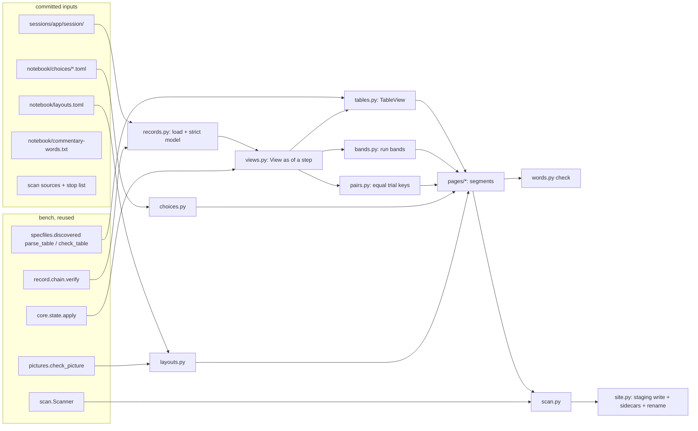

# Design: lab-notebook

This design covers Requirements 1-22 of `lab-notebook`. Section references such as "N4" point to the builder's
design decisions at the end ("Decisions"). Things that need the user, a rule exception or a change in `bench/` are
under "Open questions"; nothing in this design makes one of them.

Which Kiro: everything here is built and run by **the builder** and read by **visitors**. Dr. Kiro and the reader
never see the notebook or its build.

## Overview

The notebook is one Python program, `notebook-build`, in its own `uv` project `notebook/`. It reads the sealed
records in `sessions/`, the committed choice, cover, layout and word-list files, and writes a static site of plain
HTML, CSS, JavaScript and the recorded PNG picture sheets. It reuses the bench for everything the bench already
defines: chain verification, the discovered spec table reader and check, the state replay, condition classes, the
picture check and the blind scan. It never imports the bench front end.

The build works in four phases and writes only in the last one:

1. **Check inputs**: arguments, output folder, layouts, word list, records (chain, seal, no fake trial, shapes,
   authors, pictures, end table), choice files and the cover file.
2. **Model**: one `RecordModel` per record and one `View` per (record, step), computed by pure functions.
3. **Render**: every page as a list of authored segments, in memory; the commentary word check; the blind scan of
   every segment at its author's level, and again of every finished file through its author ranges.
4. **Write**: into a fresh staging folder, then one rename onto the output folder.

Any failure in phases 1-3 stops the build with a named error and nothing written. A failure in phase 4 leaves the
output folder absent or empty (N4).

## Architecture



### Package layout

```
notebook/
  pyproject.toml          uv project "lab-notebook", Python 3.12, console script notebook-build
  uv.lock
  layouts.toml            frame layout table (Requirement 7.1)
  commentary-words.txt    reviewed word list for the motion-wording rule (5.5)
  choices/
    cover.toml            the cover file (13.5)
    <application>/<session-id>.toml   one choice file per record (12.1)
  src/notebook/
    cli.py                argument parsing; the only entry point
    errors.py             NotebookError(where, problem)
    inputs.py             Inputs (all folders and files, explicit), output-folder checks (1.3, 1.4)
    records.py            verify with bench, strict typed model of every entry kind
    views.py              View: the session as of one entry; replay steps
    tables.py             snapshot tables through the bench reader; end check; TableView with links
    bands.py              parameter groups and run bands
    pairs.py              equal trial keys across records
    refusals.py           refusal messages as segments; refused-end notes
    choices.py            choice files and the cover file
    layouts.py            layouts.toml; picture size check
    numbers.py            number formatting
    text.py               every commentary string of the site (the one place builder words live)
    words.py              commentary word list check
    ink.py                Ink, Segment, escape, joining segments into text and author ranges
    html.py               element helpers over segments (plain string templates)
    pages/                cover.py, lab.py, session.py, replay.py, how.py, built.py, parts.py
    assets/               notebook.css, notebook.js, deco.svg (builder files, copied byte for byte)
    scan.py               the bench Scanner over segments and finished files
    site.py               Site: path -> bytes and ranges; sidecars; staging and rename
    build.py              the four phases
  tests/                  unit, properties, real (see Testing Strategy)
```

### Dependencies (Requirement 1.5)

```toml
[project]
name = "lab-notebook"
requires-python = ">=3.12,<3.13"
dependencies = ["lab-bench", "body-lab-adapter", "wind-tunnel-adapter"]

[project.scripts]
notebook-build = "notebook.cli:main"

[tool.uv.sources]
lab-bench = { path = "../bench", editable = true }
body-lab-adapter = { path = "../body-lab/adapter", editable = true }
wind-tunnel-adapter = { path = "../wind-tunnel/adapter", editable = true }

[dependency-groups]
dev = ["pytest", "hypothesis", "ruff"]
```

- `lab-bench` is named without extras, so the `frontend` group and `mcp` are never installed. A test checks that
  `uv.lock` of `notebook/` does not contain `mcp`.
- The two adapter packages are needed only because the bench scan reads each application's allow list by importing
  its declaration (`bench/src/bench/scan/terms.py`, `load_app`). This installs the MuJoCo Python package and
  `wind-tunnel-model`; the build never runs a trial, a simulator, a solver or Docker. The user chose this
  (option A, N23; requirements Decision 42, Requirement 1.5).
- Ruff uses the bench's banned-API list for network and process modules (`http`, `urllib`, `socket`, `subprocess`,
  `asyncio`, ...), so the build cannot make a request or start a process (3.2, 3.3).

### Command line (Requirements 1.3, 1.4)

```
uv run --project notebook notebook-build \
  --sessions sessions --choices notebook/choices --layouts notebook/layouts.toml \
  --words notebook/commentary-words.txt \
  --scan-config body-lab/adapter/scan_sources.toml --scan-config wind-tunnel/adapter/scan_sources.toml \
  --stop-list .kiro/blind-scan/stop-list.txt --out <output folder>
```

Every option is required (`argparse` `required=True`; `--scan-config` at least once); a missing one is named and
the build exits 2 before reading anything. No option has a default. `--out` must not exist, or be an empty folder;
otherwise the build refuses, naming it. The build-from-spec runs get their option when the `build-from-spec` spec
defines their records (19.8, N22).

## Components and Interfaces

### 1. Inputs and records (Requirements 1, 2.2, 2.3, 4.2)

`records.load(sessions: Path) -> list[RecordModel]`:

- Lists `sessions/<application>/<session-id>/` folders, sorted by (application, session id) in code-point order
  (21.2). Any other file in `sessions/` or in an application folder fails the build, naming it.
- Calls `bench.record.chain.verify(folder, sealed=True)`. A `VerifyError` becomes
  `NotebookError(<record>, "<where>: <problem>")`, naming the first entry or file that does not match (2.2).
- Checks: the first entry is `start`; its `application` and `session` equal the folder names; the declaration's
  `fake` is false and every trial's `fake` is false (2.3). Fixture builds pass `allow_fake=True` through the Python
  API only (N19).
- Builds a strict typed model. Each entry kind has the exact key set the bench writes (all five records today
  agree; `snapshot` has `experiment` except for `for` `end`). An unknown kind, a missing key or an extra key fails
  the build, naming the record and the `log.jsonl` line.
- Every text the site may show is read as `Authored(text, author, source)`: from `{"author", "text"}` objects,
  from quote spans (`{"file", "line", "quote"}`), and from blobs with their recorded `author`. Plain strings in
  entry bodies (ids, outcome names, condition classes, actions) are the bench's, as in
  `bench.scan.levels.entry_strings`. `source` is `"<record>/log.jsonl line <n>"` or `"<record>/blobs/<hash>"`. A
  value whose author cannot be determined by these rules fails the build (4.2).

`RecordModel` holds the raw entries in record order, the declaration, experiments, trials, hypotheses with
predictions, outcomes, verdicts, flags, refusals, snapshots, the failure entry if any, and the seal.

### 2. Views and replay steps (Requirements 10, 16)

`views.view(record, upto: int) -> View` is the session as of entry `upto` (a `seq`): it replays
`entries[0:upto]` through `bench.core.state.apply` into a bench `State`, and keeps the same prefix for display.
The session page uses `upto = len(entries)`; a replay step uses the `seq` of its snapshot entry. There is one code
path, so the session page is the last replay step plus the sections only the session page has.

`View` gives: the entries in the prefix; experiments, trials, outcomes, verdicts, flags and refusals in the prefix;
`remaining` and `trials_run` from `State`; the snapshot whose table, plan and requirements are shown (the step's
snapshot, or for the session page: the `end` snapshot of an ended session, else the last snapshot); and whether
that table is "checked by the bench" (only an accepted `end` snapshot).

`views.steps(record) -> list[Step]`: one step per snapshot with `for` `verdict`, in record order, and one final step
for the `end` snapshot if present (16.1). Step numbers are 1-based in that order. Snapshots with `for` `experiment`
are never steps. A refusal belongs to the first step whose snapshot `seq` is greater than its own (16.12); this
follows from the prefix rule and needs no extra code.

`Evidence` for the end check is built from the bench `State` exactly as `Session.evidence` does (experiment ids;
each prediction's outcome kind and condition class). A test checks it against `Session.evidence()` of a fake session
opened from the same state (N3).

### 3. Tables (Requirements 2.4-2.6, 8, 16.3-16.6)

- `tables.read(snapshot) -> Table | Unreadable`: calls `bench.specfiles.discovered.parse_table(design_text,
  file)`. A `TableError` at a middle step gives `Unreadable(section_text, message)`; the `## Discovered spec`
  section is shown as written (16.6, requirements Decision 18, N26). At the `end` snapshot a `TableError` cannot
  happen (the bench accepted it) and fails the build if it does.
- `tables.check_end(record)`: runs `check_table(design_text, evidence, file)` on the `end` snapshot; any problem
  fails the build, naming the row (2.4). Ended sessions without an `end` snapshot (body-1) are not checked and are
  shown as "no table" (2.5). There is no second table reader (2.6).
- `TableView` is built from a `Table` by a pure function:

```
ids        = [row.id for row in rows]
target(r)  = the one row s with s.id == r.replaced_by and s is not r, if exactly one exists; else None
tab(r)     = target(r) if r.status == "rejected" and target(r) is not None
note(r)    = "names no row of this table" | "names more than one row" | "names this row itself"
             when r.status == "rejected" and target(r) is None (8.4, 16.5)
reverse(s) = [r.id for r in rows if r.status == "rejected" and target(r) is s]   (table order, 8.10)
```

Each row is drawn once, in table order, with all seven cells as the reader returns them (8.1, 8.11). A rejected row
is struck through; its tab "replaced by <id>" is a `<details>` element whose content is the target's rule text in
small type and a link to `#row-<id>` (8.3). The status is drawn as a stamp with the label "checked by the bench",
"not checked by the bench" (stopped session's last snapshot) or "not yet checked by the bench" (middle replay step)
(8.2, 10.7, 16.3). The status cell's characters are shown exactly; strike-through applies only when the status is
exactly `rejected`.

Opening a row (a `<details>` around the row's evidence, below the row on narrow screens and in a side panel on
wide ones) shows, per cited prediction: hypothesis, conditions, range, condition class (bench word), Dr. Kiro's
label, outcome, measured value, each linked to its experiment entry (8.8); for `partly` rows the misses in miss red
(8.5); for `observed` rows the fixed explanation from `text.py` (8.6); for `validated` rows the hits whose class is
`new-combination` or `outside` (8.7).

### 4. Run bands (Requirement 9)

For a row of a table shown in view `v`:

```
cited_trials       = trials (in v) of the experiments in row.experiments
prediction_trials  = trials named by the outcome entries (in v) of row.predictions
names(t)           = frozenset of the parameter names of trial t (authored dr-kiro, compared as text)
groups             = sorted distinct names(t) for t in cited_trials + prediction_trials
for each group N, for each name n in N (in the declared order of the first experiment with N):
    session_trials = trials t in v with names(t) == N
    ticks          = sorted distinct values of t.params[n] over session_trials,
                     each with strength: prediction > cited > other (strongest wins on equal values)
    marked         = [min, max] of t.params[n] over cited_trials in N, or none if there are none
    lo, hi         = min, max of ticks
    if n is the name of a declared knob of kind "number":            (9.4)
        span = [knob.low, knob.high];  hatched = [knob.low, lo) and (hi, knob.high]
    else:                                                            (9.5, Dr. Kiro's parameter)
        extra = values of n in the `when` of cited predictions whose `when` names == N
        span = [min(ticks + extra), max(ticks + extra)];  hatched = [span.low, lo) and (hi, span.high]
```

An empty hatched interval is not drawn. Groups are never merged by shared names (9.2). Missing combinations are
shown only through each cited prediction's class word (9.6). The band is an inline SVG in pencil; the parameter
names are Dr. Kiro's ink and link to `#E<n>-file` of an experiment that declares them (9.7). For body-lab, each
cited trial also gets one small SVG line per channel of its recorded `inputs` against [-1, 1] (9.8).

### 5. Refusals and the refused-end note (Requirements 10.11-10.13, 16.12, 18.4)

- A refusal message is a list of parts: bench text (`{"text": {author, text}}`) and quotes (`{"file", "line",
  "quote"}`). Each part becomes a segment in the ink of its recorded author; nothing is parsed (10.12).
- Refused-end note: for a shown table and the refusal entries in the view with `action` `end`, a row gets the note
  when at least one refusal has a quote part whose text equals `row.id` exactly. N is the number of such refusal
  entries (not parts). The note is a sticky note in stamp style with the fixed text, each message as recorded, the
  sentence that the sealed status is the one shown, and "the record holds no copy of the table that was refused".
  In a replay step the note attaches only if the step's table holds that row (16.12).
- Composed quotes (10.13): the record does not mark which quotes the bench composed, and finding them would mean
  parsing the message. So every shown refusal message carries the one commentary note, and it covers every quote
  part of that message (N13, Decision 34's fallback).

### 6. Equal trial keys (Requirement 14.5)

Over all records of one application: group trials by the recorded `key`; every unordered pair in a group is listed,
including pairs within one record. A pair is ordered (session id, trial number) first, then by the second member.
"Exactly equal" means the two `measurements` objects are equal as JSON values (numbers, lists, not-measured objects
with their reasons). Each session page lists the pairs that include one of its trials; opening an entry shows the
two moving pictures side by side.

### 7. Choices, cover and layouts (Requirements 7, 12, 13)

- `layouts.load(path)`: exact keys; `frames == rows * columns` or fail naming the entry (7.2). A record whose
  application has no entry fails (7.5).
- `layouts.check_sheet(record, trial, media, data)`: media must be `image/png`; `bench.pictures.check_picture` must
  pass; then width and height (read from IHDR, bytes 16-24, after the check) must satisfy
  `width == columns * cw + (columns - 1) * gap` and `height == rows * ch + (rows - 1) * gap` for whole numbers
  `cw, ch >= 1`. Otherwise fail naming the record, trial and sizes (7.3). Today: body-lab 1600 x 360 gives 320 x 180
  cells; wind-tunnel 1208 x 404 gives 400 x 200.
- `choices.load(folder, records)` and `choices.load_cover(folder, records)` validate everything in Requirements 12.1,
  12.3-12.6 and 13.5 before rendering. Reasons are builder-level text and go to the scan (12.8).

### 8. Ink, segments and escaping (Requirements 4, 15, 20.3)

```python
class Ink(Enum): DRKIRO = "k"; PENCIL = "p"; COMMENTARY = "c"; STAMP = "s"; MARKUP = "m"

@dataclass(frozen=True)
class Segment:
    text: str        # unescaped text
    ink: Ink
    source: str      # where the text comes from, for scan findings (20.2)
```

- Ink from author: record text with author `dr-kiro` -> `DRKIRO`; bench-written record text and numbers the build
  computes from record fields -> `PENCIL`; strings from `text.py` -> `COMMENTARY`; status words -> `STAMP` (4.1,
  15.2); tags and attributes from templates -> `MARKUP`.
- Scan author per ink: `DRKIRO` -> `dr-kiro`; all others -> `bench` (the sidecar format knows only `bench` and
  `dr-kiro`; `bench` is scanned at the builder level, `bench.scan.levels.AUTHOR_LEVEL`).
- `html.text(seg)` wraps a non-markup segment in `<span class="ink-<k>">` (or `<pre>`/`<div>` for blocks) and
  escapes it: `html.escape(text, quote=True)`, then `\r` -> `&#13;`. Dr. Kiro's text is only placed in element
  content, never in an attribute; its elements use `white-space: pre-wrap` so line breaks show as written (4.3). A
  Dr. Kiro text holding a C0 control character other than tab, line feed and carriage return cannot be shown as
  written in HTML and fails the build, naming its source (N6).
- Ids used in addresses and attributes (`E<n>`, `T<n>`, `H<n>.P<n>`, `R<n>`) are checked with the bench patterns
  in `bench.core.ids` and the row pattern of `discovered.py`; anything else is never put in an attribute, and an
  id that fails the pattern fails the build.
- `ink.join(segments) -> (text, ranges)`: concatenates the escaped forms and returns author ranges
  `[{"start", "end", "author"}]` in code points, adjacent ranges of the same author merged, covering the file
  without gaps. This is the sidecar body (20.3).

### 9. Pages (Requirements 3, 8, 10, 13, 14, 16-19)

Pages are Python functions that return a list of segments; no template engine. Every page links the ink legend
(4.5) in its footer.

| Address | Page |
|---|---|
| `index.html` | cover (13) |
| `how.html` | how the lab works (18) |
| `built.html` | built from the spec (19) |
| `<app>/index.html` | lab page (14.1-14.4) |
| `<app>/<session>/index.html` | session page (10, 14.5, 14.6, 17) |
| `<app>/<session>/replay-<n>.html` | replay step n, 1-based (16.8) |
| `legend.html` | ink legend and status words defined in commentary (4.5, 15.2) |
| `p/<sha256>.png` | picture, copied byte for byte (7.7) |
| `a/notebook.css`, `a/notebook.js`, `a/deco.svg` | assets |

Anchors on a session page: `#row-R<n>`; `#E<n>` (experiment entry, a `<details>`); `#E<n>-T<n>`; `#E<n>-H<n>.P<n>`;
`#E<n>-file`; `#H<n>.P<n>` for predictions never run (11). All links are relative (3.2). JavaScript opens the
`<details>` named by the address (11.2); without JavaScript the entry is present and can be opened by hand.

Session page order (10.1): table page (with the sticky note to the chosen miss and pinned chosen pictures in its
margin), highlight, progress (with the prediction chart, 17), Dr. Kiro's plan (`tasks.md`, and `requirements.md`
collapsed below it, N18), every experiment entry, equal-trial list (14.5), replay controls (16). wt-003 gets only
14.2 and "the record has no snapshot to replay" (14.6, 16.9).

Replay pages are full static pages, one per step, rendered from `view(record, step.seq)`: back, forward and play
are links (play is JavaScript that follows the forward link every 3 s and stops on the last step). Every step page
carries "replay of a sealed record" (16.7). Chosen items and pinned pictures not in the prefix are left out with
the commentary "not run at this step" (16.2).

### 10. Moving pictures (Requirement 7.6, 7.8, 3.6)

The HTML holds a `<figure class="photo">` with an `` of the whole sheet (works without JavaScript and is the
"whole sheet" view) and `data-` attributes: columns, rows, gap, cell width and height. `notebook.js` replaces the
visible image with a `<canvas>` of one cell and draws cell k with `drawImage(img, sx, sy, cw, ch, 0, 0, cw, ch)`,
where `sx = (k mod columns) * (cw + gap)` and `sy = floor(k / columns) * (ch + gap)`, in reading order, one cell per
500 ms, looping. The PNG is never re-encoded. Controls: pause/play, step one cell, whole sheet. With
`prefers-reduced-motion: reduce`, it starts paused on cell 0.

### 11. Scan (Requirement 20)

`scan.Scanner` is `bench.scan.scan.Scanner.from_config(scan_configs, stop_list)`. Two passes, both before writing:

1. Every segment: `scanner.scan_text(seg.text, level, seg.source)` with the level from its scan author. Findings
   name the source file and line (20.2).
2. Every finished text file: the pieces built from its `(text, ranges)` exactly as `sidecar_pieces` builds them,
   so the escaped forms the site holds pass the scan that the sidecars describe (how `publish` scans is N25).

Pictures pass `check_picture` in phase 1 (20.4). The scanner also flags this machine's home folder and the
repository path (`local_paths`), which guards Requirement 21.1 against absolute paths.

### 12. Site writing (Requirements 2.7, 20.3, 21)

`Site` maps relative paths to bytes. Each `.html`, `.css`, `.js` and `.svg` file gets `<file>.authors.json`:
`{"ranges": [...]}` written with `json.dumps(..., sort_keys=True, separators=(",", ":"), ensure_ascii=False)` and a
final newline. Assets are one `bench` range. Writing: create `<parent>/.<out-name>.staging` (refuse if it
exists), write every file in sorted path order, then `os.replace(staging, out)` (out absent or an empty folder).

## Data Models

### `notebook/layouts.toml` (Requirement 7.1)

```toml
[body-lab]
frames = 10
rows = 2
columns = 5
gap = 0
source = "body-lab design, picture: 10 frames, 2 rows of 5"

[wind-tunnel]
frames = 6
rows = 2
columns = 3
gap = 4
source = "wind-tunnel Requirement 9.4"
```

Each table has exactly these five keys; integers `>= 1` (gap `>= 0`); `source` a non-empty string. Test fixtures use
their own layouts file with a `fake` entry (1 frame, 1 row, 1 column, gap 0).

### Choice file `notebook/choices/<application>/<session-id>.toml` (Requirement 12)

```toml
contrast = ["T25", "T30"]     # or: contrast = "none"  with  contrast_reason = "..."
best = "T36"                  # or: best = "none"      with  best_reason = "..."
missed = "H8.P6"              # or: missed = "none"    with  missed_reason = "..."
```

Allowed keys: `contrast`, `best`, `missed`, and `<key>_reason` exactly when `<key>` is `"none"`. `contrast` is a list
of two different trial ids of the record. Reasons are 1 to 300 characters. The content of each file is Decision 37.

### Cover file `notebook/choices/cover.toml` (Requirement 13.5)

```toml
[miss]
application = "body-lab"
session = "body-2"
prediction = "H4.P1"          # or "none"

[[card]]
application = "body-lab"
session = "body-2"
trial = "T31"

[[card]]
application = "wind-tunnel"
session = "wt-004"
trial = "T1"
```

Exactly one card per application present in `sessions/`, shown in application code-point order. The `[miss]`
session must be an ended session; its prediction must have the outcome miss; "none" is accepted only when that
session has no miss.

### `notebook/commentary-words.txt` (Requirement 5.5)

One lowercase word per line; `#` starts a comment; blank lines ignored. A commentary string fails when one of its
lowercase word tokens (letters only) equals a listed word, or equals it plus `s`, `es`, `ed` or `ing`. The first
list is proposed by the builder in a task and committed only after the user approves it.

### Number formatting (Requirement 5.3)

- Shown in lists, tables, charts and the cover: `format(v, ".4g")` (round to 4 significant digits, round half to
  even on the exact binary value, trailing zeros dropped, exponent form `1.235e+04` outside [1e-4, 1e4)).
- Shown in an opened trial: `repr(v)`, the shortest decimal that reads back as the recorded double.
- Counts, budgets, ids, seeds and trial keys are integers or strings and never pass through either function.
- A not-measured value shows its outcome name and the recorded reason, and is never plotted (5.4).

### Ordering (Requirement 21.2)

| What | Order |
|---|---|
| applications, sessions | code-point order of the id |
| entries, experiments, trials, outcomes, refusals, snapshots | record order (`seq`) |
| table rows, reverse links | table order |
| parameter groups | sorted tuple of sorted names; names within a group in the first declaring experiment's order |
| ticks | ascending value |
| predictions in the chart | record order of registration, then prediction order within the hypothesis |
| equal-trial pairs | (session id, trial number) of the first, then of the second |
| files written, sidecar keys | sorted path; `sort_keys=True` |

## Correctness Properties

*A property is a characteristic or behavior that should hold true across all valid executions of a system-essentially, a formal statement about what the system should do. Properties serve as the bridge between human-readable specifications and machine-verifiable correctness guarantees.*

Generators build records as entry lists with the bench's shapes (Testing Strategy, "Fixtures"); most properties
run on the pure model and page functions without a disk. Overlapping criteria were merged: the strike-through at a
step (16.4, 16.5) is part of Property 4, the verdict/status separation (15.1, 15.2) is part of Property 5, and the
cover file rules (13.5) are part of Property 11.

### Property 1: Dr. Kiro's text round-trips through the HTML

*For any* string (including `<`, `>`, `&`, quotes, tab, line feed, carriage return and non-ASCII characters, and
excluding the other C0 control characters), rendering it as a Dr. Kiro segment and parsing the written HTML with
`html.parser` gives an element whose text content equals the string character for character; a string with another
C0 control character fails the build naming its source.

**Validates: Requirements 4.3, 4.4**

### Property 2: Author ranges cover each file and the bench accepts them

*For any* list of segments, `ink.join` returns ranges that start at 0, are contiguous, end at the length of the
text, never join two different authors, and are accepted by `bench.scan.levels.sidecar_pieces`; every Dr. Kiro
segment's escaped form lies inside one `dr-kiro` range, and every other segment inside a `bench` range.

**Validates: Requirements 20.3, 20.1**

### Property 3: Ink follows the recorded author

*For any* generated record, every segment made from an authored value has the ink of its recorded author
(`dr-kiro` -> Dr. Kiro's ink, `bench` -> pencil), every status word has the stamp ink, and a generated entry with a
text field that has no author fails the build naming the record and line.

**Validates: Requirements 4.1, 4.2**

### Property 4: Each row once, tabs and reverse links exact

*For any* generated table (row ids possibly repeated, any status strings, `replaced by` naming any id, itself, or
nothing), the rendered table draws each row in full exactly once in table order; a `rejected` row has exactly one
"replaced by" tab when its cell names exactly one other row, and otherwise shows the cell as written with the
matching note and no tab; each row's reverse links are exactly the `rejected` rows whose tab points to it, in table
order; strike-through appears on exactly the rows whose status is `rejected`.

**Validates: Requirements 8.1, 8.3, 8.4, 8.10, 8.11, 8.12, 16.4, 16.5**

### Property 5: Every row shows its status word with the right label, and verdicts stay apart

*For any* generated record and any shown table (end snapshot, last snapshot of a stopped session, or a middle
step), every row's status cell appears, unchanged, in a stamp element labelled "checked by the bench", "not checked
by the bench" or "not yet checked by the bench" according to the table's source; no verdict appears in a stamp
element; every verdict appears as "verdict on H<n>:" inside an experiment entry or a replay step.

**Validates: Requirements 8.2, 10.7, 15.1, 15.2, 16.3, 22.2**

### Property 6: An opened row shows exactly its cited evidence

*For any* generated record and row, the opened row lists exactly the row's cited experiments and cited predictions,
each prediction with its hypothesis, conditions, range, condition class, Dr. Kiro's label, outcome and value as
recorded and a link to its experiment entry; for `partly` rows each cited miss is in miss red with the word "miss";
for `validated` rows the listed untried hits are exactly the cited hits whose class is `new-combination` or
`outside`.

**Validates: Requirements 8.5, 8.6, 8.7, 8.8**

### Property 7: Run band ticks are exact and hatched parts are empty

*For any* generated record (parameter name sets that overlap, repeat values, number knobs and Dr. Kiro's
parameters) and any row, the row's groups are exactly the distinct name sets of its cited and prediction trials;
for each band, the tick values are exactly the recorded values of that parameter over all session trials with that
name set; no hatched interval contains such a value; a number knob's band spans its declared range, and a Dr. Kiro
parameter's band spans its tried values and cited prediction conditions.

**Validates: Requirements 9.1, 9.2, 9.3, 9.4, 9.5, 9.9**

### Property 8: The refused-end note attaches by exact equality

*For any* generated end refusals (quote parts with arbitrary texts, some equal to row ids, some differing only by
case or white space) and table, a row carries the note if and only if some end refusal has a quote part whose text
equals the row id exactly, N equals the number of such refusal entries, and at a replay step the note appears only
if that step's table holds the row.

**Validates: Requirements 10.11, 10.12, 16.12**

### Property 9: Replay steps equal snapshots and record prefixes

*For any* generated record, the steps are exactly the `verdict` snapshots in record order plus the `end` snapshot
if present; at each step the shown table equals the bench reader's rows of that step's snapshot (or the unreadable
section as written), and the shown entries are exactly the record entries up to and including that snapshot entry;
each refusal is shown in exactly one step, the first whose snapshot comes after it.

**Validates: Requirements 16.1, 16.2, 16.10, 16.12**

### Property 10: Equal-trial pairs are exactly the equal keys

*For any* generated set of records of one application, the listed pairs are exactly the unordered pairs of trials
with the same recorded key, and each pair's "exactly equal" flag equals JSON equality of their measurements.

**Validates: Requirements 14.5**

### Property 11: Choice and cover validation matches the rules

*For any* generated record set and generated choice and cover files (valid, wrong ids, missed predictions that are
hits, "none" with and without reasons, reasons of 0, 1, 300 and 301 characters, extra keys, missing files, stopped
sessions on the cover), the build accepts the files if and only if a reference predicate written directly from
Requirements 12.1, 12.3-12.6 and 13.5 accepts them, and a refusal names the file and the choice.

**Validates: Requirements 12.1, 12.3, 12.4, 12.5, 12.6, 13.5**

### Property 12: Layouts and sheet sizes

*For any* layout entry (frames, rows, columns, gap) and picture width and height, the layout is accepted if and only
if frames equals rows times columns, and the sheet is accepted if and only if whole cell sizes of at least 1 pixel
exist with `width = columns * cw + (columns - 1) * gap` and `height = rows * ch + (rows - 1) * gap`.

**Validates: Requirements 7.2, 7.3**

### Property 13: Numbers are rounded to 4 significant digits and shown in full when opened

*For any* finite double v, `float(short(v)) == float(format(v, ".3e"))` and `short(v)` has at most 4 significant
digits; `float(full(v)) == v`.

**Validates: Requirements 5.3**

### Property 14: The prediction chart scale and marks

*For any* generated set of predictions with outcomes, each measurement's scale spans exactly the lowest to the
highest of its registered bounds and measured values in the session; hits and misses have the same mark size; every
miss mark is miss red and has the word "miss"; a not-run or not-checkable prediction has its word and range and no
value mark; no not-measured value is plotted anywhere.

**Validates: Requirements 17.2, 17.3, 5.4**

### Property 15: The build is deterministic

*For any* small generated input set and any permutation of the order in which folders are listed, two builds into
different output folders give the same set of paths and the same bytes, and no file contains the output folder's
path, the home folder or the repository path.

**Validates: Requirements 21.1, 21.2, 21.4, 11.1, 16.8**

### Property 16: A failed build writes nothing

*For any* generated valid input set and one generated corruption (a flipped byte in a log or blob, a missing seal,
a fake trial, a picture that does not divide into its layout, a wrong choice id, a planted builder-level term in a
choice reason), the build fails with an error naming the file, and the output folder is absent or empty afterwards.

**Validates: Requirements 2.1, 2.2, 2.3, 2.7, 7.3, 20.2**

### Property 17: Nothing is skipped

*For any* generated valid record, the session page has one experiment entry per experiment entry in the record, one
trial block per trial, one moving picture per trial, and one table row per row the reader returns.

**Validates: Requirements 2.8, 10.8**

## Error Handling

- One error type, `NotebookError(where, problem)`. `where` is a file (and line or entry) or a choice key; `problem`
  says what is wrong. Bench errors (`VerifyError`, `TableError`, `PictureError`, `ScanError`) are re-raised as
  `NotebookError` with the bench error as the cause and its text kept. No `try`/`except` swallows an error, there
  is no retry and no default value (`rules.md` 2).
- `notebook-build` prints `notebook-build: <where>: <problem>` to stderr and exits 1 on a check failure, 2 on a
  usage error. Scan findings are all printed (bench `Finding` format: file, line, kind, match), then the build
  exits 1.
- **Write nothing on failure (2.7), chosen approach: check and render everything in memory first, then write to a
  staging folder and rename.** All checks and all rendering run before the first file is written, as Requirement
  2.1 asks; the in-memory site is small (the HTML of five records and about 80 PNG files, which are copied, not
  decoded). Writing is then only I/O. The staging folder `<parent>/.<out-name>.staging` is a sibling of the output
  folder, so `os.replace` is a rename on one file system; the output folder appears complete or not at all. If a
  write fails, the build stops, names the staging folder and leaves it in place; it never deletes files, and the
  next build refuses while the staging folder exists. This was preferred over writing straight into the output
  folder (a crash would leave a half site) and over deleting partial output (a delete path in the build is a risk
  for no gain).
- Where the record is valid but cannot be shown as the requirements ask (a Dr. Kiro text with a control character,
  an id that is not a bench id), the build fails, naming the source. It never drops the item (2.8).

## Testing Strategy

`uv run --project notebook pytest` runs everything; `ruff check` and `ruff format --check` run on `notebook/`.

### Property tests

- `hypothesis`, at least 100 examples per property (`@settings(max_examples=100)` or more; Property 15 builds small
  in-memory sites so 100 examples stay fast; Property 16 writes to `tmp_path`).
- One test per property, in `tests/properties/`, each tagged with a comment
  `# Feature: lab-notebook, Property <n>: <title>`.

### Fixtures

All fixtures are labelled: their records have `fake = true` in the declaration and in every trial, they live under
`tests/fixtures/` or `tmp_path`, and they are built only through the library call `build(..., allow_fake=True)`,
which also puts a visible "test fixture" banner on every page. The CLI has no way to accept them (N19). Fixture
numbers are never presented as results.

- **Synthesized records** (`tests/fixtures/synth.py`): hypothesis strategies produce entry lists in the bench's
  shapes, chained with `bench.record.chain.entry_hash` and `bench.record.canonical.canonical_json`, with blobs
  written by hash. Each one passes `bench.record.chain.verify(sealed=True)` before a test uses it, so a generator
  bug cannot produce a record the bench would reject.
- **Session fixture** (`tests/fixtures/session.py`): a real session through `bench.core.session.Session` with
  `bench.fake.adapter.FakeAdapter`, set up the way `bench/tests/labkit.py` does (the pattern is copied; the bench
  test module is not imported). Its first verdict snapshot holds a table with R1 `rejected`, replaced by R2, and
  R2; a later verdict snapshot has an unreadable table; it ends with an accepted table. This is the fixture of
  Requirement 16.11 and also checks Evidence against `Session.evidence()` (N3).
- A fixture `layouts.toml` with a `fake` entry, fixture choice and cover files, and a fixture word list.

### Tests on the real records (`tests/real/`)

These read the committed `sessions/`, `notebook/choices/` and the scan sources and build into `tmp_path`:

- The full build passes (22.1); every row of every table shows its status word (22.2).
- body-2: 14 rows in table order; the 8 `rejected` rows R2, R3, R4, R6, R8, R10, R12, R14 are struck through, each
  with one tab naming R1, R11, R5, R7, R9, R11, R13, R13; reverse links: R1 "replaces R2", R5 "replaces R4", R7
  "replaces R6", R9 "replaces R8", R11 "replaces R3, R10", R13 "replaces R12, R14"; R13 carries the refused-end note
  with N = 2, and the two messages are shown with each part in its author's ink (22.5).
- body-2 cover: H4.P1 with trial T12's picture and track, "miss", rows R4 and R5 (13.1, 13.2, 13.7).
- wt-004: rows R1-R6 with their status words "checked by the bench"; the trial whose five measurements are `not_settled` shows the
  outcome name and reason and has no plotted mark.
- body-1: "no table" and the list of its 8 misses (10.9).
- wt-002 and wt-003: on the lab page with the same fields; wt-002 has its session page with "no table"; wt-003 has
  only the stopped-session content and "the record has no snapshot to replay" (14.2, 14.6, 16.9).
- Equal-trial list: wt-002 T1 with wt-004 T1, and the 9 body-1/body-2 pairs, all exactly equal (14.5).
- Replay of every real record matches its snapshots (16.10, 22.3).

### Example and unit tests

- Arguments: each missing option is named; a non-empty output folder is refused (1.3, 1.4).
- Scan: a term from the scan sources planted in a `text.py` string fails the build; the same term in a Dr. Kiro text
  of a fixture record does not (20.5). A planted term in a choice reason fails (12.8).
- Commentary: every string in `text.py` passes the word list; a planted listed word fails (5.5). Cover commentary
  outside `<details>` is at most 60 tokens (13.6).
- Site: no file contains `http:`, `https:`, `//` at the start of a URL, `<form`, `<input` other than the replay and
  picture buttons, or `<iframe` (3.1-3.3); text is in the HTML without script (3.4); every picture's name is the
  SHA-256 of its bytes (7.7); every page links `legend.html` (4.5).
- Colours: each foreground and background pair declared in the visual steering has a contrast ratio of at least
  4.5:1, computed with the WCAG formula from the CSS custom properties (4.6, 6.5).
- `uv.lock` holds no `mcp`; `git diff --stat bench/` is empty in the task's verification step (7.4).

### Manual checks

360 px width and reduced motion in a browser (3.5, 3.6), the moving pictures, and the user's review of the first
screen at milestone 1 (22.4), recorded in `docs/status.md`.

## Visual system

Written as the steering file `.kiro/steering/notebook-visual.md` in the first task, before any page (6.1). The
proposal below is what that file will hold; the user's review at milestone 1 may change it, and any change goes
into the steering file first (6.6). Only system font stacks are used; no font file is fetched or shipped.

| Element | Proposal |
|---|---|
| Paper | background `#fbf7ec`; faint horizontal rule lines `#dfe6ef` every line height (CSS gradient); content column max 72rem |
| Dr. Kiro's ink | colour `#1f3a8a`; serif `ui-serif, Georgia, "Times New Roman", serif`; upright; blocks have a 2px solid left rule in the same colour and the label "written by Dr. Kiro"; Dr. Kiro's code blocks use `ui-monospace` with the same left rule |
| Pencil | colour `#3d3d3d`; `ui-monospace, SFMono-Regular, Menlo, Consolas, monospace`; no rule |
| Commentary ink | colour `#2b2118`; `system-ui, -apple-system, "Segoe UI", Roboto, sans-serif`; 0.95em |
| Miss red | `#b3261e`, only on missed predictions and their measured values, always with the word "miss" (6.4) |
| Bench stamp | uppercase sans, bold, letter-spaced, 2px border with rounded corners, rotated -2deg; colour per word: validated `#1d5e3a`, partly `#7a4b00`, observed `#3a4a5c`, rejected `#5b2a6e` (never red); the label ("checked by the bench") below in small commentary type |
| Instant photo | white frame (8px sides, 28px bottom), soft shadow, rotated within +-1.5deg by a fixed rule from the trial number, a brass pin `#b08d3c` at the top; caption below |
| Sticky note | background `#fff1a8`, commentary ink, rotated 1deg, shadow; the refused-end note uses the stamp border on a sticky note |
| Strike-through | `line-through` 2px graphite; text stays at full contrast; the "replaced by" tab sits at the row's right edge as a paper tab |
| Type and spacing | base 17px / 1.5; spacing scale 4, 8, 16, 24, 40px |
| Narrow screen | at 360px one column; margin photos move below the table; wide tables scroll inside their own box |
| Halloween | one small ink-drawn bat and a cobweb corner (`deco.svg`), only in the page gutter at viewports of 1000px and wider, `aria-hidden`, no text, behind nothing (6.5) |
| Motion | 500 ms per cell; reduced motion starts paused (3.6) |

All text colours above reach at least 4.5:1 on their backgrounds (paper and sticky yellow); the test checks each
pair from the CSS.

## Delivery order (Decision 40)

1. **Milestone 1**: project, inputs, records, views, tables, choices, cover file, layouts, ink and sidecars, scan,
   site writing, the visual steering file, the cover and the session page's discovered spec table (with tabs,
   reverse links, stamps, the refused-end note and moving pictures needed by them), built from the real records.
   Then stop and show the cover and the body-2 table on a desktop and a 360 px screen to the user (22.4).
2. **Milestone 2**: experiment entries and moving pictures in full, lab pages and stopped sessions, "How the lab
   works", run bands.
3. **Milestone 3**: the prediction chart, the replay, the equal-trial list, the body-lab input lines.
4. **Then**: "Built from the spec" shows "there are no runs yet" (19.1); 19.2-19.7 wait for the `build-from-spec`
   spec (19.8).

## Requirements coverage

| Requirement | Where |
|---|---|
| 1 | Command line, Components 1, Dependencies |
| 2 | Overview phases, Components 1 and 3, Error Handling, Property 16, 17 |
| 3 | Components 9, 10, Testing (site checks), Visual system |
| 4 | Components 1, 8, Properties 1-3, Visual system |
| 5 | Data Models (numbers, word list), Property 13, 14 |
| 6 | Visual system |
| 7 | Components 7, 10, Data Models (layouts), Property 12 |
| 8 | Components 3, Properties 4-6 |
| 9 | Components 4, Property 7 |
| 10 | Components 2, 5, 9, Property 8, 17 |
| 11 | Components 9 (addresses), Property 15 |
| 12, 13 | Components 7, Data Models, Property 11 |
| 14 | Components 6, 9, Property 10 |
| 15 | Components 3, 8, Property 5 |
| 16 | Components 2, 3, 9, Property 9 |
| 17 | Components 9, Property 14 |
| 18 | Components 9; N24 |
| 19 | Delivery order 4, N22 |
| 20 | Components 8, 11, 12, Property 2, 16 |
| 21 | Data Models (ordering), Components 12, Property 15 |
| 22 | Testing (real records), Delivery order |

## Decisions

Taken by the builder under the user's delegation (requirements Decision 14). None makes an exception to a rule or
changes `bench/`.

- **N1 Own project, bench by path.** `notebook/` is a `uv` project depending on `lab-bench` by editable path
  without extras; network and process modules are banned by ruff as in the bench. (The adapter dependencies are
  N23.)
- **N2 Strict record model.** Each entry kind has the exact key set the bench writes; anything else fails the
  build. A change in the bench's record shape must then be met by a change here, not by silent tolerance.
- **N3 State from the bench, Evidence rebuilt.** The view replays entries through `bench.core.state.apply`.
  `Session.evidence` is a method of a live session, so the build makes the same `Evidence` from `State` (a few lines)
  and a test compares the two on a fake session. If the user prefers, the bench could expose a pure function later;
  that would be a bench change and is not part of this spec.
- **N4 Check and render in memory, then stage and rename.** See Error Handling. The build never deletes files.
- **N5 Segments carry ink and source.** Ink gives the style; the scan author is `dr-kiro` for Dr. Kiro's ink and
  `bench` for everything else, because the sidecar format knows only those two authors.
- **N6 Escaping.** `html.escape(quote=True)` plus `&#13;` for carriage returns; Dr. Kiro text only in element
  content with `white-space: pre-wrap`; other C0 control characters fail the build.
- **N7 Two scan passes.** Segments at their sources (findings name the source file and line), then each finished
  file through its ranges, the same pieces a later `bench-scan` of the site would see.
- **N8 Moving pictures by canvas.** The whole sheet is an `` (the no-script and "whole sheet" view); JavaScript
  draws one cell at a time from source rectangles that include the gap. No re-encoding. CSS `background-position`
  was not chosen because two-axis stepping with gaps needs per-cell keyframes generated per layout.
- **N9 Addresses.** As in the table of Components 9; ids are bench ids checked by pattern.
- **N10 Replay as static pages.** One page per step, so every step's text is in the HTML and has a fixed address;
  "play" only follows the forward link.
- **N11 Number format.** `.4g` and `repr`, as in Data Models.
- **N12 Replacement edge cases.** A `replaced by` cell that names a repeated id or the row itself is treated like a
  cell that names no row: shown as written, with a note, no tab (only possible at a middle step; the bench refuses
  it at the end).
- **N13 Refusal note covers every quote.** Per Decision 34's fallback; the design does not parse messages.
- **N14 Equal-trial pairs.** All pairs with the same key in one application, including pairs within one record;
  equality is JSON equality of the measurements.
- **N15 Number knob or Dr. Kiro parameter.** A parameter is a number knob when its name equals a declared knob of
  kind `number`; otherwise it is Dr. Kiro's parameter (body-lab refuses function-knob names as parameters).
- **N16 File formats.** Choice, cover and layout keys as in Data Models; unknown keys fail.
- **N17 Word list matching.** Whole lowercase tokens and the suffixes `s`, `es`, `ed`, `ing`; the list's content is
  proposed in a task and needs the user's approval.
- **N18 Requirements shown with the plan.** Requirement 16.2 shows a step's requirements; on the session page
  `requirements.md` is shown collapsed under Dr. Kiro's plan, so the section order of 10.1 is kept.
- **N19 Fixture mode only through the library.** `build(..., allow_fake=True)` accepts fake records and marks every
  page "test fixture"; the CLI cannot.
- **N20 Visual system.** As proposed above, written to steering first.
- **N21 Plots.** Track paths keep equal x and y scale, fitted to the trial's own track with the start marked;
  input lines use a fixed [-1, 1] axis; SVG coordinates are formatted with 2 decimals so the output is stable.
- **N22 Built from the spec.** No CLI option for runs until `build-from-spec` defines its records; the page says
  there are no runs yet.
- **N23 Adapters installed for the scan (user, option A).** The bench scan reads each application's allow list by
  importing its declaration (`load_app` imports `body_lab.adapter`, which imports `mujoco`, and
  `wind_tunnel.declaration`, which imports `wind_tunnel_model`). The notebook depends on both adapter packages by
  path; MuJoCo's Python package is installed but nothing is simulated or solved, and no Docker is needed
  (Requirement 1.5, requirements Decision 42). Not chosen: B, running the scan in each application's own
  environment as a separate process (needs a process start, which N1 forbids, and a staging site on disk before
  the scan); C, changing the bench so the scan can take the declaration from elsewhere (a `bench/` change, and the
  allow list must come from the application's own declaration, `rules.md` 1).
- **N24 No link to the root `.kiro/` (user).** "How the lab works" has no link to the repository's root `.kiro/`,
  and no commentary names or links a file or folder outside a lab. The question is decided again in the README step
  (`docs/brief.md` section 5 item 8) (Requirement 18.5, requirements Decision 43). This was the former Open
  question 3.
- **N25 Rescanning the written site is decided in `publish` (user).** `bench-scan` on a folder outside a lab reads
  every file as text, so the PNG files of the site would fail it (`bench/src/bench/scan/scan.py`, `scan_file`). How
  `publish` scans the site is decided in the `publish` spec when it is written. The notebook still writes a sidecar
  for every text file (Requirement 20.3, Components 12), and its own two scan passes before writing stay
  (Components 11, N7) (requirements Decision 44). This was the former Open question 4.
- **N26 Unreadable middle-step table shown as written (user).** A `TableError` at a middle step gives `Unreadable`;
  the `## Discovered spec` section is shown as written with the labelled sentence, and no rows are guessed
  (Components 3, Requirement 16.6, requirements Decision 18, confirmed by the user). This was the former Open
  question 2.

## Open questions

None. The former Open question 1 (adapters for the scan) was decided by the user as N23, the former Open question
2 (unreadable middle-step table) as N26, the former Open question 3 as N24, and the former Open question 4 as N25.
