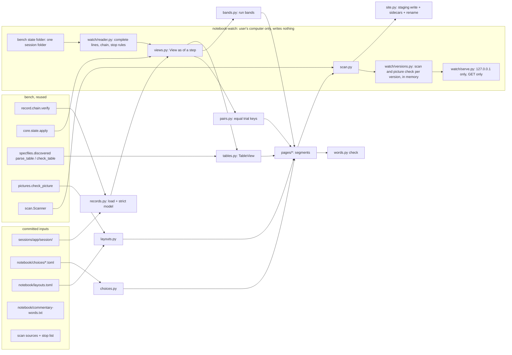

# Design: lab-notebook

This design covers Requirements 1-23 of `lab-notebook`. Section references such as "N4" point to the builder's
design decisions at the end ("Decisions"). Things that need the user, a rule exception or a change in `bench/` are
under "Open questions"; nothing in this design makes one of them.

Which Kiro: everything here is built and run by **the builder** and read by **visitors**. Dr. Kiro and the reader
never see the notebook or its build.

Not in this version (requirements Decision 48): the equal-trial list (Requirement 14.5) and the input lines (9.8). The tracks in
experiment entries (10.10) are back (requirements Decision 54). On hold (requirements Decision 48): the replay (Requirement 16). This version stops after the
prediction chart; all of these stay described below but are not implemented by the build. The sections, properties and decisions concerned are marked.

## Overview

The notebook is one Python program, `notebook-build`, in its own `uv` project `notebook/`. It reads the sealed
records in `sessions/`, the committed choice, cover, layout and word-list files, and writes a static site of plain
HTML, CSS, JavaScript and the recorded PNG picture sheets. It reuses the bench for everything the bench already
defines: chain verification, the discovered spec table reader and check, the state replay, condition classes, the
picture check and the blind scan. It never imports the bench front end.

The build works in four phases and writes only in the last one:

1. **Check inputs**: arguments, output folder, layouts, word list, records (chain, seal, no fake trial, shapes,
   authors, pictures, end table), choice files and the cover file.
2. **Model**: one `RecordModel` per record and one `View` per (record, step), computed by pure functions.
3. **Render**: every page as a list of authored segments, in memory; the commentary word check; the blind scan of
   every segment at its author's level, and again of every finished file through its author ranges.
4. **Write**: into a fresh staging folder, then one rename onto the output folder.

Any failure in phases 1-3 stops the build with a named error and nothing written. A failure in phase 4 leaves the
output folder absent or empty (N4).

The watch (`notebook-watch`, Requirement 23, Component 13) is a second command. It shows one session while the bench
writes its record, on the user's own computer only, and is run by the user; visitors never see it. It makes the
session page in the `at_bench` mode from the record so far, with the same views, pages, blind scan and picture check
as the build, and serves it on 127.0.0.1. It writes no file and is never part of the published site. No build module
imports the watch (N33, N34).

## Architecture



### Package layout

```
notebook/
  pyproject.toml          uv project "lab-notebook", Python 3.12, console scripts notebook-build and notebook-watch
  uv.lock
  layouts.toml            frame layout table (Requirement 7.1)
  commentary-words.txt    reviewed word list for the motion-wording rule (5.5)
  choices/
    cover.toml            the cover file (13.5)
    <application>/<session-id>.toml   one choice file per record (12.1)
  src/notebook/
    cli.py                argument parsing; the only entry point
    errors.py             NotebookError(where, problem)
    inputs.py             Inputs (all folders and files, explicit), output-folder checks (1.3, 1.4)
    records.py            verify with bench, strict typed model of every entry kind
    views.py              View: the session as of one entry; replay steps
    tables.py             snapshot tables through the bench reader; end check; TableView with links
    bands.py              parameter groups and run bands
    pairs.py              equal trial keys across records
    refusals.py           refusal messages as segments; refused-end notes
    choices.py            choice files and the cover file
    layouts.py            layouts.toml; picture size check
    numbers.py            number formatting
    text.py               every commentary string of the site (the one place builder words live)
    words.py              commentary word list check
    ink.py                Ink, Segment, escape, joining segments into text and author ranges
    html.py               element helpers over segments (plain string templates)
    pages/                cover.py, lab.py, session.py, replay.py, how.py, built.py, parts.py
    assets/               notebook.css, notebook.js (builder files, copied byte for byte); the Halloween decoration is inline SVG in
                          the page markup (parts.py), not a file (N28)
    scan.py               the bench Scanner over segments and finished files
    site.py               Site: path -> bytes and ranges; sidecars; staging and rename
    build.py              the four phases
    watch/                notebook-watch (Component 13); no build module imports it
      cli.py              argument parsing for notebook-watch
      reader.py           incremental reader of the record: complete lines, chain, stop rules
      versions.py         one version per pass: views, page in at_bench mode, scan, picture check, in memory
      serve.py            loopback server, GET only (Open question 3: answered yes)
      assets/watch.js     the refresh script, served by the watch only (23.4)
  tests/                  unit, properties, real (see Testing Strategy)
```

### Dependencies (Requirement 1.5)

```toml
[project]
name = "lab-notebook"
requires-python = ">=3.12,<3.13"
dependencies = ["lab-bench", "body-lab-adapter", "wind-tunnel-adapter"]

[project.scripts]
notebook-build = "notebook.cli:main"
notebook-watch = "notebook.watch.cli:main"

[tool.uv.sources]
lab-bench = { path = "../bench", editable = true }
body-lab-adapter = { path = "../body-lab/adapter", editable = true }
wind-tunnel-adapter = { path = "../wind-tunnel/adapter", editable = true }

[dependency-groups]
dev = ["pytest", "hypothesis", "ruff"]
```

- `lab-bench` is named without extras, so the `frontend` group and `mcp` are never installed. A test checks that
  `uv.lock` of `notebook/` does not contain `mcp`.
- The two adapter packages are needed only because the bench scan reads each application's allow list by importing
  its declaration (`bench/src/bench/scan/terms.py`, `load_app`). This installs the MuJoCo Python package and
  `wind-tunnel-model`; the build never runs a trial, a simulator, a solver or Docker. The user chose this
  (option A, N23; requirements Decision 42, Requirement 1.5).
- Ruff uses the bench's banned-API list for network and process modules (`http`, `urllib`, `socket`, `subprocess`,
  `asyncio`, ...), so the build cannot make a request or start a process (3.2, 3.3).

### Command line (Requirements 1.3, 1.4)

```
uv run --project notebook notebook-build \
  --sessions sessions --choices notebook/choices --layouts notebook/layouts.toml \
  --words notebook/commentary-words.txt \
  --scan-config body-lab/adapter/scan_sources.toml --scan-config wind-tunnel/adapter/scan_sources.toml \
  --stop-list .kiro/blind-scan/stop-list.txt --out <output folder>
```

Every option is required (`argparse` `required=True`; `--scan-config` at least once); a missing one is named and
the build exits 2 before reading anything. No option has a default. `--out` must not exist, or be an empty folder;
otherwise the build refuses, naming it. The build-from-spec runs get their option when the `build-from-spec` spec
defines their records (19.8, N22).

### Command line of the watch (Requirement 23, N33)

```
uv run --project notebook notebook-watch \
  --record <bench state folder>/<session-id> --state <bench state folder> \
  --layouts notebook/layouts.toml --words notebook/commentary-words.txt \
  --scan-config body-lab/adapter/scan_sources.toml --scan-config wind-tunnel/adapter/scan_sources.toml \
  --stop-list .kiro/blind-scan/stop-list.txt --port <port> \
  --app wind-tunnel/notebook --app body-lab/notebook \
  [--replay <seconds>] [--site <built site>]
```

Every option is required and none has a default, except the two that turn on a part: `--replay` shows a sealed
record one entry every that many seconds (23.17), and `--site` names a built site whose page of this session is
linked after the seal (23.16). `--scan-config` and `--app` at least once. `--app` names an
application's notebook folder, as for the build; the watch uses the one whose `app.toml` names the application of
the record's start entry, and fails when there is not exactly one. It never looks for a settings file beside another
input. A missing option is named and the
watch exits 2 before it reads anything. There is no `--out` (the watch writes no site), no `--choices` (the parts after
the seal are not read, 23.7) and no host option (the watch binds 127.0.0.1 only, 23.3). `--record` must lie under
`--state`. Usage errors exit 2 and check failures exit 1, as for the build, and messages have the same form.

## Components and Interfaces

### 1. Inputs and records (Requirements 1, 2.2, 2.3, 4.2)

`records.load(sessions: Path) -> list[RecordModel]`:

- Lists `sessions/<application>/<session-id>/` folders, sorted by (application, session id) in code-point order
  (21.2). Any other file in `sessions/` or in an application folder fails the build, naming it.
- Calls `bench.record.chain.verify(folder, sealed=True)`. A `VerifyError` becomes
  `NotebookError(<record>, "<where>: <problem>")`, naming the first entry or file that does not match (2.2).
- Checks: the first entry is `start`; its `application` and `session` equal the folder names; the declaration's
  `fake` is false and every trial's `fake` is false (2.3). Fixture builds pass `allow_fake=True` through the Python
  API only (N19).
- Builds a strict typed model. Each entry kind has the exact key set the bench writes (all five records today
  agree; `snapshot` has `experiment` except for `for` `end`). An unknown kind, a missing key or an extra key fails
  the build, naming the record and the `log.jsonl` line.
- Every text the site may show is read as `Authored(text, author, source)`: from `{"author", "text"}` objects,
  from quote spans (`{"file", "line", "quote"}`), and from blobs with their recorded `author`. Plain strings in
  entry bodies (ids, outcome names, condition classes, actions) are the bench's, as in
  `bench.scan.levels.entry_strings`. `source` is `"<record>/log.jsonl line <n>"` or `"<record>/blobs/<hash>"`. A
  value whose author cannot be determined by these rules fails the build (4.2).

`RecordModel` holds the raw entries in record order, the declaration, experiments, trials, hypotheses with
predictions, outcomes, verdicts, flags, refusals, snapshots, the failure entry if any, and the seal.

### 2. Views and replay steps (Requirements 10, 16)

The replay steps (`views.steps`, `views.step_view` and `View.events` below) are on hold (requirements
Decision 48); `views.view` is used by the session page.

`views.view(record, upto: int) -> View` is the session as of entry `upto` (a `seq`): it replays
`entries[0:upto]` through `bench.core.state.apply` into a bench `State`, and keeps the same prefix for display.
The session page uses `upto = len(entries)`; a replay step uses the `seq` of its snapshot entry. There is one code
path, so the session page is the last replay step plus the sections only the session page has.

`View` gives: the entries in the prefix; experiments, trials, outcomes, verdicts, flags and refusals in the prefix;
`remaining` and `trials_run` from `State`; the snapshot whose table, plan and requirements are shown (the step's
snapshot, or for the session page: the `end` snapshot of an ended session, else the last snapshot); and whether
that table is "checked by the bench" (only an accepted `end` snapshot).

`views.steps(record) -> list[Step]`: one step per snapshot with `for` `verdict`, in record order, and one final step
for the `end` snapshot if present (16.1). Step numbers are 1-based in that order. Snapshots with `for` `experiment`
are never steps. A refusal is an event of the first step whose snapshot `seq` is greater than its own (16.12, Decision
33). `views.step_view` gives a step `View.events`: the refusals after the previous step's snapshot and before its own.
`View.refusals` keeps every refusal of the prefix, which the refused-end note reads (16.12). A refusal after the last
step is an event of no step.

`Evidence` for the end check is built from the bench `State` exactly as `Session.evidence` does (experiment ids;
each prediction's outcome kind and condition class). A test checks it against `Session.evidence()` of a fake session
opened from the same state (N3).

### 3. Tables (Requirements 2.4-2.6, 8, 16.3-16.6)

- `tables.read(snapshot) -> Table | Unreadable`: calls `bench.specfiles.discovered.parse_table(design_text,
  file)`. A `TableError` at any snapshot that is not an accepted `end` snapshot (a middle step, or the last
  snapshot of a stopped session) gives `Unreadable(section_text, message)`, with `message` the text the reader
  returned; this includes a table with no rows, which the reader refuses. The page shows the `## Discovered spec`
  section as written in Dr. Kiro's ink, `message` in pencil, and the commentary "the bench's table reader did not
  accept this table"; the message is never parsed (10.14, 16.6, requirements Decisions 18 and 45, N26, N27). At
  the `end` snapshot a `TableError` cannot happen (the bench accepted it) and fails the build if it does.
- `tables.check_end(record)`: runs `check_table(design_text, evidence, file)` on the `end` snapshot; any problem
  fails the build, naming the row (2.4). Ended sessions without an `end` snapshot (body-1) are not checked and are
  shown as "no table" (2.5, 10.9); "no table" is used for no other case. There is no second table reader (2.6).
- `TableView` is built from a `Table` by a pure function:

```
ids        = [row.id for row in rows]
target(r)  = the one row s with s.id == r.replaced_by and s is not r, if exactly one exists; else None
tab(r)     = target(r) if r.status == "rejected" and target(r) is not None
note(r)    = "names no row of this table" | "names more than one row" | "names this row itself"
             when r.status == "rejected" and target(r) is None (8.4, 16.5)
reverse(s) = [r.id for r in rows if r.status == "rejected" and target(r) is s]   (table order, 8.10)
```

Each row is drawn once, in table order, with all seven cells as the reader returns them (8.1, 8.11). A rejected row
is struck through; its tab "replaced by <id>" is a `<details>` element whose content is the target's rule text in
small type and a link to `#row-<id>` (8.3). The `<details>` carries the `open` attribute, so the tab is open by default
(8.13, N31). The status is drawn as a stamp with the label "checked by the bench",
"not checked by the bench" (stopped session's last snapshot) or "not yet checked by the bench" (middle replay step)
(8.2, 10.7, 16.3). The status cell's characters are shown exactly; strike-through applies only when the status is
exactly `rejected`.

Opening a row (a `<details>` around the row's evidence, below the row on narrow screens and in a side panel on
wide ones) shows, per cited prediction: hypothesis, conditions, range, condition class (bench word), Dr. Kiro's
label, outcome, measured value, each linked to its experiment entry (8.8); for `partly` rows the misses in miss red
(8.5); for `observed` rows the fixed explanation from `text.py` (8.6); for `validated` rows the hits whose class is
`new-combination` or `outside` (8.7).

### 4. Run bands (Requirement 9)

For a row of a table shown in view `v`:

```
cited_trials       = trials (in v) of the experiments in row.experiments
prediction_trials  = trials named by the outcome entries (in v) of row.predictions
names(t)           = frozenset of the parameter names of trial t (authored dr-kiro, compared as text)
groups             = sorted distinct names(t) for t in cited_trials + prediction_trials
for each group N, for each name n in N (in the declared order of the first experiment with N):
    session_trials = trials t in v with names(t) == N
    ticks          = sorted distinct values of t.params[n] over session_trials,
                     each with strength: prediction > cited > other (strongest wins on equal values)
    marked         = [min, max] of t.params[n] over cited_trials in N, or none if there are none
    lo, hi         = min, max of ticks
    if n is the name of a declared knob of kind "number":            (9.4)
        span = [knob.low, knob.high];  hatched = [knob.low, lo) and (hi, knob.high]
    else:                                                            (9.5, Dr. Kiro's parameter)
        extra = values of n in the `when` of cited predictions whose `when` names == N
        span = [min(ticks + extra), max(ticks + extra)];  hatched = [span.low, lo) and (hi, span.high]
```

An empty hatched interval is not drawn. Groups are never merged by shared names (9.2). Missing combinations are
shown only through each cited prediction's class word (9.6). The band is an inline SVG in pencil; the parameter
names are Dr. Kiro's ink and link to `#E<n>-file` of an experiment that declares them (9.7). For body-lab, each
cited trial also gets one small SVG line per channel of its recorded `inputs` against [-1, 1] (9.8; not in this version, requirements Decision 48).

### 5. Refusals and the refused-end note (Requirements 10.11-10.13, 16.12, 18.4)

- A refusal message is a list of parts: bench text (`{"text": {author, text}}`) and quotes (`{"file", "line",
  "quote"}`). Each part becomes a segment in the ink of its recorded author; nothing is parsed (10.12).
- Refused-end note: for a shown table and the refusal entries in the view with `action` `end`, a row gets the note
  when at least one refusal has a quote part whose text equals `row.id` exactly. N is the number of such refusal
  entries (not parts). The note is a sticky note in stamp style with the fixed text, each message as recorded, the
  sentence that the sealed status is the one shown, and "the record holds no copy of the table that was refused".
  In a replay step the note attaches only if the step's table holds that row (16.12; replay is on hold, requirements Decision 48).
- Composed quotes (10.13): the record does not mark which quotes the bench composed, and finding them would mean
  parsing the message. So every shown refusal message carries the one commentary note, and it covers every quote
  part of that message (N13, Decision 34's fallback).

### 6. Equal trial keys (Requirement 14.5)

Not in this version (requirements Decision 48).

Over all records of one application: group trials by the recorded `key`; every unordered pair in a group is listed,
including pairs within one record. A pair is ordered (session id, trial number) first, then by the second member.
"Exactly equal" means the two `measurements` objects are equal as JSON values (numbers, lists, not-measured objects
with their reasons). Each session page lists the pairs that include one of its trials; opening an entry shows the
two moving pictures side by side.

### 7. Choices, cover and layouts (Requirements 7, 12, 13)

- `layouts.load(path)`: exact keys; `frames == rows * columns` or fail naming the entry (7.2). A record whose
  application has no entry fails (7.5).
- `layouts.check_sheet(record, trial, media, data)`: media must be `image/png`; `bench.pictures.check_picture` must
  pass; then width and height (read from IHDR, bytes 16-24, after the check) must satisfy
  `width == columns * cw + (columns - 1) * gap` and `height == rows * ch + (rows - 1) * gap` for whole numbers
  `cw, ch >= 1`. Otherwise fail naming the record, trial and sizes (7.3). Today: body-lab 1600 x 360 gives 320 x 180
  cells; wind-tunnel 1208 x 404 gives 400 x 200.
- `choices.load(folder, records)` and `choices.load_cover(folder, records)` validate everything in Requirements 12.1,
  12.3-12.6 and 13.5 before rendering. Reasons are builder-level text and go to the scan (12.8).

### 8. Ink, segments and escaping (Requirements 4, 15, 20.3)

```python
class Ink(Enum): DRKIRO = "k"; PENCIL = "p"; COMMENTARY = "c"; STAMP = "s"; MARKUP = "m"

@dataclass(frozen=True)
class Segment:
    text: str        # unescaped text
    ink: Ink
    source: str      # where the text comes from, for scan findings (20.2)
```

- Ink from author: record text with author `dr-kiro` -> `DRKIRO`; bench-written record text and numbers the build
  computes from record fields -> `PENCIL`; strings from `text.py` -> `COMMENTARY`; status words -> `STAMP` (4.1,
  15.2); tags and attributes from templates -> `MARKUP`.
- Exception for Dr. Kiro's fixed words (4.2, N29): the verdict word of a `verdict` entry and Dr. Kiro's label of a
  prediction in a `register` entry are plain strings in the record, with no author, but Dr. Kiro passed them to
  the bench. The pages show them as `DRKIRO` segments (`pages/session.py`, `_drkiro_word`; 15.1, 17.4), with the
  source of their log entry. They are the only `DRKIRO` segments that do not come from a value recorded with
  author `dr-kiro`, and they are also scanned at the builder level (Components 11).
- Scan author per ink: `DRKIRO` -> `dr-kiro`; all others -> `bench` (the sidecar format knows only `bench` and
  `dr-kiro`; `bench` is scanned at the builder level, `bench.scan.levels.AUTHOR_LEVEL`).
- `html.text(seg)` wraps a non-markup segment in `<span class="ink-<k>">` (or `<pre>`/`<div>` for blocks) and
  escapes it: `html.escape(text, quote=True)`, then `\r` -> `&#13;`. Dr. Kiro's text is only placed in element
  content, never in an attribute; its elements use `white-space: pre-wrap` so line breaks show as written (4.3). A
  Dr. Kiro text holding a C0 control character other than tab, line feed and carriage return cannot be shown as
  written in HTML and fails the build, naming its source (N6).
- Ids used in addresses and attributes (`E<n>`, `T<n>`, `H<n>.P<n>`, `R<n>`) are checked with the bench patterns
  in `bench.core.ids` and the row pattern of `discovered.py`; anything else is never put in an attribute, and an
  id that fails the pattern fails the build.
- `ink.join(segments) -> (text, ranges)`: concatenates the escaped forms and returns author ranges
  `[{"start", "end", "author"}]` in code points, adjacent ranges of the same author merged, covering the file
  without gaps. This is the sidecar body (20.3).

### 9. Pages (Requirements 3, 8, 10, 13, 14, 16-19)

Pages are Python functions that return a list of segments; no template engine. Every page links the ink legend
(4.5) in its footer, and next to it `how.html`, how the lab works (18; user, 2026-11-17).

| Address | Page |
|---|---|
| `index.html` | cover (13) |
| `how.html` | how the lab works (18) |
| `built.html` | built from the spec (19) |
| `<app>.html` | lab page (14.1-14.4) |
| `<app>-<session>.html` | session page (10, 14.5, 14.6, 17) |
| `<app>-<session>-replay-<n>.html` | replay step n, 1-based (16.8) |
| `legend.html` | ink legend and status words defined in commentary (4.5, 15.2) |
| `p/<sha256>.png` | picture, copied byte for byte (7.7) |
| `a/notebook.css`, `a/notebook.js` | assets |

The replay pages `<app>-<session>-replay-<n>.html` of the table are on hold (requirements Decision 48).

The site is flat (N28): every page is at the site root, and the only subfolders are `p/` and `a/`. A link is
relative and never contains `..`: a page links `legend.html`, `<app>.html`, `p/<sha256>.png`, `a/notebook.css`
and so on directly. Addresses cannot collide, because the build checks it: application and session ids must match
`[a-z0-9]+(-[a-z0-9]+)*` (the real ids are `body-lab`, `wind-tunnel`, `body-1`, `wt-004`), and `Site` refuses to add
a path that is already present, naming both owners (for example a session id `x-replay-1` of application `a`
against step 1 of session `x` would be caught here, as would an application named `how`). The bench defines no id
pattern for applications and sessions, so this check is the notebook's own and fails the build, naming the id.
Lower case only, so two addresses cannot differ by case on a case-insensitive file system.

Anchors on a session page: `#row-R<n>`; `#E<n>` (experiment entry, a `<details>`); `#E<n>-T<n>`; `#E<n>-H<n>.P<n>`;
`#E<n>-file`; `#H<n>.P<n>` for predictions never run (11). All links are relative and contain no `..` (3.2,
N28). JavaScript opens the
`<details>` named by the address (11.2); without JavaScript the entry is present and can be opened by hand.

Session page order (10.1): table page (with the sticky note to the chosen miss and pinned chosen pictures in its
margin), highlight, progress (with the prediction chart, 17), Dr. Kiro's plan (`tasks.md`, and `requirements.md`
collapsed below it, N18), every experiment entry. The equal-trial list (14.5) is not in this version and the replay controls (16) are on
hold (requirements Decision 48). wt-003 gets only 14.2 (14.6).

Replay pages (on hold, requirements Decision 48) are full static pages, one per step, rendered from `view(record, step.seq)`: back, forward and play
are links (play is JavaScript that follows the forward link every 3 s and stops on the last step). Every step page
carries "replay of a sealed record" (16.7). Chosen items and pinned pictures not in the prefix are left out with
the commentary "not run at this step" (16.2).

### 10. Moving pictures (Requirement 7.6, 7.8, 3.6)

The HTML holds a `<figure class="photo">` with an `` of the whole sheet (works without JavaScript and is the
"whole sheet" view) and `data-` attributes: columns, rows, gap, and `data-tile-width` and `data-tile-height` for
the cell size (N28). `notebook.js` replaces the
visible image with a `<canvas>` of one cell and draws cell k with `drawImage(img, sx, sy, cw, ch, 0, 0, cw, ch)`,
where `sx = (k mod columns) * (cw + gap)` and `sy = floor(k / columns) * (ch + gap)`, in reading order, one cell per
`data-interval` ms (the layout's `interval`, so each lab has its own), looping. Only the cells of the sheet are
drawn; there is no frame between two cells and no interpolation. The PNG is never re-encoded. Controls: pause/play,
step one cell, whole picture (the sheet as it is). With `prefers-reduced-motion: reduce`, it starts paused on cell 0.

Which picture moves: for a body-lab trial the body is a few pixels in the whole sheet, so the magnified picture below is
the one that moves on its own. The whole picture is not on the page: the magnified figure names its sheet
(`data-whole-src`, `data-whole-gap`, `data-whole-tile-width`, `data-whole-tile-height`) and "whole picture" swaps it in
at the same place and cell, moving one cell at a time with the same interval; "magnified picture" swaps back. On the cover the figure holds two captions (`data-caption="near"` and `"far"`, the
second with `hidden`): "magnified around the body, one recorded frame at a time" and "the whole picture, one recorded
frame at a time"; the script shows the one of the picture on view. Without the script the magnified picture shows its
first cell and its caption. A lab card shows the first cell and waits for "play"
(`data-start="first"`). A wind-tunnel picture is the only picture of its trial and moves on its own.

For each body-lab trial, except on the lab cards, the page shows a magnified picture of the moving body instead of the whole picture (a
`<figure class="photo photo-magnified">` with the same controls and `data-` attributes as the whole picture, for the
magnified sheet: same columns and rows, gap 0, the size of one magnified cell, the lab's interval): the box of the
pixels that change between frames, plus a 4 px margin (7.9, N32): the build derives it from the recorded sheet with the standard library only, writes it as
`p/<sha256>.png` (the SHA-256 of its bytes) with the alt text "Magnified view of the picture beside it", and leaves the
recorded PNG file untouched. A wind-tunnel moving picture has none: the flow moves through the whole sheet, so no
region of it is the moving body (7.9, Decision 50).

### 11. Scan (Requirement 20)

`scan.Scanner` is `bench.scan.scan.Scanner.from_config(scan_configs, stop_list)`. Two passes, both before writing:

1. Every segment: `scanner.scan_text(seg.text, level, seg.source)` with the level from its scan author. Findings
   name the source file and line (20.2).
2. Every finished text file: the pieces built from its `(text, ranges)` exactly as `sidecar_pieces` builds them,
   so the escaped forms the site holds pass the scan that the sidecars describe (how `publish` scans is N25).

Extra segments, scanned in pass 1 but not a file of their own (`scan.check(..., extra)`): the choice reasons at
the builder level (`scan.choice_segments`, 12.8), and Dr. Kiro's fixed words at the builder level
(`scan.drkiro_word_segments`: every verdict word and every Dr. Kiro label of a prediction of every record, as
pencil segments named by their log entry; 4.2, N29). Where a page shows a fixed word, it is also scanned there at
Dr. Kiro's level, in both passes.

Pictures pass `check_picture` in phase 1 (20.4). The scanner also flags this machine's home folder and the
repository path (`local_paths`), which guards Requirement 21.1 against absolute paths.

General rule (N28): the builder's own text, the CSS, the JavaScript and the HTML attribute and class names are
written to avoid the terms the scan derives from the model and solver files (and `..` in links, which the scan
reads as a path outside the lab). A finding is fixed by rewording or restructuring the builder's text, never by
the stop list and never by an exception in the scanner. Known cases: no `linear`, `thickness` or `spacing` in the
CSS, no `window.` or `tagName` in the JavaScript, `data-tile-width` instead of a cell-width name.

### 12. Site writing (Requirements 2.7, 20.3, 21)

`Site` maps relative paths to bytes. Each `.html`, `.css` and `.js` file gets `<file>.authors.json`:
`{"ranges": [...]}` written with `json.dumps(..., sort_keys=True, separators=(",", ":"), ensure_ascii=False)` and a
final newline. Assets are one `bench` range. Writing: create `<parent>/.<out-name>.staging` (refuse if it
exists), write every file in sorted path order, then `os.replace(staging, out)` (out absent or an empty folder).

### 13. The watch (Requirement 23; N33-N37)

The watch shows one session while the bench writes it. It is the command `notebook-watch`, separate from the build
(N33). It writes no file anywhere and is never published (23.3).

**Inputs.** The record folder is `<state>/<session-id>` in the bench state folder given by `--state` (`lab-bench`
9.1). The watch reads that folder's `log.jsonl` and `blobs/`, the frame layout table, the commentary word list, the
scan sources and the stop list (23.2). It reads no `lab/` folder, no `sessions/` folder, no `discovered/` folder, no
choice file and no cover file. The session in the start entry must equal the record folder's name. The state folder
has no application folder (`bench` design 9.1), so the application is shown from the start entry and is not checked
against a folder name (N33).

**Reader (23.4, 23.5, 23.12; N35).** Every 500 ms the reader reads `log.jsonl` from the byte offset after the last
complete line it accepted.

- A last piece with no line end is left for the next pass and is not shown (23.5).
- A complete line is accepted only if it is JSON; its object has exactly the keys seq, kind, body, prev and hash; it is
  in canonical JSON; its kind is one of the bench's entry kinds and its body has the strict shape of that kind (N2,
  the model of `records.py`); seq is one more than the last accepted seq (1 for the first line); prev equals the
  previous hash (`GENESIS`, 64 zeros, for the first line); hash equals `chain.entry_hash` of the entry without its
  hash; every blob reference in the body has the shape `check_blob_ref` accepts and names a file in `blobs/`, whose
  bytes hash to its name when first read.
- A line that fails a check stops the reader at that line. Nothing is skipped, guessed or repaired (23.5).
- The reader never opens `.lock`, never calls `Store.open`, never reads `builder.log`, ignores the temporary names
  that start with a dot in `blobs/`, and writes nothing.

**Stop texts.** Every stop shows a fixed problem text from `text.py`, such as "not JSON", "not in the record's
format", "out of sequence", "prev does not follow the entry before", "hash does not match", "refers to a blob that
is not in the record" and "the record so far does not make a session page". It never shows the bad text and never the bench's error text (N37).

**Blind scan and picture check (23.6).** Each version (below) passes the two scan passes of Component 11 and the
picture check of 7.3 for every picture it uses. A pass 1 finding stops the watch at the entry of its source line. A
pass 2 finding, which belongs to a whole finished file, stops the watch at the newest entry of that pass. The stop
shows the entry number and the kind of finding (term, path, credential or picture), never the text.

**One page, two modes (23.1, 23.7-23.10; N34).** The session page function takes `mode`: `sealed` (the build) or
`at_bench` (the watch). Only these parts differ:

- the header says "at the bench" and shows the session id in place of the title;
- the title and summary, the highlight and the reader's test show their heading with "written after the seal" or
  "runs after the seal" in commentary ink (23.7);
- every table status is labelled "not yet checked by the bench" (23.8, 16.3); the table comes from the latest
  snapshot and no end check runs;
- a prediction with no outcome entry shows "waiting" (23.8);
- the entry of the hypothesis that is registered with no verdict yet is open and marked "at the bench" (23.9);
- on the seal entry the page says that the session is sealed and that the build makes its finished page (23.10);
- links to pages the watch does not serve (`how.html`, the cover, the lab pages and the replay pages) are left out;
- "What happened here", while the record has no seal entry, says the misses so far and that the bench checks the spec
  at the seal and a next Kiro reads it after that (`STORY_MISSED_SO_FAR`, `STORY_AT_BENCH`); it never says "final"
  of a record that is still being written (23.7);
- a hypothesis with no trial yet, while the record has no seal entry, shows "not run yet" in place of "never run";
- a prediction with no outcome entry is "waiting" until its hypothesis has a verdict and "not run" after it (23.8);
  until a table exists, the chips say "no spec table yet" (`CHIP_NO_TABLE_YET`);
- the shelf holds one card, `card-bench`, that is not a link: the session id, "at the bench" (or the replay label),
  the budget used so far and the predictions that came true so far (23.15);
- the head says "replay of a sealed record" in place of "at the bench" when the watch replays (23.17); after the seal
  entry the sealed statement links "Open the finished page." when `--site` holds the page (23.16).

The session page is `pages/book.py` `body` (the parts) and `pages/shelf.py` (the page around them); the watch calls
`shelf.at_bench_page`. The page's counts take the singular when the count is one ("1 row is validated", "1 trial",
"1 rule was struck out"); the word for one budgeted step comes from `unit_one` in `app.toml` (notebook-shelf design),
not from cutting a letter off `unit`.

**Versions (23.1, 23.4; N36).** A pass that accepts at least one new complete entry builds a version from the
record so far (`records.from_entries`), checks every trial's picture sheet, makes the page in `at_bench` mode
(`shelf.at_bench_page`) and runs both scan passes on it. When the reader stops in the same pass after accepting
entries, the version of the accepted entries is made first and the stop is recorded after it. Before the page is
made, each flag entry is checked: its `not-run` count must equal the predictions of its hypothesis with no outcome
entry before the flag, or the watch stops at the flag with `WATCH_NOT_RUN_COUNT` (23.14). With `--replay`, the
reader is `ReplayReader`: it reads and checks the whole sealed record once, refuses one without a seal entry, and
releases one more entry every interval. The
version is held in memory. Its number grows by one, and `/version` returns it. A version is served only after it has
passed completely.

**Stop (23.5, 23.6; N37).** After a stop no new version is made and the reader reads nothing more. The last version
that passed stays on the page. `/version` also gives the stop text, and `watch.js` shows it in the element
`#watch-stop`. The process serves until the user stops it.

**Serving (23.3; Open question 3).** The watch answers only on 127.0.0.1, only for GET, with these fixed routes: the
session page at `/<app>-<session>.html` and at `/`; `/version` (JSON: the version number and the stop text or `null`);
`/legend.html`; `/a/notebook.css`, `/a/notebook.js` and `/a/watch.js`; and `/p/<sha256>.png` for each picture the page
names. The fonts and the font licence that `notebook.css` refers to (`/a/*.woff2`, `/a/fonts-license.txt`) are
served too. Any other path gets 404. The assets are read from the package when the watch starts. Pictures come from the
record's blobs or from the version in memory. The watch writes no file. The server uses the standard `http.server`
under the exception the user approved (Open question 3, answered yes). `serve.py` also holds `fetch()`, a small
`http.client` call that the tests use to read the routes, because the tests keep the ban on `http` and `socket`.
With `--site`, `/site/<path>` answers with that file of the built site, read when asked, only from inside that folder
and only for the site's own file types (23.16).

**Refresh (23.4; `a/watch.js`).** `watch.js` is served by the watch only, and the build does not link it. Every 1000
ms it reads `/version`. When the number changes it fetches the page at the current address (same origin); saves
`scrollY` and the open state of every `<details>` by its id; replaces the content of `main`; restores the scroll
position and the open states; shows the stop text with `textContent` in `#watch-stop`; and dispatches the event
`notebook:refresh` on `document`. An entry that carried the "at the bench" mark before the refresh and has lost it
after (its verdict came) is kept open for 2000 ms (`CLOSE_AFTER`) and then closed (23.13); an entry already
finished when the page opens comes closed from the watch. `notebook.js` listens for that event and sets up the moving pictures again on the
new content, so the script needs no global name. Requests are same-origin only. Node is not used (`tech.md`), so the
tests of the script are static Python checks (26.3). The script reads `scrollY` without the `window.` prefix, as N28
requires.

**Width (23.11).** The 600 px check is the 360 px rule of 3.5 with width 600, checked in a browser on the user's Mac
(task 26.4).

**Publishing (23.3).** `publish` never publishes the watch, and the `publish` spec must not serve it. The watch writes
nothing, so the site has nothing to exclude. The build holds no watch module and links no `watch.js` (a test checks
both).

## Data Models

### `notebook/layouts.toml` (Requirement 7.1)

```toml
[body-lab]
frames = 10
rows = 2
columns = 5
gap = 0
interval = 220
source = "body-lab design, picture: 10 frames, 2 rows of 5"

[wind-tunnel]
frames = 6
rows = 2
columns = 3
gap = 4
interval = 150
source = "wind-tunnel Requirement 9.4"
```

Each table has exactly these six keys; integers `>= 1` (gap `>= 0`, `interval >= 50`); `interval` is the time in
milliseconds that a moving picture of the application shows one cell (body-lab 220, wind-tunnel 150, user); `source` a
non-empty string. Test fixtures use
their own layouts file with a `fake` entry (1 frame, 1 row, 1 column, gap 0).

### Choice file `notebook/choices/<application>/<session-id>.toml` (Requirement 12)

```toml
contrast = ["T25", "T30"]     # or: contrast = "none"  with  contrast_reason = "..."
best = "T36"                  # or: best = "none"      with  best_reason = "..."
missed = "H8.P6"              # or: missed = "none"    with  missed_reason = "..."
```

Allowed keys: `contrast`, `best`, `missed`, and `<key>_reason` exactly when `<key>` is `"none"`. `contrast` is a list
of two different trial ids of the record. Reasons are 1 to 300 characters. The content of each file is Decision 37.

### Cover file `notebook/choices/cover.toml` (Requirement 13.5)

```toml
[miss]
application = "body-lab"
session = "body-2"
prediction = "H4.P1"          # or "none"

[[card]]
application = "wind-tunnel"
session = "wt-004"
trial = "T1"
kicker = "LAB I · BY DAYLIGHT"
title = "The Wind Tunnel"
engine = "OpenFOAM"
unit = "runs"

[[card]]
application = "body-lab"
session = "body-2"
trial = "T31"
kicker = "LAB II · KEPT SECRET"
title = "The Stitched Body"
engine = "MuJoCo"
unit = "trials"
```

Exactly one card per application present in `sessions/`, shown as one tab each in the order of the file (one to four
tabs). The four words of a card are the person's words for its tab; they are commentary. The tab of the lab of the
`[miss]` session is the checked one. The `[miss]`
session must be an ended session; its prediction must have the outcome miss; "none" is accepted only when that
session has no miss.

### `notebook/commentary-words.txt` (Requirement 5.5)

One lowercase word per line; `#` starts a comment; blank lines ignored. A commentary string fails when one of its
lowercase word tokens (letters only) equals a listed word, or equals it plus `s`, `es`, `ed` or `ing`. The first
list is proposed by the builder in a task and committed only after the user approves it.

### Number formatting (Requirement 5.3)

- Shown in lists, tables, charts and the cover: `format(v, ".4g")` (round to 4 significant digits, round half to
  even on the exact binary value, trailing zeros dropped, exponent form `1.235e+04` outside [1e-4, 1e4)).
- Shown in an opened trial: `repr(v)`, the shortest decimal that reads back as the recorded double.
- Counts, budgets, ids, seeds and trial keys are integers or strings and never pass through either function.
- A not-measured value shows its outcome name and the recorded reason, and is never plotted (5.4).

### Ordering (Requirement 21.2)

| What | Order |
|---|---|
| applications, sessions | code-point order of the id |
| entries, experiments, trials, outcomes, refusals, snapshots | record order (`seq`) |
| table rows, reverse links | table order |
| parameter groups | sorted tuple of sorted names; names within a group in the first declaring experiment's order |
| ticks | ascending value |
| predictions in the chart | record order of registration, then prediction order within the hypothesis |
| equal-trial pairs | (session id, trial number) of the first, then of the second |
| files written, sidecar keys | sorted path; `sort_keys=True` |

## Correctness Properties

*A property is a characteristic or behavior that should hold true across all valid executions of a system-essentially, a formal statement about what the system should do. Properties serve as the bridge between human-readable specifications and machine-verifiable correctness guarantees.*

Generators build records as entry lists with the bench's shapes (Testing Strategy, "Fixtures"); most properties
run on the pure model and page functions without a disk. Overlapping criteria were merged: the strike-through at a
step (16.4, 16.5) is part of Property 4, the verdict/status separation (15.1, 15.2) is part of Property 5, and the
cover file rules (13.5) are part of Property 11.

### Property 1: Dr. Kiro's text round-trips through the HTML

*For any* string (including `<`, `>`, `&`, quotes, tab, line feed, carriage return and non-ASCII characters, and
excluding the other C0 control characters), rendering it as a Dr. Kiro segment and parsing the written HTML with
`html.parser` gives an element whose text content equals the string character for character; a string with another
C0 control character fails the build naming its source.

**Validates: Requirements 4.3, 4.4**

### Property 2: Author ranges cover each file and the bench accepts them

*For any* list of segments, `ink.join` returns ranges that start at 0, are contiguous, end at the length of the
text, never join two different authors, and are accepted by `bench.scan.levels.sidecar_pieces`; every Dr. Kiro
segment's escaped form lies inside one `dr-kiro` range, and every other segment inside a `bench` range.

**Validates: Requirements 20.3, 20.1**

### Property 3: Ink follows the recorded author

*For any* generated record, every segment made from an authored value has the ink of its recorded author
(`dr-kiro` -> Dr. Kiro's ink, `bench` -> pencil), every status word has the stamp ink, and a generated entry with a
text field that has no author fails the build naming the record and line. The one exception is Dr. Kiro's fixed
words (N29): on the session page, a Dr. Kiro's ink segment from a log entry is either a value recorded with author
`dr-kiro` or a verdict word or Dr. Kiro's label of a prediction of that entry; each such word is shown in Dr.
Kiro's ink and is also a builder-level scan segment.

**Validates: Requirements 4.1, 4.2**

### Property 4: Each row once, tabs and reverse links exact

*For any* generated table (row ids possibly repeated, any status strings, `replaced by` naming any id, itself, or
nothing), the rendered table draws each row in full exactly once in table order; a `rejected` row has exactly one
"replaced by" tab when its cell names exactly one other row, and otherwise shows the cell as written with the
matching note and no tab; each row's reverse links are exactly the `rejected` rows whose tab points to it, in table
order; strike-through appears on exactly the rows whose status is `rejected`.

**Validates: Requirements 8.1, 8.3, 8.4, 8.10, 8.11, 8.12, 16.4, 16.5**

### Property 5: Every row shows its status word with the right label, and verdicts stay apart

*For any* generated record and any shown table (end snapshot, last snapshot of a stopped session, or a middle
step), every row's status cell appears, unchanged, in a stamp element labelled "checked by the bench", "not checked
by the bench" or "not yet checked by the bench" according to the table's source; no verdict appears in a stamp
element; every verdict appears as "verdict on H<n>:" inside an experiment entry or a replay step.

**Validates: Requirements 8.2, 10.7, 15.1, 15.2, 16.3, 22.2**

### Property 6: An opened row shows exactly its cited evidence

*For any* generated record and row, the opened row lists exactly the row's cited experiments and cited predictions,
each prediction with its hypothesis, conditions, range, condition class, Dr. Kiro's label, outcome and value as
recorded and a link to its experiment entry; for `partly` rows each cited miss is in miss red with the word "miss";
for `validated` rows the listed untried hits are exactly the cited hits whose class is `new-combination` or
`outside`.

**Validates: Requirements 8.5, 8.6, 8.7, 8.8**

### Property 7: Run band ticks are exact and hatched parts are empty

*For any* generated record (parameter name sets that overlap, repeat values, number knobs and Dr. Kiro's
parameters) and any row, the row's groups are exactly the distinct name sets of its cited and prediction trials;
for each band, the tick values are exactly the recorded values of that parameter over all session trials with that
name set; no hatched interval contains such a value; a number knob's band spans its declared range, and a Dr. Kiro
parameter's band spans its tried values and cited prediction conditions.

**Validates: Requirements 9.1, 9.2, 9.3, 9.4, 9.5, 9.9**

### Property 8: The refused-end note attaches by exact equality

*For any* generated end refusals (quote parts with arbitrary texts, some equal to row ids, some differing only by
case or white space) and table, a row carries the note if and only if some end refusal has a quote part whose text
equals the row id exactly, N equals the number of such refusal entries, and at a replay step the note appears only
if that step's table holds the row.

**Validates: Requirements 10.11, 10.12, 16.12**

### Property 9: Replay steps equal snapshots and record prefixes (on hold, requirements Decision 48)

*For any* generated record, the steps are exactly the `verdict` snapshots in record order plus the `end` snapshot
if present; at each step the shown table equals the bench reader's rows of that step's snapshot (or the unreadable
section as written with the reader's message), and the shown entries are exactly the record entries up to and including that snapshot entry;
each refusal is shown as an event in exactly one step, the first whose snapshot comes after it, and in no step when no
snapshot comes after it.

**Validates: Requirements 16.1, 16.2, 16.10, 16.12**

### Property 10: Equal-trial pairs are exactly the equal keys (not in this version)

*For any* generated set of records of one application, the listed pairs are exactly the unordered pairs of trials
with the same recorded key, and each pair's "exactly equal" flag equals JSON equality of their measurements.

**Validates: Requirements 14.5**

### Property 11: Choice and cover validation matches the rules

*For any* generated record set and generated choice and cover files (valid, wrong ids, missed predictions that are
hits, "none" with and without reasons, reasons of 0, 1, 300 and 301 characters, extra keys, missing files, stopped
sessions on the cover), the build accepts the files if and only if a reference predicate written directly from
Requirements 12.1, 12.3-12.6 and 13.5 accepts them, and a refusal names the file and the choice.

**Validates: Requirements 12.1, 12.3, 12.4, 12.5, 12.6, 13.5**

### Property 12: Layouts and sheet sizes

*For any* layout entry (frames, rows, columns, gap) and picture width and height, the layout is accepted if and only
if frames equals rows times columns, and the sheet is accepted if and only if whole cell sizes of at least 1 pixel
exist with `width = columns * cw + (columns - 1) * gap` and `height = rows * ch + (rows - 1) * gap`.

**Validates: Requirements 7.2, 7.3**

### Property 13: Numbers are rounded to 4 significant digits and shown in full when opened

*For any* finite double v, `float(short(v)) == float(format(v, ".3e"))` and `short(v)` has at most 4 significant
digits; `float(full(v)) == v`.

**Validates: Requirements 5.3**

### Property 14: The prediction chart scale and marks

*For any* generated set of predictions with outcomes, each measurement's scale spans exactly the lowest to the
highest of its registered bounds and measured values in the session; hits and misses have the same mark size; every
miss mark is miss red and has the word "miss"; a not-run or not-checkable prediction has its word and range and no
value mark; no not-measured value is plotted anywhere.

**Validates: Requirements 17.2, 17.3, 5.4**

### Property 15: The build is deterministic

*For any* small generated input set and any permutation of the order in which folders are listed, two builds into
different output folders give the same set of paths and the same bytes, and no file contains the output folder's
path, the home folder or the repository path.

**Validates: Requirements 21.1, 21.2, 21.4, 11.1, 16.8**

### Property 16: A failed build writes nothing

*For any* generated valid input set and one generated corruption (a flipped byte in a log or blob, a missing seal,
a fake trial, a picture that does not divide into its layout, a wrong choice id, a planted builder-level term in a
choice reason), the build fails with an error naming the file, and the output folder is absent or empty afterwards.

**Validates: Requirements 2.1, 2.2, 2.3, 2.7, 7.3, 20.2**

### Property 17: Nothing is skipped

*For any* generated valid record, the session page has one experiment entry per experiment entry in the record, one
trial block per trial, one moving picture per trial, and one table row per row the reader returns.

**Validates: Requirements 2.8, 10.8**

### Property 18: The reader shows exactly the complete, valid prefix

*For any* generated record (Testing Strategy, "Fixtures") and any split of its bytes into successive writes, fed to the
watch reader in chunks of any size, the entries the reader accepts are exactly the complete lines so far, in order, and
the page never shows part of a line. A last line without a line end is not shown. *For any* complete line that breaks
a rule of Component 13 (not JSON, a key set other than the one its kind requires, a seq other than one more, a prev
other than the previous hash, a hash other than `entry_hash`, or a blob reference to a file not in `blobs/`), the
reader stops at exactly that line number, accepts nothing from that line on, and reads no later line.

**Validates: Requirements 23.4, 23.5, 23.12**

### Property 19: The at-bench page shows what the sealed page shows for the same prefix

*For any* generated record and every complete prefix of its entries (from one line to all lines), the data that the
`at_bench` page of that prefix shows (trial measurements and their outcomes, hypotheses and verdicts, refusals, the
table rows with their status words, and the prediction lines) equals the data that the `sealed` mode shows for the
same prefix. The two modes differ only in the labels and parts named in 23.7-23.10 and in Component 13.

**Validates: Requirements 23.1, 23.8**

## Error Handling

- One error type, `NotebookError(where, problem)`. `where` is a file (and line or entry) or a choice key; `problem`
  says what is wrong. Bench errors (`VerifyError`, `TableError`, `PictureError`, `ScanError`) are re-raised as
  `NotebookError` with the bench error as the cause and its text kept. No `try`/`except` swallows an error, there
  is no retry and no default value (`rules.md` 2).
- `notebook-build` prints `notebook-build: <where>: <problem>` to stderr and exits 1 on a check failure, 2 on a
  usage error. Scan findings are all printed (bench `Finding` format: file, line, kind, match), then the build
  exits 1.
- **Write nothing on failure (2.7), chosen approach: check and render everything in memory first, then write to a
  staging folder and rename.** All checks and all rendering run before the first file is written, as Requirement
  2.1 asks; the in-memory site is small (the HTML of five records and about 80 PNG files, which are copied, not
  decoded). Writing is then only I/O. The staging folder `<parent>/.<out-name>.staging` is a sibling of the output
  folder, so `os.replace` is a rename on one file system; the output folder appears complete or not at all. If a
  write fails, the build stops, names the staging folder and leaves it in place; it never deletes files, and the
  next build refuses while the staging folder exists. This was preferred over writing straight into the output
  folder (a crash would leave a half site) and over deleting partial output (a delete path in the build is a risk
  for no gain).
- Where the record is valid but cannot be shown as the requirements ask (a Dr. Kiro text with a control character,
  an id that is not a bench id), the build fails, naming the source. It never drops the item (2.8).

## Testing Strategy

`uv run --project notebook pytest` runs everything; `ruff check` and `ruff format --check` run on `notebook/`.

### Property tests

- `hypothesis`, at least 100 examples per property (`@settings(max_examples=100)` or more; Property 15 builds small
  in-memory sites so 100 examples stay fast; Property 16 writes to `tmp_path`).
- One test per property, in `tests/properties/`, each tagged with a comment
  `# Feature: lab-notebook, Property <n>: <title>`.

### Fixtures

All fixtures are labelled: their records have `fake = true` in the declaration and in every trial, they live under
`tests/fixtures/` or `tmp_path`, and they are built only through the library call `build(..., allow_fake=True)`,
which also puts a visible "test fixture" banner on every page. The CLI has no way to accept them (N19). Fixture
numbers are never presented as results.

- **Synthesized records** (`tests/fixtures/synth.py`): hypothesis strategies produce entry lists in the bench's
  shapes, chained with `bench.record.chain.entry_hash` and `bench.record.canonical.canonical_json`, with blobs
  written by hash. Each one passes `bench.record.chain.verify(sealed=True)` before a test uses it, so a generator
  bug cannot produce a record the bench would reject.
- **Session fixture** (`tests/fixtures/session.py`): a real session through `bench.core.session.Session` with
  `bench.fake.adapter.FakeAdapter`, set up the way `bench/tests/labkit.py` does (the pattern is copied; the bench
  test module is not imported). Its first verdict snapshot holds a table with R1 `rejected`, replaced by R2, and
  R2; a later verdict snapshot has an unreadable table; it ends with an accepted table. This is the fixture of
  Requirement 16.11 and also checks Evidence against `Session.evidence()` (N3).
- A fixture `layouts.toml` with a `fake` entry, fixture choice and cover files, and a fixture word list.

### Tests on the real records (`tests/real/`)

These read the committed `sessions/`, `notebook/choices/` and the scan sources and build into `tmp_path`:

- The full build passes (22.1); every row of every table shows its status word (22.2).
- body-2: 14 rows in table order; the 8 `rejected` rows R2, R3, R4, R6, R8, R10, R12, R14 are struck through, each
  with one tab naming R1, R11, R5, R7, R9, R11, R13, R13; reverse links: R1 "replaces R2", R5 "replaces R4", R7
  "replaces R6", R9 "replaces R8", R11 "replaces R3, R10", R13 "replaces R12, R14"; R13 carries the refused-end note
  with N = 2, and the two messages are shown with each part in its author's ink (22.5).
- body-2 cover: H4.P1 with trial T12's picture and track, "miss", rows R4 and R5 (13.1, 13.2, 13.7).
- wt-004: rows R1-R6 with their status words "checked by the bench"; the trial whose five measurements are `not_settled` shows the
  outcome name and reason and has no plotted mark.
- body-1: "no table" and the list of its 8 misses (10.9).
- Every real snapshot before `end` (body-1, body-2, wt-002, wt-004): the section as written, the reader's message
  in pencil and "the bench's table reader did not accept this table" (10.14, 16.6).
- wt-002 and wt-003: on the lab page with the same fields; wt-002 has its session page with its last snapshot's
  section as written, the reader's message and "not checked by the bench" (not "no table"); wt-003 has
  only the stopped-session content and "the record has no snapshot to replay" (14.2, 14.6, 16.9).
- (Not in this version, requirements Decision 48.) Equal-trial list: wt-002 T1 with wt-004 T1, and the 9 body-1/body-2 pairs, all exactly equal (14.5).
- (On hold, requirements Decision 48.) Replay of every real record matches its snapshots (16.10, 22.3).

### Example and unit tests

- Arguments: each missing option is named; a non-empty output folder is refused (1.3, 1.4).
- Scan: a term from the scan sources planted in a `text.py` string fails the build; the same term in a Dr. Kiro text
  of a fixture record does not (20.5). A planted term in a choice reason fails (12.8).
- Commentary: every string in `text.py` passes the word list; a planted listed word fails (5.5). Cover commentary
  outside `<details>` is at most 240 tokens (13.6).
- Site: every page is at the root and no link contains `..`; ids that could make two addresses equal fail the
  build (N28); no file contains `xmlns`, `http:`, `https:`, `//` at the start of a URL, `<form`, `<input` other than the replay and
  picture buttons, or `<iframe` (3.1-3.3); text is in the HTML without script (3.4); every picture's name is the
  SHA-256 of its bytes (7.7); every page links `legend.html` (4.5).
- Colours: each foreground and background pair declared in the visual steering has a contrast ratio of at least
  4.5:1, computed with the WCAG formula from the CSS custom properties (4.6, 6.5).
- `uv.lock` holds no `mcp`; `git diff --stat bench/` is empty in the task's verification step (7.4).

### Watch tests (Requirement 23)

- Properties 18 and 19 in `notebook/tests/properties/`, as above.
- Reader and stop examples on synthesized records in `tmp_path` (`fake = true`, built through the library with
  `allow_fake=True`): a half-written last line; a flipped byte; a wrong seq; a wrong prev; a missing blob; a key set
  that does not fit the kind. A term from the scan sources planted in bench-written text stops the watch at its entry,
  shows the kind and not the text (23.6).
- The `at_bench` page on a fixture halfway through a session: "waiting", the open hypothesis, the labels and the
  headings of 23.7, the sealed banner after the seal entry (23.8-23.10).
- Static checks: `serve.py` binds 127.0.0.1 only and answers GET only on the fixed routes; no build module imports
  `notebook.watch`; the page and `watch.js` make no request to another host (3.2); `watch.js` polls every 1000 ms, uses
  same-origin requests only, and has no `window.` and no `tagName`; the bench state folder and `sessions/` are the same
  before and after a run on a copy (folder listing and hashes).
- Browser checks at 600 px and 360 px, and a live update within 2 seconds, at the milestone 4 checkpoint (task 26.4) on
  the user's Mac.

### Manual checks

360 px width and reduced motion in a browser (3.5, 3.6), the moving pictures, and the user's review of the first
screen at milestone 1 (22.4), recorded in `docs/status.md`.

## Visual system

Written as the steering file `.kiro/steering/notebook-visual.md` in the first task, before any page (6.1). The
proposal below is what that file will hold; the user's review at milestone 1 may change it, and any change goes
into the steering file first (6.6). The stylesheet bundles Lora, IBM Plex Mono and Caveat as woff2 files of the
site, with their licence, and lists them first in the stacks below; the system stacks stay as fallbacks. Nothing is
fetched from another host (3.2). The steering file holds the stacks and the cover layout as built (Decision 51).

| Element | Proposal |
|---|---|
| Paper | background `#fbf7ec`; faint graph-paper lines `#dfe6ef`, one along the bottom and one along the right edge of each 1.5rem tile (CSS gradient); content column max 72rem |
| Dr. Kiro's ink | colour `#1f3a8a`; serif `ui-serif, Georgia, "Times New Roman", serif`; upright; blocks have a 2px solid left rule in the same colour and the label "written by Dr. Kiro"; Dr. Kiro's code blocks use `ui-monospace` with the same left rule |
| Pencil | colour `#3d3d3d`; `ui-monospace, SFMono-Regular, Menlo, Consolas, monospace`; no rule |
| Commentary ink | colour `#2b2118`; `system-ui, -apple-system, "Segoe UI", Roboto, sans-serif`; 0.95em |
| Miss red | `#b3261e`, only on missed predictions and their measured values, always with the word "miss" (the cover's stamp says "missed") (6.4) |
| Rewrite red | `#a3302a` on `#fbe8e4`, for rejected rows and cards (band, strike on cover cards, dotted replaced-by line); never on a miss (Decision 51) |
| Bench stamp | uppercase monospace, semibold, 2px border with rounded corners, rotated -2deg; colour per word: validated `#1d5e3a`, partly `#7a4b00`, observed `#3a4a5c` with a dashed border, rejected `#5b2a6e` filled with the word in white (never red; revised 2026-11-22 so the two read apart); the label ("checked by the bench") below in small commentary type |
| Instant photo | white frame (8px sides, 28px bottom), soft shadow, rotated within +-1.5deg by a fixed rule from the trial number, a brass pin `#b08d3c` at the top; caption below |
| Sticky note | background `#fff1a8`, commentary ink, rotated 1deg, shadow; the refused-end note uses the stamp border on a sticky note |
| Strike-through | `line-through` 2px graphite in a table row, rewrite red on a cover card; text stays at full contrast; the "replaced by" line is the dotted last line of the card |
| Type and spacing | base 17px / 1.5; spacing scale 4, 8, 16, 24, 40px |
| Narrow screen | at 360px one column; margin photos move below the table; the spec table is cards, so it has no sideways scroll |
| Halloween | one small ink-drawn bat and a cobweb corner (inline SVG in the page markup, no file, no `xmlns` attribute, no text), only in the page gutter at viewports of 1000px and wider, `aria-hidden`, no text, behind nothing (6.5) |
| Night lab | under `prefers-color-scheme: dark` only, a second `:root` in the stylesheet overrides the colour properties: warm near-black paper `#1d1b18`, lighter cards, light inks, lightened miss red, rewrite red and stamps; no switch, no script; recorded pictures unfiltered; every contrast pair checked with the night values too (6.2, Decision 52) |
| Motion | one cell per `interval` of the lab's layout (body-lab 220 ms, wind-tunnel 150 ms); reduced motion starts paused (3.6) |

All text colours above reach at least 4.5:1 on their backgrounds (paper and sticky yellow); the test checks each
pair from the CSS.

## Delivery order (Decision 40)

1. **Milestone 1**: project, inputs, records, views, tables, choices, cover file, layouts, ink and sidecars, scan,
   site writing, the visual steering file, the cover and the session page's discovered spec table (with tabs,
   reverse links, stamps, the refused-end note and moving pictures needed by them), built from the real records.
   Then stop and show the cover and the body-2 table on a desktop and a 360 px screen to the user (22.4).
2. **Milestone 2**: experiment entries and moving pictures in full, lab pages and stopped sessions, "How the lab
   works", run bands.
3. **Milestone 3**: the prediction chart. The replay is on hold, and the equal-trial list and the body-lab input lines are not in this
   version (requirements Decision 48); this version stops after the prediction chart.
4. **Milestone 4 (Requirement 23, Decision 53)**: the watch, after milestone 3 and before "Then". Task 25 is the reader
   and the `at_bench` page, with Properties 18 and 19. Task 26 is the loopback server and the refresh; it waits for
   Open question 3 and for a checkpoint on the user's Mac.
5. **Then**: "Built from the spec" shows "there are no runs yet" (19.1); 19.2-19.7 wait for the `build-from-spec`
   spec (19.8).

## Requirements coverage

| Requirement | Where |
|---|---|
| 1 | Command line, Components 1, Dependencies |
| 2 | Overview phases, Components 1 and 3, Error Handling, Property 16, 17 |
| 3 | Components 9, 10, Testing (site checks), Visual system |
| 4 | Components 1, 8, Properties 1-3, Visual system |
| 5 | Data Models (numbers, word list), Property 13, 14 |
| 6 | Visual system |
| 7 | Components 7, 10 (7.9 enlarged picture), Data Models (layouts), Property 12 |
| 8 | Components 3, Properties 4-6 |
| 9 | Components 4, Property 7 |
| 10 | Components 2, 5, 9, Property 8, 17 |
| 11 | Components 9 (addresses), Property 15 |
| 12, 13 | Components 7, Data Models, Property 11 |
| 14 | Components 6 (14.5 not in this version), 9, Property 10 (not in this version) |
| 15 | Components 3, 8, Property 5 |
| 16 | Components 2, 3, 9, Property 9 (all of 16 on hold) |
| 17 | Components 9, Property 14 |
| 18 | Components 9; N24 |
| 19 | Delivery order 4, N22 |
| 20 | Components 8, 11, 12, Property 2, 16 |
| 21 | Data Models (ordering), Components 12, Property 15 |
| 22 | Testing (real records), Delivery order |
| 23 | Component 13, Command line of the watch, N33-N37, Properties 18, 19, Open question 3 |

## Decisions

Taken by the builder under the user's delegation (requirements Decision 14). None makes an exception to a rule or
changes `bench/`.

- **N1 Own project, bench by path.** `notebook/` is a `uv` project depending on `lab-bench` by editable path
  without extras; network and process modules are banned by ruff as in the bench. (The adapter dependencies are
  N23.)
- **N2 Strict record model.** Each entry kind has the exact key set the bench writes; anything else fails the
  build. A change in the bench's record shape must then be met by a change here, not by silent tolerance.
- **N3 State from the bench, Evidence rebuilt.** The view replays entries through `bench.core.state.apply`.
  `Session.evidence` is a method of a live session, so the build makes the same `Evidence` from `State` (a few lines)
  and a test compares the two on a fake session. If the user prefers, the bench could expose a pure function later;
  that would be a bench change and is not part of this spec.
- **N4 Check and render in memory, then stage and rename.** See Error Handling. The build never deletes files.
- **N5 Segments carry ink and source.** Ink gives the style; the scan author is `dr-kiro` for Dr. Kiro's ink and
  `bench` for everything else, because the sidecar format knows only those two authors.
- **N6 Escaping.** `html.escape(quote=True)` plus `&#13;` for carriage returns; Dr. Kiro text only in element
  content with `white-space: pre-wrap`; other C0 control characters fail the build.
- **N7 Two scan passes.** Segments at their sources (findings name the source file and line), then each finished
  file through its ranges, the same pieces a later `bench-scan` of the site would see.
- **N8 Moving pictures by canvas.** The whole sheet is an `` (the no-script and "whole picture" view); JavaScript
  draws one cell at a time from source rectangles that include the gap. No re-encoding. CSS `background-position`
  was not chosen because two-axis stepping with gaps needs per-cell keyframes generated per layout.
- **N9 Addresses.** As in the table of Components 9; ids are bench ids checked by pattern.
- **N10 Replay as static pages (on hold, requirements Decision 48).** One page per step, so every step's text is in the HTML and has a fixed address;
  "play" only follows the forward link.
- **N11 Number format.** `.4g` and `repr`, as in Data Models.
- **N12 Replacement edge cases.** A `replaced by` cell that names a repeated id, the row itself or no row is shown
  as written, with a note, no tab (only possible at a middle step; the bench refuses it at the end). The note
  says "names this row itself", "names no row of this table" (also for an empty cell) or "names more than one
  row".
- **N13 Refusal note covers every quote.** Per Decision 34's fallback; the design does not parse messages.
- **N14 Equal-trial pairs (not in this version, requirements Decision 48).** All pairs with the same key in one application, including pairs within one record;
  equality is JSON equality of the measurements.
- **N15 Number knob or Dr. Kiro parameter.** A parameter is a number knob when its name equals a declared knob of
  kind `number`; otherwise it is Dr. Kiro's parameter (body-lab refuses function-knob names as parameters).
- **N16 File formats.** Choice, cover and layout keys as in Data Models; unknown keys fail.
- **N17 Word list matching.** Whole lowercase tokens and the suffixes `s`, `es`, `ed`, `ing`; the list's content is
  proposed in a task and needs the user's approval.
- **N18 Requirements shown with the plan.** Requirement 16.2 shows a step's requirements; on the session page
  `requirements.md` is shown collapsed under Dr. Kiro's plan, so the section order of 10.1 is kept.
- **N19 Fixture mode only through the library.** `build(..., allow_fake=True)` accepts fake records and marks every
  page "test fixture"; the CLI cannot.
- **N20 Visual system.** As proposed above, written to steering first.
- **N21 Plots (the input lines are not in this version, requirements Decision 48).** Track paths (`photo.track_sketch`, on each trial card
  without a retaken picture, requirements Decision 54) keep equal x and y scale, fitted to the trial's own track with the start marked;
  input lines use a fixed [-1, 1] axis; SVG coordinates are formatted with 2 decimals so the output is stable.
- **N22 Built from the spec.** No CLI option for runs until `build-from-spec` defines its records; the page says
  there are no runs yet.
- **N23 Adapters installed for the scan (user, option A).** The bench scan reads each application's allow list by
  importing its declaration (`load_app` imports `body_lab.adapter`, which imports `mujoco`, and
  `wind_tunnel.declaration`, which imports `wind_tunnel_model`). The notebook depends on both adapter packages by
  path; MuJoCo's Python package is installed but nothing is simulated or solved, and no Docker is needed
  (Requirement 1.5, requirements Decision 42). Not chosen: B, running the scan in each application's own
  environment as a separate process (needs a process start, which N1 forbids, and a staging site on disk before
  the scan); C, changing the bench so the scan can take the declaration from elsewhere (a `bench/` change, and the
  allow list must come from the application's own declaration, `rules.md` 1).
- **N24 No link to the root `.kiro/` (user).** "How the lab works" has no link to the repository's root `.kiro/`,
  and no commentary names or links a file or folder outside a lab. The question is decided again in the README step
  (`docs/brief.md` section 5 item 8) (Requirement 18.5, requirements Decision 43). This was the former Open
  question 3.
- **N25 Rescanning the written site is decided in `publish` (user).** `bench-scan` on a folder outside a lab reads
  every file as text, so the PNG files of the site would fail it (`bench/src/bench/scan/scan.py`, `scan_file`). How
  `publish` scans the site is decided in the `publish` spec when it is written. The notebook still writes a sidecar
  for every text file (Requirement 20.3, Components 12), and its own two scan passes before writing stay
  (Components 11, N7) (requirements Decision 44). This was the former Open question 4.
- **N26 Unreadable middle-step table shown as written (user).** A `TableError` at a middle step gives `Unreadable`;
  the `## Discovered spec` section is shown as written with the labelled sentence, and no rows are guessed
  (Components 3, Requirement 16.6, requirements Decision 18, confirmed by the user). This was the former Open
  question 2.
- **N27 A table the reader does not accept (user, 2026-11-17).** A table that `parse_table` rejects, including a
  table with no rows (every real snapshot before `end`), is shown as its `## Discovered spec` section as written
  (Dr. Kiro's ink), the reader's message (pencil) and the commentary "the bench's table reader did not accept this
  table"; the build does not parse the message and has no second reader. "No table" is only for an ended session
  without an `end` snapshot (body-1). wt-002 shows its last snapshot this way, labelled "not checked by the
  bench" (Components 3, Requirements 10.9, 10.14, 14.6, 16.6, requirements Decision 45). Extends N26.
- **N28 Flat site, wording avoids scan terms (user, 2026-11-17).** Task 8.1's scan of the builder's own text found
  that (1) relative links with `../` are read as paths pointing outside the lab, (2) `notebook.css` held the
  derived terms `linear`, `thickness` and `spacing`, (3) `deco.svg` held `xmlns="http://www.w3.org/2000/svg"`, which
  the `http:` site check (task 9.5) rejects, and (4) the picture attributes and the JavaScript used names that are
  scan terms. Decided: the site layout is flat, with every page at the root (table in Components 9) and `p/` and
  `a/` the only folders, so no link needs `..`; the CSS is reworded without the flagged words (never the stop
  list); the Halloween decoration is inline SVG with no `xmlns`, and `deco.svg` is not an asset; the picture
  attributes are `data-tile-width` and `data-tile-height`; and the general rule in Components 11 holds. Ids are
  checked as in Components 9. The `http:` check stays strict. Extends N9 (Requirements 3.2, 6.5, 20.1, 20.2,
  requirements Decision 46).
- **N29 Dr. Kiro's fixed words (user, 2026-11-17).** Task 12.1 found that the verdict word and Dr. Kiro's label of
  a prediction are recorded as plain strings with no author (the bench's scan treats them as bench strings),
  while the same values appear with author `dr-kiro` in the `given` of a refusal. Decided: they are shown in Dr.
  Kiro's ink, as the exception of Requirement 4.2, and `scan.drkiro_word_segments` adds each of them, from every
  record, as a builder-level segment to the scan, besides the Dr. Kiro level scan where a page shows it. Property
  3 states the exception: on a session page, a `DRKIRO` segment from a log entry is a value recorded with author
  `dr-kiro` or one of these words, and every such word is shown in Dr. Kiro's ink. `bench/` and the records are
  not changed (Components 8, 11; Requirements 4.2, 15.1, 17.4, 20.1; requirements Decision 47).
- **N30 Declaration columns on `how.html` and the footer link (user, 2026-11-17).** Task 14.1 found that the
  sealed body-1 record's declaration differs from body-2's only in a field the page does not show. Decided: on
  `how.html` records of one application are shown in separate columns only when the five items of Requirement 18.3
  differ (knobs and their ranges, measurements, budget, picture kind, goal); every other field of the declaration,
  such as how the measurements are made (`measured_by`) and the knob descriptions, is not shown and does not make a
  column (`how.declaration_key`). Every page's footer links `how.html` next to the ink legend link (Components 9).
  The records and `bench/` are not changed (Requirement 18.3).
- **N31 Rejected-row tab open by default (user, 2026-11-17).** The "replaced by" `<details>` of a `rejected` row
  whose cell names exactly one other row of the table is written with `open`; its content and link are unchanged. A
  visitor can close it (Requirement 8.13, requirements Decision 49).
- **N32 Enlarged picture (user, 2026-11-17).** The build decodes the recorded PNG with `zlib` and `struct` (no new
  dependency; `notebook/src/notebook/png.py` reads 8-bit RGB and RGBA, unfiltered or with the five row filters, and
  writes filter type 0). The region is chosen from the sheet's pixels, not from the track (the records have no mapping from track
  coordinates to picture pixels): a pixel is moving when its colour differs from the first frame's pixel at the same
  place in some frame; the box round all moving pixels, with
  a margin of 4 pixels clipped to the cell, is cut out of every frame in the sheet's layout (no moving pixel: the
  whole cell). Each cut-out is enlarged by one whole number, nearest neighbour, the smallest that makes the enlarged
  box at least as large as the frame in both directions. The magnified sheet keeps the layout and has no gap
  (`notebook/src/notebook/magnify.py`). It is named by the SHA-256 of its own bytes, as every picture (7.7). It is
  shown beside the moving picture in one row that wraps on a narrow screen. Every body-lab moving picture gets one except
  the lab cards (`photo(..., magnified=False)`, 7.9); a wind-tunnel picture gets none, because the flow moves
  through the whole sheet (`photo.MAGNIFIED_APPLICATIONS`, Decision 50). The recorded file is copied byte for byte as before (7.7); the
  derived file is deterministic and passes the bench's picture check and the scan (Requirement 7.9, requirements
  Decision 50).

- **N33 The watch is a second command that writes nothing (Decision 53).** `notebook-watch` lives in
  `notebook/src/notebook/watch/` and is a console script of its own, not an option of `notebook-build`. Its options
  are in "Command line of the watch": all required, none with a default. There is no `--out`, because it writes no
  site; no `--choices`, because the parts after the seal are not read (23.7); and no host option, because it binds
  127.0.0.1 only (23.3). `--record` must lie under `--state`. The start entry's session must equal the record folder's
  name. The state folder has no application folder (`bench` design 9.1), so the application is not checked against a
  folder name. Not chosen: a build flag (it would share the output-folder rules
  and the site writer, and the watch writes no site); a second page code (23.1).
- **N34 One session page, two modes (Decision 53).** `pages/book.py` `body` and `pages/shelf.py` take `mode` as
  `sealed` or `at_bench`. The
  build passes `sealed` and the watch passes `at_bench`. The differences are exactly those listed in Component 13, and
  every other part is the same code, so Property 19 can compare them. The banner and the "at the bench" label use
  commentary ink and the stamp style; their classes are added to `notebook.css` with words that N28 allows. Not
  chosen: a separate template for the watch (23.1 asks for one page kind).
- **N35 The watch has its own reader; facts of the bench (Decision 53).** Facts checked in the bench code:
  - `Store.put_blob` writes the blob file (a temporary name, `fsync`, then a rename) before any entry refers to it.
    `Store.append` refuses an entry whose referenced blob is not in `blobs/` (`store.py`, `append`: "entry references
    blob ... that is not stored"). So a complete line always has its blobs on disk. A blob can exist for a moment
    before its entry, so the reader does not require every blob to be referenced while the session is open.
  - `chain.verify(folder, sealed=False)` reads the whole file and refuses a blob that no entry references. The watch
    cannot use it on a growing file, so it applies the same checks as `chain.read_entries` line by line: canonical
    form, seq, prev, hash by `entry_hash` (with `GENESIS`), and the shape of each blob reference (`check_blob_ref`).
  - `Store.open` takes the `.lock` file. The watch never calls it and never opens `.lock`.
  - The record so far is made into a model by `records.from_entries` and a page by `shelf.at_bench_page`. When
    either fails, the watch stops at the newest entry of the pass with the fixed text "the record so far does not
    make a session page" (`WATCH_NO_PAGE`); the error's own words are not shown, as they may quote the record.
  Not chosen: an incremental `verify` in the bench (a `bench/` change, which this spec may not make).
- **N36 Versions are held in memory (Decision 53).** A version is a complete set of files held in memory: the page,
  the legend, the pictures the page names, and the derived magnified pictures (Component 10). The build's functions
  make it. The reader checks the record every 500 ms, and the browser polls every 1000 ms, so a new line reaches the
  page at most about 1.5 s after it is written, before rendering, within the 2 seconds of 23.4. The 500 ms is the
  builder's choice; it is not a requirement. Not chosen: writing versions to a folder (23.2 forbids writing anywhere).
- **N37 A stop keeps the last good version (Decision 53; 23.5, 23.6).** A stop is decided at the first line that
  fails a check, at the first scan or picture finding, or at the first pass whose record does not make a page. The stop makes no
  version. The last version that passed stays served, `/version` gives the stop text, and no further line is read.
  The process keeps serving until the user stops it. The stop text gives the line number, which is the entry number
  (seq equals the line number), and a fixed problem text. A finding gives the entry number and the kind of finding,
  never the text. No retry and no skip (`rules.md` 2).

## Open questions

Open question 3 was answered yes by the user (2026-11-21): the exception below is in `pyproject.toml`. The former Open question 1
(adapters for the scan) was decided by the user as N23, the former Open question 2 (unreadable middle-step table) as
N26, the former Open question 3 as N24, and the former Open question 4 as N25. The new Open question 3 is a different
question with the same number.

### 3. Serving the watch on loopback (answered: yes)

Requirement 23.3 needs an HTTP server that answers on the loopback address. Ruff bans `http` and `socket` in
`notebook/` (N1), so the server cannot be written without an exception. The user decided it (below).

The proposed exception: a per-file exception in `notebook/src/notebook/watch/serve.py` only, allowing the standard
`http.server`, bound to 127.0.0.1. The build modules keep the ban, and a test checks that no build module imports the
watch.

Options for the user:

- (a) Yes: the exception as written above. **Chosen by the user (2026-11-21).**
- (b) No: another way to serve loopback, to be proposed. Until one is chosen, the watch cannot be built as designed.
