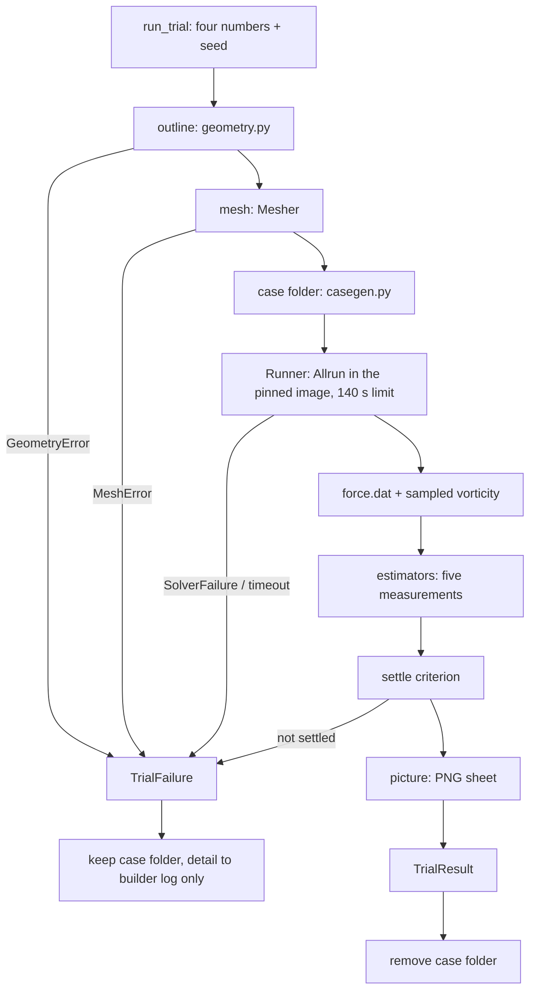

# Design: wind-tunnel

Covers Requirements 1-18. Settings come from `wind-tunnel/model/settings.toml`, `wind-tunnel/model/image-lock.toml` and the case templates,
read at load time; no value of the solver setup is written twice. Values that do not exist yet are visible placeholders in
angle brackets, such as `<not yet recorded>`, and each has a task that fills it (`rules.md` 4, Honest). A value
that is a starting choice and not a result (a mesh size, the first time step, the colour limit) is written as a
number with a comment that says "starting value" and which task confirms it. The
adapter contract is `bench/src/bench/adapter.py` (`lab-bench` design 4), the model of an adapter is
`body-lab/adapter` (`body-lab` design 1-5).

## Overview

One trial is one run of the solver. The adapter turns four numbers into a body outline, a mesh and an OpenFOAM
case, runs the case once in a pinned Docker image under a wall-clock limit, reads the force history and the
sampled vorticity, computes five measurements with pure functions, and returns the measurements and one PNG picture
sheet of vorticity frames in time order. Anything that goes wrong is a trial failure with a fixed public reason (Requirement 8), never a made-up value.

The system is split in two projects so that the rule "the model is never visible from `lab/`" has one place to
hold it:

- `wind-tunnel/model/` is the system: numbers, case templates, the outline, the Gmsh recipe, the parsers of solver
  output, and the pure functions that turn a force history into the five measurements and the settle criterion.
  It contains no bench code. (The estimators are here and not in the adapter so that they, like the geometry, are
  written and tested before the sheet reading gate of Requirement 9.9, which stops adapter code only. Decision 14.)
- `wind-tunnel/adapter/` plugs the system into the bench: the declaration, the run, the picture, the failure
  mapping, the circle check. It contains no solver number of its own.

Highlights of the choices (details below):

| Topic | Choice | Why |
|---|---|---|
| Strouhal estimator | Least-squares sinusoid fit on a fine frequency grid, refined by golden-section search; no FFT | Resolves far below the bin width 1/70 (about 8% of 0.17), works on the uneven times of an adaptive time step (5.2) |
| Output of the solver | Function objects write `force.dat` and sampled vorticity during the run; no field dumps, no reconstruction | Short run, small disk use, the forces and the picture come from the same run |
| Picture | One PNG contact sheet: 6 vorticity frames in 2 rows of 3, a fixed colour ramp, numpy and `bench.pictures.encode_png`, no Pillow | Same colour scale in every trial by construction (9.1); Dr. Kiro's file tool delivers one still image (the GIF check failed); no plotting library, no text, no metadata; the form of `body-lab`'s picture |
| Docker | `docker run` of the pinned image with a bind-mounted case folder; one script (`Allrun`) from `model/` | One command to time out and kill; the in-image commands are solver setup and live in `model/` (6.9) |
| Environment check | At adapter construction; the scan uses a second factory that only builds the declaration | `bench-scan` must work without Docker (Kiro Web, publishing) |
| Tests without Docker | A fake runner and a fake mesher behind two small protocols | Everything except the three slow checks runs in Kiro Web |

## Architecture

```
wind-tunnel/
  README.md                       connection time, code size, circle check, limits (16, 17.4)
  numbers.md                      connection time (self-reported) and code size (16)
  circle-check.json               written by the circle check (15.5)
  form-knowledge-review.md        the reviewed list (12.3)
  count_lines.py                  writes the code size into numbers.md (16.2)
  extreme-runs.json               outcome and time of the 32 end-corner and near-end runs (17.6)
  model/                          uv project "wind-tunnel-model"; never visible from lab/
    pyproject.toml                depends on gmsh and numpy
    settings.toml                 every number of the solver setup (6.8, 6.9)
    image-lock.toml               image digest and image id, written by the digest task (7.1)
    case/                         OpenFOAM templates (*.in, placeholders @NAME@) and Allrun
    src/wind_tunnel_model/
      settings.py                 load and validate settings.toml; the Reynolds-number override
      geometry.py                 outline of the body from the four knobs (pure)
      mesh.py                     Gmsh recipe: outline -> mesh file
      casegen.py                  templates -> case folder (pure text)
      solver_output.py            parse force.dat and sampled-vorticity files
      estimators.py               cd, cl_mean, cl_amp, strouhal, shedding (5)
      settle.py                   settle criterion (8.3)
    tests/
  adapter/                        uv project "wind-tunnel-adapter"
    pyproject.toml                depends on lab-bench (path), wind-tunnel-model (path), numpy
    scan_sources.toml             solver files and lab layout (13.5)
    src/wind_tunnel/
      declaration.py              knobs, measurements, told text, budget, goal (1, 3, 4, 11)
      adapter.py                  WindAdapter, scan_adapter, the run pipeline
      environment.py              Docker and image check, environment record (7)
      runner.py                   Runner protocol, DockerRunner (8.7, 10)
      failures.py                 failure kinds and fixed public reasons (8)
      picture.py                  vorticity -> colour -> picture sheet PNG (9)
      circle_check.py             the circle check and its record (15)
      told_set.py                 export of the told set (2)
    tests/                        ordinary tests (no Docker)
    tests/slow/                   slow local tests (Docker), marker `slow`
  lab/                            made by bench-make-lab (14.3)
```

The bench gets one new file, the scan extractors (section 9), and the knob `description` field (`lab-bench`
Requirement 18 and tasks 23-26, which are done before the adapter is written).
`body-lab` is not touched (14.4). `spikes/` is not used (14.5).



## Components and Interfaces

### 1. Declaration and told set (Req 1, 2, 3, 4, 11)

`declaration.py` builds one `Declaration` from constants and from `measured_by`/knob texts that Requirements 3.2 and
4.2 give.

- Knobs: four `NumberKnob`, in the order `aspect`, `corner`, `splitter`, `angle`, with the ranges of 3.1 and the
  knob texts of 3.2. The texts are constants in `declaration.py`; a test compares them with the text of
  Requirement 3.2 (read from the spec file when it exists, so the two cannot drift; skipped with a visible reason
  where `.kiro/` is absent).
- Measurements: `cd`, `cl_mean`, `cl_amp`, `strouhal`, `shedding`, unit `1`, kind `scalar`; `strouhal` has the
  not-measured outcome `not_shedding`.
- `picture = "image/png"`, `budget = 24`, `fake = False`, `goal` as in 11.2, `measured_by` as in 4.2. It says
  "the settled part of the trial" and nothing about times (4.3). In the wording, "force" is used in the singular
  where the sentence allows, so that no word of the told set equals a term the solver files will give (13.8);
  the test of 13.8 decides, and what it cannot avoid goes the way of Requirements 13.4 and 13.9.
- **The knob texts are carried in the `description` field** that `lab-bench` Requirement 18 adds to `NumberKnob`
  (option A, Decision 18). The bench prints it in the tool descriptions on the knob's line and records it; nothing
  else reads it. The texts are the four of Requirement 3.2, built in `declaration.py` from constants, except that
  the plate thickness in the `splitter` text is formatted from `settings.body.thickness` (`f"{t:g}"`, 0.08), so
  the number exists once. Each text is at most 800 characters (the longest is about 450) and has no line break.
  The design of the wording, with the reason for each sentence:
  - `aspect`, `corner`: unchanged from the approved texts.
  - `splitter`: what the plate is and where it is (the back of the body, away from the oncoming flow); how the
    length is counted (from the rearmost point of the body without the plate, which is well defined for every
    `corner`, also when the back is a semicircle); that it lies along the line through the middle of the body
    along its length; that it is joined with no gap; its thickness; the meaning of 0.
  - `angle`: what the angle is; that the oncoming flow goes in +x (the same fact as in `measured_by`, repeated so
    that the knob text is complete alone); the meaning of 0; the centre of the turn; that the plate turns with
    the body; the sense of a positive angle in terms of +y and -y, which `measured_by` already uses for the lift.
  - Every sentence is a definition. No sentence says what a knob does to the flow or to a measurement. The
    reviewed list (Requirement 12) records this sentence by sentence.
  - A test compares the four texts, with the thickness filled in, with Requirement 3.2 read from the spec file
    (skipped with a visible reason where `.kiro/` is absent), so that spec and code cannot drift.
- Two factories: `WindAdapter()` (checks the environment, section 6) and `scan_adapter()` (the same declaration, no
  `run_trial`, no check). `scan_sources.toml` names `scan_adapter` as its `adapter`. A test asserts that both give
  equal declarations. The scan therefore needs no Docker (13.5, 14.4).
- `told_set.py` has the console command `wind-tunnel-told-set --out PATH`. It calls
  `bench.frontend.describe.declaration_text` on `scan_adapter().declaration()` and writes the text with a final
  newline and nothing else; the path is required (2.1-2.3). A test compares the output with the text that
  `describe.py` puts into the tool descriptions (2.4).

### 2. Geometry (Req 6.1-6.5, 6.10) in `wind_tunnel_model/geometry.py`

A pure function `outline(aspect, corner, splitter, angle, settings) -> Outline`. No Gmsh import.

- Frame of the body before rotation: the rectangle spans x in [-a/2, a/2] and y in [-1/2, 1/2], `a = aspect`; the
  flow goes in +x, so the rear is the +x side.
- Corner radius `r = corner * min(1, a) / 2` (6.2). A straight piece of length `side - 2r` is kept when that length
  is above zero and omitted when it is exactly zero (`corner = 1` and the shorter side; at `a = 1` all four are
  omitted and the outline is four quarter arcs, a circle). Floating-point products of `corner` with powers of two
  make the exact-zero case exact.
- Plate (when `splitter` > 0): a rectangle of thickness `t` = 0.08 (`settings.toml`) on the centre line, told in the
  `splitter` text, from
  `x = a/2 - t` (inside the body, so there is no gap whatever the rounding) to `x = a/2 + s`. The outline is the
  union: the rear straight piece (or arc) is cut where the plate's top and bottom edges cross it, found in closed
  form: `x_c = a/2` when `t/2 <= 1/2 - r` (for `a < 1` the rear is always straight, since `r <= 1/4`), else
  `x_c = a/2 - r + sqrt(r^2 - (t/2 - (1/2 - r))^2)`. The plate's inner overlap needs no outline of its own.
- Rotation by `angle` degrees about the origin (the centre of the rectangle), with the sense of Requirement 6.4:
  a positive angle `θ` moves the front end (-x before the turn) toward +y. With the flow along +x and +y up, that
  is a clockwise turn, the usual sense of a positive angle of attack. As a matrix, `(x, y) -> (x cos θ + y sin θ,
  -x sin θ + y cos θ)`. The point `(-a/2, 0)` goes to `(-(a/2) cos θ, (a/2) sin θ)`, which is above the axis for
  `θ > 0`; the point `(a/2, 0)` goes below it. The sense is written once, in `geometry.py`, as the sign in this
  matrix; there is no `rotation_sense` setting that could disagree with the told text. The sense is told in the
  `angle` text (Requirement 3.2) and Property 3 pins it.
  Why this sense: it is the prototype's, confirmed by the user (Decision 19 of the requirements).
- Output: an ordered, closed list of primitives (`Line(p, q)`, `Arc(p, centre, q)`), each with exact endpoints.
- `GeometryError` (with the knob values and the reason, builder side only) when a positive piece is shorter than
  `min_edge`, or when `x_c` is undefined. Pieces of length exactly zero are not errors (Requirement 6.10).
  `min_edge` is 0.0 in `settings.toml` until the user decides otherwise: the near-end cases of Requirement 17.2
  must reach the mesher and the solver so that they can be measured, and a refusal in the geometry would hide the
  result. With 0.0, only a negative or undefined piece is a `GeometryError`. Decision 12.

### 3. Mesh (Req 6.8, 7.2) in `wind_tunnel_model/mesh.py`

- Gmsh Python API, built-in kernel: points, lines and `addCircleArc` from the outline; the outer rectangle with the
  domain of 6.8 (inlet 6 heights ahead of the body's centre, outlet 18 behind, 7 above and below, measured from
  the centre; the same values as `settings.toml [domain]`); one plane surface with the body as a hole.
- Size field: a distance-and-threshold field from the body curves (`size_body` near, growing to `size_far`) and a
  box field over the near wake (`size_wake`). Sizes are `<chosen in the mesh task, before the circle check is
  run>`; changing them afterwards is a change that may alter the circle check and needs the user (6.8).
- Extruded one layer in z by `depth` (`settings.toml`, the unit of a force per unit depth, 1) so that OpenFOAM sees
  a 2D case; physical groups give the patches `inlet`, `outlet`, `lateral` (top and bottom), `obstacle` and
  `frontAndBack`. The names are in `settings.toml [patches]` and used by both the recipe and the templates. They are
  chosen so that none is a word of the told set (13.8).
- Written as a Gmsh `.msh` file in the case folder. Mesh generation uses no random seed; Gmsh's algorithm choice and
  the thread count (1) are set explicitly in `settings.toml` (10.2).
- Interface `Mesher.build(outline, settings, dest) -> None`, raising `MeshError(reason)`. `GmshMesher` is the real
  one; `FakeMesher` writes a fixed small file for tests.

### 4. Case and solver (Req 6.6, 6.8, 6.9, 10.1) in `model/case/` and `casegen.py`

`casegen.render_case(knobs, settings, dest)` copies every template, replacing `@NAME@` with the setting named
`NAME`, formatted with `repr` of the float, and writes files in sorted order with `\n` endings. A missing
placeholder value, or a placeholder left over after substitution, is an error. Two calls with equal inputs write
identical bytes (10.2).

Contents of the templates (names are OpenFOAM's; values come from `settings.toml`):

| File | Holds |
|---|---|
| `constant/transportProperties.in` | `nu = speed * height / reynolds` |
| `constant/momentumTransport.in` | laminar |
| `system/controlDict.in` | `pimpleFoam`, end time 150, adaptive step with `maxCo` 0.8 and `maxDeltaT` (at most 0.05, section 5), no field output, function objects below |
| `system/fvSchemes.in`, `fvSolution.in` | second-order time and convection schemes (`backward`, `linearUpwind`), pressure-velocity coupling with one outer corrector; choices to be confirmed by the circle check |
| `system/decomposeParDict.in` | 3 subdomains, method `simple`, counts (3 1 1), fixed text (10.1) |
| `system/changeDictionaryDict.in` | sets `frontAndBack` to `empty` after `gmshToFoam` |
| `0/U.in`, `0/p.in` | inlet speed `(speed 0 0)`; `lateral` with `slip`; `obstacle` with `noSlip`; outlet pressure 0 |
| `system/functions.in` | the force function object on `obstacle` (density 1, writes every time step), and the vorticity sampling (below) |
| `Allrun` | `set -e`; `gmshToFoam`, `changeDictionary`, `decomposePar`, `mpirun -np 3 pimpleFoam -parallel` |

- The top and bottom boundaries are not specified by the brief ("walls 7 above and below"). This design takes
  `slip`; the circle check decides whether that is acceptable (Decision 5).
- Sampled vorticity: function objects `vorticity` and a cloud `sets` sampler over a regular grid of
  `cell_width * cell_height` points covering the picture window, written as raw text, at the frame times
  (`end - (frames - 1 - k) * spacing`, k = 0..frames-1: 145, 146, ..., 150). The grid points are written into the case by `casegen` (they depend only on
  settings). Points outside the fluid are not returned by the sampler; the picture reads that as the body mask.
  Both outputs land in the case's `postProcessing/`, which is the collated output of a parallel run, so
  `reconstructPar` is not needed. The exact spellings are confirmed in the smoke-run task (Stop condition S5).
- The in-image commands of `Allrun` are not a second copy of anything: they are solver setup (6.9).

### 5. Estimators and settle criterion (Req 4, 5, 8.3) in `model/estimators.py`, `settle.py`

Inputs are the force history `(t, Fx, Fy)` of the settled part (`t >= average_from`), with uneven times. Constants:
`ESTIMATOR_MAX_DT = 0.05`, the largest sample interval the 1% accuracy is shown for; `settings.toml` is checked to
have `max_delta_t <= ESTIMATOR_MAX_DT` when it is loaded.

- `cd = mean(Fx) / q`, `cl = Fy / q`, `q = 0.5 * rho * speed^2 * height * depth` with the values 1 of `settings.toml`
  (4.2, 4.6). Means are time-weighted (trapezoid rule over the settled part divided by its length).
- `cl_mean` is the time-weighted mean of `cl`; `cl_amp = (max(cl) - min(cl)) / 2` over the samples.
  The mean is over the settled part, not over whole periods. A window rarely holds a whole number of periods, so
  the leftover partial period shifts the mean by at most `amplitude / (pi * f * T)` (`f` the signal frequency, `T`
  the length of the settled part). This is part of the bound of Requirement 5.4 (Decision 28 of the requirements).
- `shedding = 1.0` when `cl_amp > 0.01`, else `0.0` (4.2).
- `strouhal` (only when `shedding` is 1): remove nothing; for each frequency `f` on a grid from `5 / T` to `1.0`
  with step `1 / (10 T)` (`T` the length of the settled part), fit `a cos(2 pi f t) + b sin(2 pi f t) + c` by linear
  least squares and take the explained variance; take the best grid frequency and refine it by golden-section
  search in the two neighbouring grid steps down to a width of 1e-9. `St = f * height / speed`. Deterministic, no
  random start. Why: with `T = 70`, a bin of an FFT is `1/70 = 0.0143`, 8% of 0.17 (5.2); this estimator has no
  bin. The grid start `5 / T` is the lowest frequency that can pass the five-period rule of 8.3.
- When `shedding` is 0 the adapter returns `NotMeasured("not_shedding", "the lift does not oscillate: cl_amp is not
  above 0.01")` for `strouhal` and does not run the estimator (4.4).
- The accuracy range of Requirement 5.3: St in [0.08, 0.5]. The low end is the five-period rule (0.0714) with margin;
  the high end is at least twice any value expected for a bluff body, and at 0.5 and `ESTIMATOR_MAX_DT` there are 40
  samples per period. The amplitude in 5.3/5.4 is in [0.011, 3] and the mean in [-3, 3]. The bound of `cl_mean` in 5.4 is 1% of the mean
  plus `amplitude / (pi * f * T)`.
- Settle (8.3), `settled(t, cd, cl, shedding, st) -> SettleResult(ok, reason)`: split the settled part at its
  midpoint in time; `|mean cd(first) - mean cd(second)| <= 0.02 * |mean cd(whole)|`;
  `|cl_amp(first) - cl_amp(second)| <= max(0.1 * cl_amp(whole), 0.002)`; when `shedding` is 1,
  `st * speed / height * T >= 5`. Comparisons are written without division. The reason names the criterion that
  failed (builder side).

### 6. Environment and run (Req 7, 8.7, 10)

- `environment.check(settings)` runs at `WindAdapter.__init__`, so a missing Docker stops the bench server at
  start and not at the first trial. It runs `docker version`, `docker image inspect` for the image by the recorded
  digest, and `docker info` for the number of CPUs of the Docker machine (at least the 3 processes of 10.1, else
  `mpirun` cannot start). Each failure raises `EnvironmentFailure` naming which of: Docker not reachable, image
  missing, digest different, too few CPUs; what was expected; what was found. No pull, no other tag (7.4).
- It then appends one JSON line to `bench-run/wind-tunnel/environment.jsonl` (git-ignored, builder side): the image
  name, the digest, the image id, the Gmsh version, the numpy version, the platform. No time, so that
  the file is a function of the environment (7.5). The sealed record does not carry it and `measured_by` does not
  mention it.
- The image: `opencfd/openfoam-default:2412`, run as `name@digest`. `settings.toml [image]` holds `name` and `tag`.
  The digest and the image id are in `model/image-lock.toml`, which does not exist until the digest task has run;
  `WindAdapter` (not `scan_adapter`) fails with "image lock missing" while it is absent, so no placeholder is ever
  loaded as a value and the Docker-free parts need no digest. A task
  on the user's Mac writes both with `docker image inspect` (the digest is that of the image index; the image id is
  the one of the arm64 build, so the pair pins the platform, 7.1). No digest is invented.
- `Runner` protocol: `run(case_dir, deadline) -> RunOutput(force_file, sample_files)`, raising `SolverFailure(kind,
  reason, detail)`. `DockerRunner` runs `docker run --rm --name <case-name> -v <case>:/case -w /case <name@digest>
  ./Allrun` through `subprocess.run(..., timeout=remaining)`. `remaining = 140 s - (time already used by outline
  and mesh)`. On timeout it runs `docker kill <case-name>` and raises `SolverFailure("timeout")`. A non-zero exit,
  a missing output file or a non-finite value raises `SolverFailure` with the solver's last log lines in `detail`.
  The exact in-image invocation (user id, whether the image's entry point already prepares the environment) is
  confirmed in the smoke-run task (S5).
- Case folder: `bench-run/wind-tunnel/<seed as 16 hex digits>/`, made by the adapter; `bench-run/` is git-ignored.
  The folder name uses the trial seed only as a label (Decision 3); an existing folder is a failure, not
  overwritten. Removed after success, kept after failure, named in `detail` (10.5, 10.6).
- `run_trial(inputs, seed)`: check that `inputs` has exactly the four names and finite numbers inside the ranges
  (otherwise `ValueError`, which the bench turns into a bench failure; nothing is clipped, 3.4); then the flow of
  the diagram above. Unexpected exceptions are not caught.
- Reynolds number: `Settings.load()` reads 150. `Settings.with_reynolds(x)` returns a copy and is called only by
  `circle_check.py`; a test walks the syntax trees of the `src/` files of both projects and fails when any other
  file mentions it. `WindAdapter` takes no Reynolds argument, so no trial input or lab file can reach it (6.7).

### 7. Picture (Req 9) in `adapter/picture.py`

One PNG picture sheet, the form of `body-lab`'s picture (`body-lab` design 4). No window, no OpenGL, no plotting
library: the sheet is built from arrays.

- Input: for each of the frame times, the sampled vorticity `omega_z` on the `cell_width * cell_height` grid, with a
  mask of points the sampler did not return (the body).
- Frame times (a pure function in the model's `settings.py`, `frame_times(settings)`, so that the case generator and the picture use one list): `t_k = end - (frames - 1 - k) * spacing`
  for k = 0..frames-1, so the last frame is at the end of the run and the times increase. With the starting values
  this is 145, 146, ..., 150. The settings loader refuses `t_0 < average_from` (9.3) and `frames != rows * columns`.
- Colour: `index = round(254 * (clip(omega, -L, L) + L) / (2 L))`, an integer in 0..254, with `L` =
  `vorticity_limit` from `settings.toml` (a starting value, chosen from the vorticity range of the 32 gate runs and
  then fixed, 9.5). The colour of an index comes from one fixed table of 255 RGB entries, a diverging ramp between
  three anchor colours (a blue and a red that are not black, and white at the middle) built by linear interpolation
  in `picture.py`. A masked point gets one fixed grey that is not in the table. The table has one source and the
  same table is used in every trial (9.1).
- Cell: the sampling grid is the cell, so no resampling is done. A cell is a `cell_height * cell_width * 3` array of
  `uint8` made by indexing the table.
- Sheet: an array of the gap colour (black, which is not in the table) with the cells copied in, cell `k` at row
  `k // columns` and column `k % columns` (time order, left to right and then top to bottom), with `gap` pixels
  between cells and none outside. Size: `columns * cell_width + (columns - 1) * gap` by
  `rows * cell_height + (rows - 1) * gap`; with the proposed values 1208 by 404.
- Encoding: the array is turned into rows of RGB tuples and encoded by `bench.pictures.encode_png`, which writes no
  ancillary chunk; the same input gives the same bytes. No text is drawn. `bench.pictures.check_picture` is run on the
  bytes in the tests.
- Settings (9.4, `settings.toml [picture]`, **proposed, the user confirms at design approval**, Decision 16):
  `rows = 2`, `columns = 3`, `frames = 6`, `spacing = 1.0`, `cell_width = 400`, `cell_height = 200`, `gap = 4`;
  window x in [-2.5, 9.5], y in [-3, 3] (2 to 1, the shape of a cell); `vorticity_limit`.
  Why six frames at 1.0: one shedding period at a Strouhal number of about 0.17 is about 6 time units, so the
  sheet covers about one period. A body that does not shed gives nearly identical cells (9.11).
  Why a gap: the vorticity of the free stream is near zero, shown as the white middle of the table, so without a gap
  the right edge of one cell and the left edge of the next run together. A gap of 0 is a valid setting if the user
  prefers it.
- Legibility: whether Dr. Kiro's file tool delivers a sheet of this size so that each cell can be read is checked,
  not assumed: on a synthetic sheet by tasks 7.1-7.2 and on a real sheet by task 14.5 (9.7, 9.10). The size is a
  setting, so a failure can be answered with other values, but only by the user's decision (9.8).
- Libraries: numpy only (a dependency of the adapter) and `bench.pictures`. Pillow is not needed: there is no
  resizing and no GIF writer. matplotlib is not used: the table, the mask and the scale are a few lines, and a
  plotting library would bring axes, fonts and metadata that 9.2 forbids.
- Notebook: the moving picture in the notebook (the frames of a sheet shown in turn) is decided in the
  `lab-notebook` spec, once for both labs. Nothing here prepares it.

### 8. Failures (Req 8)

`failures.py` holds the kinds and the only public texts:

| Kind | Cause (builder side) | `public_reason` |
|---|---|---|
| `not_settled` | settle criterion failed | "the trial did not settle" |
| `incomplete` | diverged, non-finite, abnormal exit, missing or unreadable output, geometry or mesh error | "the trial could not be completed" |
| `timeout` | the 140 s limit | "the trial took too long" |

`detail` holds the kind, the cause, the knob values, the case folder and the tail of the solver log. The reasons do
not depend on the inputs (8.5) and nothing is written into `lab/` (8.6). There is no retry (8.2). A time-out is a
failure, not a not-measured outcome (8.8).

### 9. Blind scan extractors (Req 13) in `bench/src/bench/scan/foam_terms.py`

Registered in `EXTRACTORS` of `terms.py`; standard library only.

| Extractor | Source | Terms |
|---|---|---|
| `openfoam-dict` | each `case/**/*.in` | every entry keyword, every sub-dictionary name, every bare word that is a value (scheme, solver, boundary-type and function-object names); numbers, the switch words `yes no on off true false` and the `FoamFile` header block are syntax and are left out |
| `shell-words` | `case/Allrun` | the command names |
| `toml-names` | `settings.toml` | keys, and string values that look like names (patch names, image name and tag) |
| `python-names` | `geometry.py`, `mesh.py`, `casegen.py`, `solver_output.py` | names of functions, classes and module-level constants; no string literals |

- Every extractor drops, by two fixed rules and no other filter (Decisions item 29): the Python reserved words
  (`keyword.kwlist`, `keyword.softkwlist`), the Python built-in names (`dir(builtins)`), and names of one character.
  The lists are the standard library's.
- A file that cannot be read or parsed is a `ScanError` naming file and problem (13.2). Template placeholders
  `@NAME@` are read as the bare word `NAME`.
- Source file names and stems go into the terms by the existing code (11.1 of `lab-bench`).
- `scan_sources.toml` lists the sources, the lab layout as `body-lab` does, and `adapter = "wind_tunnel.adapter:scan_adapter"`.
- The allow list stays what `lab-bench` makes it: the declared names (knob names, measurement names, the outcome
  name). The words of the knob texts are scanned like any builder text and nothing is removed for them (Requirement
  13.3). A test (13.8) builds the real told set and the real derived terms and fails if they meet. The expected
  trouble is ordinary words that OpenFOAM uses as keywords (for example `type`, `value`, `method`, `default`,
  `none`, `time` and the word `default` in the image name). The order of resolution is fixed by Requirement 13.4:
  rename what the builder chose; reword; ask the user. The extractor output is listed for the user's review before
  any stop-list entry is proposed (Requirement 13.9, Decision 13).

### 10. Circle check and numbers (Req 15, 16)

- `circle_check.py` has a console command. It builds the settings with `with_reynolds(100.0)`, runs the circle
  (`aspect` 1, `corner` 1, `splitter` 0, `angle` 0) through the same pipeline as `run_trial` with the real mesher
  and runner, and gets `strouhal`. `literature(re) = A / re + B + C * re` with A = -3.3265, B = 0.1816, C = 1.600e-4
  and the source text of 15.4 as constants of the module. The check passes when
  `abs(difference_percent) <= 5`, `difference_percent = 100 * (measured - literature) / literature`. It writes
  `wind-tunnel/circle-check.json` with: `reynolds`, `measured`, `literature`, `constants`, `source`,
  `difference_percent`, `image_digest`, `passed` (15.5). If the circle does not give a `strouhal`, or does not
  settle, the check fails with that reason and writes `passed = false`.
- `count_lines.py` counts non-blank, non-comment lines in `wind-tunnel/adapter/` and `wind-tunnel/model/` (not the
  lock files, virtual environments or caches), lists the test files on a separate line, and rewrites the code-size
  part of `numbers.md`. The connection time is typed by the user (16.1). Until a number exists the file holds
  `<not yet measured>` (16.3).
- The reviewed list is `wind-tunnel/form-knowledge-review.md`: one line per text Dr. Kiro can read, with
  "reviewed, no form knowledge" and who reviewed it (12.3).

## Data Models

`settings.toml` (model; every row has one reader, `settings.py`, which fails on a missing, extra or placeholder
key):

| Section | Keys | Source of the value |
|---|---|---|
| `[flow]` | `reynolds`, `speed`, `height`, `depth`, `density` | 150 (brief), 1, 1, 1, 1 |
| `[body]` | `thickness`, `min_edge` | 0.08 (decisions), 0.0 (no refusal in the geometry until the user decides, Decision 12) |
| `[domain]` | `ahead`, `behind`, `above_below` | 6, 18, 7 (brief) |
| `[time]` | `end`, `average_from`, `max_co`, `max_delta_t`, `initial_delta_t` | 150, 80, 0.8 (brief), 0.05 (the estimator limit), a starting value confirmed by the smoke-run task |
| `[mesh]` | `size_body`, `size_far`, `size_wake`, `wake_length`, `algorithm`, `threads` | starting values chosen in the mesh task from cell counts and confirmed by the smoke run; algorithm and threads set |
| `[run]` | `processes`, `timeout_s`, `decomposition` | 3, 140, `simple (3 1 1)` |
| `[image]` | `name`, `tag` | brief (the digest and the image id are in `image-lock.toml`) |
| `[patches]` | five names | chosen, none a word of the told set |
| `[picture]` | `rows`, `columns`, `frames`, `spacing`, `cell_width`, `cell_height`, `gap`, `window`, `vorticity_limit` | section 7 (the layout is a proposal until the user confirms it, Decision 16); `vorticity_limit` is a starting value, replaced from the observed range in the extreme-run task and then fixed (9.5) |

Other records:

- `Outline`: ordered closed tuple of `Line` and `Arc` with point pairs; `GeometryError(reason, knobs)`.
- `ForceSeries`: `t`, `fx`, `fy` as `numpy` arrays of equal length, only the settled part, finite.
- `SolverFailure(kind, reason, detail)`; `FailureKind`: `not_settled`, `incomplete`, `timeout`.
- `SettleResult(ok, reason)`.
- `environment.jsonl` line: `{image, digest, image_id, gmsh, numpy, platform}`.
- `circle-check.json`: section 10.
- Force file: columns `time`, `(total_x total_y total_z)`, `(pressure ...)`, `(viscous ...)`; lines starting `#`
  are comments. Only the total is read.

## Correctness Properties

*A property is a characteristic or behavior that should hold true across all valid executions of a system-essentially, a formal statement about what the system should do. Properties serve as the bridge between human-readable specifications and machine-verifiable correctness guarantees.*

Properties are tested with `hypothesis` (at least 100 examples each, the profile the bench tests use), without
Docker, OpenFOAM or a display. Property 1-3 and 13 need no Gmsh either.

### Property 1: Outline is closed and valid for every knob value

For all `aspect` in [0.5, 3], `corner` in [0, 1], `splitter` in [0, 3], `angle` in [0, 30] (ends included), the
outline is either a closed, continuous loop in which no straight piece has length zero, or a `GeometryError`
that names the piece shorter than `min_edge`.

**Validates: Requirements 3.3, 6.10**

### Property 2: Corner radius follows the definition

For all `aspect` below and above 1 and all `corner`, every corner arc has radius `corner * min(1, aspect) / 2`;
the straight piece along the shorter side has length `shorter - 2r`, and is absent exactly when that is zero; for
`splitter` 0 the area of the outline equals `aspect - (4 - pi) r^2` within 1e-5; the height of the unrotated
outline is 1.

**Validates: Requirements 6.1, 6.2**

### Property 3: Plate and rotation

For all knob values, the outline has a plate exactly when `splitter` > 0, the plate is `thickness` thick, reaches
`a/2 + splitter` before rotation, and the union has no gap; rotation by `angle` preserves every piece length and the
distance of every endpoint from the origin, `angle` 0 is the identity, and for `angle` > 0 the front end of the body
(the point at `-a/2` on the centre line before rotation) has a positive y and the back end of the body without the
plate (the point at `+a/2`) has a negative y, as the `angle` text tells.

**Validates: Requirements 3.6, 6.3, 6.4**

### Property 4: Strouhal accuracy

For all sinusoidal lift signals with St in [0.08, 0.5], any mean in [-3, 3], any amplitude in [0.011, 3], any phase,
sampled over 70 time units with uneven intervals not above `ESTIMATOR_MAX_DT`, the estimated `strouhal` is within 1%
of St.

**Validates: Requirements 5.2, 5.3**

### Property 5: Amplitude and mean accuracy

For all such signals, and for amplitude 0, `cl_amp` is within 1% of the amplitude (absolute 1e-6 at 0) and
`cl_mean` is within 1% of the mean plus `amplitude / (pi * f * T)` (absolute 1e-6 when amplitude and mean are 0),
with `f` the signal frequency and `T` the length of the settled part.

**Validates: Requirements 5.4**

### Property 6: Shedding flag and the absent Strouhal number

For all force series, `shedding` is 1 exactly when the estimated `cl_amp` is above 0.01; the estimator gives no
Strouhal number exactly when `shedding` is 0 and gives one exactly when `shedding` is 1. (The adapter turns the
absent number into the `not_shedding` outcome, which Property 10 and an example test cover.)

**Validates: Requirements 4.4, 4.5, 5.5**

### Property 7: Estimators are deterministic and shift-invariant

For all force series, two evaluations give bit-equal results, and shifting all times by a constant changes none of
the five measurements.

**Validates: Requirements 5.1, 5.6**

### Property 8: Settle criterion

For all stationary synthetic series (constant `cd` with noise below 1%, sinusoidal lift with at least 5 periods in
the window) the criterion says settled; for all series where a ramp makes the mean `cd` of the halves differ by more
than 2%, or the amplitude of the halves differ by more than 10% and 0.002, or an oscillating series has fewer than 5
periods, it says not settled; scaling `cd` by a positive constant does not change the outcome.

**Validates: Requirements 8.3**

### Property 9: Failure mapping

For all failure causes (solver failure kinds, geometry error, mesh error, non-finite value, timeout, not settled)
and all knob values, the `TrialFailure` has one of the three fixed public reasons, the reason is the same for the
same kind whatever the inputs, it has no term of a fixed list of solver words, and the `detail` holds the cause.

**Validates: Requirements 8.1, 8.4, 8.5, 8.8**

### Property 10: Result contract and seed independence

For all in-range knob values and two seeds, `run_trial` with the fake mesher and fake runner returns a result that
passes `bench.adapter.check_result` for the declaration, and the two results are equal.

**Validates: Requirements 3.3, 3.4, 10.2, 17.1**

### Property 11: Case generation is deterministic and complete

For all knob values and Reynolds numbers in a range, `render_case` writes identical bytes when called twice, leaves
no `@` placeholder, and writes a viscosity equal to `speed * height / reynolds`.

**Validates: Requirements 6.6, 6.7, 10.1, 10.2**

### Property 12: Force file round trip

For all force series with finite values and increasing times, parsing the text that a test-side writer produces
from the series gives back the series (within the printed precision), and a file with a non-finite value or no
rows is refused.

**Validates: Requirements 8.1**

### Property 13: Told set export equals the declaration

For all declarations accepted by `check_declaration` (generated with knob texts), the exported document equals the
text `describe.declaration_text` builds for the tool descriptions, is byte-identical on two calls, and contains no
file name, path, version or session value.

**Validates: Requirements 1.1, 2.1, 2.2, 2.3, 2.4**

### Property 14: Picture sheet mapping and file

For all vorticity fields, all limits `L` and all valid layout settings, the colour index is non-decreasing in the
value and clipped to 0..254; a masked point has the fixed mask colour, which no index has; the sheet has the size
`columns * cell_width + (columns - 1) * gap` by `rows * cell_height + (rows - 1) * gap`; cell `k` holds frame `k`
(read back with a test-side decoder, so frame order is left to right and then top to bottom); the gap pixels have the
gap colour; the same input gives the same bytes; the bytes pass `bench.pictures.check_picture` for `image/png` and
hold no chunk other than the image data.

**Validates: Requirements 9.1, 9.2, 9.3, 9.4**

### Property 15: Planted solver terms are found

For all terms planted from each kind of solver source (an OpenFOAM keyword, a patch name, a function-object name, a
script name), the scan finds the term in builder-level text and ignores it in Dr. Kiro-level text; an unreadable
source file is an error.

**Validates: Requirements 13.1, 13.2, 13.7**

### Property 16: Frame times follow the settings

For all settings with `rows`, `columns`, `spacing` > 0, `end` and `average_from` that the loader accepts, the frame
times are `frames = rows * columns` numbers in strictly increasing order, the last equals `end`, consecutive times
differ by `spacing`, and the first is not before `average_from`; settings whose first frame would be before
`average_from`, or with `frames != rows * columns`, are refused naming the key.

**Validates: Requirements 9.3, 9.4**

## Error Handling

| Situation | Outcome | Where it is seen |
|---|---|---|
| Docker, image, digest or CPUs wrong | `EnvironmentFailure` at construction; the bench server does not start | Builder |
| Geometry or mesh cannot be made | `TrialFailure` `incomplete` | Dr. Kiro sees the fixed reason; builder sees the knob values |
| Solver exits abnormally, non-finite value, missing output | `TrialFailure` `incomplete` | same |
| 140 s exceeded | container killed, `TrialFailure` `timeout` | same |
| Settle criterion fails | `TrialFailure` `not_settled` | same |
| Result breaks the contract | bench failure by `check_result` | Builder |
| Placeholder left in `settings.toml`, missing key | error at load | Builder |
| Programming error in the adapter | exception, a bench failure with a fixed text | Builder |

A `TrialFailure` stops the session (`lab-bench` 2.7 and 11.3); none of these is retried or repaired.

## Testing Strategy

Property-based testing applies to the pure parts: geometry, estimators, settle criterion, failure mapping, case
generation, parsing, the told-set export, the picture mapping and the extractors. It does not apply to Docker, the
solver, Gmsh output quality, the circle check, or the review of form knowledge; those use example tests, slow local
tests and the reviewed list.

| Kind | Tests | Runs where |
|---|---|---|
| Properties 1-16 | `hypothesis`, one test each, tagged `Feature: wind-tunnel, Property N` | Kiro Web and local |
| Examples | the declaration passes `check_declaration`; both factories give equal declarations; knob texts equal Requirement 3.2; the 13.8 overlap check on the real files; the circle literature value at Reynolds 100 is 0.164335 within 1e-6 and the band is 0.1561 to 0.1726; `max_delta_t <= ESTIMATOR_MAX_DT`; the Reynolds-override walk | Kiro Web and local |
| Gmsh | the mesher on the corners of the knob ranges gives a mesh file with the five named groups; marked `needs_gmsh`, skipped with a visible reason where Gmsh cannot be imported (the task checks this in Kiro Web first, as `body-lab` did for rendering) | where Gmsh imports |
| Slow (marker `slow`, excluded by default, Docker) | the circle check (15); same input twice gives identical measurements and picture (10.4); the sheet reading check on a real sheet (9.10, run by the builder, recorded in `spikes/sheet/results.md`); the 16 end-corner runs and the 16 near-end runs, written to `extreme-runs.json`, with the stop of 17.6 | Local Mac only |
| Review | `form-knowledge-review.md` (12.3) | By reading |

The ordinary suite uses `FakeMesher` and `FakeRunner`, which writes a synthetic `force.dat` and vorticity files from
a known sinusoid, so `run_trial` is tested end to end without Docker.

## Requirements coverage

| Part | Requirements |
|---|---|
| `declaration.py`, `told_set.py`, the knob `description` field (`lab-bench` 18) | 1, 2, 3, 4.1-4.4, 11 |
| `geometry.py` | 3.3, 6.1-6.5, 6.10 |
| `mesh.py`, `casegen.py`, `model/case/`, `settings.toml` | 6.6-6.9, 9.5, 10.1 |
| `environment.py`, `runner.py` | 7, 8.7, 8.8, 10.3, 10.5, 10.6 |
| `estimators.py`, `settle.py` | 4.2-4.6, 5, 8.3 |
| `failures.py` | 8.1-8.6 |
| `picture.py`, `frame_times` in `settings.py` | 9.1-9.6, 9.10, 9.11 |
| `foam_terms.py`, `scan_sources.toml` | 13 |
| `circle_check.py`, `count_lines.py`, `numbers.md` | 15, 16 |
| `form-knowledge-review.md` | 12 |
| `lab/`, the install steps in `README.md` | 14.3, 17.3 |
| Extreme and near-end runs, `extreme-runs.json`, and the stops | 17.2, 17.6, 18.5, 13.9 |
| Tests | 5, 8, 10.4, 13.7, 17.1, 17.2 |
| Order of work (tasks): sheet reading gate first (9.7-9.9), hands-on steps last (18.3) | 9.7-9.10, 18 |

## What would make me stop and ask

- S1. `lab-bench` tasks 23-26 are not done, or a golden file of body-lab differs after them (task 1.1 checks).
- S2. The sheet reading check (`spikes/sheet/results.md`) is missing, failed, or, on a real sheet, the agent cannot describe the sheet (9.8-9.10).
- S3. A change to `lab-bench` other than the extractors and the knob `description` field (14.2), or any conflict with
  the `lab-bench` spec.
- S4. Mesh or solver settings that I must change after the circle check was run (6.8); a circle check outside 5%
  (15.7); two runs of one input that differ (10.4); a run slower than 140 s or six runs that do not fit in 900 s
  (8.7); any of the 32 end-corner and near-end runs that times out, fails to mesh, fails or does not settle (17.2, 17.6).
- S5. An OpenFOAM spelling, an in-image command or a Docker option that I cannot confirm in the smoke run (for
  example the function-object time window, the sampler output layout, the user id in the container).
- S6. A derived term of the solver files that collides with the told set or with a builder text and cannot be
  avoided by renaming or rewording: a proposal with evidence for the user, never added to the stop list before the
  user approves it (13.4, 13.9).
- S7. A near-end value of `corner` or `splitter` that makes a run fail or exceed the limit: report the numbers; the
  user chooses a bench rule, a narrower range, or acceptance (17.6).
- S8. Any wish to keep the picture or a number that the pre-check says is not allowed by the blind scan.

## Decisions

Made by the builder in this design; none changes a requirement.

1. **Two projects.** `model/` is a uv project with the geometry, the Gmsh recipe and the parsers; the adapter
   depends on it by path. Requirement 7.2 says Gmsh comes from the adapter's own uv project; here it comes through
   the model project and is locked in the adapter's `uv.lock`, because the Gmsh recipe is part of the model (13.5
   calls it the geometry script). If the user wants Gmsh declared in the adapter, the recipe moves to the adapter
   and the extractor reads it there.
2. **Strouhal by least squares on a frequency grid**, not by FFT with interpolation (section 5).
3. **The case folder is named by the trial seed**, because the contract gives the adapter no session or trial id and
   the seed is a function of both (`lab-bench` 6.3). Requirement 10.2 says the adapter does not use the seed;
   this is a label only, and Property 10 shows that the results do not depend on it. Say so if you prefer a counter
   and a hash of the inputs.
4. **Environment check at construction, second factory for the scan** (section 1).
5. **Top and bottom boundary: `slip`; second-order schemes; simple decomposition (3 1 1).** The brief does not
   fix them. They are the first choice, and the circle check judges them. A change after the check needs the user.
6. **Vorticity sampled inside the run** by function objects; no field output and no `reconstructPar`.
7. **Picture by numpy and `bench.pictures.encode_png` only**, with one fixed colour table; one PNG sheet of 6 frames (the layout is Decision 16).
8. **Patch names `inlet`, `outlet`, `lateral`, `obstacle`, `frontAndBack`**, none a word of the told set.
9. **A check of the Docker machine's CPUs**, in addition to 7.3.

10. **Estimators and settle criterion live in `model/`** (Decision 14).
11. **The image digest and image id are in `model/image-lock.toml`**, written by the digest task, so that
    `settings.toml` never holds a placeholder that a loader must refuse.
12. **`min_edge` is 0.0** until the near-end runs have been measured (Requirement 17.2, 17.6). The geometry then
    refuses nothing before the mesher; whatever the mesher and the solver do is the measurement. The near-end
    distances (0.001 and 0.01 of the range) are the builder's proposal.
13. **Stop-list proposals** for OpenFOAM keywords are a stop with a written proposal (Requirement 13.9). The builder
    renames its own identifiers and rewords first.
14. **Sign of the angle.** A positive angle moves the front end toward +y (clockwise with the flow along +x and +y
    up, as in the prototype, confirmed by the user), written once in `geometry.py`; the estimators sit in `model/` so
    that they are written before the sheet reading gate that stops adapter code (Requirement 9.9).
15. **The plate thickness in the `splitter` text is formatted from `settings.toml`**, not typed again.
16. **Picture sheet layout: PROPOSED, the user confirms at design approval.** One PNG, 6 frames in 2 rows of 3, each
    cell 400 by 200, frames at t = 145, ..., 150 (spacing 1.0, a setting), a fixed 4 pixel gap in black, so the sheet
    is 1208 by 404 (1200 by 400 if the gap is 0). Reasons: section 7. The sampling grid equals the cell, so no
    resampling is done. The legibility for Dr. Kiro is checked (9.7, 9.10), not claimed.
17. **No Pillow.** The GIF writer and the resize were the only uses; `bench.pictures.encode_png` encodes the sheet.
18. **The notebook's moving picture** is a `lab-notebook` decision for both labs (Decision 25 of the requirements);
    nothing in this design prepares it.

## Open questions

One item is open, and it does not block the tasks: the user confirms the sheet layout of Decision 16 (proposal)
when approving this design. The two results-dependent questions (the near-degenerate knob values, and the stop-list
words for OpenFOAM keywords) were accepted as procedures with a stop: Requirement 17.6 and Requirement 13.9,
Decisions 12 and 13. The computational domain stays untold, the user's decision.
