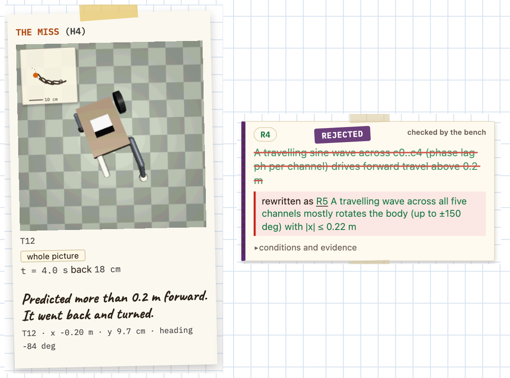
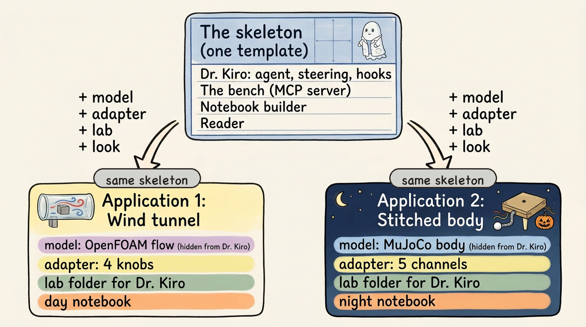
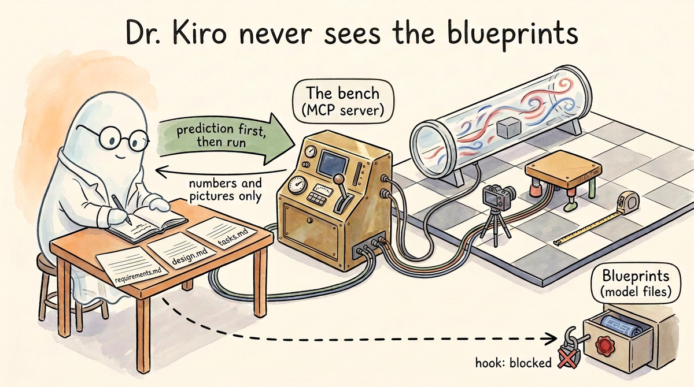
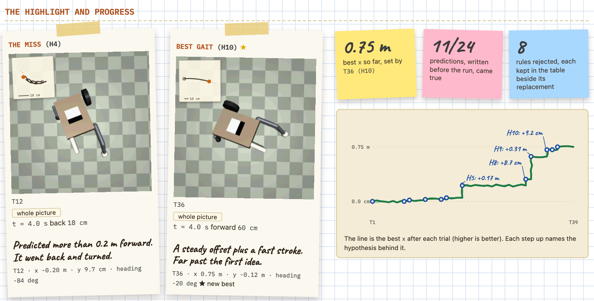
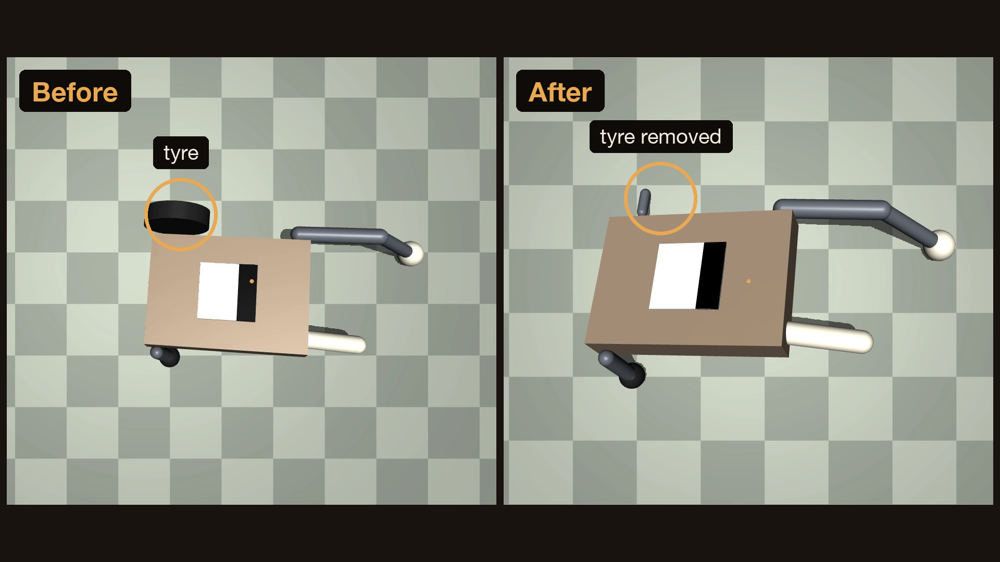
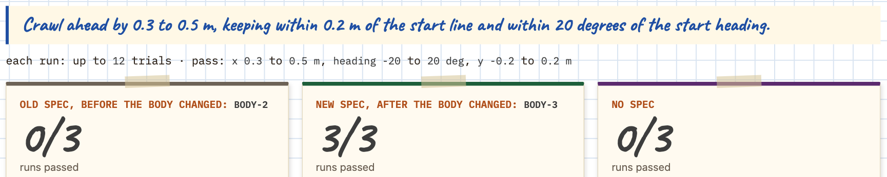
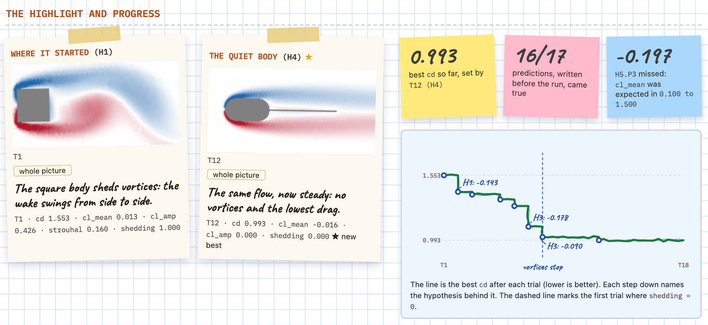
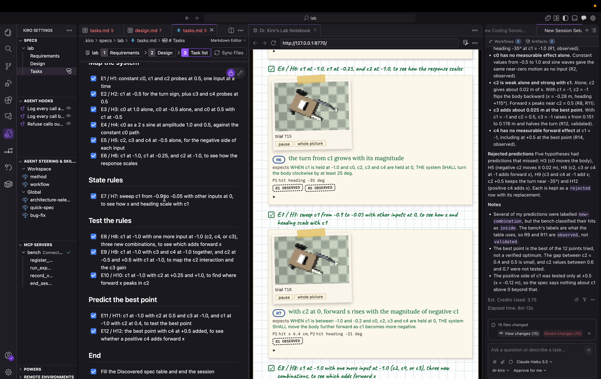

# Dr. Kiro's Lab Notebook

**Discover the spec. Don't just follow it.** Built for Kiroween 2026, Skeleton Crew category.


[Demo video](https://youtu.be/NlJjpljgRmU) · [The specs Dr. Kiro wrote](#read-the-specs-dr-kiro-wrote) · [Run Dr. Kiro yourself](#3-run-dr-kiro-yourself-in-kiro-ide)

Some systems come with no description: a robot whose wires nobody labelled, a rig with no docs, a simulator nobody
has mapped. Ask an AI to spec one and every line comes back in the same confident voice, with nothing to say which
lines were tested and which were guessed. This project writes such a spec from experiments instead.

It has three parts, built in Kiro:

- **Dr. Kiro**, a Kiro custom agent that studies a system nobody has described and writes its spec from experiments.
- **The lab bench**, an MCP server with four tools: Dr. Kiro's only way to touch the system, and the thing that
  enforces the method.
- **The Lab Notebook**, a website built from the bench's sealed records, where a person reads what was tried, what
  was predicted and what happened.

**One experiment, in five steps:**

1. Dr. Kiro gets a robot with five unlabeled wires (channels c0 to c4) and no manual.
2. It adds a line to its `tasks.md` and writes a numeric prediction into `requirements.md`: *a travelling wave
   across the wires will move the robot more than 0.20 m forward.* The bench refuses to run an experiment until a
   prediction is on record.
3. The bench runs the simulator and records the result in a hash-chained record. The robot went 0.20 m backwards.
4. The rule stays in `design.md`, never erased: its row is marked `rejected` and names its replacement. The notebook
   shows that row struck through. Each rule carries a status word (`validated`, `partly`, `observed`, `rejected`)
   that the bench checks against the record: if Dr. Kiro claims more than the record shows, the bench refuses to
   seal the session.
5. What comes out is an ordinary Kiro spec (`requirements.md`, `design.md`, `tasks.md`) and the notebook. A second
   Kiro agent that never saw the experiments can start from that spec alone.



The status words mean: `validated`, every cited prediction hit and at least one hit was on a new combination or
outside the range already tried; `observed`, no miss, but only inside what was tried; `partly`, hits and misses;
`rejected`, a miss, with the rule that replaces it named.

## One skeleton, two applications



| | Application 1: The Wind Tunnel | Application 2: The Stitched Body |
|---|---|---|
| Model (hidden from Dr. Kiro) | 2D flow around a body, OpenFOAM | A stitched robot body (legs and a wheel), MuJoCo |
| Adapter | 4 knobs: aspect, corner, splitter, angle | 5 unlabeled channels, one signal over time each |
| Budget | 24 solver runs | 40 trials of 5 s |
| Notebook | by day | at night |

The skeleton is in `bench/`, `notebook/` and `build-from-spec/`. An application plugs in through an adapter with two
methods ([`bench/src/bench/adapter.py`](bench/src/bench/adapter.py)):

```python
class Adapter(Protocol):
    def declaration(self) -> Declaration: ...  # knobs, measurements, picture, budget, goal, how it measures
    def run_trial(self, inputs: ComputedInputs, seed: int) -> TrialResult | TrialFailure: ...
```

The body's adapter is 460 lines, the wind tunnel's 1,157, and the smallest working example 98.

To add a third lab, start from the contract in [`bench/src/bench/adapter.py`](bench/src/bench/adapter.py), the
smallest working example in [`bench/src/bench/fake/adapter.py`](bench/src/bench/fake/adapter.py), and the two real
adapters in [`wind-tunnel/adapter/`](wind-tunnel/adapter/) and [`body-lab/adapter/`](body-lab/adapter/). Then make its
lab with `bench-make-lab` and give it a notebook look in `<application>/notebook/app.toml`.

## Blind by design



Dr. Kiro must learn only from experiments, like a subject in a blind test. The simulator's code and model files sit
in this repository, but Dr. Kiro never sees them: it works inside one folder (`body-lab/lab/` or
`wind-tunnel/lab/`) and has no shell, and a Kiro hook (`lab/.kiro/hooks/confine.py`) refuses any file access
outside that folder. An automatic check (the blind scan) also keeps the model's own part names, and paths to it, out
of the lab, the bench's messages and the notebook. The reader is blind in a second way: it never sees the
experiments, only the final spec.

## What happened when we ran it

All numbers below come from the sealed records in [`sessions/`](sessions/).

1. **The original robot (`body-2`).** 13 of 24 predictions missed, and 8 of 14 rules ended `rejected`, each
   paired with its replacement. The rule that held: wire c1 steady and wire c3 on a fast sine, 0.75 m forward. Twice the
   bench refused to end the session over a `validated` it could not back.

   

2. **The twist: we took a tyre off and told no one (`body-3`).** Wire c1 had driven that wheel; now it spun in the
   air. From a blank notebook, Dr. Kiro found a new crawl with c2 and c3 together, 0.27 m at best, and 12 of its 16
   predictions came true.

   

3. **The test.** A second Kiro, the reader, got one spec and one task on the changed robot: crawl ahead by 0.3 to
   0.5 m (past the 0.27 m Dr. Kiro itself reached on this body), keeping within 0.2 m of the start line and within 20° of
   the start heading. Each condition got 3 runs of up to 12 trials; the reader never saw Dr. Kiro's experiments.

   | The reader was given | Passed |
   |---|---|
   | The spec written before the tyre came off (`body-2`) | 0 of 3 |
   | The spec written after (`body-3`) | 3 of 3 |
   | No spec | 0 of 3 |

   

   In all three runs with the old spec, the reader named the c1 rules it would rely on.
   With the spec written after, each of the three runs first met all three bounds between trials 5 and 7 of its 12.
   The runs are in [`sessions/build-from-spec/body-lab/`](sessions/build-from-spec/body-lab/).
4. **Same skeleton, another world: the wind tunnel (`wt-004`).** Rounded corners and a long splitter plate stopped
   the vortex shedding, and the drag coefficient fell from 1.55 to 0.99. 16 of 17 predictions came true; the one miss keeps its rule
   `partly`.

   

These are rules for these simulators and these conditions, from one to three sessions per lab, and three
reader runs per condition.

### Read the specs Dr. Kiro wrote

Each is an ordinary Kiro spec, copied from an ended session and checked against its record:

| Session | Rules | Predictions | Experiment plan |
|---|---|---|---|
| The original robot (`body-2`) | [design.md](discovered/body-lab/body-2/design.md) | [requirements.md](discovered/body-lab/body-2/requirements.md) | [tasks.md](discovered/body-lab/body-2/tasks.md) |
| The changed robot (`body-3`) | [design.md](discovered/body-lab/body-3/design.md) | [requirements.md](discovered/body-lab/body-3/requirements.md) | [tasks.md](discovered/body-lab/body-3/tasks.md) |
| The wind tunnel (`wt-004`) | [design.md](discovered/wind-tunnel/wt-004/design.md) | [requirements.md](discovered/wind-tunnel/wt-004/requirements.md) | [tasks.md](discovered/wind-tunnel/wt-004/tasks.md) |

## Requirements

| To do this | You need |
|---|---|
| Read or check the records | uv |
| Run Dr. Kiro in body-lab | uv, Kiro IDE |
| Run the reader (`build-from-spec/`) | uv, Kiro CLI |
| Run the wind-tunnel solver | Docker (see [`wind-tunnel/README.md`](wind-tunnel/README.md)) |
| Publish the notebook | the AWS CLI and an AWS account |

uv manages Python 3.12 and the locked dependencies for each part. No other Python install is needed.

## Three ways to try it

### 1. Read the notebook

Build it from the sealed records (needs only [uv](https://docs.astral.sh/uv/)):

```sh
sh scripts/view-notebook.sh
```

Open http://127.0.0.1:8000/. The site is built into a new folder under the system temporary folder and served on
127.0.0.1 only. `--port N` serves on another port, `--open` opens the browser (macOS). The build stops with a
message, and serves nothing, if the blind scan fails.

### 2. Check a sealed record

```sh
(cd bench && uv run bench-verify ../sessions/body-lab/body-3)
```

It prints `verified` with the number of entries. Any changed byte fails the check. To check that each final spec
in `discovered/` still matches the record it came from:

```sh
(cd bench && uv run bench-check-discovered ../sessions ../discovered)
```

### 3. Run Dr. Kiro yourself, in Kiro IDE

Needs uv, Kiro IDE, and a POSIX shell (macOS or Linux).

```sh
sh scripts/try-lab.sh start
```

The script installs the bench tools with `uv tool install`, opens a new body-lab session, and starts a live
notebook at http://127.0.0.1:8770/ that fills in as Dr. Kiro works. Make sure `uv`'s tool folder is on your
`PATH` when the script asks for it. Then, in Kiro IDE:

1. Open `body-lab/lab` as the only folder of the workspace (File → Open Folder).
2. Check that the `bench` MCP server shows Connected (four tools).
3. Choose the agent **Dr. Kiro** and send: `Begin the session.`

Open `.kiro/specs/lab/tasks.md` to watch the experiments appear one line at a time and get ticked. A session takes
about 10 minutes; the one in the demo video took about 8 minutes and 3.75 Kiro credits.



When Dr. Kiro ends the session, or to stop early:

```sh
sh scripts/try-lab.sh stop
```

`stop` seals an open session as stopped, clears Dr. Kiro's experiment files and pictures, and resets the lab's spec
to the template. `start` again opens a new session, and the running bench server switches to it on the next call. Your trial files stay in
`bench-run/try/`, which git ignores; `sessions/` is never written.

### Run the tests

Each part is its own uv project. For example:

```sh
(cd bench && uv run --all-extras --all-groups pytest -q)
(cd notebook && uv run pytest -q)
```

The reader's runs are described in [`build-from-spec/README.md`](build-from-spec/README.md), and the wind tunnel's
solver setup in [`wind-tunnel/README.md`](wind-tunnel/README.md).

## How it uses Kiro

**Inside the product**

- **Custom agents.** Dr. Kiro (`body-lab/lab/.kiro/agents/dr-kiro.json`, and the same for the wind tunnel) has no
  shell: its only tools are its lab files and the bench. The reader (`build-from-spec/`) is a second Kiro agent, run with
  Kiro CLI, that starts from one spec and one task, never the experiments.
- **MCP.** The bench is one MCP server with four tools: `register_hypothesis`, `run_experiment`, `record_verdict`,
  `end_session`.
- **Hooks.** In each lab, two hooks log every call (before and after it runs) and a third refuses any call outside
  the lab.
- **Steering.** Two steering files in each lab (`method.md`, `workflow.md`) set Dr. Kiro's loop: one task line per
  experiment, a numeric prediction before every run, a refuted rule kept as `rejected`, never deleted.
- **Specs.** Dr. Kiro writes its findings as a Kiro spec. The lab itself was built from specs too:
  `.kiro/specs/` holds lab-bench, dr-kiro, body-lab, wind-tunnel, lab-notebook, notebook-shelf and
  build-from-spec.

**Building it**

- **Kiro Web, then Kiro IDE.** Most of the build started in Kiro Web; the parts that needed MuJoCo, Docker or a
  picture renderer moved to Kiro IDE on a Mac, with a steering file and `docs/status.md` carrying the state across.
- **A chat first, then the spec.** Each part was talked through in an ordinary chat before its spec was opened, and
  each spec says where Kiro must stop and ask; the decisions stay written in it.
- **Quick Spec.** The live notebook view was one requirement added to a finished spec; Quick Spec turned it into
  design and tasks in about 10 minutes.
- **Property-based tests.** Any changed byte of a record fails verification, and a planted word from a hidden model
  is caught by the blind scan. One property stopped a Run all by finding an error in a requirement, not the code:
  the wind tunnel's mean lift could not be within 1% of the true mean when a window holds part of a cycle. Kiro
  stopped with three options, and the requirement was rewritten.

## Repository layout

| Folder | Contents |
|---|---|
| `bench/` | The skeleton: session rules, trial runner, record writer, and the MCP server Dr. Kiro talks to |
| `wind-tunnel/` | Application 1. `model/` holds the solver setup (never visible to Dr. Kiro), `adapter/` plugs it into the bench, `lab/` is the only folder Dr. Kiro opens, `notebook/` sets its look |
| `body-lab/` | Application 2, the same four folders. `model/` holds the body |
| `notebook/` | The notebook builder: a static site built from the sealed records, and the live view |
| `build-from-spec/` | The reader. Starting from one spec (never the experiments), it tries a new task within a fixed trial budget and is graded against ranges committed before the run |
| `sessions/` | Sealed session records, one folder per session |
| `discovered/` | Copies of the final specs Dr. Kiro wrote in ended sessions, checked against their records |
| `scripts/` | `view-notebook.sh`, `try-lab.sh`, `publish-notebook.sh`, and `ja-check.sh` for the Japanese translations |
| `deploy/` | The CloudFormation template for publishing the notebook |
| `spikes/` | Small checks of tools (GIF, MCP, contact sheets, timing) |
| `.kiro/` | How the lab was built: the specs in `.kiro/specs/`, steering, hooks, and the blind-scan stop list |
| `docs/` | The brief (`docs/brief.md`), the status notes, and Japanese translations of the specs in `docs/ja/` |

Each lab's `lab/.kiro/` belongs to Dr. Kiro. The root `.kiro/` belongs to the builder and is never visible to
Dr. Kiro.

## Publish your own copy

`scripts/publish-notebook.sh` puts the notebook on AWS: a private S3 bucket behind CloudFront
(`deploy/notebook-site.yaml`). Needs the AWS CLI and your own profile; every option is required and nothing is
stored.

```sh
sh scripts/publish-notebook.sh create  --profile P --region R --stack S --bucket B
sh scripts/publish-notebook.sh publish --profile P --region R --stack S --bucket B
```

## License

MIT License. See [LICENSE](LICENSE). Copyright (c) 2026 marcosanyo.
