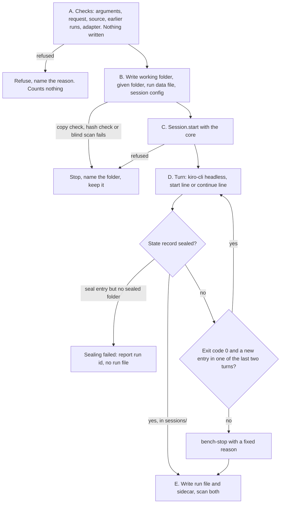

> **参考訳（日本語）** — 正本は英語版 [`.kiro/specs/build-from-spec/design.md`](../../../.kiro/specs/build-from-spec/design.md) です。内容が食い違う場合は英語版が優先されます。Kiro はこのファイルを読みません。
> 原文 SHA-256: `fdcab6b6147bfb74ca381312c26ff7309f1f74a0edad6ef9a858d849cc2ed68b`

# 設計: build-from-spec

要件 1-19 を対象とする。`lab-bench`（コア、フロントエンド F1-F12）と `dr-kiro` の上に築く。この設計を書く間に見つかった、要件と既存コードの 2 つの衝突は、解決方法とともに節 11 に記録している（要件の K25、K26）。Kiro の決定は末尾に挙げる。

## 概要

実行スクリプトは、実行ごとに 1 つの作業フォルダーを用意し、コアでその実行のベンチセッションを開始し、リーダーを Kiro CLI のヘッドレスで動かし（開始の行を 1 回、その後は固定の継続の行）、記録が封印されたら、その隣に実行情報ファイルを書く。確認コマンドは、コミット済みのファイルだけからすべての実行情報ファイルを再計算する。

作業の大部分は、すでにあるベンチのコードが行う:

| 必要なこと | 再利用するもの |
|---|---|
| 記録、そのエントリ、ブロブの検証 | `bench.record.chain.verify`, `blob_refs`, `sha256_hex`, `BLOB_DIR`, `LOG_NAME` |
| 元の最終仕様 | `bench.record.spec_copy.read_end`, `final_spec` |
| 発見された仕様の表の行 ID | `bench.specfiles.discovered.parse_table` |
| 試行番号 | `bench.core.ids.parse_trial_id` |
| セッション設定ファイル | `bench.frontend.config.load`（`bench-mcp` と `bench-stop` が読むのと同じファイル） |
| セッションの開始 | `bench.core.session.Session.start` |
| セッションの停止 | `bench.frontend.stop.main`（`bench-stop`） |
| ツールの説明 | `bench.frontend.describe.descriptions`、改訂の設定つき（節 3.14） |
| 作業フォルダーのフック | `bench.frontend.labhooks.install`（`bench-lab-hooks`） |
| 手法のステアリング | `bench/src/bench/drkiro/files/method.md`、パッケージデータとして読む |
| 開いたままのセッションがないこと | `bench.drkiro.session.open_sessions` |
| ブラインドスキャン | `bench.scan.scan.Scanner`（`from_config`, `scan_text`, `scan_record`, `scan_file`）と、`bench.scan.levels` のサイドカーのレベル源 |
| 閉じ込めのテスト | `bench/src/bench/frontend/hooks/confine.py` の `decide` |

新しいコードは小さく、ほとんどが純粋である: リクエストファイル、ラッピングアダプター、作業フォルダー、縮約記録コピー、頼る行、結果プログラム、ターンのループ、実行情報ファイル、確認。

## アーキテクチャ

### 2.1 構成

```
build-from-spec/                       own uv project (Req 1.2)
  pyproject.toml, uv.lock, README.md
  requests/stop-ahead.toml             committed before any run (unchanged by this spec); the request run
  requests/straight-ahead.toml         committed, not run (Decision 18)
  requests/turn-right.toml             committed, not run (Decision 18)
  src/build_from_spec/
    apps.py        the application table: wrapped adapter, scan sources, reader budget
    request.py     request file: parse, print, check (bfs-check-request)
    wrap.py        the wrapping adapter and its factory names
    files/         the reader's builder files and templates, copied byte for byte
      reader.json  reader-prompt.md  reader.md  requirements.md  design.md  tasks.md
    folder.py      the working folder: builder files, given folder, hashes, blind scan
    reduced.py     reduced record copy and its check
    relied.py      the relied-on line and the allowed ids
    judge.py       the result program
    turns.py       the start and continue loop
    runs.py        run ids, earlier runs of a request, consistency
    runfile.py     run data file, run file, author sidecar (bfs-run-file)
    run.py         bfs-run
    check.py       bfs-check-runs
  tests/
```

`build-from-spec/` は手法のテキストの写しを持たない（要件 1.1）。`folder.py` が、作業フォルダーを書くときにベンチパッケージから読む。

ビルダー側、git 無視（`bench-run/` は無視される）:

```
bench-run/build-from-spec/
  state/<run-id>/                bench state folder of the run (log, blobs, builder.log)
  <run-id>/                      the working folder (section 3.5)
  <run-id>.session.toml          session config, named by BENCH_SESSION_CONFIG
  <run-id>.run-data.json         run data file (Req 11.11)
  <run-id>.hook-log.jsonl        call log, named by BENCH_HOOK_LOG (Req 9.1)
  <run-id>.turn-<k>.log          Kiro CLI's stdout and stderr of turn k
```

コミットされるもの。それぞれ名前を指定して追加する（要件 13.3）:

```
sessions/build-from-spec/body-lab/<run-id>/                       sealed run record
sessions/build-from-spec/body-lab/<run-id>.run.json                run file
sessions/build-from-spec/body-lab/<run-id>.run.json.authors.json   its author sidecar (section 3.13)
```

記録のパスは、ベンチの既存の規則 `<sessions_dir>/<application>/<session-id>/`（`Session._seal`）から決まり、`sessions_dir = sessions/build-from-spec`、`application = body-lab` である（要件 13.1、K12）。

### 2.2 コマンド

すべてリポジトリのルートから `uv run --project build-from-spec <command>` で実行する。どれも、現在のフォルダーに `.git` がなければ開始を拒否するので、この設計のリポジトリのパスはすべてルートからの相対である。

| コマンド | すること | 要件 |
|---|---|---|
| `bfs-check-request <request file> --source <record path>` | 形式確認、`id` と `words` のビルダーレベルのブラインドスキャン、そして元の確認: 元の記録のカウントされる試行のうち、挙げられたすべての計測項目が合格範囲の中にあるものがない。`--source` は必須で、デフォルトはない。何も書かない。 | 2, 3.1-3.5 |
| `bfs-run --request <file> --setup <setup> --source <record> --seed <n> --run <n> --model <m> --effort <e>` | 確認し、準備し、ベンチセッションを開始し、ターンを実行し、実行情報ファイルを書く。 | 4-11, 13, 17 |
| `bfs-run-file <run-id>` | 封印済み実行記録の実行情報ファイルを書く。`bfs-run` は最後に同じ関数を呼ぶ。このコマンドは、封印後にスクリプトが中断された実行のためにある。 | 14, 16.2 |
| `bfs-check-runs` | すべての実行情報ファイルを、その記録とコミット済みのリクエストと照合し、1 つのリクエストの実行どうしを照合し、ノートブックが表示するものを導出する。 | 14.3, 14.6, 16, 18 |

`bench-mcp` は、Dr. Kiro の場合と同じく、Kiro CLI が `PATH` から起動する。ラッピングアダプターを import できなければならないので、ビルダーは `uv tool install --editable './bench[frontend]' --with-editable ./body-lab/adapter --with-editable ./build-from-spec --reinstall` でコマンドをインストールする（README）。

### 2.3 `bfs-run` の流れ



## コンポーネントとインターフェース

### 3.1 アプリケーション表（`apps.py`、要件 4.3、4.7、8.6）

```python
@dataclass(frozen=True)
class App:
    name: str           # the application name in records and request files
    adapter: str        # module:factory of the application's adapter
    scan_sources: str   # its scan_sources.toml, relative to the repository root
    budget: int         # the reader budget in trials

APPS = {"body-lab": App("body-lab", "body_lab.adapter:BodyAdapter", "body-lab/adapter/scan_sources.toml", 12)}
```

リーダーの予算を書く場所はここだけである。表を必要とするすべての関数は、それを引数として受け取る。コマンドは `APPS` を渡し、テストはフェイクアプリケーション（`bench.fake.adapter:FakeAdapter`、`bench/src/bench/fake/scan_sources.toml`）を入れた表を渡す。表にないアプリケーションは「no reader budget is decided for <application>」で拒否される（要件 4.7、8.6）。wind-tunnel は、その予算が決まったときに項目を得る（未決事項）。

### 3.2 リクエストファイル（`request.py`、要件 2、3）

```python
@dataclass(frozen=True)
class PassRange:
    measurement: str
    low: float
    high: float

@dataclass(frozen=True)
class Request:
    id: str
    application: str
    words: str
    passes: tuple[PassRange, ...]

class RequestError(Exception): ...          # file, where (field or line), problem

def parse_request(path: Path, apps) -> Request
def print_request(request: Request) -> str
def inside(value: float, p: PassRange) -> bool   # p.low <= value <= p.high (Req 2.3)
def source_trials_inside(request: Request, record: Path) -> list[str]   # ids of counted trials inside every pass range (Req 3.5)
def check_request(path: Path, source: Path, apps, stop_list: Path) -> list[str]   # bfs-check-request
```

`parse_request` は `tomllib` でファイルを読み、要件 2.2 の順序で、ファイルとフィールド（`id`、`words`、`pass[2].range` など）、または TOML エラー自身のテキストとその行を挙げて拒否する: TOML ではない。フィールドの欠け。最上位の余分なフィールド、または `[[pass]]` テーブルの余分なフィールド。`id` が `[a-z0-9-]+` でない、またはファイルの語幹と異なる。`application` が表にない。`words` が空、または空白だけ。`[[pass]]` がない。範囲の端が数でない（int は float として扱い、bool は拒否する）、または有限でない（TOML は `inf` と `nan` を許す）。`low` が `high` より厳密に小さくない。計測項目が 2 回挙げられている。計測項目が、そのアプリケーションのアダプターの宣言で種類 `scalar` でない（アダプターは `App.adapter` から作られ、宣言を尋ねられる。body-lab のスカラーは `x`、`y`、`heading`）。

`print_request` は `id`、`application`、`words` の順に書き、続いて範囲ごとに 1 つの `[[pass]]` テーブルを順に書く。文字列は `json.dumps(..., ensure_ascii=False)` で書く: JSON のエスケープはすべて有効な TOML の基本文字列のエスケープである。範囲の端は、読み戻して同じ float になる `repr` で書く。往復は値について成り立つ（要件 2.4）: 出力されたテキストが、コミット済みファイルのバイトと等しい必要はない。

`check_request` は、パースしてから、`Scanner.from_config([App.scan_sources], stop_list)` で `id` と `words` をビルダーレベルでスキャンする。各所見の行は、ファイルの中で `id =` または `words =` で始まる行である。各所見を `<file>:<line>: <kind>: <match>` として出力して終了コード 1 で終わるか、「no findings」を出力して終了コード 0 で終わる（要件 3.2、3.4）。下の元の確認を除いて、それ以外は何も判定しない（要件 3.3）。

`source_trials_inside(request, record)` は元の確認である（要件 3.5、Kiro の決定 K27）。記録を `verify(record, sealed=True)`（`bench.record.chain`）で検証し、`judge.py`（節 3.8）の `counted_trials(entries)` でカウントされる試行を取り、リクエストに挙げられたすべての計測項目が数であり、かつ `inside` が成り立つ試行の id を、ログの順に返す。未計測の値は、節 3.8 と同じく範囲外とする。挙げられた計測項目が試行にない場合は、節 3.8 と同じく、コマンドが失敗する。`check_request` は元のパスをデフォルトなしの引数として受け取り、リストが空でないときに失敗して、リクエストファイルと各試行の id を挙げる。検証に通らない元は、パスを挙げて失敗する（rules.md 2）。実行スクリプトは、その実行の元で `check_request` を呼ぶ（節 3.9、ステップ A2）ので、確認は実行が結び付く記録と同じ記録に対して行われる。

### 3.3 ラッピングアダプター（`wrap.py`、要件 8）

セッション設定は、アダプターを次のように指名する

```toml
adapter = "build_from_spec.wrap:reader/body-lab/stop-ahead/12"
```

`bench.frontend.config` は `build_from_spec.wrap` を import し、`getattr(module, "reader/body-lab/stop-ahead/12")` を呼ぶ。モジュールは `__getattr__(name)`（PEP 562）を定義する: `__` で始まらない名前に対して、その名前のファクトリを返し、ダンダー名は通常どおり `AttributeError` を送出する。ファクトリは、ベンチがすべてのアダプターファクトリを呼ぶのと同じく引数なしで呼ばれ、次のことを行う:

1. 名前を `/` で分割する。ちょうど 4 つの部分が必要で、最初は `reader`。そうでなければ、欠けているもの、つまりアプリケーション、リクエスト、予算を挙げて `WrapError` を送出する（要件 8.5）。
2. アプリケーションを `APPS` で調べる。なければ `WrapError`「no reader budget is decided for <application>」（要件 8.6）。
3. 予算の部分が `App.budget` の 10 進表記であることを要求する。そうでなければ両方を挙げて `WrapError`。
4. `build-from-spec/requests/<request-id>.toml` を、パッケージのソースの隣（`Path(__file__).parents[2] / "requests"`）から `parse_request` で読み、その `application` が名前のアプリケーションであることを要求する。
5. `App.adapter` から、ラップされるアダプターを作る。

```python
class ReaderAdapter:
    def __init__(self, wrapped, budget: int, words: str) -> None
    def declaration(self) -> Declaration    # dataclasses.replace(wrapped.declaration(), budget=budget, goal=words)
    def run_trial(self, inputs, seed)        # return self.wrapped.run_trial(inputs, seed)
```

- ノブ、計測項目、画像、`fake`、`measured_by` は、ラップされる宣言のものがそのまま使われる（要件 8.1）。アプリケーションの名前は `Declaration` の一部ではない。それはセッション設定の `application` で、実行スクリプトがリクエストのアプリケーションに設定し、実行情報ファイルの確認は、それを記録の開始エントリと比べる。
- `run_trial` は同じ入力とシードを渡し、結果をそのまま返す。何も捕捉しないので、送出されたエラーや `TrialFailure` は、ラップされるアダプターからのものと同じくベンチに届く（要件 8.2）。
- 任意のメソッド `builder_versions` と `check_inputs`（`bench.adapter`）は、ラップされるアダプターがそれらを持つ場合に限り、そのバインドメソッドとしてインスタンスに設定される。body-lab は `builder_versions` を持つので、MuJoCo のバージョンは引き続き `builder.log` だけに行く。
- `bench-mcp` は、この宣言とセッション設定の `discovered_table` の設定だけからツールの説明を組み立てる（`describe.descriptions`、節 3.14、要件 8.3、12.9）。すべての実行でその設定は `"not-required"` なので、テキストは 1 つのリクエストの 3 つのセットアップで同じである。ゴールと `request.md` はどちらもリクエストの `words` で、バイト単位で同一である（要件 8.4）。
- `bench-mcp` は、Kiro CLI がそれを起動するたびにリクエストファイルを読み直す。`Session.open` は宣言を開始エントリと比べるので、実行中に変更されたリクエストファイルでセッションを再び開くことはできない: ターンは失敗し、実行は停止される（節 3.10）。

### 3.4 リーダーのファイル（`files/`、要件 9）

**`reader.json`** は `dr-kiro.json` の 3 つのフィールドを変えたものである: `name` を `reader`、1 行の `description`、`prompt` を `file://./reader-prompt.md`。`resources`、`mcpServers`（環境から `BENCH_SESSION_CONFIG` を受けて `bench-mcp` を実行する `bench` の項目）、`tools`（`read`、`write`、`@bench`）、`includeMcpJson`、`includePowers`、`permissions` は同じである。シェルはない（要件 9.1）。テストは、その 3 つのフィールドを取り除いた 2 つのファイルを JSON として比べる。

**`reader-prompt.md`** は約 8 行: あなたはリーダーである。あなたは、ベンチツールが説明するものと `given/` にあるもの以外、何も知らないシステムについての 1 つのリクエストに答える。リクエストは `request.md` にあり、ベンチツールではゴールである。あなたは単独で働き、ユーザーに何も尋ねず、答えを待たない。`end_session` が成功するか、ベンチがセッションの終了を報告するまで続ける。ステアリングに従う。

**`method.md`** は `files/` にない。`folder.py` は、ベンチパッケージのファイル `bench/drkiro/files/method.md` をバイト単位でコピーする。テストは、作業フォルダーのコピーの SHA-256 をそのファイルと比べる（要件 9.3）。Dr. Kiro の `workflow.md` はコピーしない。`method.md` は仕様ファイルの場所として `.kiro/specs/lab/` を挙げるので、リーダーの仕様ファイルもそこにある。

**`reader.md`**（ステアリング、`inclusion: always`）、短い節:

- **持っているもの。** `request.md` がリクエストを持つ。`given/` がシステムについての資料を持つ。何もないこともある。最初の仮説の前に、そのすべてを読む。
- **H1 が頼るものを挙げる。** H1 の `prediction` ブロックの内側の最初の行は `# relies on: <ids>` である: `given/` に現れるとおりの、頼るものの ID（`R<n>` のような規則の行、`H<n>` のような仮説、`E<n>` のような実験）をカンマで区切ったもの。または `# relies on: none`。最初の実験の前に H1 を登録する。この行は H1 とともに凍結される。
- **実験。** すべての実験は `PHASE = "best"` を設定する。
- **あなたの答え。** あなたの最後の試行があなたの答えである。その計測値がリクエストに対して判定される。
- **終了。** 最後の試行が終わり、すべての実験に判定があるとき、`end_session` を呼ぶ。終了に何が必要かは `end_session` ツールの説明が述べる。それが唯一の出所であり、`reader.md` はそれを繰り返さない。
- 手法の仮説の形式での H1 の例を 1 つ。頼る行を含み、すべての値の代わりに山括弧のプレースホルダーを使う（`rules.md`、Honest）。

このテキストはすべてのセットアップで同じなので（要件 4.2）、すべての種類の ID を挙げ、実行がどのセットアップかは述べない。

**テンプレート**（`.kiro/specs/lab/` にコピーされる）。仮説なし、実験なし、数なし、表なし（要件 9.4）:

```
requirements.md   # Requirements / ## Hypotheses
design.md         # Design / ## Notes
tasks.md          # Tasks / - [ ] Read what is given / - [ ] Answer the request
```

**開始の行** `Begin the session.` と **継続の行** `Continue the session.` は、Dr. Kiro のものと同じで、`build-from-spec/README.md` に書かれ、`turns.py` に定数として置かれる（要件 9.6）。

### 3.5 作業フォルダー（`folder.py`、要件 4、7）

```python
def builder_files(request: Request) -> dict[str, bytes]      # every file outside given/, hooks excluded
def given_files(setup: str, source: Path) -> GivenFiles       # files under given/, and the removed entries
def write_folder(folder: Path, request: Request, given: GivenFiles) -> None
def file_hashes(folder: Path) -> dict[str, str]               # relative POSIX path -> SHA-256, outside given/
def tool_hashes(adapter) -> dict[str, str]                    # tool name -> SHA-256 of descriptions(decl, "not-required")
def scan_folder(scanner: Scanner, folder: Path) -> list[Finding]
```

`write_folder` の後の内容（要件 7.2）:

```
<run-id>/
  .kiro/agents/reader.json, reader-prompt.md
  .kiro/steering/method.md, reader.md
  .kiro/hooks/confine.py, calllog.py, confine-pre-tool.json, calllog-pre-tool.json, calllog-post-tool.json
  .kiro/specs/lab/requirements.md, design.md, tasks.md
  request.md                      the request words, exactly (no newline added)
  experiments/                    empty
  given/                          spec: requirements.md, design.md, tasks.md
                                  record: record/log.jsonl, record/blobs/<sha256>
                                  none: empty (Req 4.5)
```

- `write_folder` は既存のフォルダーを拒否する（`exist_ok` なしの `mkdir`）。フックは `labhooks.install(folder)` が書くので、ベンチ自身のバイトであり、閉じ込めフックはこのフォルダーに閉じ込める（フックは、自分より 2 階層上のフォルダーを取る）。
- セットアップ `spec`: `final_spec(source).files` の 3 つのファイルを、バイト単位で（要件 5.3）。セットアップ `record`: 縮約記録コピー（節 3.6）。
- `given/` の外のものは、セットアップ、実行番号、元に依存しない: `builder_files` はリクエストだけを取る。セッション設定は `BENCH_SESSION_CONFIG` を通して、呼び出しログは `BENCH_HOOK_LOG` を通して到達する（要件 7.7）。
- `file_hashes` は `given/` の外のすべてのファイルを対象とする。`tool_hashes` は `bench-mcp` が登録する 4 つのテキストを対象とし、同じ宣言と同じ `discovered_table` の値（`"not-required"`、節 4.2）から、同じ関数で組み立てる（要件 7.3）。
- `scan_folder` は要件 7.6 のレベルを自分で適用する: `given/record/` は `scanner.scan_record`（各テキストを記録された作者で）、渡す 3 つの仕様ファイルは Dr. Kiro レベル、その他すべてのファイルはビルダーレベル。作業フォルダーはどの `scan_sources.toml` のラボでもないので、スキャンのラボの glob ではこれらのレベルを与えられない。ツールのテキストも、（`bench-mcp` が開始時に行うのと同じく）ビルダーレベルでスキャンする。

### 3.6 縮約記録コピー（`reduced.py`、要件 6）

```python
@dataclass(frozen=True)
class Removed:
    seq: int
    hash: str

def reduce(source: Path, target: Path) -> tuple[Removed, ...]
def check_reduced(copy: Path, source: Path) -> list[str]    # empty: the copy matches
```

`reduce`:

1. `entries = verify(source, sealed=True)`。ログの行は、そのバイトを `\n` で分割したもの（最後の空の断片は捨てる）で、エントリごとに 1 行。
2. 残すもの: エントリの種類が `snapshot` でないすべての行を、順に、バイト単位で。取り除くもの: 各スナップショットエントリの `seq` と `hash` を、ログの順に（要件 6.4）。
3. 残すブロブ: 残すエントリが参照するすべてのブロブ（`blob_refs`）。封印済みの記録は参照されるブロブだけを持つので、これは取り除かれるエントリだけが参照するわけではないブロブとちょうど一致する（要件 6.1）。凍結された仮説のテキスト、実験ファイル、画像は、`register`、`experiment`、`trial` のエントリが参照するので、残る（要件 6.2）。
4. `target/log.jsonl` と `target/blobs/<sha256>` を、元と同じ名前で書く。

`check_reduced` は、元から同じ方法で期待される行とブロブの集合を導出し、行またはブロブを挙げて、次を報告する: 元の行と異なる残した行。欠けた行または加えられた行（取り除かれた非スナップショットの行、残されたスナップショットの行）。欠けた、余分な、またはバイトが異なるブロブ。その他のファイル（要件 6.3）。コピーのハッシュチェーンは、シーケンス番号に欠番があるため検証を通らない（K10）。この確認が存在する理由である。

### 3.7 頼る行（`relied.py`、要件 10）

```python
PREFIX = "# relies on: "
PROBLEMS = ("no-h1", "no-line", "bad-syntax", "unknown-id", "late")

@dataclass(frozen=True)
class Relied:
    ids: tuple[str, ...] | None    # as found; None when there is no line or it cannot be read
    problem: str | None            # None: the line is valid

def relied_line(frozen: str) -> str | None
def parse_ids(line: str) -> tuple[str, ...] | None          # None: bad syntax
def format_ids(ids: tuple[str, ...]) -> str
def allowed_ids(setup: str, source: Path) -> frozenset[str]
def relied_on(entries, frozen_h1: str | None, allowed: frozenset[str]) -> Relied
```

- `relied_line`: 凍結部分は H1 の見出し、記述、予測ブロックである（`bench.specfiles.hypotheses`）。ベンチは見出しの後の最初のフェンスを予測ブロックとして取るので、候補は、見出しの後で 3 つのバッククォートまたはチルダで始まる最初の行の、すぐ次の行である。`# relies on` で始まる候補が頼る行である。それ以外の候補は、行がないことを意味する。
- `parse_ids`: 行は `PREFIX` の後に `none` が続くか、`[^,\s]+` に一致する 1 つ以上の ID が、カンマとその後の任意の空白で区切られて続き、最後の ID の後に何もないものでなければならない。ID は互いに異なり、`none` は他の ID と並べられない（要件 10.1）。大文字と小文字を区別する。
- `allowed_ids` は、元の記録だけから取り、作業フォルダーからは決して取らない（要件 10.5、K16）:
  - `spec`: `none` と、最終仕様の `design.md` に対する `parse_table` の行 ID。パースできない表はコマンドを失敗させる（元は表の確認のもとで終了したので、これは壊れた元を意味する）。
  - `record`: `none`、元の非スナップショットエントリ（縮約コピーのエントリ）の中の `register` エントリのすべての `H<n>`、および `experiment` エントリのすべての `E<n>`。
  - `none`: `none` だけ（要件 10.2）。
- `relied_on` は、最初に一致したものを返す: `no-h1`（`H1` の `register` エントリがない）、`no-line`、`bad-syntax`、`unknown-id`（`allowed` にない ID。`ids` は見つかったものを保つ）、`late`（`experiment` エントリが H1 の `register` エントリより小さい `seq` を持つ、要件 10.3、10.4）。そうでなければ行は有効である。どの問題も結果を `not-counted` にする（要件 15.2）。

ベンチの変更はない: この行は TOML のコメントで、予測のパーサーは無視し、凍結部分は保つ。

### 3.8 結果プログラム（`judge.py`、要件 15）

```python
@dataclass(frozen=True)
class Judgement:
    end: str                          # "ended" | "stopped", from the seal entry
    relied: Relied
    result: str                       # "pass" | "fail" | "no-trial" | "not-counted"
    first_in_range: str | None        # trial id; None is the no-in-range marker
    last_trial: str | None            # trial id of the last counted trial
    last_phase: str | None            # PHASE of its experiment
    last_values: dict[str, float | str]   # each named measurement; a not-measured outcome by its name

def counted_trials(entries) -> list[dict]
def judge(entries, frozen_h1: str | None, request: Request, allowed: frozenset[str]) -> Judgement
def judge_record(record: Path, request: Request, allowed: frozenset[str]) -> Judgement   # reads, then judge
```

- **カウントされる試行**（要件 15.9）: その実験に、`"for": "experiment"` で同じ実験 ID を持つ `snapshot` エントリもある `trial` エントリ。`Session._run_trials` は、実行の呼び出しが `Ran` を返したときだけそのスナップショットを書く。ベンチ障害が実行を途中で止めたときは、実行された試行は記録されるが、呼び出しの結果はベンチ障害なので、カウントされない。拒否された呼び出しは `trial` エントリを書かない。
- **最後の試行**: 最も大きい番号を持つカウントされる試行（`parse_trial_id`）。
- **範囲内**: すべての合格範囲について、その試行の計測値が数（`{"not_measured": ...}` オブジェクトではない）であり、`inside` が成り立つ。未計測の値、body-lab では `lost` は範囲外である（要件 15.4）。試行エントリに、挙げられた計測項目がないときはコマンドを失敗させる: ベンチはそのような試行を決して記録しない（`check_result`）。
- **結果**、この順序で: `relied.problem` が設定されていれば `not-counted`。カウントされる試行がなければ `no-trial`。最後の試行が範囲内なら `pass`。それ以外は `fail`（要件 15.2-15.4、15.8）。最後の試行のフェーズは関与せず（要件 15.10）、終わり方も関与しない（要件 15.6）。
- **最初の範囲内**: 範囲内にある、最も小さい番号のカウントされる試行、または `None`（要件 15.5）。結果は決して変えない。

`judge` は、エントリ、H1 の凍結テキスト、リクエストの純粋関数である。`judge_record` は封印済みの記録を検証し、H1 の凍結ブロブを読む。許される ID は元から取る（節 3.7）ので、結果は実行記録、コミット済みのリクエスト、元の記録だけに依存する（要件 15.1）。

### 3.9 実行スクリプト（`run.py`、要件 4、5、7、11、17）

引数はすべて必須で、既定値を持つものはない（要件 11.1）: `--request`、`--setup`、`--source`、`--seed`、`--run`、`--model`、`--effort`。文字列として読み、拒否が引数と値を挙げるように検証する: `setup` は `spec`、`none`、`record` のいずれか。`seed` は整数。`run` は 1 以上の整数。`model` と `effort` は空でない（要件 11.8）。実行 ID: `<request-id>-<setup>-<n>`。

**A. 確認。何も書かない**（要件 5.7、K14）。順に、各拒否は失敗したものを挙げる:

1. リクエストファイルが追跡されていて（`git ls-files --error-unmatch`）、`HEAD` と、ステージの有無にかかわらず等しい（`git diff --quiet HEAD -- <file>`）（要件 11.2）。その最後に変更したコミットは `git log -1 --format=%H -- <file>`。その SHA-256 はファイルから取る（要件 11.3）。
2. `parse_request` と、その実行の元での節 3.2 のリクエストの確認（要件 11.4、3.5）。
3. アプリケーションが `APPS` にある（要件 4.7）。
4. 元: フォルダーで、`sessions/build-from-spec/` の中にない（要件 5.5）。`read_end` がそれを検証し、その終わり方、アプリケーション、最終仕様を与える。`ended` で、最終仕様を持ち、リクエストのアプリケーションのものでなければならない（要件 5.2）。その封印ハッシュは最後のエントリのハッシュである。
5. この実行 ID の作業フォルダー、実行記録、実行情報ファイルがない（要件 7.1）。
6. リクエストの以前の実行（節 3.12）: リクエストのすべての実行記録が実行情報ファイルを持つ（要件 7.8）。そして以前のすべての実行情報ファイルが、同じシード（要件 4.6）、元セッションと封印ハッシュ（要件 5.6）、リクエストの SHA-256 とコミット（要件 17.5）、Kiro CLI のバージョン、モデル、エフォート（決定 B5）を持つ。違いは両方の値を挙げる。
7. `bench-run/build-from-spec/state/` にセッションが開いていない（`open_sessions`）。
8. ファクトリ名を通して作られたリーダーのアダプター（節 3.3）と、そのツールのテキスト。
9. `kiro-cli --version`、記録される。

**B. 準備。** ここでの失敗は作業フォルダーを挙げ、それをそのまま残す。同じ実行番号は、ユーザーがそれを削除した後にだけ再び使う（要件 11.10）。

1. `write_folder`（節 3.5）。
2. セットアップ `record`: `check_reduced`。問題があれば実行を停止し、行またはブロブを挙げる（要件 6.6）。
3. `file_hashes` と `tool_hashes` を、リクエストの以前のすべての実行情報ファイルと比べる。違いがあれば実行を停止し、ファイルまたはツールを挙げる（要件 7.4）。比較は、ハッシュが書かれたとおりのファイルのものになるよう、書いた後にここで行う。
4. `scan_folder` とツールのテキスト。所見があれば実行を停止し、ファイルと行を挙げる（要件 7.5）。
5. 実行データファイル（節 4.3、要件 11.11）。
6. セッション設定（節 4.2、要件 11.5）、`resume = true`。

**C. 開始。** `bench.frontend.config.load(<config>)`、続いて `Session.start(cfg.session)`、続いて `close()`。`bench-new-session` と同じである。拒否はリーダーが始まる前に実行を停止する（要件 11.7）。`resume = true` は、`bench-mcp` の以降のすべての起動がこのセッションを再び開くことを意味する（決定 B11）。ここから実行はカウントされる（要件 17.4）。

**D. ターン**（節 3.10）。Kiro CLI は、作業フォルダーを作業ディレクトリとし、標準入力を閉じ、標準出力とエラーを `<run-id>.turn-<k>.log` に書き、スクリプトの環境に、絶対パスの `BENCH_SESSION_CONFIG` と `BENCH_HOOK_LOG` を加えて実行する。ヘッドレスの Kiro CLI が必要とする `KIRO_API_KEY`（`bench/README.md`）は、ビルダーの環境に留まり、ファイルには決して書かれない。

**E. 終了。**

- 状態記録が封印で終わり、`sessions/build-from-spec/<application>/<run-id>/` が存在する: 実行情報ファイルを書く（節 3.11）。
- 状態記録が封印で終わるが、封印済みフォルダーが存在しない: 封印が失敗した。おそらくそのブラインドスキャンで（`Session._seal_failed`）。スクリプトは実行 ID と状態フォルダーの `builder.log` を報告し、実行情報ファイルを書かず、停止する（要件 13.5）。
- ターンの規則が実行を停止する（節 3.10）: `bench.frontend.stop.main([<config>, "--reason", <reason>])`、続いて実行情報ファイル。`bench-stop` が失敗した場合（たとえば、終了しなかった `bench-mcp` によって状態フォルダーがまだロックされている）、スクリプトはそのメッセージを出力して停止する。ユーザーが決める（要件 11.9、13.6）。

### 3.10 ターン（`turns.py`、要件 9.6、11.6）

1 ターンは 1 つの Kiro CLI のプロセスである。コマンドは、固定された 2 つの引数を除いて固定:

```
kiro-cli chat --v3 --no-interactive --require-mcp-startup --trust-workspace --trust-tools= \
              --agent reader --model <model> --effort <effort> [--resume] "<line>"
```

最初のターンは `--resume` なしで開始の行を送る。以降のターンは、作業フォルダーの最新の会話を再開する `--resume` つきで継続の行を送る。フォルダーは実行ごとに新しいので、それは実行自身の会話である。

```python
@dataclass(frozen=True)
class Prompt:
    kind: str            # "start" | "continue"
    sha256: str          # of the line sent
    time: str            # UTC, "%Y-%m-%dT%H:%M:%SZ", when the turn started
    exit: int            # Kiro CLI's exit code
    entries_before: int  # entries in the state record before the turn
    entries_after: int   # and after it

@dataclass(frozen=True)
class TurnsEnd:
    sealed: bool
    stop_reason: str | None
    prompts: tuple[Prompt, ...]

def run_turns(launch: Callable[[str], int], entries: Callable[[], tuple[int, bool]],
              save: Callable[[tuple[Prompt, ...]], None]) -> TurnsEnd
```

`launch(kind)` は 1 ターンを実行して終了コードを返す。`entries()` は `verify(<state>/<run-id>, sealed=False)` で状態記録を読み、エントリ数と最後のエントリが封印かどうかを返す。`save` は各ターンの後に実行データファイルを書き直す。ループは、各ターンの後に:

1. 封印された: 終了コードにかかわらず、終わり。
2. 終了コードが 0 でない: 停止し、理由は「the reader's Kiro CLI exited with code <n>」。
3. このターンにも、その前のターンにも新しいエントリがない: 停止し、理由は「the reader called no bench tool in two turns in a row」。
4. そうでなければ継続の行を送る。

セッションが開いている間のベンチの呼び出しは、拒否も含めてすべてエントリを加えるので、「新しいエントリがない」は、リーダーがそのターンにベンチツールを呼ばなかったことを意味する。規則 3 は上限ではない: ベンチを呼び続けるリーダーは、必要なだけ継続の行を得る（決定 15）。それが止めるのは、継続の行 1 つがすでに何も変えなかったリーダーだけである（決定 B3）。停止の理由は、禁止された用語を含まないベンチの言葉であり、`bench-stop` がそれを記録に封印する。

### 3.11 実行情報ファイル（`runfile.py`、要件 14、16.2）

`write_run_file(run_id, apps, stop_list)`。コマンド `bfs-run-file <run-id>` でもある:

1. 実行情報ファイルが存在すれば拒否する（要件 14.5）。
2. 実行データファイルを読み、封印済みの実行記録を検証し（`verify(sealed=True)`）、その封印ハッシュと終わり方を読む。
3. 元の記録と、記録されたコミットでのリクエスト（`git show <commit>:<request file>`）を読み、元の封印ハッシュとリクエストの SHA-256 が記録されたものであることを要求する。
4. `allowed_ids`、`judge_record`。
5. 実行情報ファイル（節 4.4）とそのサイドカー（節 3.13）を組み立て、同じフォルダーの一時的な名前で両方を書き、実行記録（`scan_record`）と一時的な実行情報ファイル（サイドカーを読む `scan_file`）をスキャンし、所見がないときだけ両方の名前を変更する。所見があれば 2 つの一時ファイルを削除し、実行記録は変えず、ファイルと行を出力して停止する（要件 16.2、16.4）。

### 3.12 以前の実行と確認（`runs.py`、`check.py`、要件 14.3、14.6、18）

実行 ID は `^(?P<request>[a-z0-9-]+)-(?P<setup>spec|none|record)-(?P<n>[1-9][0-9]*)$` で読む。セットアップと番号は末尾から照合するので、リクエスト ID は曖昧にならない。「同じリクエストの実行」とは、`sessions/build-from-spec/<application>/` の実行記録と実行情報ファイルのうち、実行 ID がそのリクエスト ID を持つものである。

`bfs-check-runs` は、`sessions/build-from-spec/`、記録されたコミットでの `build-from-spec/requests/`、実行情報ファイルが挙げる元の記録だけを読む（要件 14.3「コミット済みのファイルだけ」、18.1）。各アプリケーションのフォルダーについて:

1. すべての実行記録が実行情報ファイルを持ち、すべての実行情報ファイルが実行記録を持つ。
2. 各実行情報ファイルについて: 実行記録が検証を通り、その封印ハッシュが記録されたものである。その開始エントリが、セッションとして実行 ID、リクエストのアプリケーション、記録されたシードを持つ。元の記録が、記録された封印で検証を通る。記録されたコミットでのリクエストが記録された SHA-256 を持ち、そのコミットが実行より前にリクエストファイルを変更した最後のコミットである（`git log -1 --format=%H <C> -- <request file>`。`C` は実行情報ファイルを加えたコミット、またはまだコミットされていない間は `HEAD`）。セットアップ `spec`: 渡された仕様のハッシュが `final_spec` のものと等しい。セットアップ `record`: 取り除かれたエントリが、元から `reduce` が導出するものと等しい。頼る ID、結果、最初の範囲内の試行、最後の試行とそのフェーズ、終わり方が、新しい `judge` と等しい。プロンプトは 1 つの `start` で始まり、`continue` だけが続き、そのハッシュは 2 つの固定の行のものであり、`continue_lines` は `continue` のプロンプトの数であり、各ターンの `entries_before` は前のターンの `entries_after` であり（最初は 1、開始エントリ）、記録は最後の `entries_after` 個のエントリを持つ（`bench-stop` が封印した場合は 1 つ多い）。
3. 1 つのリクエストの実行情報ファイル: 同じシード、元の封印ハッシュ、リクエストの SHA-256 とコミット、ファイルのハッシュ、ツールのハッシュ、Kiro CLI のバージョン、モデル、エフォート（要件 14.6）。違いは両方の実行情報ファイルとフィールドを挙げる。
4. 各実行について、要件 18.1 の項目: 記録されたコミットでのリクエストの言葉と合格範囲、セットアップ、頼る ID、最後の試行の計測値（記録から）、結果、最初の範囲内の試行、終わり方、他のセットアップでの同じリクエストの実行 ID。導出できない項目は、実行 ID と項目を挙げて失敗する。

実行ごとに 1 行を出力し、問題があれば実行情報ファイルとフィールドを挙げて終了コード 1 で終わる。手順 4 を導出する関数（`derive_run`）は、`lab-notebook` のビルドが呼べるものである。

### 3.13 実行情報ファイルのブラインドスキャンのレベル（要件 14.4、16）

実行情報ファイルは、`bench.scan.levels.sidecar_pieces` の既存の形式（`{"ranges": [{"start", "end", "author"}]}`、ファイルを順に覆う文字オフセット）で、作者サイドカー `<run-id>.run.json.authors.json` を得る。頼る ID の JSON 文字列トークンは、引用符を含めて `dr-kiro` である: それらは H1 からコピーされたリーダーのテキストである。それ以外はすべて `bench` である。書き手は、各 ID の代わりに一意なプレースホルダーを入れて実行情報ファイルをシリアライズし、プレースホルダーでテキストを分割して範囲を得て、JSON エンコードした ID を元に戻す。

- `bfs-run-file` は、実行情報ファイルを書くときにそれをスキャンする（節 3.11）。
- `sessions/` または `sessions/build-from-spec/` に対する `bench-scan` は、すでに両方を扱う: `log.jsonl` を持つフォルダーは記録としてスキャンされ、`.run.json` ファイルはそのサイドカーを通して、サイドカーはそれ自身のファイルとしては飛ばされる（`Scanner._scan_path`）。公開はそのスキャンを実行する（要件 16.3）。
- サイドカーのない実行情報ファイルは、ファイルを挙げて「no level source」（`sidecar_pieces`）でスキャンに失敗する（要件 16.5）。
- 実行情報ファイルはパスを持たない: リクエストファイルと元の記録は ID で指名され、パスは導出される（`build-from-spec/requests/<id>.toml`、`sessions/<application>/<session>`）。

### 3.14 lab-bench の改訂（要件 12、13.7）

2 つの小さな改訂を、後で main のフォルダーで 1 つの `lab-bench` タスクとして、それぞれ独自のテストとともに行う: 表なしの終了（要件 12、K21、K26）と、実行記録を飛ばす `bench-check-discovered`（要件 13.7、K25）。

#### 3.14.1 表なしの終了（要件 12）

変更のすべて:

| 場所 | 変更 |
|---|---|
| `SessionConfig`（`core/session.py`） | 新しいフィールド `discovered_table: str`、既定値なし。 |
| `Session._check_config` | `"required"` または `"not-required"` でなければ拒否: 「cannot start: discovered_table must be required or not-required」（要件 12.6）。 |
| `frontend/config.py` | `FIELDS` はすでに `SessionConfig` に従うので、欠けたフィールドは名前を挙げて拒否される。`load` は文字列であることを確認して渡す。 |
| 開始エントリ | `"discovered_table": config.discovered_table`（要件 12.7）。`Session.open` は `seed` と同じようにそれを設定と比べる。 |
| `Session._end` | 1 つの分岐: `check_table` のブロックは、値が `"required"` のときだけ実行される。判定の関門、3 つのファイルの 1 回の読み取り、`"for": "end"` のスナップショット、`ended` としての封印はそのまま（要件 12.2、12.3）。 |
| `frontend/describe.py` | `descriptions` は設定を取る。`"not-required"` のとき、`end_session` のテキストは表の節を省く（下記、要件 12.9）。 |
| `frontend/server.py` | `BenchServer` は `descriptions(session.declaration, session.config.discovered_table)` を呼ぶ。唯一の呼び出し元である。 |
| `bench-new-session`（`drkiro/session.py`） | `discovered_table = "required"` を渡して書く（要件 12.4）。 |
| テストとドキュメント | `tests/labkit.py` とテストのすべての設定が `"required"` を明記する。`bench/README.md` のサンプル `session.toml` にその行が加わる。 |

- 改訂より前に封印された記録は、開始エントリに `discovered_table` を持たない。`bench-verify` と `final_spec` はそれを読まないので、有効なままである（要件 12.8）: テストは両方を body-1、body-2、wt-004 に対して実行する。
- `Session.open` はそのキーのない記録を拒否するので、改訂より前に開始された開いたセッションは、再び開けない。改訂をマージするとき、開いているセッションがあってはならない。現在は 1 つもない。
- `bench-run/` の設定は git 無視で、すべて封印済みのセッションのものである。編集しない。開いたセッションのためにまた必要になれば、その行は手で加える。
- 新しいテスト: `"not-required"` で、表のない `end` は、`final_spec` が読む終了スナップショットとともに `ended` として封印される。未決の判定があればなお拒否する。欠けた値または未知の値は、開始時に設定を挙げて拒否される。開始エントリが値を持つ。

**`frontend/describe.py`。** 現在、`end_session` のテキストは 1 つの文字列である:

```python
"End the session. Every experiment needs a verdict, and your design.md must end with a "
"Discovered spec table that agrees with the record."
```

改訂の後:

```python
END_BASE = "End the session. Every experiment needs a verdict"
END_TABLE = ", and your design.md must end with a Discovered spec table that agrees with the record"

def descriptions(decl: Declaration, discovered_table: str) -> dict[str, str]:
    if discovered_table not in ("required", "not-required"):
        raise ValueError(f"discovered_table must be required or not-required, not {discovered_table!r}")
    ...
    "end_session": END_BASE + (END_TABLE if discovered_table == "required" else "") + ".",
```

- `"required"` は現在のテキストをバイト単位で与えるので、Dr. Kiro のツールのテキストは変わらない（要件 12.9）。
- `"not-required"` は `End the session. Every experiment needs a verdict.` を与える。落とされる部分は、まさに節 `, and your design.md must end with a Discovered spec table that agrees with the record` である。
- 他の 3 つのテキストは設定に依存しない。設定は既定値を持たない。未知の値は送出される（ベンチは開始時にすでに拒否しているので、これは別の呼び出し元への備えだけである）。
- テキストは宣言と設定だけに依存するので、リクエストの 3 つのセットアップでバイト単位で同一である（要件 4.2、12.9）。

テスト（`bench/tests/frontend/test_describe.py`、`test_server.py`）: `"required"` では `end_session` が上の現在のリテラルと等しい。`"not-required"` では `End the session. Every experiment needs a verdict.` と等しい。両方の値で他の 3 つのテキストが互いに等しい。未知の値は設定を挙げて送出される。`"not-required"` の設定で開始したサーバーは短い `end_session` のテキストを列挙し、`"required"` では現在のものを列挙する。

#### 3.14.2 実行記録を飛ばす `bench-check-discovered`（要件 13.7）

`record/spec_copy.py` の `_records` は現在、`sessions/<x>/` の下のすべてのフォルダーをセッション記録として読み、`log.jsonl` のないフォルダーで送出する。`sessions/build-from-spec/body-lab/` は実行記録と実行情報ファイルを持つので、`bench-check-discovered sessions discovered` は失敗するか、さらに深く読めば、`discovered/` にリーダーの実行の写しを求める。変更:

```python
RUN_RECORDS = "build-from-spec"   # sessions/build-from-spec/ holds reader run records (build-from-spec Req 13.7)

def _records(sessions: Path) -> list[Path]:
    """Every Dr. Kiro session record folder under `<sessions>/<application>/`; `<sessions>/build-from-spec/` is skipped."""
    for application in sorted(p for p in Path(sessions).iterdir() if p.is_dir() and p.name != RUN_RECORDS):
        ...  # unchanged
```

- `check_copies` は、`<sessions>/build-from-spec/` が存在するとき、報告の行を 1 つ加える: `build-from-spec: reader run records, no copies`。飛ばすことは、黙ってではなく、見える形で行われる。
- 他は何も変わらない: 他の場所の `log.jsonl` のないフォルダーはなお失敗し、フォルダー `discovered/build-from-spec/` はなお「no sealed session record has this name」と報告される。
- 実行記録は、なお `bench-verify`、`sessions/` のブラインドスキャン、`bfs-check-runs` の対象である。
- 同時に、ビルダーは `dr-kiro` 要件 8.4 の文言を「`ended` として終了スナップショットとともに封印されたすべての Dr. Kiro のセッション記録」に改め、`sessions/build-from-spec/` のリーダーの実行記録を対象外と明記する（要件 13.7）。

テスト（`bench/tests/unit/test_spec_copy.py`）: リポジトリの sessions を一時フォルダーにコピーし、終了スナップショットつきで ended となった封印済みフェイク記録を持つ `sessions/build-from-spec/body-lab/<run-id>/` と、その隣の `<run-id>.run.json` を加える: `check_copies` は問題を報告せず、飛ばした行を列挙する。`discovered/build-from-spec/<run-id>/` を加えると問題として報告される。他のアプリケーションのフォルダーの下の `log.jsonl` のないフォルダーは、なお送出される。

## データモデル

### 4.1 リクエストファイル

`build-from-spec/requests/` にコミットされているとおり（要件の付録 A）: `id`、`application`、`words`、そして `measurement` と `range = [<low>, <high>]` を持つ 1 つ以上の `[[pass]]` テーブル。

### 4.2 セッション設定

`bench-run/build-from-spec/<run-id>.session.toml`。ベンチの形式に、改訂のフィールドを加えたもの。パスはファイルからの相対（`bench.frontend.config`）。

```toml
session_id = "<run-id>"
application = "body-lab"
adapter = "build_from_spec.wrap:reader/body-lab/<request-id>/<budget>"
lab_dir = "<run-id>"
spec_files = [".kiro/specs/lab/requirements.md", ".kiro/specs/lab/design.md", ".kiro/specs/lab/tasks.md"]
experiments_dir = "experiments"
state_dir = "state"
sessions_dir = "../../sessions/build-from-spec"
seed = <seed>
scan_sources = ["../../body-lab/adapter/scan_sources.toml"]
stop_list = "../../.kiro/blind-scan/stop-list.txt"
discovered_table = "not-required"
resume = true
```

実行スクリプトは、`sessions/build-from-spec/` が存在しなければ作る。アプリケーションのフォルダーは、封印するときにベンチが作る。

### 4.3 実行データファイル

`bench-run/build-from-spec/<run-id>.run-data.json`。手順 B5 で書かれ、各ターンの後に書き直される。`indent=2`、キーをソート、末尾に改行の JSON。フィールド: `format`（`1`）、`run`、`setup`、`request`（`id`、`commit`、`sha256`）、`source`（`application`、`session`、`seal`）、`seed`、`adapter`（ファクトリ名）、`kiro`（`version`、`model`、`effort`）、`files`、`tools`、`given`、`prompts`。フィールドの意味は節 4.4 のとおり。

### 4.4 実行情報ファイル

`sessions/build-from-spec/<application>/<run-id>.run.json`。同じシリアライズ。`adapter` を除く実行データのフィールドに、封印の後に導出されるものを加える。プレースホルダーは山括弧（`rules.md`、Honest）:

```json
{
  "format": 1,
  "run": "<request-id>-<setup>-<n>",
  "setup": "spec | none | record",
  "request": {"id": "<request-id>", "commit": "<commit of the last change>", "sha256": "<sha256>"},
  "source": {"application": "body-lab", "session": "body-2", "seal": "<sha256 of the seal entry>"},
  "record": {"seal": "<sha256 of the run's seal entry>", "end": "ended | stopped"},
  "seed": "<seed>",
  "kiro": {"version": "<kiro-cli --version>", "model": "<model>", "effort": "<effort>"},
  "files": {"<path in the working folder>": "<sha256>"},
  "tools": {"register_hypothesis": "<sha256>", "run_experiment": "<sha256>",
            "record_verdict": "<sha256>", "end_session": "<sha256>"},
  "given": "spec: {\"spec\": {\"requirements.md\": <sha256>, ...}} | record: {\"record\": {\"removed\": [{\"seq\": <seq>, \"hash\": <sha256>}]}} | none: {}",
  "relied_on": {"ids": ["<id>"], "problem": null},
  "result": "pass | fail | no-trial | not-counted",
  "first_in_range": "T<n> or null",
  "last_trial": {"trial": "T<n>", "phase": "<phase>"},
  "prompts": [{"kind": "start", "sha256": "<sha256>", "time": "<UTC time>", "exit": "<exit code>",
               "entries_before": "<count>", "entries_after": "<count>"}],
  "continue_lines": "<count>",
  "limits": ["<picture limit text of K30, setup record only>"]
}
```

- `limits` は文字列のリストである。セットアップ `record` では厳密に `["<K30 の絵の制限の文>"]`、`spec` と `none` では `[]`。`write_run_file` がセットアップから設定し（`runfile.py` の `limits_for`）、`bfs-check-runs` はセットアップから再計算して、違う値を拒否する（実行情報ファイルの名前とフィールド `limits` を挙げる）（K30）。

- `relied_on.ids` は、H1 がない、行がない、または構文の悪い行のとき `null` である: `["none"]` とは区別されるマーカー（要件 14.2）。`problem` は `null` または `PROBLEMS` のいずれか。
- `first_in_range` は、カウントされる試行に範囲内のものがないとき `null` である: 範囲内なしマーカーで、どの試行 ID とも区別される（要件 15.5）。`last_trial` は、カウントされる試行がないとき `null` である。
- `files` は `given/` の外のすべてのファイルを挙げる（節 3.5）。パスは作業フォルダーからの相対で、その内側にある。

### 4.5 作者サイドカー

`<run-id>.run.json.authors.json`: `{"ranges": [{"start": <offset>, "end": <offset>, "author": "bench" | "dr-kiro"}]}`。実行情報ファイルを、隙間なく順に覆う（節 3.13）。

## 正しさの性質

*性質とは、システムのすべての有効な実行で成り立つべき特性または振る舞いである。つまり、システムが何をすべきかについての形式的な記述である。性質は、人間が読める仕様と、機械で検証できる正しさの保証との橋渡しをする。*

性質は純粋な部分を対象とする: リクエストファイル、頼る行、結果プログラム、縮約記録コピー、ターンのループ、実行情報ファイル。フォルダーの準備、Kiro CLI の起動、git の確認は例のテストである（テスト戦略）。性質 3-5 の記録は、ベンチのエントリの形のエントリ辞書のリストである。性質 7、8、12 の記録は、本物の記録と同じように検証を通るよう、ベンチの `Store` で書く。

### 性質 1: リクエストの往復

任意の有効なリクエスト（`[a-z0-9-]+` に一致する任意の id、引用符、バックスラッシュ、改行、非 ASCII のテキストを含む任意の空でない words、有限な `low < high` を持つ互いに異なるスカラー計測項目への 1 つ以上の合格範囲）について、`parse_request(print_request(r))` は `r` と等しく、出力されたテキストを 2 回パースしても等しいリクエストが得られる。

**検証: 要件 2.1, 2.4**

### 性質 2: 不正なリクエストは名前を挙げて拒否される

任意の有効なリクエストと、要件 2.2 のクラスからの任意の 1 つの変異（壊れた TOML、削除されたフィールド、最上位または `[[pass]]` テーブルの余分なフィールド、不正または一致しない id、未知のアプリケーション、空の words、`[[pass]]` なし、数でない、`inf`、`nan` の端、`low >= high`、2 回挙げられた計測項目、系列または未知の計測項目）について、`parse_request` は拒否し、拒否はその変異のファイルとフィールドまたは行を挙げる。

**検証: 要件 2.2**

### 性質 3: 頼る行の往復

`none` を含まず `[^,\s]+` に一致する、互いに異なる ID の任意の空でないタプルと `("none",)` について、`parse_ids(PREFIX + format_ids(ids)) == ids` であり、カンマの後に任意の数の空白があっても成り立つ。末尾または先頭の空白、空の id、重ねたカンマ、または別の id の隣の `none` を加えた任意の行について、`parse_ids` は `None` を返す。

**検証: 要件 10.1**

### 性質 4: 結果の確認の順序

任意の実行記録とリクエストについて: H1 がない、頼る行がない、構文の悪い行がある、許される集合にない id を挙げる、または最初の `experiment` エントリより後に登録された場合、試行にかかわらず結果は `not-counted` である。そうでなければ、記録にカウントされる試行がないとき、結果は `no-trial` である。

**検証: 要件 10.3, 10.4, 15.2, 15.3**

### 性質 5: 最後のカウントされる試行だけが決める

有効な頼る行と少なくとも 1 つのカウントされる試行を持つ任意の実行記録と、任意の合格範囲について、結果は、最も大きい番号のカウントされる試行の挙げられたすべての計測値が、`low <= value <= high` の数であるときちょうど `pass` であり、そうでなければ `fail` である。ジェネレーターは、端に等しい値、`lost` の値、拒否のエントリ、ベンチ障害で途中停止した実行（その試行はカウントされない）、任意の `PHASE`、`ended` または `stopped` として封印された記録を含む。以前の試行について何を変えても、結果は変わらない。

**検証: 要件 2.3, 15.4, 15.6, 15.8, 15.9, 15.10**

### 性質 6: 最初の範囲内の試行と、2 回の判定

任意の実行記録とリクエストについて、`first_in_range` は、挙げられたすべての計測値が範囲内である最も小さい番号のカウントされる試行、またはなければ `None` である。結果は `first_in_range` を計算しない場合と同じである。同じ記録とリクエストを 2 回判定すると、等しい `Judgement` が得られる。

**検証: 要件 15.5, 15.7**

### 性質 7: 縮約コピーはスナップショット以外のすべてを保つ

任意の封印済み記録（あらゆる種類のランダムなエントリ、他のエントリからも参照されることがあるスナップショットのブロブつき）について、`reduce` は、元のログの非スナップショットの行を、バイト単位で、順に、ちょうどそのまま書く。そのブロブフォルダーは、それらの行が参照するブロブをちょうど、元のバイトで持つ。取り除かれたリストは、すべてのスナップショットエントリの `seq` と `hash` を、ログの順に持つ。

**検証: 要件 6.1, 6.2, 6.4**

### 性質 8: コピーの確認はコピーを受け入れ、すべての変更を見つける

任意の封印済み記録について、`check_reduced(reduce(source), source)` は何も報告せず、コピーへの任意の 1 つの変更（残した行の改変、非スナップショットの行の削除、スナップショットの行の保持、ブロブの追加、削除、改変、別のファイルの追加）について、その行またはブロブを挙げて問題を報告する。

**検証: 要件 6.3**

### 性質 9: ターンのループ

ターンの結果の任意の列（終了コード、加えられたエントリの数、ターンの後に記録が封印されているか）について、`run_turns` は、開始の行をちょうど 1 回、最初に送り、終了コード 0、封印されていない記録、そのターンまたはその前のターンに新しいエントリがあるという条件で終わったすべてのターンの後に、継続の行を送る。記録を封印する、非ゼロで終了する、または新しいエントリのない 2 回連続のターンになる最初のターンで、節 3.10 の理由とともに停止する。記録されたプロンプトはターンごとに 1 つ、順に、`entries_before` と `entries_after` が対応し、継続の行の数はプロンプトの数マイナス 1 である。

**検証: 要件 9.6, 11.6**

### 性質 10: 実行情報ファイルの往復

任意の実行情報ファイルの内容（任意のセットアップ、任意の文字でできた頼る ID、`null` マーカー、任意の数のプロンプト）について、書かれた実行情報ファイルを読むと等しい内容が得られ、2 回書くと同じバイトになる。

**検証: 要件 14.2**

### 性質 11: サイドカーはすべての文字に 1 人の作者を与える

任意の実行情報ファイルの内容について、サイドカーの範囲は実行情報ファイルのテキストを隙間なく順に覆い、`dr-kiro` の範囲はまさに頼る ID の JSON 文字列トークンであり、`sidecar_pieces` はその組を受け入れる。

**検証: 要件 14.4, 16.5**

### 性質 12: 実行情報ファイルの確認は変更されたフィールドを見つける

フェイクアプリケーションの封印済みの実行から書かれた実行情報ファイルと、実行記録の封印、元の封印、リクエストの SHA-256、セットアップ、シード、頼る ID、結果、最初の範囲内の試行、最後の試行とそのフェーズ、終わり方、プロンプト、継続の行のうちの任意の 1 つのフィールドについて、その値を異なる、有効に見える値に置き換えると、`bfs-check-runs` は失敗し、実行情報ファイルとそのフィールドを挙げる。

**検証: 要件 14.3, 19.5**

## エラー処理

`rules.md` 2 がすべてに適用される: すべての失敗は、何が、どこで、なぜ失敗したかを挙げ、コマンドは停止する。`try`/`except` は失敗を隠さない。既定値は欠けた値を埋めない。何も再試行しない。

| 場所 | 失敗 | 起こること |
|---|---|---|
| `bfs-check-request` | 形式エラー、所見、範囲の中にあるカウントされる元の試行、または検証に通らない元 | ファイル、行またはフィールド、項目（または試行の id、または元のパス）を出力する。終了コード 1。何も書かない。 |
| `bfs-run`、フェーズ A | どの確認でも | 理由を出力する。終了コード 2。何も書かない。実行は何もカウントしない（要件 17.4）。 |
| フェーズ B | 書き込みエラー、コピーの確認、ハッシュの違い、ブラインドスキャンの所見 | 理由と作業フォルダーを出力する。終了コード 1。フォルダーは残る。ベンチセッションは開始されない（要件 11.7、11.10）。 |
| フェーズ C | `Session.start` が拒否する | ベンチのメッセージを出力する。終了コード 1。セッションはない。フォルダーは残る。 |
| フェーズ D | 終了コードが 0 でない、またはベンチの呼び出しのない 2 回連続のターン | 固定の理由で `bench-stop`。その後、実行情報ファイル。実行はカウントされる（要件 11.9、17.4）。 |
| フェーズ D/E | `bench-stop` が失敗する | そのメッセージを出力する。終了コード 1。ユーザーが手でセッションを停止する（要件 13.6）。 |
| フェーズ E | 封印エントリはあるが、封印済みフォルダーがない | 実行 ID と状態フォルダーの `builder.log` を出力する。終了コード 1。実行情報ファイルはない（要件 13.5）。 |
| `bfs-run-file` | 実行情報ファイルが存在する。記録または元が検証を通らない。ハッシュが異なる。スキャンの所見 | ファイルとフィールドまたは行を出力する。終了コード 1。一時ファイルは削除される。実行記録は変わらない（要件 14.5、16.4）。 |
| `bfs-check-runs` | どの違いでも | 実行情報ファイルとフィールドを出力する。終了コード 1。 |
| `wrap.py` | ファクトリ名が不完全、予算のないアプリケーション、予算が異なる、リクエストが読めない | 欠けているものを挙げる `WrapError`。`bfs-run` のフェーズ A で送出される。`bench-mcp` では開始時にサーバーを終了させるので、Kiro CLI は終了コード 3 で終了し（`--require-mcp-startup`）、ターンの規則が実行を停止する。 |

リーダーへのメッセージは、ベンチとフックの既存の文言からだけ来る。`build-from-spec` は、リーダーが見るテキストを何も書かない。ただしビルダーのファイルは別で、それらはスキャンされる（要件 7.5）。

## テスト戦略

`build-from-spec/tests/` の `pytest` と `hypothesis`。`build-from-spec/` で `uv run pytest` で実行する。Ruff は `bench` と同じ。テストは、テスト用の `APPS` 表を通してフェイクアプリケーションを、git の確認のために一時的な git リポジトリを、封印済みの記録が必要なところでは本物のフェイクセッション（`Session.start`、`register`、`run`、`verdict`、`end`/`stop`）が作る記録を使う。body-lab は、要件が名指すところ（予算、body-2 の許される ID）でだけ使う。

**性質テスト。** 正しさの性質の 1 つにつき 1 つのテスト。それぞれ `@settings(max_examples=100)` 以上で、コメント `# Feature: build-from-spec, Property <n>: <title>` を付ける。Kiro CLI も MuJoCo も起動しない。

**例のテスト:**

| テスト | 要件 |
|---|---|
| コミット済みのリクエストに対する `--source sessions/body-lab/body-2` 付きの `bfs-check-request`: `stop-ahead` は所見なしでファイルは変わらない。`straight-ahead` は T31、T34、T35、T37、T38、T39 を挙げて拒否される。`turn-right` は T19、T25、T29 を挙げて拒否される（決定 18）。`words` と `id` に仕込んだフェイクの用語は、行を挙げて失敗する。範囲にフェイクの元の試行を含むリクエストは、その試行を挙げて拒否される。 | 3 |
| body-2 の許される ID: `spec` は R1-R14 と `none`。`record` は H1-H11、E1-E11 と `none`。`none` は `none` だけ。 | 10.2, 10.5 |
| フェイクセッションが、予測ブロックが頼るコメントで始まる H1 を登録する。記録された凍結ブロブがその行をバイト単位で持つ。本物の実行より前に実行する。 | 10.6 |
| 1 つのリクエストの 3 つの作業フォルダー（`spec`、`none`、`record`）は、`given/` の外で同一の木とバイトを持つ。`none` の `given/` は空。`request.md` と宣言されたゴールは `words` と等しい。`given/` の外のどのファイルも、実行 ID、元セッション ID、パスを持たない。 | 4.2, 4.5, 7.2, 7.7, 8.4 |
| 作業フォルダーの `method.md` は、ベンチパッケージのファイルの SHA-256 を持つ。`reader.json` は名前、説明、プロンプトを除いて `dr-kiro.json` と等しい。テンプレートは仮説ブロックも数字も `## Discovered spec` も持たない。 | 9.1, 9.3, 9.4 |
| 一時的なリポジトリの作業フォルダーでの `confine.decide` は、`build-from-spec/requests/`、`sessions/`、別の作業フォルダー、`body-lab/lab/`、`notebook/` の読み取りと書き込みを拒否する。 | 9.5 |
| ラッパーの宣言は、予算とゴールを除いてラップされたものと等しい。試行の結果と `TrialFailure` はそのまま戻る。不完全なファクトリ名と未知のアプリケーションは名前を挙げて拒否される。 | 8 |
| `bfs-run` は、何かを書く前に次を拒否する: 追跡されていないリクエスト、変更されたリクエスト（ステージ済みと未ステージ）、所見のあるリクエスト、body-lab でないアプリケーション、body-1（終了スナップショットなし）、停止した記録、検証を通らない記録、別のアプリケーションの元、`sessions/build-from-spec/` の中の元、既存の作業フォルダー、実行記録、実行情報ファイル、実行情報ファイルのない実行記録、異なるシード、元、リクエストのハッシュまたはコミット、モデルまたはエフォート、不正な引数。 | 4.6, 4.7, 5, 7.1, 7.8, 11.2, 11.8, 17.5 |
| 書いた後: 変更されたビルダーのファイルまたはツールのテキストは、名前を挙げて拒否される。ビルダーのファイルに仕込んだ用語はスキャンに失敗する。フォルダーは残る。 | 7.4, 7.5, 11.10 |
| コアを通してフェイクセッションを動かすフェイクの `launch` でのターンのループ: セッションは終了して `ended` として封印される。何もしない `launch` では、2 回目の空のターンの後に停止される。非ゼロの終了では、ただちに停止される。どちらの場合も `bench-stop` が使われる。 | 9.6, 11.9 |
| 封印済みのフェイクの実行に対する `bfs-run-file` は、実行情報ファイルとサイドカーを書き、2 回目は拒否し、リーダーのテキストに仕込んだパスがスキャンに失敗したときは何も残さない。 | 14.1, 14.5, 16.2 |
| `bfs-check-runs` は、変更された記録、変更されたリクエスト、変更された元、異なるシードを持つ 1 つのリクエストの 2 つの実行情報ファイルで失敗する。各実行について要件 18.1 の項目を列挙する。 | 14.3, 14.6, 18.1 |

**lab-bench の改訂のテスト**（`bench/tests/` の中、節 3.14.1 と 3.14.2）は、`lab-bench` のタスクの一部である。

**手動、実装時（ビルダーの Mac の Kiro CLI）:** 節 9 を参照。

## 8. 要件の対応

| 部分 | 要件 |
|---|---|
| `pyproject.toml`、構成、`apps.py` | 1, 4.3, 4.7 |
| `request.py` | 2, 3 |
| `folder.py` | 4.1, 4.2, 4.5, 5.3, 7 |
| `reduced.py` | 6 |
| `wrap.py` | 8 |
| `files/` | 9.1-9.5 |
| `relied.py` | 10 |
| `run.py` | 4.4, 4.6, 5, 7.1, 7.4, 7.8, 11, 13.5, 13.6, 17.3-17.5 |
| `turns.py` | 9.6, 11.6 |
| lab-bench の改訂（節 3.14） | 8.3, 12, 13.7 |
| セッション設定とベンチの封印 | 13.1, 13.2, 13.4 |
| `runfile.py` | 14.1, 14.2, 14.4, 14.5, 16.2 |
| `judge.py` | 15 |
| `bench-scan`、サイドカー | 16 |
| `runs.py`、`check.py` | 14.3, 14.6, 18 |
| README と実行そのもの | 6.5, 13.3, 17.1, 17.2, 19.6 |
| テスト（テスト戦略） | 19 |

## 9. 実装時の確認と、止まって尋ねることになるもの

これらは、モデルとともに Kiro CLI を動かさなければ確認できない。それぞれ、`bench-run/` のフェイクアプリケーションで 1 回確認し、`build-from-spec/README.md` に観察した、または観察していないとして書く。失敗した確認は停止である: 報告して尋ねる。それを避けるために手法を変えない。

1. 節 3.10 のヘッドレスコマンドは、新しい作業フォルダーで、プロンプトなしに開始する: `--trust-workspace` がエージェント、フック、MCP サーバーを読み込み、`--trust-tools=` は何も信頼せず、エージェントの権限規則が `read`、`write`、ベンチツールの実行を許す。尋ねることになるツールは、待たれずに拒否される。
2. `--no-interactive` と入力を伴う `--resume` は、同じ会話を続ける（フォルダーでの `kiro-cli chat --list-sessions` が、2 ターンの後に 1 つの会話を示す）。
3. `--model` と `--effort` に与えた値は受け入れられる（`kiro-cli chat --list-models`）。
4. Kiro CLI は、通常のターンの終わりに 0 で、`bench-mcp` が起動できないときに 3 で終了する。
5. ヘッドレスモードで、`BENCH_SESSION_CONFIG` が `bench-mcp` に届き、`BENCH_HOOK_LOG` がフックに届く。
6. Kiro CLI が終了するとき、その `bench-mcp` も終了するので、`bench-stop` がロックを取れる。
7. リーダーのファイルツールは、`given/record/blobs/` の画像ブロブ（ハッシュの名前、拡張子なし）を開く（要件 6.5）。開かなければ、その制限を README に書き、実行の前に尋ねる。
8. `uv tool install ... --with-editable ./build-from-spec` のコマンドは、ラッピングアダプターを import する。

また、実行が動くために `--trust-tools` が `@bench` 以外のツールを挙げる必要がある場合、ビルダーのファイルがブラインドスキャンに失敗し、唯一の直し方が除外リストの語である場合も、止まって尋ねる。

## 10. 制限

- リーダーのツールは、リーダーに作業フォルダーの絶対パスを見せる（`lab-bench` D12）。それは実行 ID、したがってセットアップ名を含む。フックは、リーダーがフォルダーの外の何も読めないようにする。
- `bench-mcp` は、Dr. Kiro の場合と同じく、`build-from-spec/uv.lock` からではなく、ビルダーの `uv tool` の環境から実行される。宣言は再び開くたびに比較され、`builder.log` は MuJoCo のバージョンを記録する。
- 語 `spec`、`none`、`record` は、`method.md` でも普通の語として現れる。要件 7.7（「セットアップ名なし」）は、`given/` の外のファイルが 3 つのセットアップですべてバイト単位で同一であること（要件 4.2）によって満たされる。テストは、それらが実行 ID、元セッション ID、パスを持たないことを確認する。

## 11. 見つかった衝突と、その解決

両方の衝突は、この設計を書く間に見つかり、要件の中で選択肢 (a) により解決されている。

### C1. `bench-check-discovered` と実行記録（K25）

`check_copies`（`bench/src/bench/record/spec_copy.py`）は `sessions/<x>/` の下のすべてのフォルダーを Dr. Kiro のセッション記録として読んだので、`sessions/build-from-spec/` に最初の実行がコミットされると、`bench-check-discovered` は失敗するか、`discovered/` にリーダーの実行の写しを求めた。2 つ目の小さな `lab-bench` 改訂で解決する: `_records` が `sessions/build-from-spec/` を飛ばし、独自のテストを持つ。そして `dr-kiro` 要件 8.4 は、Dr. Kiro のセッション記録だけを対象とするよう文言を改める（要件 13.7、節 3.14.2）。選ばなかったもの: `sessions/` の外の実行記録。より多くの要件、`structure.md`、`rules.md` のブラインドスキャンの範囲を変えることになった。

### C2. `end_session` のツールのテキスト（K26）

`describe.descriptions` は、すべてのエージェントに、終了には `Discovered spec` の表が必要だと伝えたが、`discovered_table = "not-required"` のときリーダーにとってそれは偽である。最初の改訂で解決する: `descriptions` は設定を取り、表が不要のとき、`end_session` のテキストのその節を省く。`"required"` ではテキストは変わらない（要件 8.3、12.5、12.9、節 3.14.1）。ツールの説明は、終了に何が必要かを述べる唯一の場所であり、`reader.md` はそれを繰り返さない（節 3.4）。選ばなかったもの: テキストを保ち、`reader.md` でそれを訂正すること。リーダーに食い違う 2 つのことを伝えることになった。

---

## 決定

### ユーザーによる（要件の中で）

要件の決定 1-17 が適用される。決定 17 は、リーダーの開始方式と実行情報ファイルのレベル源をこの設計に委ねた（B1-B7）。

### Kiro による（ユーザーは変更してよい）

- **B1. ヘッドレスの開始。** 各ターンは、作業フォルダーでの 1 つの `kiro-cli chat --v3 --no-interactive` のプロセスである: 最初は開始の行で、以降は `--resume` と継続の行で。誰も何も入力せず、すべての入力は固定の行であり、スクリプトは各ターンの終わりをプロセスの終了として見る。対話モードは選ばなかった: 行を入力する人が必要になる。
- **B2. フォルダーによる再開。** `--resume-id` ではなく `--resume`（フォルダーの最新の会話）。フォルダーは実行ごとに新しいので、最新の会話は実行自身のものであり、Kiro CLI の出力からセッション ID を読む必要がない。実装時に確認する（節 9、確認 2）。
- **B3. スクリプトが実行を停止するとき。** 0 以外のコードで終了するターンの後、または新しい記録のエントリがない 2 回連続のターンの 2 回目の後。継続の行 1 つは、早く終わるターンの既知の直し方である（Dr. Kiro のセッション）。2 回目のターンもベンチツールを呼ばないなら、同じ行をさらに送っても新しい証拠は得られず、実行は終わりなく続きうる。これは実行の前に知られた固定の規則であり、上限ではない: リーダーがベンチを呼び続ける間、継続の行の数に制限はない。停止は理由とともに記録に封印されるので、黙ったフォールバックではない。選ばなかったもの: 最初の空のターンの後に停止すること（継続の行が直す実行を終わらせてしまう）、そして時間制限（ユーザーが設定していない数）。
- **B4. 信頼のフラグ。** `--trust-tools=`（何も信頼しない）、`--trust-workspace`、`--require-mcp-startup`。エージェントの権限規則は、フォルダー内の読み取りと書き込みとベンチツールをすでに許しており、フックは、Dr. Kiro の場合と同じく、残りを拒否する。`--trust-all-tools` と、`read` または `write` を信頼することは使わない: Kiro CLI のヘルプは、信頼されたツールはワークスペースの外を含むどのパスでも信頼されると述べている。`--trust-workspace` は、すべての作業フォルダーが新しいので必要である。それはその起動だけに適用される。`--require-mcp-startup` は、起動できないベンチを終了コード 3 にし、それが実行を停止する。
- **B5. 固定された条件。** `--v3` はコマンドで固定される。`--model` と `--effort` は `bfs-run` の必須引数である。`kiro-cli --version` の出力とともに、実行データと実行情報ファイルに記録され、リクエストのすべての実行は同じ 3 つを持たなければならず、ハッシュと同じように確認される（要件の決定 10: 同じ条件）。
- **B6. プロンプトの記録。** 送られた各プロンプトは、その種類、テキストの SHA-256、開始時刻、Kiro CLI の終了コード、ターンの前後の記録のエントリ数とともに、実行データファイルと実行情報ファイルに記録される。継続の行の数はそのリストから導出され（要件 9.6）、`bfs-check-runs` は、エントリ数を通して、そのリストを封印済みの記録に結び付ける。
- **B7. 実行情報ファイルのレベル源。** 作者サイドカー `<run-id>.run.json.authors.json`。スキャンがラボ、記録、写しの外のファイル（`discovered/README.md.authors.json`）のためにすでに読む形式である。頼る ID はリーダーのテキストで `dr-kiro` であり、それ以外はすべて `bench` である。実行情報ファイルは、書かれるときと、公開の前の `sessions/` のすべてのスキャンでスキャンされる。スキャンの変更はない。
- **B8. 改訂。** 値 `"required"` と `"not-required"` を持つ 1 つの必須フィールド `discovered_table`。`SessionConfig`、設定ファイル、開始時の確認、開始エントリ、`end` の 1 つの分岐、`end_session` のテキストに置く。`bench-new-session` は `"required"` を書く（節 3.14.1）。2 つ目の改訂で、`check_copies` は `sessions/build-from-spec/` を飛ばす（節 3.14.2）。選ばなかったもの: 真偽値。その `false` は、記録の中で分かりにくい。
- **B9. パッケージ。** `lab-bench` と `body-lab-adapter` にパスで依存する独自の `uv` プロジェクト（要件 1.2）で、4 つのコマンド: `bfs-check-request`、`bfs-run`、`bfs-run-file`、`bfs-check-runs`。MCP SDK はなし: `bench.frontend` から使うモジュール（`config`、`describe`、`labhooks`、`stop`）はそれを import しない。
- **B10. ラッピングアダプターが実行を知る方法。** セッション設定の `adapter` フィールドにあるファクトリ名から（節 3.3）。要件 8.5 は、セッション設定がアプリケーション、リクエスト、予算を挙げることを求める。設定のフィールドはベンチが固定しており（未知のフィールドは拒否される）、フィールドを加えることは、要件 1.3 が許さないベンチの変更になる。`adapter` はベンチがビルダーのコードに渡す唯一のフィールドであり、`bench-mcp`、`bench-stop`、`bfs-run` はすべて同じファイルを読むので、追加の環境変数は要らない。選ばなかったもの: 実行データファイルを指名する環境変数（セッション設定はリクエストを挙げないことになり、`bench-stop` もそれを必要とする）。
- **B11. 実行スクリプトがセッションを開始する。** `Session.start` と、`resume = true` で書いた設定を使う。`bench-new-session` と同じである。`bench-mcp` のすべての起動は、最初のものを含めて同じセッションを再び開くので、開始の行と継続の行は、実行の間変わらない 1 つの設定ファイルを使う。
- **B12. 仕様フォルダー `.kiro/specs/lab/`。** `method.md` はバイト単位で同一でなければならず（要件 9.3）、そのフォルダーを挙げる。
- **B13. リーダーのファイル。** エージェントファイルは、名前、説明、プロンプトを変えた Dr. Kiro のもの。`method.md` の隣に短いリーダーのステアリングファイルが 1 つ。小さなテンプレートが 3 つ。Dr. Kiro と同じ開始の行と継続の行。
- **B14. カウントされる試行。** `trial` エントリは、その実験が `"for": "experiment"` のスナップショットを持つときカウントされる。ベンチは、`Ran` を返した実行の呼び出しにだけそれを書く（節 3.8）。これは、新しいエントリの種類なしに、ベンチが書いたとおりの記録から読まれる。
- **B15. 頼る行の詳細。** ID は、カンマも空白も含まない任意のテキストである。ID が既知かどうかは許される集合に対して確認されるので、変わった綴りは `unknown-id` である。`# relies on` で始まる行は構文を確認される。それ以外の最初の行は「行なし」である。実行情報ファイルは問題の語を保つ。表がパースできない元の `design.md` は、空の集合を与える代わりにコマンドを失敗させる。
- **B16. 同じリクエスト。** 実行 ID から読み、そのセットアップと番号は末尾から照合する。
- **B17. 開いているリーダーのセッションは 1 度に 1 つ。** `bfs-run` は、リーダーの状態フォルダーのどれかのセッションが開いている間は拒否する（`bench-new-session` と同じく `open_sessions`）。開いたセッションは、以前の実行が停止されなかったことを意味する。
- **B18. 作業フォルダーのスキャンのレベル** は、要件 7.6 から `scan_folder` が適用する。実行ごとにファイルが必要になる `scan_sources.toml` のラボの節を通さない。
- **B19. 書いた後のハッシュの比較。** 要件 7.4 のハッシュは、セッションが開始する前に、書かれたとおりのファイルから取る。違いがあれば、あらゆる準備の失敗と同じく、フォルダーは残る。
- **B20. `bfs-run` の最後の実行情報ファイル。** スクリプトは、記録が封印されたときにそれを書く。`bfs-run-file` は、封印後にスクリプトが中断された実行のために、同じ関数を実行する。
- **B21. ターンのログ**（Kiro CLI の出力）は `bench-run/` のビルダー側に留まり、コミットされない: ノートブックが表示するのは、封印済みの記録と実行情報ファイルである。
- **B22. リクエストのプリンター。** 文字列は `json.dumps`、範囲の端は `repr`。往復は値について成り立つ。
- **B23. マーカー。** 「範囲内の試行なし」と、読めなかった頼る ID には `null`。ID の隣に問題の語を置く。
- **B24. コマンドはリポジトリのルートから実行し**、他の場所では拒否するので、すべてのパスはルートからの相対になる。
- **B25. 実行情報ファイルにパスなし。** リクエストと元は ID で指名され、そのパスは導出される。コミット済みのテキストの中のパスは、スキャンが指摘するものがもう 1 つ増えるだけである。
- **B26. 停止の理由** は固定のベンチの言葉である: 「the reader's Kiro CLI exited with code <n>」と「the reader called no bench tool in two turns in a row」。
- **K28. 要求の生成器からフィルタを外す（テストコードのみ）。** 性質 1 と性質 2 は、合格範囲の 2 つの境界を独立に引き、`assume(low < high)` で捨てていた。リクエストには合格範囲が最大 3 つあるため、範囲ごとに約半分の引きが捨てられ、hypothesis が `FailedHealthCheck: filter_too_much` で失敗した（性質 1 で `--hypothesis-seed=9` のとき観測）。生成器は `low` を [-1e6, 1e6) から、`high` を (low, 1e6] から引くようにした。引いた値はすべて有効な合格範囲になり、捨てる引きはない。範囲（±1e6 内の有限な境界で `low < high`）、検査する性質、`max_examples=100` は変えておらず、ヘルスチェックも抑止していない。
- **K29. 効果 `default` では `--effort` を付けない。** `kiro-cli` は既定の効果を表示しない（`kiro-cli chat --help` に既定値がなく、`kiro-cli settings list` に効果の設定もない）。そのため既定の効果に書ける値がない。リーダーの効果は実行で `default` とし、`kiro_command` は `--effort` を付けない。既定値は Kiro CLI が使うものになり、実行データに記録する Kiro CLI のバージョン（B5）がどの既定値かの記録になる。それ以外の値は `--effort <値>` として渡す。`--model` は必須のままで、空の効果は引き続き拒否する。採らなかった案: 既定値として数値を書くこと。それは作った値になる（rules.md 4）。
- **K30. 実行情報ファイルのフィールド `limits`（絵の制限）。** セットアップ `record` のピクチャーブロブは、Kiro CLI の読み取りツールでは開けなかった。ユーザーの決定により、実行情報ファイルはこれを制限として記録する。各実行情報ファイルにフィールド `limits`（文字列のリスト）がある。セットアップ `record` では厳密に `["生の記録の絵は Kiro CLI の読み取りでは開けなかった。record の reader が使えたのは、記録の文字と実験のファイル"]`、`spec` と `none` では `[]`。`write_run_file` がセットアップから設定し（`runfile.py` の `limits_for`）、`check_run` はセットアップから再計算して、違う値を、実行情報ファイルの名前とフィールド `limits` を挙げて拒否する。同じ文は `build-from-spec/README.md` の「Limits of this version」の節に、また `record` の結果を示すところすべてに示す。採らなかった案: 実行ごとの自由な文。値がセットアップからずれるため。

## 未決事項

- **wind-tunnel の予算**: 決まっていない。決まったとき、`APPS` に項目が加わる。
- **実装時の確認**: 節 9。
