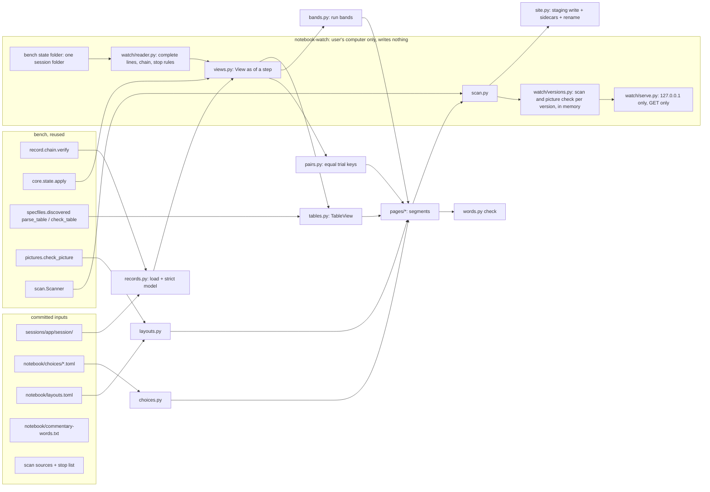

> **参考訳（日本語）** — 正本は英語版 [`.kiro/specs/lab-notebook/design.md`](../../../.kiro/specs/lab-notebook/design.md) です。内容が食い違う場合は英語版が優先されます。Kiro はこのファイルを読みません。
> 原文 SHA-256: `3492d9083f58d9776a618687cc41cf6bd45b1184a3a0dc8abe656e93754edf3d`

# Design: lab-notebook

この設計は `lab-notebook` の要件 1-23 を対象とします。"N4" のような節の参照は、末尾の「Decisions」にあるビルダーの設計判断を指します。ユーザーの判断、規則の例外、`bench/` の変更が要るものは「Open questions」にあります。この設計はそのどれも自分では決めません。

どの Kiro か: ここにあるものはすべて **ビルダー** が作って動かし、**訪問者** が読みます。Dr. Kiro とリーダーはノートブックにもそのビルドにも触れません。

この版に含めない（requirements の Decision 48）: 等しい試行の一覧（要件 14.5）、入力の線（9.8）。実験エントリーの中の軌跡（10.10）は戻した（requirements の Decision 54）。保留（要件の決定 48）: リプレイ（要件 16）。この版は予測チャートの後で止まる。これらはすべて以下に記述が残るがビルドは実装しない。関係する節、Property、決定には印をつけてある。

## Overview

ノートブックは 1 つの Python プログラム `notebook-build` で、専用の `uv` プロジェクト `notebook/` にあります。`sessions/` の封印済み記録と、コミット済みの選択ファイル、カバーファイル、レイアウト表、語のリストを読み、素の HTML、CSS、JavaScript と、記録された PNG の画像シートからなる静的サイトを書き出します。ベンチがすでに定義しているものは、すべてベンチを再利用します: チェーン検証、発見された spec の表のリーダーと検査、状態のリプレイ、条件クラス、画像チェック、ブラインドスキャン。ベンチのフロントエンドは決して import しません。

ビルドは 4 つのフェーズで進み、書くのは最後のフェーズだけです。

1. **入力のチェック**: 引数、出力フォルダー、レイアウト、語のリスト、記録（チェーン、封印、fake 試行なし、形、書き手、画像、end の表）、選択ファイルとカバーファイル。
2. **モデル**: 記録ごとに 1 つの `RecordModel`、（記録、ステップ）ごとに 1 つの `View` を、純関数で計算する。
3. **描画**: すべてのページを、書き手つきのセグメントのリストとしてメモリ上に作る。解説の語のチェック。すべてのセグメントを書き手のレベルでブラインドスキャンし、さらに完成した各ファイルを書き手の範囲を通してもう一度スキャンする。
4. **書き出し**: 新しいステージングフォルダーに書き、1 回のリネームで出力フォルダーにする。

フェーズ 1-3 での失敗は、名前つきのエラーでビルドを止め、何も書きません。フェーズ 4 での失敗は、出力フォルダーを存在しない状態か空の状態のままにします（N4）。

ウォッチ（`notebook-watch`、要件 23、Component 13）は 2 つ目のコマンドです。ベンチが記録を書いている間のセッションを 1 つ、ユーザー自身のコンピューターの上だけで見せ、ユーザーが動かします。訪問者は見ません。その時点までの記録から、ビルドと同じビュー、ページ、ブラインドスキャン、写真の検査を使って `at_bench` モードのセッションページを作り、127.0.0.1 で配信します。ファイルは書かず、公開するサイトには決して入りません。ビルドのモジュールはウォッチを import しません（N33、N34）。

## Architecture



### Package layout

```
notebook/
  pyproject.toml          uv project "lab-notebook", Python 3.12, console scripts notebook-build and notebook-watch
  uv.lock
  layouts.toml            frame layout table (Requirement 7.1)
  commentary-words.txt    reviewed word list for the motion-wording rule (5.5)
  choices/
    cover.toml            the cover file (13.5)
    <application>/<session-id>.toml   one choice file per record (12.1)
  src/notebook/
    cli.py                argument parsing; the only entry point
    errors.py             NotebookError(where, problem)
    inputs.py             Inputs (all folders and files, explicit), output-folder checks (1.3, 1.4)
    records.py            verify with bench, strict typed model of every entry kind
    views.py              View: the session as of one entry; replay steps
    tables.py             snapshot tables through the bench reader; end check; TableView with links
    bands.py              parameter groups and run bands
    pairs.py              equal trial keys across records
    refusals.py           refusal messages as segments; refused-end notes
    choices.py            choice files and the cover file
    layouts.py            layouts.toml; picture size check
    numbers.py            number formatting
    text.py               every commentary string of the site (the one place builder words live)
    words.py              commentary word list check
    ink.py                Ink, Segment, escape, joining segments into text and author ranges
    html.py               element helpers over segments (plain string templates)
    pages/                cover.py, lab.py, session.py, replay.py, how.py, built.py, parts.py
    assets/               notebook.css, notebook.js (builder files, copied byte for byte); the Halloween decoration is inline SVG in
                          the page markup (parts.py), not a file (N28)
    scan.py               the bench Scanner over segments and finished files
    site.py               Site: path -> bytes and ranges; sidecars; staging and rename
    build.py              the four phases
    watch/                notebook-watch (Component 13); no build module imports it
      cli.py              argument parsing for notebook-watch
      reader.py           incremental reader of the record: complete lines, chain, stop rules
      versions.py         one version per pass: views, page in at_bench mode, scan, picture check, in memory
      serve.py            loopback server, GET only (Open question 3: answered yes)
      assets/watch.js     the refresh script, served by the watch only (23.4)
  tests/                  unit, properties, real (see Testing Strategy)
```

### Dependencies (Requirement 1.5)

```toml
[project]
name = "lab-notebook"
requires-python = ">=3.12,<3.13"
dependencies = ["lab-bench", "body-lab-adapter", "wind-tunnel-adapter"]

[project.scripts]
notebook-build = "notebook.cli:main"
notebook-watch = "notebook.watch.cli:main"

[tool.uv.sources]
lab-bench = { path = "../bench", editable = true }
body-lab-adapter = { path = "../body-lab/adapter", editable = true }
wind-tunnel-adapter = { path = "../wind-tunnel/adapter", editable = true }

[dependency-groups]
dev = ["pytest", "hypothesis", "ruff"]
```

- `lab-bench` は extras なしで指定するので、`frontend` グループと `mcp` は決してインストールされません。テストが、`notebook/` の `uv.lock` に `mcp` が含まれないことを確認します。
- 2 つのアダプターパッケージが必要なのは、ベンチのスキャンが各アプリケーションの宣言を import して許可リストを読むからだけです（`bench/src/bench/scan/terms.py`、`load_app`）。これにより MuJoCo の Python パッケージと `wind-tunnel-model` がインストールされます。ビルドは試行、シミュレーター、ソルバー、Docker を決して動かしません。ユーザーがこれを選びました（選択肢 A、N23、要件の Decision 42、要件 1.5）。
- Ruff は、ネットワークとプロセスのモジュール（`http`、`urllib`、`socket`、`subprocess`、`asyncio` など）についてベンチの禁止 API リストを使うので、ビルドはリクエストも、プロセスの起動もできません（3.2、3.3）。

### Command line (Requirements 1.3, 1.4)

```
uv run --project notebook notebook-build \
  --sessions sessions --choices notebook/choices --layouts notebook/layouts.toml \
  --words notebook/commentary-words.txt \
  --scan-config body-lab/adapter/scan_sources.toml --scan-config wind-tunnel/adapter/scan_sources.toml \
  --stop-list .kiro/blind-scan/stop-list.txt --out <output folder>
```

すべてのオプションが必須です（`argparse` の `required=True`。`--scan-config` は少なくとも 1 回）。欠けているものは名指しされ、ビルドは何も読む前に終了コード 2 で終わります。どのオプションにもデフォルトはありません。`--out` は存在しないか、空のフォルダーでなければなりません。そうでなければビルドは、それを名指しして拒否します。build-from-spec の実行は、`build-from-spec` の spec がその記録を定義したときにオプションを得ます（19.8、N22）。

### Command line of the watch (Requirement 23, N33)

```
uv run --project notebook notebook-watch \
  --record <bench state folder>/<session-id> --state <bench state folder> \
  --layouts notebook/layouts.toml --words notebook/commentary-words.txt \
  --scan-config body-lab/adapter/scan_sources.toml --scan-config wind-tunnel/adapter/scan_sources.toml \
  --stop-list .kiro/blind-scan/stop-list.txt --port <port> \
  --app wind-tunnel/notebook --app body-lab/notebook \
  [--replay <seconds>] [--site <built site>]
```

すべてのオプションが必須で、既定値を持ちません。ただし、ある部分を動かす 2 つは別です: `--replay` は封印済みの記録をその秒数ごとに 1 項目ずつ見せ（23.17）、`--site` は、封印の後にこのセッションのページへリンクするビルド済みのサイトを指します（23.16）。`--scan-config` と `--app` は少なくとも 1 回です。`--app` は、ビルドと同じく、アプリケーションのノートブックのフォルダーを指します。ウォッチは、`app.toml` が記録の開始エントリーのアプリケーションを名指しするものを使い、ちょうど 1 つでなければ失敗します。ほかの入力の隣から設定ファイルを探すことはしません。欠けているオプションは名指しされ、ウォッチは何も読む前に 2 で終了します。`--out`（ウォッチはサイトを書かない）、`--choices`（封印の後の部分は読まない、23.7）、ホストのオプション（ウォッチは 127.0.0.1 だけに bind する、23.3）はありません。`--record` は `--state` の下になければなりません。使い方の誤りは 2、チェックの失敗は 1 で終了し、メッセージの形はビルドと同じです。

## Components and Interfaces

### 1. Inputs and records (Requirements 1, 2.2, 2.3, 4.2)

`records.load(sessions: Path) -> list[RecordModel]`:

- `sessions/<application>/<session-id>/` のフォルダーを、（application、セッション id）のコードポイント順に並べて列挙する（21.2）。`sessions/` やアプリケーションのフォルダーにある他のファイルは、それを名指ししてビルドを失敗させる。
- `bench.record.chain.verify(folder, sealed=True)` を呼ぶ。`VerifyError` は `NotebookError(<record>, "<where>: <problem>")` になり、一致しない最初のエントリーまたはファイルを名指しする（2.2）。
- チェック: 最初のエントリーが `start` であること。その `application` と `session` がフォルダー名に等しいこと。宣言の `fake` が false で、すべての試行の `fake` が false であること（2.3）。フィクスチャのビルドは、Python API だけを通して `allow_fake=True` を渡す（N19）。
- 厳密な型つきモデルを作る。各エントリーの種類は、ベンチが書くとおりのキー集合を正確に持つ（現在の 5 つの記録はすべて一致している。`snapshot` は `for` が `end` のものを除いて `experiment` を持つ）。未知の種類、欠けているキー、余分なキーは、記録と `log.jsonl` の行を名指ししてビルドを失敗させる。
- サイトが見せうるすべてのテキストは `Authored(text, author, source)` として読む。`{"author", "text"}` オブジェクトから、引用範囲（`{"file", "line", "quote"}`）から、そして記録された `author` を持つ blob からである。エントリー本体の中の素の文字列（id、結果名、条件クラス、操作）は、`bench.scan.levels.entry_strings` と同じく、ベンチのものである。`source` は `"<record>/log.jsonl line <n>"` または `"<record>/blobs/<hash>"`。これらの規則で書き手を決められない値は、ビルドを失敗させる（4.2）。

`RecordModel` は、記録順の生のエントリー、宣言、実験、試行、予測を持つ仮説、結果、判定、フラグ、拒否、スナップショット、あれば失敗エントリー、そして封印を持つ。

### 2. Views and replay steps (Requirements 10, 16)

リプレイのステップ（以下の `views.steps`、`views.step_view`、`View.events`）は保留（要件の決定 48）。セッションページは `views.view` を使う。

`views.view(record, upto: int) -> View` は、エントリー `upto`（`seq`）の時点でのセッションである。`entries[0:upto]` を `bench.core.state.apply` に通してベンチの `State` にリプレイし、表示のために同じ接頭辞を保持する。セッションページは `upto = len(entries)` を使い、リプレイのステップはそのスナップショットの `seq` を使う。コードの経路は 1 つで、セッションページは、最後のリプレイのステップに、セッションページだけが持つ節を足したものである。

`View` が与えるもの: 接頭辞のエントリー。接頭辞の中の実験、試行、結果、判定、フラグ、拒否。`State` からの `remaining` と `trials_run`。表、計画、要件を見せるスナップショット（ステップのスナップショット。セッションページでは、終了したセッションの `end` スナップショット、そうでなければ最後のスナップショット）。そしてその表が「ベンチに検査された」ものかどうか（受理された `end` スナップショットだけ）。

`views.steps(record) -> list[Step]`: `for` が `verdict` のスナップショットごとに記録順で 1 ステップ、`end` スナップショットがあればそれに最後の 1 ステップ（16.1）。ステップ番号はその順での 1 始まり。`for` が `experiment` のスナップショットは決してステップにならない。拒否は、`seq` が自分より大きいスナップショットを持つ最初のステップの出来事である（16.12、Decision 33）。`views.step_view` は、ステップに `View.events` を与える。前のステップのスナップショットより後で、自分のスナップショットより前の拒否である。`View.refusals` は接頭辞のすべての拒否を保つ。これは拒否の注記が読む（16.12）。最後のステップより後の拒否は、どのステップの出来事でもない。

end の検査のための `Evidence` は、`Session.evidence` とまったく同じように、ベンチの `State` から作る（実験 id。各予測の結果の種類と条件クラス）。テストが、同じ状態から開いた fake セッションの `Session.evidence()` と照合する（N3）。

### 3. Tables (Requirements 2.4-2.6, 8, 16.3-16.6)

- `tables.read(snapshot) -> Table | Unreadable`: `bench.specfiles.discovered.parse_table(design_text, file)` を呼ぶ。受理された `end` スナップショットでないスナップショット（途中のステップ、または停止したセッションの最後のスナップショット）での `TableError` は `Unreadable(section_text, message)` になる（`message` はリーダーが返したテキスト）。行のない表もリーダーが拒否するのでここに含まれる。ページは `## Discovered spec` の節を Dr. Kiro のインクで書かれたとおりに、`message` をペンシルで、コメンタリー "the bench's table reader did not accept this table" とともに見せる。メッセージは解析しない（10.14、16.6、要件の Decision 18 と 45、N26、N27）。`end` スナップショットでは `TableError` は起こりえず（ベンチが受理した）、起こればビルドを失敗させる。
- `tables.check_end(record)`: `end` スナップショットに `check_table(design_text, evidence, file)` を走らせる。問題があれば、行を名指ししてビルドを失敗させる（2.4）。`end` スナップショットのない終了済みセッション（body-1）は検査せず、"no table" として見せる（2.5、10.9）。"no table" は他の場合には使わない。2 つ目の表リーダーはない（2.6）。
- `TableView` は、純関数で `Table` から作る:

```
ids        = [row.id for row in rows]
target(r)  = the one row s with s.id == r.replaced_by and s is not r, if exactly one exists; else None
tab(r)     = target(r) if r.status == "rejected" and target(r) is not None
note(r)    = "names no row of this table" | "names more than one row" | "names this row itself"
             when r.status == "rejected" and target(r) is None (8.4, 16.5)
reverse(s) = [r.id for r in rows if r.status == "rejected" and target(r) is s]   (table order, 8.10)
```

各行は表の順序で 1 回だけ描き、7 つのセルはすべてリーダーが返したとおりにする（8.1、8.11）。`rejected` の行は取り消し線を引く。そのタブ "replaced by <id>" は `<details>` 要素で、中身は対象の規則の文を小さな文字で書いたものと `#row-<id>` へのリンクである（8.3）。この `<details>` は `open` 属性を持つので、タブは最初から開いている（8.13、N31）。ステータスは、"checked by the bench"、"not checked by the bench"（停止したセッションの最後のスナップショット）、"not yet checked by the bench"（途中のリプレイステップ）のラベルをもつスタンプとして描く（8.2、10.7、16.3）。ステータスのセルの文字は書かれたとおりに見せ、取り消し線はステータスが厳密に `rejected` のときだけ適用する。

行を開く（行の証拠を包む `<details>`。狭い画面では行の下、広い画面ではサイドパネル）と、引用された予測ごとに次を見せる: 仮説、条件、範囲、条件クラス（ベンチの語）、Dr. Kiro のラベル、結果、計測値。それぞれが自分の実験エントリーにリンクする（8.8）。`partly` の行では外れを miss red で（8.5）、`observed` の行では `text.py` の固定の説明を（8.6）、`validated` の行では条件クラスが `new-combination` か `outside` の的中を見せる（8.7）。

### 4. Run bands (Requirement 9)

ビュー `v` で見せる表の行について:

```
cited_trials       = trials (in v) of the experiments in row.experiments
prediction_trials  = trials named by the outcome entries (in v) of row.predictions
names(t)           = frozenset of the parameter names of trial t (authored dr-kiro, compared as text)
groups             = sorted distinct names(t) for t in cited_trials + prediction_trials
for each group N, for each name n in N (in the declared order of the first experiment with N):
    session_trials = trials t in v with names(t) == N
    ticks          = sorted distinct values of t.params[n] over session_trials,
                     each with strength: prediction > cited > other (strongest wins on equal values)
    marked         = [min, max] of t.params[n] over cited_trials in N, or none if there are none
    lo, hi         = min, max of ticks
    if n is the name of a declared knob of kind "number":            (9.4)
        span = [knob.low, knob.high];  hatched = [knob.low, lo) and (hi, knob.high]
    else:                                                            (9.5, Dr. Kiro's parameter)
        extra = values of n in the `when` of cited predictions whose `when` names == N
        span = [min(ticks + extra), max(ticks + extra)];  hatched = [span.low, lo) and (hi, span.high]
```

空の斜線の区間は描かない。グループは、共通の名前でまとめることは決してない（9.2）。足りない組み合わせは、引用された各予測の条件クラスの語を通してだけ見せる（9.6）。バンドは鉛筆の inline SVG である。パラメーター名は Dr. Kiro のインクで、それを宣言する実験の `#E<n>-file` にリンクする（9.7）。body-lab では、引用された各試行に、記録された `inputs` のチャンネルごとに [-1, 1] に対する小さな SVG の線も 1 本付く（9.8。この版に含めない、requirements の Decision 48）。

### 5. Refusals and the refused-end note (Requirements 10.11-10.13, 16.12, 18.4)

- 拒否メッセージは部分のリストである: ベンチのテキスト（`{"text": {author, text}}`）と引用（`{"file", "line", "quote"}`）。各部分は、記録された書き手のインクのセグメントになる。何も解析しない（10.12）。
- 拒否された終了の注記: 見せる表と、`action` が `end` であるビューの中の拒否エントリーについて、少なくとも 1 つの拒否が、テキストが `row.id` に厳密に等しい引用部分を持つとき、その行に注記が付く。N はそのような拒否エントリー（部分ではなく）の数である。注記はスタンプのスタイルの付箋で、固定のテキスト、記録されたとおりの各メッセージ、封印されたステータスが見せているものであるという文、そして "the record holds no copy of the table that was refused" を持つ。リプレイのステップでは、そのステップの表がその行を持つときだけ注記が付く（16.12。リプレイは保留、要件の決定 48）。
- 組み立てられた引用（10.13）: 記録は、どの引用をベンチが組み立てたかを印づけておらず、見つけるにはメッセージを解析することになる。そのため、見せるすべての拒否メッセージは解説の注記を 1 つ持ち、それがそのメッセージのすべての引用部分を対象とする（N13、Decision 34 のフォールバック）。

### 6. Equal trial keys (Requirement 14.5)

Not in this version（requirements の Decision 48）。

1 つのアプリケーションのすべての記録にわたって: 記録された `key` で試行をグループにし、グループの中の順序なしの組をすべて列挙する。1 つの記録の中の組も含む。組は（セッション id、試行番号）の順、次に 2 番目のメンバーの順に並べる。「厳密に等しい」とは、2 つの `measurements` オブジェクトが JSON の値として等しいこと（数値、リスト、理由つきの未計測オブジェクト）を指す。各セッションページは、自分の試行を含む組を列挙し、エントリーを開くと 2 つの動く画像が並んで見える。

### 7. Choices, cover and layouts (Requirements 7, 12, 13)

- `layouts.load(path)`: キーが正確に一致する。`frames == rows * columns`、そうでなければエントリーを名指しして失敗する（7.2）。アプリケーションのエントリーがない記録は失敗する（7.5）。
- `layouts.check_sheet(record, trial, media, data)`: メディアタイプは `image/png` でなければならない。`bench.pictures.check_picture` が通らなければならない。そのうえで幅と高さ（チェックの後に IHDR のバイト 16-24 から読む）が、1 以上の整数 `cw, ch` について `width == columns * cw + (columns - 1) * gap` と `height == rows * ch + (rows - 1) * gap` を満たさなければならない。そうでなければ、記録、試行、サイズを名指しして失敗する（7.3）。現在: body-lab の 1600 x 360 は 320 x 180 のセル、wind-tunnel の 1208 x 404 は 400 x 200 のセルになる。
- `choices.load(folder, records)` と `choices.load_cover(folder, records)` は、描画の前に、要件 12.1、12.3-12.6、13.5 のすべてを検証する。理由はビルダーレベルのテキストで、スキャンに回る（12.8）。

### 8. Ink, segments and escaping (Requirements 4, 15, 20.3)

```python
class Ink(Enum): DRKIRO = "k"; PENCIL = "p"; COMMENTARY = "c"; STAMP = "s"; MARKUP = "m"

@dataclass(frozen=True)
class Segment:
    text: str        # unescaped text
    ink: Ink
    source: str      # where the text comes from, for scan findings (20.2)
```

- 書き手からインクへ: 書き手が `dr-kiro` の記録のテキスト -> `DRKIRO`。ベンチが書いた記録のテキストと、記録のフィールドからビルドが計算した数 -> `PENCIL`。`text.py` の文字列 -> `COMMENTARY`。ステータスの語 -> `STAMP`（4.1、15.2）。テンプレートのタグと属性 -> `MARKUP`。
- Dr. Kiro の固定の語の例外（4.2、N29）: `verdict` エントリーの判定の語と、`register` エントリーの予測についての Dr. Kiro のラベルは、記録では書き手のない素の文字列だが、Dr. Kiro がベンチに渡したものである。ページはこれらを、そのログエントリーのソースつきの `DRKIRO` セグメントとして見せる（`pages/session.py`、`_drkiro_word`。15.1、17.4）。これらは、書き手 `dr-kiro` で記録された値から来ない唯一の `DRKIRO` セグメントであり、ビルダーのレベルでもスキャンされる（Components 11）。
- インクごとのスキャンの書き手: `DRKIRO` -> `dr-kiro`。それ以外はすべて -> `bench`（サイドカーの形式は `bench` と `dr-kiro` しか知らない。`bench` はビルダーレベルでスキャンされる、`bench.scan.levels.AUTHOR_LEVEL`）。
- `html.text(seg)` は、マークアップでないセグメントを `<span class="ink-<k>">`（ブロックなら `<pre>`/`<div>`）で包み、エスケープする: `html.escape(text, quote=True)`、その後 `\r` -> `&#13;`。Dr. Kiro のテキストは要素の内容にだけ置き、属性には決して置かない。その要素は `white-space: pre-wrap` を使うので、改行は書かれたとおりに見える（4.3）。タブ、改行、キャリッジリターン以外の C0 制御文字を含む Dr. Kiro のテキストは、HTML で書かれたとおりには見せられないので、そのソースを名指ししてビルドを失敗させる（N6）。
- アドレスと属性に使う id（`E<n>`、`T<n>`、`H<n>.P<n>`、`R<n>`）は、`bench.core.ids` のパターンと `discovered.py` の行のパターンで検査する。それ以外は決して属性に入れず、パターンに合わない id はビルドを失敗させる。
- `ink.join(segments) -> (text, ranges)`: エスケープした形を連結し、コードポイントで数えた書き手の範囲 `[{"start", "end", "author"}]` を返す。同じ書き手の隣り合う範囲はまとめ、ファイル全体を隙間なく覆う。これがサイドカーの本体である（20.3）。

### 9. Pages (Requirements 3, 8, 10, 13, 14, 16-19)

ページは、セグメントのリストを返す Python の関数である。テンプレートエンジンは使わない。すべてのページはフッターにインクの凡例（4.5）へのリンクを持ち、その隣に `how.html`（ラボの仕組み、18。ユーザー、2026-11-17）へのリンクを持つ。

| Address | Page |
|---|---|
| `index.html` | カバー（13） |
| `how.html` | ラボのしくみ（18） |
| `built.html` | spec から作る（19） |
| `<app>.html` | ラボのページ（14.1-14.4） |
| `<app>-<session>.html` | セッションページ（10、14.5、14.6、17） |
| `<app>-<session>-replay-<n>.html` | リプレイのステップ n、1 始まり（16.8） |
| `legend.html` | インクの凡例と、解説で定義するステータスの語（4.5、15.2） |
| `p/<sha256>.png` | 画像。バイト単位でコピー（7.7） |
| `a/notebook.css`, `a/notebook.js` | アセット |

表のリプレイページ `<app>-<session>-replay-<n>.html` は保留（要件の決定 48）。

サイトはフラットである（N28）: すべてのページはサイトのルートにあり、サブフォルダーは `p/` と `a/` だけである。リンクは相対で、`..` を含まない。ページは `legend.html`、`<app>.html`、`p/<sha256>.png`、`a/notebook.css` などを直接リンクする。アドレスが衝突しないことはビルドが検査する: application と session の id は `[a-z0-9]+(-[a-z0-9]+)*` に一致しなければならない（実際の id は `body-lab`、`wind-tunnel`、`body-1`、`wt-004`）。`Site` は、すでにあるパスの追加を、両方の持ち主を挙げて拒否する（たとえば application `a` の session id `x-replay-1` は session `x` のステップ 1 と衝突するので、ここで見つかる。`how` という名前の application も同じ）。ベンチは application と session の id のパターンを定めていないので、この検査はノートブック自身のもので、id を挙げてビルドを失敗させる。小文字だけなので、大文字小文字を区別しないファイルシステムでも 2 つのアドレスが大文字小文字だけで違うことはない。

セッションページのアンカー: `#row-R<n>`、`#E<n>`（実験エントリー、`<details>`）、`#E<n>-T<n>`、`#E<n>-H<n>.P<n>`、`#E<n>-file`、一度も走らなかった予測のための `#H<n>.P<n>`（11）。すべてのリンクは相対で、`..` を含まない（3.2、N28）。JavaScript は、アドレスが指す `<details>` を開く（11.2）。JavaScript がなくても、エントリーは存在し、手で開ける。

セッションページの順序（10.1）: 表のページ（選んだ外れへの付箋と、余白にピンで留めた選んだ画像を伴う）、ハイライト、進み具合（予測チャートを含む、17）、Dr. Kiro の計画（`tasks.md`。`requirements.md` はその下に折りたたむ、N18）、すべての実験エントリー。等しい試行の一覧（14.5）はこの版に含めず、リプレイの操作（16）は保留（要件の決定 48）。wt-003 は 14.2 だけを得る（14.6）。

リプレイのページ（保留、要件の決定 48）は、ステップごとに 1 つの完全な静的ページで、`view(record, step.seq)` から描く: 戻る、進む、再生はリンクである（再生は、3 秒ごとに進むリンクをたどり、最後のステップで止まる JavaScript）。すべてのステップのページは "replay of a sealed record" を持つ（16.7）。接頭辞に入っていない選んだ項目とピンで留めた画像は、解説 "not run at this step" とともに省く（16.2）。

### 10. Moving pictures (Requirement 7.6, 7.8, 3.6)

HTML は、シート全体の ``（JavaScript なしで動き、「シート全体」の表示にもなる）を持つ `<figure class="photo">` と、`data-` 属性（列、行、隙間、およびセルの大きさのための `data-tile-width` と `data-tile-height`。N28）を持つ。`notebook.js` は、見えている画像を 1 つのセルの `<canvas>` に置き換え、セル k を `drawImage(img, sx, sy, cw, ch, 0, 0, cw, ch)` で描く。ここで `sx = (k mod columns) * (cw + gap)`、`sy = floor(k / columns) * (ch + gap)` である。読む順序で、`data-interval` ms（レイアウトの `interval`。ラボごとに違う）に 1 セル、ループする。描くのはシートのセルだけで、セルとセルの間のフレームは作らず、補間もしない。PNG は決して再エンコードしない。操作: 一時停止/再生、1 セル進む、全体の画像（シートそのまま）。`prefers-reduced-motion: reduce` のときは、セル 0 で一時停止して始まる。

どの画像が動くか: body-lab の試行では、体はシートの中で数ピクセルしかないので、下の拡大した画像が自分で動く。全体の画像はページに出さない。拡大した figure がそのシートを名指し（`data-whole-src`、`data-whole-gap`、`data-whole-tile-width`、`data-whole-tile-height`）し、「whole picture」を押すと同じ場所、同じセルで入れ替わり、同じ間隔で 1 セルずつ動く。「magnified picture」で戻る。表紙では figure が 2 つの見出し（`data-caption="near"` と `"far"`、後者は `hidden`）を持つ: 「magnified around the body, one recorded frame at a time」と「the whole picture, one recorded frame at a time」。スクリプトは今見えている画像の見出しを見せる。スクリプトがなければ拡大した画像とその見出しは最初のセルを見せる。ラボのカードは最初のセルを見せて「play」を待つ（`data-start="first"`）。wind-tunnel の画像は試行の唯一の画像なので、自分で動く。

body-lab の各試行について（ラボのカードは除く）、ページは全体の画像の代わりに、動く体を拡大した画像（フレーム間で変わるピクセルの箱に 4 px の余白を足したもの）を見せる（7.9、N32。操作と `data-` 属性は動く画像と同じで、全体のシートの名指しがつく `<figure class="photo photo-magnified">` で、拡大したシートについて、列と行は同じ、隙間 0、拡大した 1 セルの大きさ、ラボの interval）: ビルドは標準ライブラリだけで記録されたシートからそれを導出し、`p/<sha256>.png`（そのバイト列の SHA-256）として書き、代替テキスト "Magnified view of the picture beside it" をつけ、記録された PNG ファイルには触れない。wind-tunnel の動く画像には付けない: 流れがシート全体を動くので、動く体にあたる領域がないためである（7.9、Decision 50）。

### 11. Scan (Requirement 20)

`scan.Scanner` は `bench.scan.scan.Scanner.from_config(scan_configs, stop_list)` である。書き出しの前に 2 回の走査を行う:

1. すべてのセグメント: `scanner.scan_text(seg.text, level, seg.source)`。レベルはそのスキャンの書き手から取る。検出はソースのファイルと行を名指しする（20.2）。
2. 完成したすべてのテキストファイル: `(text, ranges)` から、`sidecar_pieces` がまったく同じ作り方で作る断片を使う。サイトが持つエスケープ後の形が、サイドカーが記述するスキャンを通る（`publish` がどうスキャンするかは N25）。

追加のセグメント。パス 1 でスキャンされるが、それ自身のファイルではない（`scan.check(..., extra)`）: ビルダーのレベルの選択の理由（`scan.choice_segments`、12.8）と、ビルダーのレベルの Dr. Kiro の固定の語（`scan.drkiro_word_segments`: すべての記録のすべての判定の語と、予測についてのすべての Dr. Kiro のラベルを、そのログエントリーで名指しされるペンシルのセグメントとして。4.2、N29）。ページが固定の語を見せるところでは、そこで Dr. Kiro のレベルでも、両方のパスでスキャンされる。

画像はフェーズ 1 で `check_picture` を通す（20.4）。スキャナーは、このマシンのホームフォルダーとリポジトリのパス（`local_paths`）にも印をつけ、絶対パスについての要件 21.1 を守る。

一般規則（N28）: ビルダー自身のテキスト、CSS、JavaScript、HTML の属性名とクラス名は、スキャンがモデルとソルバーのファイルから導く語（およびスキャンがラボの外を指すパスと読む、リンクの `..`）を避けて書く。指摘は、ビルダーのテキストの言い換えまたは構成の変更で直す。除外リストでも、スキャナーの例外でも直さない。既知の例: CSS に `linear`、`thickness`、`spacing` を使わない。JavaScript に `window.` と `tagName` を使わない。セル幅を表す名前の代わりに `data-tile-width` を使う。

### 12. Site writing (Requirements 2.7, 20.3, 21)

`Site` は、相対パスをバイト列に対応づける。各 `.html`、`.css`、`.js` のファイルは `<file>.authors.json` を得る: `{"ranges": [...]}` を `json.dumps(..., sort_keys=True, separators=(",", ":"), ensure_ascii=False)` と最後の改行で書く。アセットは `bench` の範囲 1 つである。書き出し: `<parent>/.<out-name>.staging` を作り（すでにあれば拒否）、すべてのファイルをパスの並び順で書き、`os.replace(staging, out)`（out は存在しないか、空のフォルダー）。

### 13. The watch (Requirement 23; N33-N37)

ウォッチは、ベンチが書いている間のセッションを 1 つ見せます。ビルドとは別のコマンド `notebook-watch` です（N33）。どこにもファイルを書かず、公開されません（23.3）。

**入力。** 記録フォルダーは、`--state` で渡すベンチ状態フォルダーの中の `<state>/<session-id>` です（`lab-bench` 9.1）。ウォッチが読むのは、そのフォルダーの `log.jsonl` と `blobs/`、フレームレイアウト表、解説の語のリスト、スキャンのソース、ストップリストです（23.2）。`lab/`、`sessions/`、`discovered/` のどのフォルダーも、選択ファイルもカバーファイルも読みません。開始エントリーのセッションは、記録フォルダーの名前と等しくなければなりません。状態フォルダーにはアプリケーションのフォルダーがないので（`bench` design 9.1）、アプリケーションは開始エントリーから示し、フォルダー名とは照合しません（N33）。

**リーダー（23.4、23.5、23.12。N35）。** リーダーは 500 ms ごとに、最後に受理した完全な行の直後のバイト位置から `log.jsonl` を読みます。

- 行末のない最後の断片は次の回に回し、見せません（23.5）。
- 完全な行を受理するのは、次をすべて満たすときだけです: JSON であること。オブジェクトのキーがちょうど seq、kind、body、prev、hash であること。正規形の JSON であること。kind がベンチのエントリーの種類の 1 つで、body がその種類の厳密な形を持つこと（N2、`records.py` のモデル）。seq が最後に受理した seq より 1 大きいこと（最初の行は 1）。prev が前のハッシュと等しいこと（最初の行は `GENESIS`、64 個のゼロ）。hash が、hash を除いたエントリーの `chain.entry_hash` と等しいこと。body の中のすべての blob 参照が `check_blob_ref` の受け付ける形で、`blobs/` の中のファイルを名指しし、最初に読んだときにその中身のハッシュが名前と一致すること。
- チェックに落ちた行で、リーダーはその行で止まります。飛ばしたり、推測したり、直したりはしません（23.5）。
- リーダーは `.lock` を開かず、`Store.open` を呼ばず、`builder.log` を読まず、`blobs/` のドットで始まる一時的な名前を無視し、何も書きません。

**停止の文。** 停止はどれも、`text.py` の固定の問題文を出します。たとえば "not JSON"、"not in the record's format"、"out of sequence"、"prev does not follow the entry before"、"hash does not match"、"refers to a blob that is not in the record"、"the record so far does not make a session page" です。悪い文そのものも、ベンチのエラーの文も出しません（N37）。

**ブラインドスキャンと写真の検査（23.6）。** 各版（下）は、Component 11 の 2 つのスキャンのパスと、使うすべての写真について 7.3 の写真の検査を通ります。パス 1 の指摘は、そのソースの行のエントリーでウォッチを止めます。パス 2 の指摘は、仕上がったファイル全体に属するので、そのパスの最新のエントリーでウォッチを止めます。停止は、エントリーの番号と指摘の種類（語、パス、資格情報、写真）を出し、文そのものは出しません。

**1 つのページ、2 つのモード（23.1、23.7-23.10。N34）。** セッションページの関数は `mode` を受け取ります: `sealed`（ビルド）か `at_bench`（ウォッチ）です。違うのは次の部分だけです:

- 見出しは "at the bench" と言い、題の代わりにセッション ID を出す。
- 題と要約、ハイライト、リーダーのテストは、見出しと、解説インクの "written after the seal" か "runs after the seal" を出す（23.7）。
- 表のすべてのステータスに "not yet checked by the bench" と添える（23.8、16.3）。表は最新のスナップショットから取り、終わりのチェックは走らせない。
- 結果のエントリーのない予測は "waiting" を出す（23.8）。
- 登録されてまだ判定のない仮説のエントリーは開いていて、"at the bench" の印を付ける（23.9）。
- 封印のエントリーで、ページはセッションが封印されたことと、完成したページはビルドが作ることを言う（23.10）。
- ウォッチが配信しないページ（`how.html`、カバー、ラボのページ、リプレイのページ）へのリンクは出さない。
- "What happened here" は、記録に封印のエントリーがない間、これまでの外れの数と、ベンチが封印の時に spec を確かめ、その後で次の Kiro が読むことを言う（`STORY_MISSED_SO_FAR`、`STORY_AT_BENCH`）。まだ書かれている記録について "final" とは言わない（23.7）。
- まだ試行のない仮説は、記録に封印のエントリーがない間、"never run" の代わりに "not run yet" を出す。
- 結果のエントリーのない予測は、その仮説に判定が出るまでは "waiting"、出た後は "not run"（23.8）。表がまだ無い間、札は "no spec table yet"（`CHIP_NO_TABLE_YET`）。
- 棚にはリンクでないカード `card-bench` が 1 枚: セッション ID、"at the bench"（または再生のラベル）、これまでに使った予算、これまでに当たった予測（23.15）。
- ウォッチが再生するとき、見出しは "at the bench" の代わりに "replay of a sealed record" と言う（23.17）。封印のエントリーの後、`--site` がそのページを持つとき、封印の文は "Open the finished page." をリンクする（23.16）。

セッションページは `pages/book.py` の `body`（部品）と `pages/shelf.py`（その周りのページ）です。ウォッチは `shelf.at_bench_page` を呼びます。ページの数は、1 のときは単数になります（"1 row is validated"、"1 trial"、"1 rule was struck out"）。予算の 1 歩を指す語の単数は、`app.toml` の `unit_one`（notebook-shelf design）から取り、`unit` の文字を削って作りはしません。

**版（23.1、23.4。N36）。** 新しい完全なエントリーを少なくとも 1 つ受理したパスは、その時点までの記録（`records.from_entries`）から版を作ります。すべての試行の画像シートを確かめ、`at_bench` モードでページを作り（`shelf.at_bench_page`）、両方のスキャンのパスをかけます。同じパスでエントリーを受理した後にリーダーが止まったときは、受理したエントリーの版を先に作り、停止はその後に記録します。ページを作る前に、各フラグのエントリーを確かめます: その `not-run` の数は、フラグより前に結果のエントリーの無い、その仮説の予測の数と等しくなければならず、違えばウォッチはフラグで `WATCH_NOT_RUN_COUNT` とともに止まります（23.14）。`--replay` のとき、リーダーは `ReplayReader` です: 封印済みの記録全体を 1 回読んで確かめ、封印のエントリーの無い記録を拒否し、間隔ごとに 1 エントリーずつ出します。版はメモリに保持されます。番号は 1 ずつ増え、`/version` がそれを返します。版は、すべてを通ってから配信されます。

**停止（23.5、23.6。N37）。** 停止の後は新しい版を作らず、リーダーはそれ以上読みません。最後に通った版がページに残ります。`/version` は停止の文も返し、`watch.js` はそれを要素 `#watch-stop` に出します。プロセスは、ユーザーが止めるまで配信を続けます。

**配信（23.3。Open question 3）。** ウォッチは 127.0.0.1 だけで、GET だけに、次の固定のルートで応答します: `/<app>-<session>.html` と `/` のセッションページ。`/version`（JSON: 版の番号と、停止の文または `null`）。`/legend.html`。`/a/notebook.css`、`/a/notebook.js`、`/a/watch.js`。ページが名指しする写真ごとの `/p/<sha256>.png`。`notebook.css` が参照する書体と書体のライセンス（`/a/*.woff2`、`/a/fonts-license.txt`）も配信します。ほかのパスは 404 です。アセットはウォッチの起動時にパッケージから読みます。写真は記録の blob か、メモリの版から来ます。ウォッチはファイルを書きません。サーバーは、ユーザーが承認した例外のもとで標準の `http.server` を使います（Open question 3、答えは yes）。`serve.py` には `fetch()` もあります。テストがルートを読むための小さな `http.client` の呼び出しで、テストは `http` と `socket` の禁止をそのまま守るためです。`--site` のとき、`/site/<path>` はビルド済みのサイトのそのファイルで応答します。求められたときに読み、そのフォルダーの中だけから、サイト自身のファイルの種類だけを返します（23.16）。

**更新（23.4。`a/watch.js`）。** `watch.js` はウォッチだけが配信し、ビルドはリンクしません。1000 ms ごとに `/version` を読みます。番号が変わると、今のアドレスのページを取得し（同じオリジン）、`scrollY` と、すべての `<details>` の開閉状態を id ごとに保存し、`main` の中身を入れ替え、スクロールの位置と開閉状態を戻し、停止の文を `textContent` で `#watch-stop` に出し、`document` にイベント `notebook:refresh` を送ります。更新の前に "at the bench" の印を持ち、更新の後にそれを失った（判定が来た）項目は、2000 ms（`CLOSE_AFTER`）開いたままにしてから閉じます（23.13）。ページを開いたときにすでに終わっていた項目は、ウォッチから閉じた状態で来ます。`notebook.js` はそのイベントを聞き、新しい中身の上で動く画像を設定し直すので、スクリプトにグローバルな名前は要りません。要求は同じオリジンだけです。Node は使わないので（`tech.md`）、スクリプトのテストは Python の静的なチェックです（26.3）。スクリプトは、N28 のとおり、`window.` を付けずに `scrollY` を読みます。

**幅（23.11）。** 600 px のチェックは、3.5 の 360 px の規則を幅 600 にしたもので、ユーザーの Mac のブラウザーで確かめます（タスク 26.4）。

**公開（23.3）。** `publish` はウォッチを決して公開せず、`publish` の spec はそれを配信してはなりません。ウォッチは何も書かないので、サイトから除くものはありません。ビルドはウォッチのモジュールを持たず、`watch.js` をリンクしません（テストが両方を確かめます）。

## Data Models

### `notebook/layouts.toml` (Requirement 7.1)

```toml
[body-lab]
frames = 10
rows = 2
columns = 5
gap = 0
interval = 220
source = "body-lab design, picture: 10 frames, 2 rows of 5"

[wind-tunnel]
frames = 6
rows = 2
columns = 3
gap = 4
interval = 150
source = "wind-tunnel Requirement 9.4"
```

各表は、まさにこの 6 つのキーを持つ。整数は `>= 1`（gap は `>= 0`、`interval >= 50`）。`interval` は、そのアプリケーションの動く画像が 1 セルを見せる時間（ミリ秒。body-lab 220、wind-tunnel 150、ユーザー）。`source` は空でない文字列。テストのフィクスチャは、`fake` のエントリー（1 フレーム、1 行、1 列、gap 0）を持つ自前のレイアウトファイルを使う。

### Choice file `notebook/choices/<application>/<session-id>.toml` (Requirement 12)

```toml
contrast = ["T25", "T30"]     # or: contrast = "none"  with  contrast_reason = "..."
best = "T36"                  # or: best = "none"      with  best_reason = "..."
missed = "H8.P6"              # or: missed = "none"    with  missed_reason = "..."
```

許されるキーは `contrast`、`best`、`missed`、そして `<key>` がちょうど `"none"` のときの `<key>_reason`。`contrast` は、その記録の異なる 2 つの試行 id のリスト。理由は 1 から 300 文字。各ファイルの内容は Decision 37 である。

### Cover file `notebook/choices/cover.toml` (Requirement 13.5)

```toml
[miss]
application = "body-lab"
session = "body-2"
prediction = "H4.P1"          # or "none"

[[card]]
application = "wind-tunnel"
session = "wt-004"
trial = "T1"
kicker = "LAB I · BY DAYLIGHT"
title = "The Wind Tunnel"
engine = "OpenFOAM"
unit = "runs"

[[card]]
application = "body-lab"
session = "body-2"
trial = "T31"
kicker = "LAB II · KEPT SECRET"
title = "The Stitched Body"
engine = "MuJoCo"
unit = "trials"
```

`sessions/` にあるアプリケーションごとに、カードはちょうど 1 枚で、ファイルの順に 1 枚ずつタブとして見せる（タブは 1 から 4 個）。カードの 4 つの語（kicker、title、engine、unit）は、そのタブに付ける人の言葉で、解説である。`[miss]` のセッションのラボのタブが、開いた状態のタブになる。`[miss]` のセッションは、終了したセッションでなければならない。その予測の結果は miss でなければならない。"none" は、そのセッションに外れがないときだけ受理される。

### `notebook/commentary-words.txt` (Requirement 5.5)

1 行に小文字の語を 1 つ。`#` はコメントの開始。空行は無視。解説の文字列は、その小文字の語のトークン（文字だけ）の 1 つがリストの語に等しいか、リストの語に `s`、`es`、`ed`、`ing` を足したものに等しいとき失敗する。最初のリストはビルダーがタスクで提案し、ユーザーが承認したあとにだけコミットする。

### Number formatting (Requirement 5.3)

- 一覧、表、チャート、カバーで見せるもの: `format(v, ".4g")`（有効数字 4 桁に丸める。正確な 2 進の値で偶数への丸め。末尾の 0 は落とす。[1e-4, 1e4) の外では `1.235e+04` の指数形）。
- 開いた試行で見せるもの: `repr(v)`。記録された倍精度として読み戻せる最短の 10 進数。
- 件数、予算、id、シード、試行キーは整数か文字列で、どちらの関数も通らない。
- 未計測の値は、結果名と記録された理由を見せ、決してプロットしない（5.4）。

### Ordering (Requirement 21.2)

| What | Order |
|---|---|
| applications、sessions | id のコードポイント順 |
| entries、experiments、trials、outcomes、refusals、snapshots | 記録順（`seq`） |
| table rows、reverse links | 表の順序 |
| parameter groups | 名前のソート済みタプルのソート。グループ内の名前は、最初に宣言した実験の順 |
| ticks | 値の昇順 |
| predictions in the chart | 登録の記録順、次に仮説の中の予測の順 |
| equal-trial pairs | 最初の（セッション id、試行番号）、次に 2 番目 |
| files written、sidecar keys | ソートしたパス。`sort_keys=True` |

## Correctness Properties

*性質とは、システムのあらゆる有効な実行で成り立つべき特性や振る舞いです。つまり、システムが何をすべきかについての形式的な記述です。性質は、人が読める仕様と、機械で検証できる正しさの保証とをつなぎます。*

ジェネレーターは、ベンチの形のエントリーのリストとして記録を作ります（Testing Strategy の "Fixtures"）。ほとんどの性質は、ディスクなしで、純粋なモデルとページの関数に対して走ります。重なる基準はまとめました: あるステップでの取り消し線（16.4、16.5）は Property 4 の一部、判定とステータスの分離（15.1、15.2）は Property 5 の一部、カバーファイルの規則（13.5）は Property 11 の一部です。

### Property 1: Dr. Kiro's text round-trips through the HTML

*任意の* 文字列（`<`、`>`、`&`、引用符、タブ、改行、キャリッジリターン、非 ASCII 文字を含み、他の C0 制御文字を除く）について、それを Dr. Kiro のセグメントとして描き、書き出した HTML を `html.parser` で解析すると、テキストの内容が文字列と 1 文字ずつ等しい要素が得られる。他の C0 制御文字を含む文字列は、そのソースを名指ししてビルドを失敗させる。

**Validates: Requirements 4.3, 4.4**

### Property 2: Author ranges cover each file and the bench accepts them

*任意の* セグメントのリストについて、`ink.join` が返す範囲は 0 から始まり、連続し、テキストの長さで終わり、異なる 2 つの書き手を決して結ばず、`bench.scan.levels.sidecar_pieces` に受理される。Dr. Kiro のセグメントのエスケープ後の形はすべて 1 つの `dr-kiro` 範囲の中にあり、それ以外のセグメントはすべて `bench` 範囲の中にある。

**Validates: Requirements 20.3, 20.1**

### Property 3: Ink follows the recorded author

*任意の* 生成された記録について、書き手つきの値から作ったすべてのセグメントは、記録された書き手のインクを持つ（`dr-kiro` -> Dr. Kiro のインク、`bench` -> 鉛筆）。すべてのステータスの語はスタンプのインクを持つ。書き手のないテキストのフィールドを持つ生成エントリーは、記録と行を名指ししてビルドを失敗させる。唯一の例外は Dr. Kiro の固定の語（N29）である: セッションページで、ログエントリーから来る Dr. Kiro のインクのセグメントは、書き手 `dr-kiro` で記録された値か、そのエントリーの判定の語または予測についての Dr. Kiro のラベルのどちらかである。そうした語はそれぞれ Dr. Kiro のインクで見せられ、ビルダーのレベルのスキャンのセグメントでもある。

**Validates: Requirements 4.1, 4.2**

### Property 4: Each row once, tabs and reverse links exact

*任意の* 生成された表（行 id が重複しうる、任意のステータス文字列、`replaced by` が任意の id、自分自身、または何も指さない）について、描画した表は各行を表の順序で正確に 1 回、完全に描く。`rejected` の行は、そのセルがちょうど 1 つの他の行を指すときにちょうど 1 つの "replaced by" タブを持ち、そうでなければ、セルを書かれたとおりに、対応する注記とともに見せ、タブを持たない。各行の逆リンクは、タブがその行を指す `rejected` の行とまったく同じで、表の順序である。取り消し線は、ステータスが `rejected` である行にだけ現れる。

**Validates: Requirements 8.1, 8.3, 8.4, 8.10, 8.11, 8.12, 16.4, 16.5**

### Property 5: Every row shows its status word with the right label, and verdicts stay apart

*任意の* 生成された記録と、見せる任意の表（end スナップショット、停止したセッションの最後のスナップショット、途中のステップ）について、すべての行のステータスのセルは、表の出どころに応じて "checked by the bench"、"not checked by the bench"、"not yet checked by the bench" のいずれかのラベルがついたスタンプ要素の中に、変更なしで現れる。判定はスタンプ要素の中に現れない。すべての判定は、実験エントリーまたはリプレイのステップの中に "verdict on H<n>:" として現れる。

**Validates: Requirements 8.2, 10.7, 15.1, 15.2, 16.3, 22.2**

### Property 6: An opened row shows exactly its cited evidence

*任意の* 生成された記録と行について、開いた行は、その行が引用する実験と予測をまさに列挙する。各予測は、その仮説、条件、範囲、条件クラス、Dr. Kiro のラベル、結果、値を記録されたとおりに持ち、その実験エントリーへのリンクを持つ。`partly` の行では、引用された外れはそれぞれ miss red で "miss" の語とともにある。`validated` の行では、列挙される未試行の的中は、条件クラスが `new-combination` か `outside` である引用された的中とまったく同じである。

**Validates: Requirements 8.5, 8.6, 8.7, 8.8**

### Property 7: Run band ticks are exact and hatched parts are empty

*任意の* 生成された記録（重なる、値が繰り返されるパラメーター名の集合、数値ノブと Dr. Kiro のパラメーター）と任意の行について、その行のグループは、引用された試行と予測の試行の、異なる名前の集合とまったく同じである。各バンドについて、目盛りの値は、その名前の集合を持つすべてのセッションの試行にわたる、そのパラメーターの記録された値とまったく同じである。斜線の区間にそのような値を含むものはない。数値ノブのバンドは宣言された範囲に広がり、Dr. Kiro のパラメーターのバンドは、試した値と引用された予測の条件に広がる。

**Validates: Requirements 9.1, 9.2, 9.3, 9.4, 9.5, 9.9**

### Property 8: The refused-end note attaches by exact equality

*任意の* 生成された end の拒否（引用部分のテキストが任意で、行 id に等しいものと、大文字小文字や空白だけが違うものがある）と表について、ある行が注記を持つのは、ある end の拒否が、テキストがその行 id に厳密に等しい引用部分を持つときであり、かつそのときに限る。N はそのような拒否エントリーの数に等しい。リプレイのステップでは、そのステップの表がその行を持つときにだけ注記が現れる。

**Validates: Requirements 10.11, 10.12, 16.12**

### Property 9: Replay steps equal snapshots and record prefixes (on hold, requirements Decision 48)

*任意の* 生成された記録について、ステップは、記録順の `verdict` スナップショットと、あれば `end` スナップショットとまったく同じである。各ステップで、見せる表は、そのステップのスナップショットに対するベンチのリーダーの行（またはリーダーのメッセージつきで書かれたとおりの読めない節）に等しく、見せるエントリーは、そのスナップショットのエントリーまでを含む記録のエントリーとまったく同じである。各拒否は、それより後にスナップショットが来る最初のステップの出来事として、ちょうど 1 つのステップで見せる。それより後にどのスナップショットも来なければ、どのステップでも見せない。

**Validates: Requirements 16.1, 16.2, 16.10, 16.12**

### Property 10: Equal-trial pairs are exactly the equal keys (not in this version)

*任意の* 生成された、1 つのアプリケーションの記録の集合について、列挙される組は、記録された同じキーを持つ試行の順序なしの組とまったく同じで、各組の "exactly equal" フラグは、それらの計測値の JSON としての等しさに等しい。

**Validates: Requirements 14.5**

### Property 11: Choice and cover validation matches the rules

*任意の* 生成された記録の集合と、生成された選択ファイルとカバーファイル（有効なもの、誤った id、的中である外れの予測、理由あり・なしの "none"、0、1、300、301 文字の理由、余分なキー、欠けているファイル、カバーにある停止したセッション）について、ビルドがそのファイルを受理するのは、要件 12.1、12.3-12.6、13.5 から直接書いた参照用の述語が受理するときであり、かつそのときに限る。拒否は、ファイルと選択を名指しする。

**Validates: Requirements 12.1, 12.3, 12.4, 12.5, 12.6, 13.5**

### Property 12: Layouts and sheet sizes

*任意の* レイアウトのエントリー（frames、rows、columns、gap）と画像の幅と高さについて、レイアウトが受理されるのは、frames が rows かける columns に等しいときであり、かつそのときに限る。シートが受理されるのは、`width = columns * cw + (columns - 1) * gap` と `height = rows * ch + (rows - 1) * gap` を満たす、1 ピクセル以上の整数のセルサイズが存在するときであり、かつそのときに限る。

**Validates: Requirements 7.2, 7.3**

### Property 13: Numbers are rounded to 4 significant digits and shown in full when opened

*任意の* 有限の倍精度 v について、`float(short(v)) == float(format(v, ".3e"))` であり、`short(v)` は多くても有効数字 4 桁である。そして `float(full(v)) == v` である。

**Validates: Requirements 5.3**

### Property 14: The prediction chart scale and marks

*任意の* 生成された結果つきの予測の集合について、各計測値の尺度は、そのセッションで登録された範囲の限界と計測値のうちの最小から最大までにちょうど広がる。的中と外れは同じ大きさの印を持つ。外れの印はすべて miss red で "miss" の語を持つ。未実行または確認不能の予測は、その語と範囲を持ち、値の印を持たない。未計測の値はどこにもプロットされない。

**Validates: Requirements 17.2, 17.3, 5.4**

### Property 15: The build is deterministic

*任意の* 小さな生成された入力の集合と、フォルダーを列挙する順序の任意の置換について、異なる出力フォルダーへの 2 回のビルドは、同じパスの集合と同じバイト列を与える。どのファイルにも、出力フォルダーのパス、ホームフォルダー、リポジトリのパスが含まれない。

**Validates: Requirements 21.1, 21.2, 21.4, 11.1, 16.8**

### Property 16: A failed build writes nothing

*任意の* 生成された有効な入力の集合と、生成された 1 つの破損（ログや blob の 1 バイトの反転、欠けた封印、fake 試行、レイアウトに分割できない画像、誤った選択 id、選択の理由に仕込んだビルダーレベルの語）について、ビルドはファイルを名指しするエラーで失敗し、その後で出力フォルダーは存在しないか空である。

**Validates: Requirements 2.1, 2.2, 2.3, 2.7, 7.3, 20.2**

### Property 17: Nothing is skipped

*任意の* 生成された有効な記録について、セッションページは、記録の実験エントリーごとに 1 つの実験エントリー、試行ごとに 1 つの試行ブロック、試行ごとに 1 つの動く画像、リーダーが返す行ごとに 1 つの表の行を持つ。

**Validates: Requirements 2.8, 10.8**

### Property 18: The reader shows exactly the complete, valid prefix

*任意の* 生成された記録（Testing Strategy の "Fixtures"）と、そのバイト列を続けて書く断片への任意の分け方について、任意の大きさの断片でウォッチのリーダーに渡したとき、リーダーが受理するエントリーは、それまでの完全な行とちょうど同じで、順番も同じであり、ページが行の一部を見せることはありません。行末のない最後の行は見せません。Component 13 の規則を破る *任意の* 完全な行（JSON でない、種類が求めるのと違うキーの集合、1 大きい以外の seq、前のハッシュ以外の prev、`entry_hash` 以外の hash、`blobs/` にないファイルへの blob 参照）について、リーダーはちょうどその行番号で止まり、その行から先は何も受理せず、後の行を読みません。

**Validates: Requirements 23.4, 23.5, 23.12**

### Property 19: The at-bench page shows what the sealed page shows for the same prefix

*任意の* 生成された記録と、そのエントリーのすべての完全な接頭辞（1 行からすべての行まで）について、その接頭辞の `at_bench` のページが見せるデータ（試行の測定値とその結果、仮説と判定、拒否、表の行とステータスの語、予測の行）は、同じ接頭辞について `sealed` モードが見せるデータと等しくなります。2 つのモードが違うのは、23.7-23.10 と Component 13 で名指しした見出しと部分だけです。

**Validates: Requirements 23.1, 23.8**

## Error Handling

- エラーの型は 1 つ、`NotebookError(where, problem)`。`where` はファイル（と行またはエントリー）か、選択のキー。`problem` は何が間違っているかを言う。ベンチのエラー（`VerifyError`、`TableError`、`PictureError`、`ScanError`）は、ベンチのエラーを原因として、そのテキストを保ったまま `NotebookError` として再送出する。`try`/`except` はエラーを握りつぶさず、再試行もデフォルト値もない（`rules.md` 2）。
- `notebook-build` は、`notebook-build: <where>: <problem>` を stderr に出力し、チェックの失敗では 1、使い方の誤りでは 2 で終了する。スキャンの検出はすべて出力し（ベンチの `Finding` の形式: ファイル、行、種類、一致）、そのあとビルドは 1 で終了する。
- **失敗したときは何も書かない（2.7）。選んだ方法: まずメモリ上ですべてをチェックして描き、それからステージングフォルダーに書いてリネームする。** 要件 2.1 が求めるとおり、すべてのチェックとすべての描画は最初のファイルを書く前に走る。メモリ上のサイトは小さい（5 つの記録の HTML と約 80 個の PNG ファイル。PNG はコピーするだけで、デコードしない）。したがって書き出しは I/O だけである。ステージングフォルダー `<parent>/.<out-name>.staging` は出力フォルダーの隣にあるので、`os.replace` は 1 つのファイルシステム上のリネームになる。出力フォルダーは、完全な形で現れるか、現れないかのどちらかである。書き込みが失敗したら、ビルドは止まり、ステージングフォルダーを名指しして、そのまま残す。ファイルを決して削除せず、次のビルドは、ステージングフォルダーがある間は拒否する。これは、出力フォルダーに直接書く方法（クラッシュすると中途半端なサイトが残る）や、途中の出力を削除する方法（ビルドに削除の経路を持つのは、得るものなしにリスクを持つこと）より好ましいとした。
- 記録は有効だが、要件が求めるようには見せられない場合（制御文字を含む Dr. Kiro のテキスト、ベンチの id でない id）、ビルドはそのソースを名指しして失敗する。項目を落とすことは決してない（2.8）。

## Testing Strategy

`uv run --project notebook pytest` がすべてを走らせます。`ruff check` と `ruff format --check` は `notebook/` に対して走ります。

### Property tests

- `hypothesis`、性質ごとに 100 例以上（`@settings(max_examples=100)` 以上。Property 15 はメモリ上の小さなサイトを作るので、100 例でも速い。Property 16 は `tmp_path` に書く）。
- 性質ごとに 1 つのテスト。`tests/properties/` に置き、それぞれにコメント `# Feature: lab-notebook, Property <n>: <title>` を付ける。

### Fixtures

すべてのフィクスチャにはラベルが付きます: その記録は、宣言とすべての試行で `fake = true` を持ち、`tests/fixtures/` か `tmp_path` にあり、ライブラリ呼び出し `build(..., allow_fake=True)` だけを通して作られます。これはすべてのページに目に見える "test fixture" のバナーも付けます。CLI はそれらを受け入れる手段を持ちません（N19）。フィクスチャの数値は、結果として示されることは決してありません。

- **Synthesized records**（`tests/fixtures/synth.py`）: hypothesis の strategies が、ベンチの形のエントリーのリストを作り、`bench.record.chain.entry_hash` と `bench.record.canonical.canonical_json` でチェーンにし、blob はハッシュで書く。それぞれはテストが使う前に `bench.record.chain.verify(sealed=True)` を通るので、ジェネレーターのバグが、ベンチが拒否する記録を作ることはない。
- **Session fixture**（`tests/fixtures/session.py`）: `bench.core.session.Session` と `bench.fake.adapter.FakeAdapter` による本物のセッションで、`bench/tests/labkit.py` と同じように用意する（パターンはコピーし、ベンチのテストモジュールは import しない）。最初の verdict のスナップショットは、R1 が `rejected` で R2 に置き換えられた表と R2 を持ち、後の verdict のスナップショットは読めない表を持ち、受理された表で終わる。これは要件 16.11 のフィクスチャであり、Evidence を `Session.evidence()` と照合する（N3）。
- `fake` のエントリーを持つフィクスチャの `layouts.toml`、フィクスチャの選択ファイルとカバーファイル、フィクスチャの語のリスト。

### Tests on the real records (`tests/real/`)

これらは、コミット済みの `sessions/`、`notebook/choices/`、スキャンのソースを読み、`tmp_path` にビルドします:

- 完全なビルドが通る（22.1）。すべての表のすべての行がそのステータスの語を見せる（22.2）。
- body-2: 表の順序で 14 行。8 つの `rejected` の行 R2、R3、R4、R6、R8、R10、R12、R14 に取り消し線があり、それぞれが 1 つのタブで R1、R11、R5、R7、R9、R11、R13、R13 を指す。逆リンク: R1 "replaces R2"、R5 "replaces R4"、R7 "replaces R6"、R9 "replaces R8"、R11 "replaces R3, R10"、R13 "replaces R12, R14"。R13 は N = 2 の拒否された終了の注記を持ち、2 つのメッセージが、各部分を書き手のインクで見せる（22.5）。
- body-2 のカバー: 試行 T12 の画像と軌跡を持つ H4.P1、"miss"、行 R4 と R5（13.1、13.2、13.7）。
- wt-004: 行 R1-R6 が、ステータスの語 "checked by the bench" を持つ。5 つの計測が `not_settled` である試行は、結果名と理由を見せ、プロットされた印を持たない。
- body-1: "no table" と、その 8 つの外れの一覧（10.9）。
- `end` より前の実記録のすべてのスナップショット（body-1、body-2、wt-002、wt-004）: 書かれたとおりの節、ペンシルのリーダーのメッセージ、"the bench's table reader did not accept this table"（10.14、16.6）。
- wt-002 と wt-003: ラボのページに同じフィールドで現れる。wt-002 は、最後のスナップショットの節を書かれたとおりに、リーダーのメッセージと "not checked by the bench" とともに見せるセッションページを持つ（"no table" ではない）。wt-003 は停止したセッションの内容と "the record has no snapshot to replay" だけを持つ（14.2、14.6、16.9）。
- （この版に含めない、requirements の Decision 48。）等しい試行の一覧: wt-002 の T1 と wt-004 の T1、および body-1/body-2 の 9 組。すべて厳密に等しい（14.5）。
- （保留、要件の決定 48。）すべての本物の記録のリプレイが、そのスナップショットと一致する（16.10、22.3）。

### Example and unit tests

- 引数: 欠けているオプションはそれぞれ名指しされる。空でない出力フォルダーは拒否される（1.3、1.4）。
- スキャン: スキャンのソースの語を `text.py` の文字列に仕込むとビルドが失敗する。同じ語がフィクスチャの記録の Dr. Kiro のテキストにあっても失敗しない（20.5）。選択の理由に仕込んだ語は失敗する（12.8）。
- 解説: `text.py` のすべての文字列が語のリストを通る。仕込んだリストの語は失敗する（5.5）。`<details>` の外にあるカバーの解説は、最大 240 トークン（13.6）。
- サイト: すべてのページがルートにあり、どのリンクにも `..` がない。2 つのアドレスを等しくしうる id はビルドを失敗させる（N28）。どのファイルにも `xmlns`、`http:`、`https:`、URL の先頭の `//`、`<form`、リプレイと画像のボタン以外の `<input`、`<iframe` が含まれない（3.1-3.3）。テキストはスクリプトなしで HTML の中にある（3.4）。すべての画像の名前は、そのバイト列の SHA-256 である（7.7）。すべてのページが `legend.html` にリンクする（4.5）。
- 色: ビジュアルのステアリングで宣言された前景と背景の組はすべて、CSS のカスタムプロパティから WCAG の式で計算したコントラスト比が 4.5:1 以上である（4.6、6.5）。
- `uv.lock` に `mcp` がない。`git diff --stat bench/` が、タスクの検証ステップで空である（7.4）。

### Watch tests (Requirement 23)

- `notebook/tests/properties/` の Property 18 と 19（上のとおり）。
- `tmp_path` の合成した記録（`fake = true`、ライブラリーを通して `allow_fake=True` で作る）でのリーダーと停止の例: 書きかけの最後の行、反転した 1 バイト、間違った seq、間違った prev、欠けた blob、種類に合わないキーの集合。スキャンのソースの語をベンチの書いた文に仕込むと、ウォッチはそのエントリーで止まり、種類を出して文は出さない（23.6）。
- セッションの途中のフィクスチャでの `at_bench` のページ: "waiting"、開いた仮説、23.7 の見出しとラベル、封印のエントリーの後の封印の文（23.8-23.10）。
- 静的なチェック: `serve.py` は 127.0.0.1 だけに bind し、固定のルートで GET だけに応答する。ビルドのモジュールは `notebook.watch` を import しない。ページと `watch.js` は他のホストに要求を出さない（3.2）。`watch.js` は 1000 ms ごとに問い合わせ、同じオリジンの要求だけを使い、`window.` も `tagName` も持たない。写しの上で動かした前後で、ベンチ状態フォルダーと `sessions/` が同じである（フォルダーの一覧とハッシュ）。
- 600 px と 360 px でのブラウザーのチェックと、2 秒以内の更新は、マイルストーン 4 のチェックポイント（タスク 26.4）でユーザーの Mac で行う。

### Manual checks

ブラウザーでの 360 px の幅とモーション低減（3.5、3.6）、動く画像、そしてマイルストーン 1 でのユーザーによる最初の画面のレビュー（22.4）。`docs/status.md` に記録します。

## Visual system

最初のタスクで、どのページよりも前に、ステアリングファイル `.kiro/steering/notebook-visual.md` として書きます（6.1）。下の提案が、そのファイルに入る内容です。マイルストーン 1 でのユーザーのレビューで変わることがあり、変更はまずステアリングファイルに入れます（6.6）。スタイルシートは Lora、IBM Plex Mono、Caveat を、サイト自身の woff2 ファイルとしてライセンスとともに同梱し、下のスタックの先頭に置きます。システムのスタックはフォールバックとして残ります。他のホストからは何も取得しません（3.2）。スタックとカバーのレイアウトは、できあがりのとおりステアリングファイルにあります（Decision 51）。

| Element | Proposal |
|---|---|
| Paper | 背景 `#fbf7ec`。かすかな方眼紙の線 `#dfe6ef`。1.5rem のタイルごとに、下の辺と右の辺に 1 本ずつ（CSS のグラデーション）。内容の列は最大 72rem |
| Dr. Kiro's ink | 色 `#1f3a8a`。セリフ体 `ui-serif, Georgia, "Times New Roman", serif`。立体。ブロックは同じ色の 2px の実線の左罫と、ラベル "written by Dr. Kiro" を持つ。Dr. Kiro のコードブロックは、同じ左罫つきで `ui-monospace` を使う |
| Pencil | 色 `#3d3d3d`。`ui-monospace, SFMono-Regular, Menlo, Consolas, monospace`。罫なし |
| Commentary ink | 色 `#2b2118`。`system-ui, -apple-system, "Segoe UI", Roboto, sans-serif`。0.95em |
| Miss red | `#b3261e`。外れた予測とその計測値にだけ使い、必ず "miss" の語とともに使う（カバーの判子は "missed" と書く）（6.4） |
| Rewrite red | `#fbe8e4` の上の `#a3302a`。`rejected` の行とカードに使う（帯、カバーのカードの取り消し線、点線の replaced-by の行）。外れには決して使わない（Decision 51） |
| Bench stamp | 大文字の等幅書体、セミボールド、角の丸い 2px の枠、-2deg 回転。語ごとの色: validated `#1d5e3a`、partly `#7a4b00`、observed `#3a4a5c`（枠は破線）、rejected `#5b2a6e`（色で塗りつぶし、文字は白。2026-11-22 に、2 つを見分けやすくするため改訂）（決して赤にしない）。ラベル（"checked by the bench"）は、下に小さな解説の書体で |
| Instant photo | 白い枠（左右 8px、下 28px）、やわらかい影、試行番号から決まる固定の規則で ±1.5deg の範囲で回転、上に真鍮色のピン `#b08d3c`。キャプションは下 |
| Sticky note | 背景 `#fff1a8`、解説のインク、1deg 回転、影。拒否された終了の注記は、付箋の上にスタンプの枠を使う |
| Strike-through | 表の行では 2px の黒鉛色の `line-through`、カバーのカードでは書き直し用の赤。文字は十分なコントラストのまま。"replaced by" の行は、カードの最後の点線の行 |
| Type and spacing | 基準 17px / 1.5。間隔の尺度は 4、8、16、24、40px |
| Narrow screen | 360px では 1 列。余白の写真は表の下へ移る。発見した spec の表はカードなので、横スクロールはない |
| Halloween | インクで描いた小さなコウモリ 1 匹とクモの巣の角 1 つ（ページのマークアップの中のインライン SVG。ファイルなし、`xmlns` 属性なし、テキストなし）。幅 1000px 以上のビューポートの、ページの余白にだけ置く。`aria-hidden`、テキストなし、何の後ろにも置かない（6.5） |
| Night lab | `prefers-color-scheme: dark` のときだけ、スタイルシートの 2 つ目の `:root` が色のプロパティを上書きする。温かみのある黒に近い紙 `#1d1b18`、それより明るいカード、明るいインク、明るくした外れの赤・書き直し用の赤・判子。切り替えなし、スクリプトなし。記録された画像にはフィルターをかけない。コントラストの組はすべて夜の値でも確かめる（6.2、Decision 52） |
| Motion | レイアウトの `interval` ごとに 1 セル（body-lab 220 ms、wind-tunnel 150 ms）。モーション低減は一時停止で始まる（3.6） |

上のすべての文字色は、その背景（紙と付箋の黄色）の上で 4.5:1 以上に達します。テストが、CSS から各組を確認します。

## Delivery order (Decision 40)

1. **Milestone 1**: プロジェクト、入力、記録、ビュー、表、選択、カバーファイル、レイアウト、インクとサイドカー、スキャン、サイトの書き出し、ビジュアルのステアリングファイル、カバー、そしてセッションページの発見された spec の表（それに要るタブ、逆リンク、スタンプ、拒否された終了の注記、動く画像を含む）を、本物の記録から作る。そこで止まり、カバーと body-2 の表を、デスクトップと 360 px の画面でユーザーに見せる（22.4）。
2. **Milestone 2**: 実験エントリーと動く画像の全体、ラボのページと停止したセッション、"How the lab works"、走行バンド。
3. **Milestone 3**: 予測チャート。リプレイは保留であり、等しい試行の一覧と body-lab の入力の線はこの版に含めない（requirements の Decision 48）。この版は予測チャートの後で止まる。
4. **Milestone 4（要件 23、Decision 53）**: ウォッチ。マイルストーン 3 の後、「その後」の前。タスク 25 はリーダーと `at_bench` のページで、Property 18 と 19 を含む。タスク 26 はループバックのサーバーと更新で、Open question 3 とユーザーの Mac でのチェックポイントを待つ。
5. **その後**: "Built from the spec" は "there are no runs yet" を見せる（19.1）。19.2-19.7 は `build-from-spec` の spec を待つ（19.8）。

## Requirements coverage

| Requirement | Where |
|---|---|
| 1 | Command line、Components 1、Dependencies |
| 2 | Overview のフェーズ、Components 1 と 3、Error Handling、Property 16、17 |
| 3 | Components 9、10、Testing（サイトのチェック）、Visual system |
| 4 | Components 1、8、Properties 1-3、Visual system |
| 5 | Data Models（数値、語のリスト）、Property 13、14 |
| 6 | Visual system |
| 7 | Components 7、10（7.9 拡大した画像）、Data Models（レイアウト）、Property 12 |
| 8 | Components 3、Properties 4-6 |
| 9 | Components 4、Property 7 |
| 10 | Components 2、5、9、Property 8、17 |
| 11 | Components 9（アドレス）、Property 15 |
| 12, 13 | Components 7、Data Models、Property 11 |
| 14 | Components 6（14.5 はこの版に含めない）、9、Property 10（この版に含めない） |
| 15 | Components 3、8、Property 5 |
| 16 | Components 2、3、9、Property 9（16 のすべてを保留） |
| 17 | Components 9、Property 14 |
| 18 | Components 9。N24 |
| 19 | Delivery order 4、N22 |
| 20 | Components 8、11、12、Property 2、16 |
| 21 | Data Models（順序）、Components 12、Property 15 |
| 22 | Testing（本物の記録）、Delivery order |
| 23 | Component 13、Command line of the watch、N33-N37、Property 18、19、Open question 3 |

## Decisions

要件の Decision 14 のユーザーの委任のもとで、ビルダーが決めました。どれも規則の例外を作らず、`bench/` を変えません。

- **N1 Own project, bench by path.** `notebook/` は `uv` のプロジェクトで、`lab-bench` に extras なしの editable なパスで依存する。ネットワークとプロセスのモジュールは、ベンチと同じく ruff が禁止する。（アダプターの依存は N23。）
- **N2 Strict record model.** 各エントリーの種類は、ベンチが書くとおりのキー集合を正確に持つ。それ以外はビルドを失敗させる。ベンチの記録の形の変更には、黙って許容するのではなく、ここでの変更で応じる。
- **N3 State from the bench, Evidence rebuilt.** ビューは、エントリーを `bench.core.state.apply` に通してリプレイする。`Session.evidence` は生きたセッションのメソッドなので、ビルドは `State` から同じ `Evidence`（数行）を作り、テストが fake セッションで両者を比べる。ユーザーが望めば、ベンチが後で純関数を公開することもできる。それはベンチの変更であり、この spec の一部ではない。
- **N4 Check and render in memory, then stage and rename.** Error Handling を参照。ビルドはファイルを決して削除しない。
- **N5 Segments carry ink and source.** インクがスタイルを与える。スキャンの書き手は、Dr. Kiro のインクなら `dr-kiro`、それ以外のすべては `bench` である。サイドカーの形式がその 2 つの書き手しか知らないためである。
- **N6 Escaping.** `html.escape(quote=True)` に、キャリッジリターンのための `&#13;` を加える。Dr. Kiro のテキストは `white-space: pre-wrap` の要素の内容にだけ置く。他の C0 制御文字はビルドを失敗させる。
- **N7 Two scan passes.** ソースでのセグメント（検出はソースのファイルと行を名指しする）。次に、完成した各ファイルをその範囲を通して。後で `bench-scan` がサイトに対して見るのと同じ断片である。
- **N8 Moving pictures by canvas.** シート全体は ``（スクリプトなしと「全体の画像」の表示）。JavaScript は、隙間を含むソースの矩形から、一度に 1 セルを描く。再エンコードはしない。CSS の `background-position` は選ばなかった。隙間つきの 2 軸のステップ送りは、レイアウトごとに生成するセル単位のキーフレームを必要とするため。
- **N9 Addresses.** Components 9 の表のとおり。id はパターンで検査したベンチの id。
- **N10 Replay as static pages (on hold, requirements Decision 48).** ステップごとに 1 ページ。すべてのステップのテキストが HTML の中にあり、固定のアドレスを持つ。「再生」は進むリンクをたどるだけ。
- **N11 Number format.** `.4g` と `repr`。Data Models のとおり。
- **N12 Replacement edge cases.** 繰り返された id、行自身、または行なしを指す `replaced by` のセルは、書かれたとおりに、注記つきで、タブなしで見せる（途中のステップでだけ起こりうる。end ではベンチが拒否する）。注記は "names this row itself"、"names no row of this table"（空のセルも）、"names more than one row" のいずれか。
- **N13 Refusal note covers every quote.** Decision 34 のフォールバックのとおり。設計はメッセージを解析しない。
- **N14 Equal-trial pairs (not in this version, requirements Decision 48).** 1 つのアプリケーションの、同じキーを持つすべての組。1 つの記録の中の組も含む。等しさは計測値の JSON としての等しさ。
- **N15 Number knob or Dr. Kiro parameter.** パラメーターが数値ノブなのは、その名前が種類 `number` の宣言されたノブに等しいとき。そうでなければ Dr. Kiro のパラメーターである（body-lab は、関数ノブの名前をパラメーターとして拒否する）。
- **N16 File formats.** 選択、カバー、レイアウトのキーは Data Models のとおり。未知のキーは失敗する。
- **N17 Word list matching.** 小文字のトークン全体と、接尾辞 `s`、`es`、`ed`、`ing`。リストの内容はタスクで提案し、ユーザーの承認が要る。
- **N18 Requirements shown with the plan.** 要件 16.2 はステップの要件を見せる。セッションページでは、`requirements.md` は Dr. Kiro の計画の下に折りたたんで見せるので、10.1 の節の順序は保たれる。
- **N19 Fixture mode only through the library.** `build(..., allow_fake=True)` は fake の記録を受け入れ、すべてのページに "test fixture" の印をつける。CLI はそれができない。
- **N20 Visual system.** 上の提案のとおり。まずステアリングに書く。
- **N21 Plots (the input lines are not in this version, requirements Decision 48).** 軌跡の経路（`photo.track_sketch`。撮り直した絵のない試行カードごと、requirements の Decision 54）は、x と y の縮尺を等しく保ち、その試行自身の軌跡に合わせ、開始点に印をつける。入力の線は固定の [-1, 1] の軸を使う。SVG の座標は小数 2 桁で書式化するので、出力は安定する。
- **N22 Built from the spec.** `build-from-spec` が記録を定義するまで、実行のための CLI オプションはない。ページは、まだ実行がないと述べる。
- **N23 Adapters installed for the scan (user, option A).** ベンチのスキャンは、各アプリケーションの宣言を import して許可リストを読む（`load_app` は、`mujoco` を import する `body_lab.adapter` と、`wind_tunnel_model` を import する `wind_tunnel.declaration` を import する）。ノートブックは両方のアダプターパッケージにパスで依存する。MuJoCo の Python パッケージはインストールされるが、何もシミュレートも解きもせず、Docker も要らない（要件 1.5、要件の Decision 42）。選ばなかったもの: B、各アプリケーション自身の環境で別プロセスとしてスキャンを走らせる（プロセスの起動が要り、N1 が禁じている。またスキャンの前にサイトのステージングがディスク上に必要になる）。C、スキャンが宣言を別の場所から取れるようにベンチを変更する（`bench/` の変更であり、許可リストはアプリケーション自身の宣言から来なければならない、`rules.md` 1）。
- **N24 No link to the root `.kiro/` (user).** "How the lab works" にはリポジトリのルートの `.kiro/` へのリンクがなく、ラボの外のファイルやフォルダーを名指ししたりリンクしたりする解説もない。この問いは README のステップ（`docs/brief.md` セクション 5 項目 8）で改めて決める（要件 18.5、要件の Decision 43）。以前の Open question 3 だったもの。
- **N25 Rescanning the written site is decided in `publish` (user).** ラボの外のフォルダーに対する `bench-scan` はすべてのファイルをテキストとして読むので、サイトの PNG ファイルは失敗する（`bench/src/bench/scan/scan.py`、`scan_file`）。`publish` がサイトをどうスキャンするかは、`publish` の spec を書くときに決める。ノートブックは今までどおりテキストファイルごとにサイドカーを書き（要件 20.3）、書き出す前の自前の 2 回のスキャンも残る（Components 11、N7）（要件の Decision 44）。以前の Open question 4 だったもの。

- **N26 Unreadable middle-step table shown as written (user).** 途中のステップでの `TableError` は `Unreadable` になり、`## Discovered spec` の節は書かれたとおりに、ラベルつきの文とともに見せる。行は推測しない（Components 3、要件 16.6、要件の Decision 18、ユーザーが確定）。以前の Open question 2 だったもの。
- **N27 A table the reader does not accept (user, 2026-11-17).** `parse_table` が拒否する表は、行のない表（`end` より前の実記録のすべてのスナップショット）を含め、`## Discovered spec` の節を書かれたとおりに（Dr. Kiro のインク）、リーダーのメッセージ（ペンシル）、コメンタリー "the bench's table reader did not accept this table" とともに見せる。ビルドはメッセージを解析せず、2 つ目のリーダーも持たない。"no table" は `end` スナップショットのない終了済みセッション（body-1）にだけ使う。wt-002 は最後のスナップショットをこの形で、"not checked by the bench" のラベルつきで見せる（Components 3、要件 10.9、10.14、14.6、16.6、要件の Decision 45）。N26 を拡張。
- **N28 Flat site, wording avoids scan terms (user, 2026-11-17).** タスク 8.1 によるビルダー自身のテキストのスキャンは、(1) 相対リンクの `../` がラボの外を指すパスと読まれること、(2) `notebook.css` に派生語 `linear`、`thickness`、`spacing` があること、(3) `deco.svg` に `xmlns="http://www.w3.org/2000/svg"` があり、`http:` のサイト検査（タスク 9.5）が拒否すること、(4) 画像の属性とスクリプトの名前がスキャン語であることを見つけた。決定: サイトのレイアウトはフラットで、すべてのページがルートにある（Components 9 の表）。`p/` と `a/` だけがフォルダーなので、どのリンクにも `..` はいらない。CSS は印のついた語を使わない言い換えにする（除外リストは使わない）。Halloween の装飾は `xmlns` のないインライン SVG で、`deco.svg` はアセットではない。画像の属性は `data-tile-width` と `data-tile-height`。Components 11 の一般規則が成り立つ。id は Components 9 のとおり検査する。`http:` 検査は厳格なまま。N9 を拡張する（要件 3.2、6.5、20.1、20.2、requirements Decision 46）。
- **N29 Dr. Kiro's fixed words (user, 2026-11-17).** タスク 12.1 で、判定の語と予測についての Dr. Kiro のラベルが書き手のない素の文字列として記録されていること（ベンチのスキャンはこれらをベンチの文字列として扱う）、一方で同じ値が拒否の `given` には書き手 `dr-kiro` つきで現れることがわかった。決定: これらは要件 4.2 の例外として Dr. Kiro のインクで見せる。`scan.drkiro_word_segments` が、すべての記録からそれぞれをビルダーのレベルのセグメントとしてスキャンに加える。ページが見せるところでの Dr. Kiro のレベルのスキャンとは別である。Property 3 はこの例外を明記する: セッションページで、ログエントリーから来る `DRKIRO` セグメントは、書き手 `dr-kiro` で記録された値か、これらの語のどちらかであり、そうした語はすべて Dr. Kiro のインクで見せられる。`bench/` と記録は変えない（Components 8、11、要件 4.2、15.1、17.4、20.1、requirements Decision 47）。
- **N30 Declaration columns on `how.html` and the footer link (user, 2026-11-17).** タスク 14.1 で、封印済みの body-1 の記録の宣言は、body-2 の宣言と、ページが見せないフィールドだけが違うことがわかった。決定: `how.html` では、1 つのアプリケーションの記録を別々の列で見せるのは、要件 18.3 の 5 つの項目（ノブとその範囲、測定、予算、画像の種類、目標）が違うときだけである。宣言のそれ以外のフィールド、たとえば測定の作り方（`measured_by`）やノブの説明は見せず、列を作らない（`how.declaration_key`）。すべてのページのフッターは、インクの凡例へのリンクの隣に `how.html` へのリンクを持つ（Components 9）。記録と `bench/` は変えない（要件 18.3）。
- **N31 Rejected-row tab open by default (user, 2026-11-17).** 表の別の 1 行だけをセルが名指しする `rejected` の行の "replaced by" `<details>` は `open` つきで書く。中身とリンクは変えない。訪問者は閉じることができる（要件 8.13、requirements の Decision 49）。
- **N32 Enlarged picture (user, 2026-11-17).** ビルドは記録された PNG を `zlib` と `struct` で復号し（新しい依存なし。`notebook/src/notebook/png.py` は 8 ビットの RGB と RGBA を、フィルターなしまたは 5 種の行フィルターで読み、フィルター種別 0 で書く）、領域はシートのピクセルから選び、軌跡からは選ばない（記録には軌跡の座標から画像のピクセルへの対応がない）。あるフレームの同じ位置で、色が最初のフレームのピクセルと違うピクセルを動いているとする。動くピクセルすべてを囲む箱に、セルで切った 4 ピクセルの余白を足したものを、シートのレイアウトのまま全フレームから切り出す（動くピクセルがなければセル全体）。切り出しは、拡大した箱が両方向でフレーム以上の大きさになる最小の整数倍に、最近傍法で拡大する。拡大したシートはレイアウトを保ち、隙間はない（`notebook/src/notebook/magnify.py`）。ほかの画像と同じく、自分のバイト列の SHA-256 で名付ける（7.7）。動く画像の隣に、狭い画面で折り返す 1 行で見せる。ラボのカード以外の body-lab のすべての動く画像に 1 つ付く（`photo(..., magnified=False)`、7.9）。wind-tunnel の画像には付かない。流れがシート全体を動くためである（`photo.MAGNIFIED_APPLICATIONS`、Decision 50）。記録されたファイルは従来どおり 1 バイトずつ複製する（7.7）。導出したファイルは決定的で、画像検査とスキャンを通る（要件 7.9、requirements の Decision 50）。
- **N33 The watch is a second command that writes nothing (Decision 53).** `notebook-watch` は `notebook/src/notebook/watch/` にあり、`notebook-build` のオプションではなく、それ自身のコンソールスクリプトです。オプションは「Command line of the watch」にあり、すべて必須で、既定値を持つものはありません。サイトを書かないので `--out` はなく、封印の後の部分を読まないので `--choices` はなく（23.7）、127.0.0.1 だけに bind するのでホストのオプションはありません（23.3）。`--record` は `--state` の下になければなりません。開始エントリーのセッションは、記録フォルダーの名前と等しくなければなりません。状態フォルダーにはアプリケーションのフォルダーがないので（`bench` design 9.1）、アプリケーションはフォルダー名と照合しません。選ばなかったもの: ビルドのフラグ（出力フォルダーの規則とサイトの書き手を共有することになるが、ウォッチはサイトを書かない）、2 つ目のページのコード（23.1）。
- **N34 One session page, two modes (Decision 53).** `pages/book.py` の `body` と `pages/shelf.py` は、`mode` を `sealed` か `at_bench` として受け取ります。ビルドは `sealed` を、ウォッチは `at_bench` を渡します。違いはちょうど Component 13 に挙げたもので、ほかの部分はすべて同じコードなので、Property 19 が両者を比べられます。封印の文と "at the bench" のラベルは、解説インクと判子のスタイルを使います。そのクラスは、N28 が許す語で `notebook.css` に加えます。選ばなかったもの: ウォッチのための別のテンプレート（23.1 は 1 種類のページを求める）。
- **N35 The watch has its own reader; facts of the bench (Decision 53).** ベンチのコードで確かめた事実:
  - `Store.put_blob` は、どのエントリーが参照するよりも前に blob のファイルを書く（一時的な名前、`fsync`、それからリネーム）。`Store.append` は、参照する blob が `blobs/` にないエントリーを拒否する（`store.py` の `append`: "entry references blob ... that is not stored"）。そのため、完全な行の blob は必ずディスクにある。blob はそのエントリーより少し前から存在しうるので、セッションが開いている間、リーダーはすべての blob が参照されていることを求めない。
  - `chain.verify(folder, sealed=False)` はファイル全体を読み、どのエントリーも参照しない blob を拒否する。ウォッチは伸びていくファイルにそれを使えないので、`chain.read_entries` と同じチェックを 1 行ずつかける: 正規形、seq、prev、`entry_hash` によるハッシュ（`GENESIS` とともに）、各 blob 参照の形（`check_blob_ref`）。
  - `Store.open` は `.lock` ファイルを取る。ウォッチはそれを呼ばず、`.lock` を開かない。
  - その時点までの記録は、`records.from_entries` でモデルに、`shelf.at_bench_page` でページになる。どちらかが失敗すると、ウォッチはそのパスの最新のエントリーで、固定の文 "the record so far does not make a session page"（`WATCH_NO_PAGE`）とともに止まる。エラーそのものの文は、記録を引用しうるので出さない。
  選ばなかったもの: ベンチの中の少しずつ進む `verify`（`bench/` の変更で、この spec はそれをしてはならない）。
- **N36 Versions are held in memory (Decision 53).** 版は、メモリに保持するファイルの完全な組です: ページ、凡例、ページが名指しする写真、そこから作る拡大した写真（Component 10）。ビルドの関数がそれを作ります。リーダーは 500 ms ごとに記録を確かめ、ブラウザーは 1000 ms ごとに問い合わせるので、新しい行は、書かれてから描画の前までにおよそ 1.5 秒以内でページに届き、23.4 の 2 秒に収まります。500 ms はビルダーの選択で、要件ではありません。選ばなかったもの: 版をフォルダーに書くこと（23.2 はどこに書くことも禁じる）。
- **N37 A stop keeps the last good version (Decision 53; 23.5, 23.6).** 停止は、チェックに落ちた最初の行、最初のスキャンか写真の指摘、またはその記録からページが作れない最初のパスで決まります。停止は版を作りません。最後に通った版が配信され続け、`/version` は停止の文を返し、それ以上の行は読みません。プロセスは、ユーザーが止めるまで配信を続けます。停止の文は行番号（seq は行番号と等しいので、エントリーの番号）と固定の問題文を出します。指摘は、エントリーの番号と指摘の種類を出し、文そのものは出しません。やり直しも飛ばしもしません（`rules.md` 2）。

## Open questions

Open question 3 は、ユーザーが yes と答えました（2026-11-21）。下の例外は `pyproject.toml` にあります。以前の Open question 1（スキャンのためのアダプター）は、ユーザーが N23 として、以前の Open question 2（途中のステップで読めない表）は N26 として、以前の Open question 3 は N24 として、以前の Open question 4 は N25 として決めました。新しい Open question 3 は、同じ番号の別の問いです。

### 3. Serving the watch on loopback (answered: yes)

要件 23.3 は、ループバックアドレスで応答する HTTP サーバーを求めます。Ruff は `notebook/` で `http` と `socket` を禁じているので（N1）、例外なしにはサーバーを書けません。ユーザーがこれを決めました（下）。

提案した例外: `notebook/src/notebook/watch/serve.py` だけのファイルごとの例外で、127.0.0.1 に bind する標準の `http.server` を許す。ビルドのモジュールは禁止のままで、どのビルドのモジュールもウォッチを import しないことをテストが確かめる。

ユーザーへの選択肢:

- (a) Yes: 上に書いた例外。**ユーザーが選んだ（2026-11-21）。**
- (b) No: ループバックで配信する別の方法を提案する。選ぶまで、ウォッチは設計どおりには作れない。
