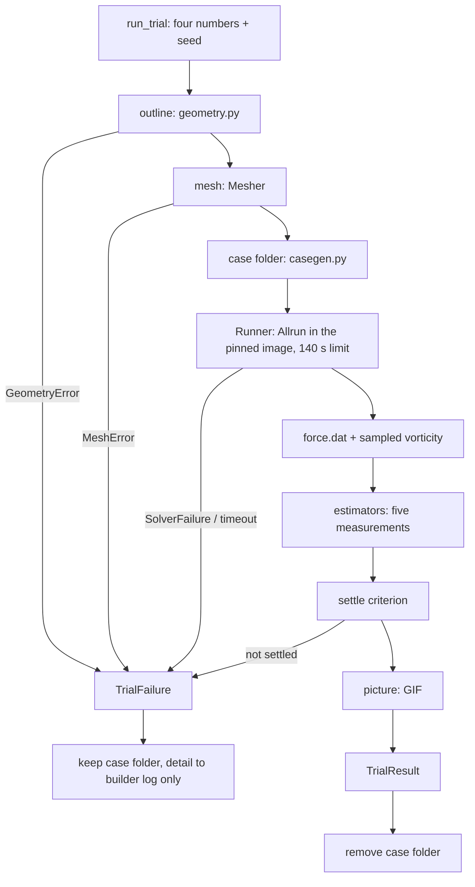

> **参考訳（日本語）** — 正本は英語版 [`.kiro/specs/wind-tunnel/design.md`](../../../.kiro/specs/wind-tunnel/design.md) です。内容が食い違う場合は英語版が優先されます。Kiro はこのファイルを読みません。
> 原文 SHA-256: `db417dbbdf0edf2f31a2d7d3f14e3610323632b35372c47f3f0400ef9b6c6654`
# Design: wind-tunnel

要件 1-18 を対象とします。設定は `wind-tunnel/model/settings.toml` とケースのテンプレートから、読み込み時に読みます。ソルバー設定の値は 2 か所に書きません。まだ存在しない値は、`<not yet recorded>` のように山括弧で書いた目に見えるプレースホルダーで、それぞれを埋めるタスクがあります（`rules.md` 4、Honest）。アダプター契約は `bench/src/bench/adapter.py`（`lab-bench` 設計 4）、アダプターの手本は `body-lab/adapter`（`body-lab` 設計 1-5）です。

## Overview

1 試行は、ソルバーの 1 回の実行です。アダプターは 4 つの数を、ボディの輪郭、メッシュ、OpenFOAM のケースにし、固定したダイジェストの Docker イメージで、実時間の上限のもとケースを 1 回実行し、力の履歴とサンプリングした渦度を読み、純関数で 5 つの計測を計算し、計測値とアニメーション GIF を 1 つ返します。何か問題があれば、固定の公開理由をもつ試行の失敗であり（要件 8）、作り上げた値は決して返しません。

「モデルは `lab/` から決して見えない」という規則を 1 か所で守るため、システムを 2 つのプロジェクトに分けます。

- `wind-tunnel/model/` はシステムそのものです: 数値、ケースのテンプレート、輪郭、Gmsh のレシピ、ソルバー出力のパーサー。ベンチのコードは含みません。
- `wind-tunnel/adapter/` はシステムをベンチに接続します: 宣言、実行、推定器、落ち着き基準、画像、失敗の対応づけ、円柱チェック。ソルバーの数値は 1 つも持ちません。

選択のハイライト（詳細は後述）:

| 話題 | 選択 | 理由 |
|---|---|---|
| ストローハル数の推定器 | 細かい周波数格子での最小二乗による正弦波フィットを、黄金分割探索で精密化する。FFT は使わない | ビンの幅 1/70（0.17 の約 8%）よりずっと細かく分解できる。適応時間刻みの不均等な時刻でも使える（5.2） |
| ソルバーの出力 | 関数オブジェクトが実行中に `force.dat` とサンプリングした渦度を書く。フィールドのダンプも再構成もしない | 実行が短く、ディスク使用が小さく、力と画像が同じ実行から来る |
| 画像 | Pillow の GIF。固定の 256 色パレットで、渦度をパレットの添字に写す | 色スケールが構成上すべての試行で同じ（9.1）。作図ライブラリも、文字も、メタデータもない |
| Docker | 固定したイメージの `docker run`。ケースフォルダーをバインドマウントし、`model/` の 1 つのスクリプト（`Allrun`）を使う | タイムアウトして kill するコマンドが 1 つ。イメージ内のコマンドはソルバー設定なので `model/` に置く（6.9） |
| 環境チェック | アダプターの構築時。スキャンは宣言だけを作る別のファクトリーを使う | `bench-scan` は Docker なしで動く必要がある（Kiro Web、公開） |
| Docker なしのテスト | 2 つの小さなプロトコルの背後に、偽のランナーと偽のメッシャー | 低速の 3 つのチェック以外は Kiro Web で動く |

## Architecture

```
wind-tunnel/
  README.md                       connection time, code size, circle check, limits (16, 17.4)
  numbers.md                      connection time (self-reported) and code size (16)
  circle-check.json               written by the circle check (15.5)
  form-knowledge-review.md        the reviewed list (12.3)
  count_lines.py                  writes the code size into numbers.md (16.2)
  model/                          uv project "wind-tunnel-model"; never visible from lab/
    pyproject.toml                depends on gmsh and numpy
    settings.toml                 every number of the solver setup (6.8, 6.9)
    case/                         OpenFOAM templates (*.in, placeholders @NAME@) and Allrun
    src/wind_tunnel_model/
      settings.py                 load and validate settings.toml; the Reynolds-number override
      geometry.py                 outline of the body from the four knobs (pure)
      mesh.py                     Gmsh recipe: outline -> mesh file
      casegen.py                  templates -> case folder (pure text)
      solver_output.py            parse force.dat and sampled-vorticity files
    tests/
  adapter/                        uv project "wind-tunnel-adapter"
    pyproject.toml                depends on lab-bench (path), wind-tunnel-model (path), numpy, pillow
    scan_sources.toml             solver files and lab layout (13.5)
    src/wind_tunnel/
      declaration.py              knobs, measurements, told text, budget, goal (1, 3, 4, 11)
      adapter.py                  WindAdapter, scan_adapter, the run pipeline
      environment.py              Docker and image check, environment record (7)
      runner.py                   Runner protocol, DockerRunner (8.7, 10)
      estimators.py               cd, cl_mean, cl_amp, strouhal, shedding (5)
      settle.py                   settle criterion (8.3)
      failures.py                 failure kinds and fixed public reasons (8)
      picture.py                  vorticity -> palette index -> GIF (9)
      circle_check.py             the circle check and its record (15)
      told_set.py                 export of the told set (2)
    tests/                        ordinary tests (no Docker)
    tests/slow/                   slow local tests (Docker), marker `slow`
  lab/                            made by bench-make-lab (14.3)
```

ベンチに加わるのは、スキャン抽出器の新しいファイル 1 つ（セクション 9）と、場合によってはノブの文の項目（Open question 1）です。`body-lab` には触れません（14.4）。`spikes/` は使いません（14.5）。



## Components and Interfaces

### 1. Declaration and told set (Req 1, 2, 3, 4, 11)

`declaration.py` は、要件 3.2 と 4.2 が与える定数と `measured_by`・ノブの文から、1 つの `Declaration` を作ります。

- ノブ: `NumberKnob` が 4 つ。順序は `aspect`、`corner`、`splitter`、`angle` で、範囲は 3.1、ノブの文は 3.2 のとおり。文は `declaration.py` の定数です。テストはそれを要件 3.2 のテキストと比べます（spec ファイルがあるときはそこから読むので、両者はずれません。`.kiro/` がない場所では、目に見える理由つきでスキップ）。
- 計測: `cd`、`cl_mean`、`cl_amp`、`strouhal`、`shedding`。単位は `1`、種類は `scalar`。`strouhal` は未計測結果 `not_shedding` を持ちます。
- `picture = "image/gif"`、`budget = 24`、`fake = False`、`goal` は 11.2、`measured_by` は 4.2。「落ち着いた部分」とだけ言い、時刻には触れません（4.3）。文面では、文が許す所で "force" を単数形で使い、伝える集合のどの語も、ソルバーファイルが与える語と等しくならないようにします（13.8）。決めるのは 13.8 のテストです。
- **契約にはノブの文を置く場所がありません**（要件 1.4、Open question 1）。この設計は選択肢 (A) で書いてあります: `NumberKnob` と `FunctionKnob` に 4 つ目の項目 `meaning: str = ""` を加え、`describe.declaration_text` がノブ名の後に出力し、`check_declaration` は `str` を求めます。`body-lab` は空の既定値のままで、テキストは変わりません。ユーザーの答えが (B) か (C) なら、変わるのは `declaration.py` と伝える集合の書き出しだけで、4 つの文が `goal` か `measured_by` に移ります。答えが出るまで、`declaration.py` を書くタスクは始めません。
- ファクトリーは 2 つ: `WindAdapter()`（環境をチェックする、セクション 6）と `scan_adapter()`（同じ宣言で、`run_trial` も、チェックもない）。`scan_sources.toml` は `scan_adapter` を `adapter` として挙げます。テストは、両者の宣言が等しいことを確かめます。したがってスキャンに Docker は要りません（13.5、14.4）。
- `told_set.py` にはコンソールコマンド `wind-tunnel-told-set --out PATH` があります。`scan_adapter().declaration()` に `bench.frontend.describe.declaration_text` を呼び、そのテキストを、末尾の改行だけ付けて書きます。パスは必須です（2.1-2.3）。テストは、出力を `describe.py` がツールの説明に入れるテキストと比べます（2.4）。

### 2. Geometry (Req 6.1-6.5, 6.10) in `wind_tunnel_model/geometry.py`

純関数 `outline(aspect, corner, splitter, angle, settings) -> Outline`。Gmsh は import しません。

- 回転前のボディの座標系: 長方形は x が [-a/2, a/2]、y が [-1/2, 1/2]、`a = aspect`。流れは +x 向きなので、後ろは +x 側です。
- 角の半径 `r = corner * min(1, a) / 2`（6.2）。直線部分は、長さ `side - 2r` が 0 より大きいとき残し、ちょうど 0 のとき省きます（`corner = 1` と短い辺。`a = 1` では 4 辺すべてが省かれ、輪郭は 4 つの四分円弧、つまり円になります）。`corner` と 2 のべき乗の浮動小数点の積は、ちょうど 0 になる場合を正確にします。
- 板（`splitter` > 0 のとき）: 厚さ `t` = 0.08（`settings.toml`）で、中心線上に、`x = a/2 - t`（ボディの内側。丸めがどうでも隙間ができない）から `x = a/2 + s` まで。輪郭は和集合です: 後ろの直線部分（または円弧）は、板の上辺と下辺がそれと交わる所で切ります。交点は閉じた式で求めます: `t/2 <= 1/2 - r` のとき `x_c = a/2`（`a < 1` では `r <= 1/4` なので後ろは常に直線）、そうでなければ `x_c = a/2 - r + sqrt(r^2 - (t/2 - (1/2 - r))^2)`。板の内側の重なりに、独自の輪郭は要りません。
- 原点（長方形の中心）まわりに `angle` 度の回転。向きは `settings.toml` で固定（`rotation_sense = "counter-clockwise"`、+x の流れ、+y が上。伝えない、6.5）。
- 出力: 順序づけられた閉じたプリミティブの並び（`Line(p, q)`、`Arc(p, centre, q)`）。端点は正確です。
- `GeometryError`（ノブの値と理由を持つ。ビルダー側だけ）: 正の長さの部分が `min_edge`（設定。`<chosen in the mesh task>`）より短いとき、または `x_c` が定義できないとき。長さがちょうど 0 の部分はエラーではありません（要件 6.10）。なぜユーザーが必要かは Open question D1 を参照。

### 3. Mesh (Req 6.8, 7.2) in `wind_tunnel_model/mesh.py`

- Gmsh の Python API、組み込みカーネル: 輪郭から点、線、`addCircleArc`。外側の長方形は 6.8 の領域（入口はボディの中心の 6 高さ前、出口は 18 後ろ、上下は 7。中心から測る。`settings.toml [domain]` と同じ値）。ボディを穴とする平面サーフェスが 1 つ。
- サイズ場: ボディの曲線からの距離としきい値の場（`size_body` から `size_far` へ増える）と、近い後流の箱の場（`size_wake`）。サイズは `<chosen in the mesh task, before the circle check is run>`。その後の変更は円柱チェックを変えるかもしれず、ユーザーが必要です（6.8）。
- z 方向に `depth`（`settings.toml`。単位奥行きあたりの力の単位、1）だけ 1 層押し出し、OpenFOAM が 2D のケースとして扱えるようにします。物理グループがパッチ `inlet`、`outlet`、`lateral`（上下）、`obstacle`、`frontAndBack` を与えます。名前は `settings.toml [patches]` にあり、レシピとテンプレートの両方が使います。どれも伝える集合の語にならないよう選んであります（13.8）。
- Gmsh の `.msh` ファイルとしてケースフォルダーに書きます。メッシュ生成は乱数シードを使いません。Gmsh のアルゴリズムの選択とスレッド数（1）は `settings.toml` で明示します（10.2）。
- インターフェース `Mesher.build(outline, settings, dest) -> None`、`MeshError(reason)` を送出します。`GmshMesher` が本物で、`FakeMesher` はテスト用に固定の小さなファイルを書きます。

### 4. Case and solver (Req 6.6, 6.8, 6.9, 10.1) in `model/case/` and `casegen.py`

`casegen.render_case(knobs, settings, dest)` は、すべてのテンプレートをコピーし、`@NAME@` を `NAME` という設定（float の `repr` で整形）に置き換え、ファイルをソート順に、`\n` 終端で書きます。プレースホルダーの値がない場合、または置換後にプレースホルダーが残った場合はエラーです。等しい入力での 2 回の呼び出しは、同一のバイト列を書きます（10.2）。

テンプレートの内容（名前は OpenFOAM のもの。値は `settings.toml` から）:

| File | Holds |
|---|---|
| `constant/transportProperties.in` | `nu = speed * height / reynolds` |
| `constant/momentumTransport.in` | laminar |
| `system/controlDict.in` | `pimpleFoam`、終了時刻 150、`maxCo` 0.8 の適応刻み、`maxDeltaT`（0.05 以下、セクション 5）、フィールド出力なし、下の関数オブジェクト |
| `system/fvSchemes.in`, `fvSolution.in` | 2 次精度の時間・対流スキーム（`backward`、`linearUpwind`）、外側修正 1 回の圧力・速度連成。選択は円柱チェックで確認する |
| `system/decomposeParDict.in` | 3 つの部分領域、方法 `simple`、分割数 (3 1 1)、固定のテキスト（10.1） |
| `system/changeDictionaryDict.in` | `gmshToFoam` の後で `frontAndBack` を `empty` にする |
| `0/U.in`, `0/p.in` | 入口の速さ `(speed 0 0)`、`lateral` は `slip`、`obstacle` は `noSlip`、出口の圧力 0 |
| `system/functions.in` | `obstacle` 上の力の関数オブジェクト（密度 1、毎時間刻みで書く）と、渦度のサンプリング（下） |
| `Allrun` | `set -e`、`gmshToFoam`、`changeDictionary`、`decomposePar`、`mpirun -np 3 pimpleFoam -parallel` |

- 上下の境界は brief で指定されていません（"walls 7 above and below"）。この設計は `slip` を取ります。受け入れられるかは円柱チェックが決めます（Decision 5）。
- 渦度のサンプリング: 関数オブジェクト `vorticity` と、画像の窓を覆う `grid_x * grid_y` 点の規則格子上の cloud `sets` サンプラー。raw テキストで、最初のフレームの時刻から終わりまで、`spacing` 時間単位ごとに書きます。格子点は `casegen` がケースに書きます（設定だけで決まります）。流体の外の点はサンプラーが返さず、画像はそれをボディのマスクとして読みます。出力はどちらもケースの `postProcessing/` に入ります。これは並列実行の集約された出力なので、`reconstructPar` は要りません。正確な綴りは、スモーク実行のタスクで確認します（停止条件 S5）。
- `Allrun` のイメージ内コマンドは、ほかの何かの 2 つ目の写しではありません: ソルバー設定です（6.9）。

### 5. Estimators and settle criterion (Req 4, 5, 8.3) in `adapter/estimators.py`, `settle.py`

入力は、落ち着いた部分（`t >= average_from`）の力の履歴 `(t, Fx, Fy)` で、時刻は不均等です。定数: `ESTIMATOR_MAX_DT = 0.05` は、1% の精度が示されるサンプル間隔の最大値です。`settings.toml` は読み込み時に `max_delta_t <= ESTIMATOR_MAX_DT` を確認されます。

- `cd = mean(Fx) / q`、`cl = Fy / q`、`q = 0.5 * rho * speed^2 * height * depth`（値は `settings.toml` の 1）（4.2、4.6）。平均は時間重みつきです（落ち着いた部分の台形則の積分を、その長さで割る）。
- `cl_mean` は `cl` の時間重みつき平均。`cl_amp = (max(cl) - min(cl)) / 2` はサンプルについて。
- `shedding = 1.0`（`cl_amp > 0.01` のとき）、そうでなければ `0.0`（4.2）。
- `strouhal`（`shedding` が 1 のときだけ）: 何も引かずに、`5 / T` から `1.0` までの周波数格子（刻み `1 / (10 T)`、`T` は落ち着いた部分の長さ）の各 `f` について、`a cos(2 pi f t) + b sin(2 pi f t) + c` を線形最小二乗でフィットして説明された分散を取り、最良の格子周波数を、隣り合う 2 つの格子刻みの中で、幅 1e-9 まで黄金分割探索で精密化します。`St = f * height / speed`。決定的で、乱数の出発点はありません。理由: `T = 70` では FFT の 1 ビンは `1/70 = 0.0143`、0.17 の 8%（5.2）。この推定器にはビンがありません。格子の開始 `5 / T` は、8.3 の 5 周期の規則を満たせる最低の周波数です。
- `shedding` が 0 のとき、アダプターは `strouhal` に `NotMeasured("not_shedding", "the lift does not oscillate: cl_amp is not above 0.01")` を返し、推定器は走らせません（4.4）。
- 要件 5.3 の精度の範囲: St は [0.08, 0.5]。下端は 5 周期の規則（0.0714）に余裕を持たせたもの。上端は、ボディが鈍い物体のとき予想される値の少なくとも 2 倍で、0.5 と `ESTIMATOR_MAX_DT` では 1 周期に 40 サンプルあります。5.3 と 5.4 の振幅は [0.011, 3]、平均は [-3, 3] です。
- 落ち着き（8.3）、`settled(t, cd, cl, shedding, st) -> SettleResult(ok, reason)`: 落ち着いた部分を時間の中点で分けます。`|mean cd(first) - mean cd(second)| <= 0.02 * |mean cd(whole)|`。`|cl_amp(first) - cl_amp(second)| <= max(0.1 * cl_amp(whole), 0.002)`。`shedding` が 1 のとき、`st * speed / height * T >= 5`。比較は除算なしで書きます。理由には、失敗した基準を名指します（ビルダー側）。

### 6. Environment and run (Req 7, 8.7, 10)

- `environment.check(settings)` は `WindAdapter.__init__` で走ります。Docker がなければ、最初の試行ではなくベンチサーバーの起動時に止まります。`docker version`、記録したダイジェストでのイメージの `docker image inspect`、Docker マシンの CPU 数の `docker info`（10.1 の 3 プロセス以上。さもないと `mpirun` が始められない）を実行します。失敗はそれぞれ `EnvironmentFailure` で、次のどれか、期待したもの、見つけたものを名指します: Docker に届かない、イメージがない、ダイジェストが違う、CPU が足りない。pull もほかのタグもしません（7.4）。
- 次に、`bench-run/wind-tunnel/environment.jsonl`（git 管理外、ビルダー側）に JSON を 1 行追記します: イメージ名、ダイジェスト、イメージ ID、Gmsh のバージョン、Pillow と numpy のバージョン、プラットフォーム。時刻は書かないので、ファイルは環境の関数になります（7.5）。封印された記録はこれを持たず、`measured_by` も触れません。
- イメージ: `opencfd/openfoam-default:2412`。`name@digest` として実行します。`settings.toml [image]` は `name`、`tag`、`digest = "<not yet recorded>"`、`image_id = "<not yet recorded>"` を持ちます。ローダーはプレースホルダーを拒否します。ユーザーの Mac 上のタスクが、`docker image inspect` で両方を記録します（ダイジェストはイメージインデックスのもの。イメージ ID は arm64 ビルドのものなので、組でプラットフォームを固定します、7.1）。ダイジェストは作り上げません。
- `Runner` プロトコル: `run(case_dir, deadline) -> RunOutput(force_file, sample_files)`、`SolverFailure(kind, reason, detail)` を送出します。`DockerRunner` は `docker run --rm --name <case-name> -v <case>:/case -w /case <name@digest> ./Allrun` を `subprocess.run(..., timeout=remaining)` で実行します。`remaining = 140 s - (輪郭とメッシュで使った時間)`。タイムアウトでは `docker kill <case-name>` を実行し、`SolverFailure("timeout")` を送出します。ゼロでない終了、出力ファイルの欠落、非有限値は、`detail` にソルバーのログの最後の数行を入れた `SolverFailure` になります。イメージ内の正確な呼び出し（ユーザー ID、イメージのエントリーポイントがすでに環境を準備するか）は、スモーク実行のタスクで確認します（S5）。
- ケースフォルダー: `bench-run/wind-tunnel/<16 桁の 16 進数のシード>/`。アダプターが作ります。`bench-run/` は git 管理外です。フォルダー名は試行のシードをラベルとしてだけ使います（Decision 3）。すでにあるフォルダーは上書きせず失敗です。成功後に削除し、失敗後は残し、`detail` に名前を入れます（10.5、10.6）。
- `run_trial(inputs, seed)`: `inputs` がちょうど 4 つの名前と、範囲内の有限な数を持つことを確かめます（そうでなければ `ValueError`。ベンチがベンチ障害にします。何もクリップしません、3.4）。次に上の図の流れ。予期しない例外は捕まえません。
- レイノルズ数: `Settings.load()` は 150 を読みます。`Settings.with_reynolds(x)` はコピーを返し、`circle_check.py` だけが呼びます。テストは両プロジェクトの `src/` のファイルの構文木をたどり、それ以外のファイルがこれに触れていれば失敗します。`WindAdapter` はレイノルズ数の引数を取らないので、試行の入力も lab のファイルも、そこには届きません（6.7）。

### 7. Picture (Req 9) in `adapter/picture.py`

- 入力: `frames` 個の各時刻について、`grid_x * grid_y` 格子上でサンプリングした渦度 `omega_z` と、サンプラーが返さなかった点のマスク。
- 写像: `index = round(255 * (clip(omega, -L, L) + L) / (2 L))` を 0..254 に制限します。`L` は `settings.toml` の `vorticity_limit`（`<not yet chosen>`。16 の角の点の実行の渦度の範囲から選び、その後は固定、9.5）。マスクされた点は添字 255。パレットは固定の 1 つの表: 255 エントリーの発散的なランプと、255 番目の中立的な灰色で、5 つの基準色の間の線形補間で `picture.py` が作ります。
- フレームは、サンプリング格子から `width * height` に双線形フィルターで拡大したパレット画像で、すべて同じパレットを共有します。Pillow の GIF ライターで、フレームごとの固定の長さと無限ループで書きます。コメントもほかの拡張も書きません。`bench.pictures.check_picture` をテストでそのバイト列に対して走らせます。
- 設定（9.4、`settings.toml [picture]`）: `frames = 36` フレーム、`0.5` 時間単位間隔で実行の最後の部分に並べるので、最初のフレームは `150 - 35 * 0.5 = 132.5` で、落ち着いた部分の中です（9.3）。`width = 640`、`height = 320`。サンプリング格子は 320 x 160。窓は x が [-2.5, 9.5]、y が [-3, 3]（幅と高さの比 2 対 1）。1 フレーム 100 ms。これらは 9.4 の範囲の中で、新しい spec なしに最初のセッションの後に変えられます。
- ライブラリ: numpy と Pillow がアダプターの依存です（任意のグループはありません。どちらもすべての試行に必要）。matplotlib は使いません: パレット、マスク、スケールは数行で、作図ライブラリは軸、フォント、メタデータを持ち込み、9.2 が禁じています。

### 8. Failures (Req 8)

`failures.py` が種類と、唯一の公開テキストを持ちます:

| Kind | Cause (builder side) | `public_reason` |
|---|---|---|
| `not_settled` | 落ち着き基準を満たさない | "the trial did not settle" |
| `incomplete` | 発散、非有限、異常終了、出力の欠落や読めない出力、ジオメトリまたはメッシュのエラー | "the trial could not be completed" |
| `timeout` | 140 s の上限 | "the trial took too long" |

`detail` は、種類、原因、ノブの値、ケースフォルダー、ソルバーのログの末尾を持ちます。理由は入力に依存しません（8.5）。`lab/` には何も書きません（8.6）。再試行はありません（8.2）。タイムアウトは失敗であり、未計測結果ではありません（8.8）。

### 9. Blind scan extractors (Req 13) in `bench/src/bench/scan/foam_terms.py`

`terms.py` の `EXTRACTORS` に登録します。標準ライブラリのみ。

| Extractor | Source | Terms |
|---|---|---|
| `openfoam-dict` | 各 `case/**/*.in` | すべてのエントリーのキーワード、すべてのサブ辞書の名前、値であるすべての裸の語（スキーム、ソルバー、境界の種類、関数オブジェクトの名前）。数、スイッチ語 `yes no on off true false`、`FoamFile` ヘッダーのブロックは構文なので除く |
| `shell-words` | `case/Allrun` | コマンド名 |
| `toml-names` | `settings.toml` | キーと、名前に見える文字列の値（パッチ名、イメージ名とタグ） |
| `python-names` | `geometry.py`, `mesh.py`, `casegen.py`, `solver_output.py` | 関数、クラス、モジュールレベルの定数の名前。名前に見える文字列リテラル |

- 読めない、またはパースできないファイルは、ファイルと問題を名指す `ScanError` です（13.2）。テンプレートのプレースホルダー `@NAME@` は裸の語 `NAME` として読みます。
- ソースのファイル名と語幹は、既存のコードが terms に入れます（`lab-bench` の 11.1）。
- `scan_sources.toml` は、ソース、`body-lab` と同じ形の lab のレイアウト、そして `adapter = "wind_tunnel.adapter:scan_adapter"` を挙げます。
- 許可リストは `lab-bench` が作るままです: 宣言された名前（ノブ名、計測名、結果名）。ノブの文の語はほかのビルダーのテキストと同じようにスキャンされ、それらのために何も除かれません（要件 13.3）。テスト（13.8）は、本物の伝える集合と本物の導かれた語を作り、両者が出会えば失敗します。予想される問題は、OpenFOAM がキーワードとして使う普通の語です（たとえば `type`、`value`、`method`、`default`、`none`、`time`、そしてイメージ名の中の語 `default`）。解決の順序は要件 13.4 が定めます: ビルダーが選んだものは名前を変える。言い換える。ユーザーに尋ねる。除外リストの項目を提案する前に、抽出器の出力をユーザーのレビュー用に一覧にします（Open question D2）。

### 10. Circle check and numbers (Req 15, 16)

- `circle_check.py` にはコンソールコマンドがあります。`with_reynolds(100.0)` で設定を作り、円（`aspect` 1、`corner` 1、`splitter` 0、`angle` 0）を、本物のメッシャーとランナーで `run_trial` と同じパイプラインに通し、`strouhal` を得ます。`literature(re) = A / re + B + C * re`、A = -3.3265、B = 0.1816、C = 1.600e-4 と、15.4 の出典のテキストはモジュールの定数です。チェックは `abs(difference_percent) <= 5` のとき合格で、`difference_percent = 100 * (measured - literature) / literature` です。`wind-tunnel/circle-check.json` に `reynolds`、`measured`、`literature`、`constants`、`source`、`difference_percent`、`image_digest`、`passed` を書きます（15.5）。円が `strouhal` を与えない、または落ち着かない場合、チェックはその理由で失敗し、`passed = false` を書きます。
- `count_lines.py` は `wind-tunnel/adapter/` と `wind-tunnel/model/` の空行でもコメントでもない行を数え（ロックファイル、仮想環境、キャッシュは除く）、テストファイルは別の行に挙げ、`numbers.md` のコード量の部分を書き換えます。接続時間はユーザーが入力します（16.1）。数値ができるまで、ファイルは `<not yet measured>` を保持します（16.3）。
- レビュー済みの一覧は `wind-tunnel/form-knowledge-review.md` です: Dr. Kiro が読めるテキストごとに 1 行、"reviewed, no form knowledge" と、誰がレビューしたか（12.3）。

## Data Models

`settings.toml`（model。各行の読み手は `settings.py` だけで、キーの欠落、余分、プレースホルダーで失敗します）:

| Section | Keys | Source of the value |
|---|---|---|
| `[flow]` | `reynolds`, `speed`, `height`, `depth`, `density` | 150（brief）、1、1、1、1 |
| `[body]` | `thickness`, `min_edge`, `rotation_sense` | 0.08（decisions）、`<chosen in the mesh task>`、設定 |
| `[domain]` | `ahead`, `behind`, `above_below` | 6、18、7（brief） |
| `[time]` | `end`, `average_from`, `max_co`, `max_delta_t`, `initial_delta_t` | 150、80、0.8（brief）、0.05 以下、`<chosen in the smoke-run task>` |
| `[mesh]` | `size_body`, `size_far`, `size_wake`, `wake_length`, `algorithm`, `threads` | `<chosen in the mesh task>`、algorithm と threads は設定 |
| `[run]` | `processes`, `timeout_s`, `decomposition` | 3、140、`simple (3 1 1)` |
| `[image]` | `name`, `tag`, `digest`, `image_id` | brief、`<not yet recorded>` |
| `[patches]` | 5 つの名前 | 選んだもの。伝える集合の語はなし |
| `[picture]` | `frames`, `spacing`, `width`, `height`, `grid_x`, `grid_y`, `window`, `frame_ms`, `vorticity_limit` | セクション 7、`<not yet chosen>` |

そのほかの記録:

- `Outline`: `Line` と `Arc` の点の組の、順序づけられた閉じたタプル。`GeometryError(reason, knobs)`。
- `ForceSeries`: `t`、`fx`、`fy`。同じ長さの `numpy` 配列で、落ち着いた部分だけ、有限。
- `SolverFailure(kind, reason, detail)`、`FailureKind`: `not_settled`、`incomplete`、`timeout`。
- `SettleResult(ok, reason)`。
- `environment.jsonl` の 1 行: `{image, digest, image_id, gmsh, pillow, numpy, platform}`。
- `circle-check.json`: セクション 10。
- 力のファイル: 列は `time`、`(total_x total_y total_z)`、`(pressure ...)`、`(viscous ...)`。`#` で始まる行はコメント。読むのは total だけ。

## Correctness Properties

*A property is a characteristic or behavior that should hold true across all valid executions of a system-essentially, a formal statement about what the system should do. Properties serve as the bridge between human-readable specifications and machine-verifiable correctness guarantees.*

性質は `hypothesis`（それぞれ 100 例以上、ベンチのテストと同じプロファイル）でテストし、Docker、OpenFOAM、ディスプレイは要りません。性質 1-3 と 13 は Gmsh も要りません。

### Property 1: Outline is closed and valid for every knob value

For all `aspect` in [0.5, 3], `corner` in [0, 1], `splitter` in [0, 3], `angle` in [0, 30]（両端を含む）、the outline is either a closed, continuous loop in which no straight piece has length zero, or a `GeometryError` that names the piece shorter than `min_edge`.

**Validates: Requirements 3.3, 6.10**

### Property 2: Corner radius follows the definition

For all `aspect` below and above 1 and all `corner`, every corner arc has radius `corner * min(1, aspect) / 2`; the straight piece along the shorter side has length `shorter - 2r`, and is absent exactly when that is zero; for `splitter` 0 the area of the outline equals `aspect - (4 - pi) r^2` within 1e-5; the height of the unrotated outline is 1.

**Validates: Requirements 6.1, 6.2**

### Property 3: Plate and rotation

For all knob values, the outline has a plate exactly when `splitter` > 0, the plate reaches `a/2 + splitter` before rotation, and the union has no gap; rotation by `angle` preserves every piece length and the distance of every endpoint from the origin, and `angle` 0 is the identity.

**Validates: Requirements 6.3, 6.4**

### Property 4: Strouhal accuracy

For all sinusoidal lift signals with St in [0.08, 0.5], any mean in [-3, 3], any amplitude in [0.011, 3], any phase, sampled over 70 time units with uneven intervals not above `ESTIMATOR_MAX_DT`, the estimated `strouhal` is within 1% of St.

**Validates: Requirements 5.2, 5.3**

### Property 5: Amplitude and mean accuracy

For all such signals, and for amplitude 0, `cl_amp` is within 1% of the amplitude (absolute 1e-6 at 0) and `cl_mean` is within 1% of the mean (absolute 1e-6 at 0).

**Validates: Requirements 5.4**

### Property 6: Shedding flag and the not-measured outcome

For all force series, `shedding` is 1 exactly when the estimated `cl_amp` is above 0.01; `strouhal` is the `not_shedding` outcome exactly when `shedding` is 0, and carries a number exactly when `shedding` is 1.

**Validates: Requirements 4.4, 4.5, 5.5**

### Property 7: Estimators are deterministic and shift-invariant

For all force series, two evaluations give bit-equal results, and shifting all times by a constant changes none of the five measurements.

**Validates: Requirements 5.1, 5.6**

### Property 8: Settle criterion

For all stationary synthetic series (constant `cd` with noise below 1%, sinusoidal lift with at least 5 periods in the window) the criterion says settled; for all series where a ramp makes the mean `cd` of the halves differ by more than 2%, or the amplitude of the halves differ by more than 10% and 0.002, or an oscillating series has fewer than 5 periods, it says not settled; scaling `cd` by a positive constant does not change the outcome.

**Validates: Requirements 8.3**

### Property 9: Failure mapping

For all failure causes (solver failure kinds, geometry error, mesh error, non-finite value, timeout, not settled) and all knob values, the `TrialFailure` has one of the three fixed public reasons, the reason is the same for the same kind whatever the inputs, it has no term of a fixed list of solver words, and the `detail` holds the cause.

**Validates: Requirements 8.1, 8.4, 8.5, 8.8**

### Property 10: Result contract and seed independence

For all in-range knob values and two seeds, `run_trial` with the fake mesher and fake runner returns a result that passes `bench.adapter.check_result` for the declaration, and the two results are equal.

**Validates: Requirements 3.3, 3.4, 10.2, 17.1**

### Property 11: Case generation is deterministic and complete

For all knob values and Reynolds numbers in a range, `render_case` writes identical bytes when called twice, leaves no `@` placeholder, and writes a viscosity equal to `speed * height / reynolds`.

**Validates: Requirements 6.6, 6.7, 10.1, 10.2**

### Property 12: Force file round trip

For all force series with finite values and increasing times, parsing the text that a test-side writer produces from the series gives back the series (within the printed precision), and a file with a non-finite value or no rows is refused.

**Validates: Requirements 8.1**

### Property 13: Told set export equals the declaration

For all declarations accepted by `check_declaration` (generated with knob texts), the exported document equals the text `describe.declaration_text` builds for the tool descriptions, is byte-identical on two calls, and contains no file name, path, version or session value.

**Validates: Requirements 1.1, 2.1, 2.2, 2.3, 2.4**

### Property 14: Picture mapping and file

For all vorticity fields and all limits `L`, the palette index is non-decreasing in the value, clipped to 0..254, and 255 only for masked points; the same field gives the same bytes; the GIF passes `bench.pictures.check_picture`, has 24 to 48 frames and a width between 480 and 800 with height half of it.

**Validates: Requirements 9.1, 9.2, 9.4**

### Property 15: Planted solver terms are found

For all terms planted from each kind of solver source (an OpenFOAM keyword, a patch name, a function-object name, a script name), the scan finds the term in builder-level text and ignores it in Dr. Kiro-level text; an unreadable source file is an error.

**Validates: Requirements 13.1, 13.2, 13.7**

## Error Handling

| Situation | Outcome | Where it is seen |
|---|---|---|
| Docker、イメージ、ダイジェスト、CPU のどれかが違う | 構築時の `EnvironmentFailure`。ベンチサーバーは起動しない | ビルダー |
| ジオメトリまたはメッシュが作れない | `TrialFailure` `incomplete` | Dr. Kiro は固定の理由を見る。ビルダーはノブの値を見る |
| ソルバーの異常終了、非有限値、出力の欠落 | `TrialFailure` `incomplete` | 同上 |
| 140 s 超過 | コンテナを kill、`TrialFailure` `timeout` | 同上 |
| 落ち着き基準を満たさない | `TrialFailure` `not_settled` | 同上 |
| 結果が契約を破る | `check_result` によるベンチ障害 | ビルダー |
| `settings.toml` にプレースホルダーが残る、キーがない | 読み込み時のエラー | ビルダー |
| アダプターのプログラムエラー | 例外。固定のテキストのベンチ障害 | ビルダー |

`TrialFailure` はセッションを止めます（`lab-bench` 2.7 と 11.3）。これらのどれも、再試行も修復もされません。

## Testing Strategy

性質に基づくテストは、純粋な部分に当てはまります: ジオメトリ、推定器、落ち着き基準、失敗の対応づけ、ケースの生成、パース、伝える集合の書き出し、画像の写像、抽出器。Docker、ソルバー、Gmsh の出力の質、円柱チェック、形の知識のレビューには当てはまりません。これらは例によるテスト、低速のローカルテスト、レビュー済みの一覧を使います。

| Kind | Tests | Runs where |
|---|---|---|
| Properties 1-15 | `hypothesis`、各 1 つのテスト、`Feature: wind-tunnel, Property N` のタグ | Kiro Web とローカル |
| Examples | 宣言が `check_declaration` を通る。両ファクトリーが等しい宣言を与える。ノブの文が要件 3.2 と等しい。本物のファイルでの 13.8 の重なりチェック。レイノルズ数 100 での円柱の文献値が 1e-6 以内で 0.164335 で、帯が 0.1561 から 0.1726。`max_delta_t <= ESTIMATOR_MAX_DT`。レイノルズ数の上書きのたどり | Kiro Web とローカル |
| Gmsh | ノブの範囲の角でのメッシャーが、5 つの名前つきグループを持つメッシュファイルを与える。`needs_gmsh` を付け、Gmsh が import できない場所では目に見える理由つきでスキップ（タスクがまず Kiro Web でこれを確かめる。`body-lab` が描画でそうしたように） | Gmsh が import できる場所 |
| Slow (marker `slow`、既定では除外、Docker) | 円柱チェック（15）。同じ入力 2 回で同一の計測と画像（10.4）。16 の極値の実行（17.2）。ほぼ縮退した `corner` と `splitter` の実行（Open question D1） | ローカルの Mac のみ |
| Review | `form-knowledge-review.md`（12.3） | 読んで |

通常のスイートは `FakeMesher` と `FakeRunner` を使います。`FakeRunner` は既知の正弦波から合成した `force.dat` と渦度ファイルを書くので、`run_trial` は Docker なしで端から端までテストされます。

## Requirements coverage

| Part | Requirements |
|---|---|
| `declaration.py`, `told_set.py`, the knob text field | 1, 2, 3, 4.1-4.4, 11 |
| `geometry.py` | 3.3, 6.1-6.5, 6.10 |
| `mesh.py`, `casegen.py`, `model/case/`, `settings.toml` | 6.6-6.9, 9.5, 10.1 |
| `environment.py`, `runner.py` | 7, 8.7, 8.8, 10.3, 10.5, 10.6 |
| `estimators.py`, `settle.py` | 4.2-4.6, 5, 8.3 |
| `failures.py` | 8.1-8.6 |
| `picture.py` | 9.1-9.6 |
| `foam_terms.py`, `scan_sources.toml` | 13 |
| `circle_check.py`, `count_lines.py`, `numbers.md` | 15, 16 |
| `form-knowledge-review.md` | 12 |
| `lab/`, the install steps in `README.md` | 14.3, 17.3 |
| Tests | 5, 8, 10.4, 13.7, 17.1, 17.2 |
| Order of work (tasks): GIF gate first (9.9), hands-on steps last (18.3) | 9.7-9.9, 18 |

## What would make me stop and ask

- S1. Open question 1 へのユーザーの答えが (A) でない: ノブの文に別の場所が要る。
- S2. GIF チェック（`spikes/gif/results.md`）がない、または失敗（9.8、9.9）。
- S3. 抽出器と、(A) の場合のノブの文の項目以外の `lab-bench` の変更（14.2）。
- S4. 円柱チェックを実行した後で変えなければならないメッシュまたはソルバーの設定（6.8）。5% の外の円柱チェック（15.7）。1 つの入力の 2 回の実行が違う（10.4）。140 s より遅い実行、または 900 s に収まらない 6 回の実行（8.7）。16 の極値の実行のうち、失敗または落ち着かないもの（17.2）。
- S5. スモーク実行で確認できない OpenFOAM の綴り、イメージ内のコマンド、Docker のオプション（たとえば関数オブジェクトの時間窓、サンプラーの出力の配置、コンテナ内のユーザー ID）。
- S6. ソルバーファイルから導かれた語が、伝える集合やビルダーのテキストと衝突し、名前の変更や言い換えで避けられない場合: 質問として出し、除外リストには決して加えない（13.4）。
- S7. 実行を失敗させる、または上限を超えさせる、ほぼ縮退した `corner` または `splitter`（D1）。
- S8. 事前チェックがブラインドスキャンで許されないと言う画像や数値を、維持したいという希望。

## Decisions

この設計でビルダーが決めたことです。要件は変えません。

1. **2 つのプロジェクト。** `model/` は、ジオメトリ、Gmsh のレシピ、パーサーを持つ uv プロジェクトで、アダプターはそれにパスで依存します。要件 7.2 は Gmsh がアダプター自身の uv プロジェクトから来ると言いますが、ここではモデルのプロジェクトを通して来て、アダプターの `uv.lock` にロックされます。Gmsh のレシピがモデルの一部だからです（13.5 はそれをジオメトリスクリプトと呼ぶ）。ユーザーが Gmsh をアダプターで宣言したいなら、レシピをアダプターに移し、抽出器がそこで読みます。
2. **ストローハル数は周波数格子上の最小二乗で。** 補間つきの FFT ではない（セクション 5）。
3. **ケースフォルダーは試行のシードで名づける。** 契約はアダプターにセッションや試行の ID を渡さず、シードはその両方の関数だからです（`lab-bench` 6.3）。要件 10.2 はアダプターがシードを使わないと言います。これはラベルとしてだけで、性質 10 が、結果がそれに依存しないことを示します。カウンターと入力のハッシュのほうがよければ、そう言ってください。
4. **環境チェックは構築時。スキャンには 2 つ目のファクトリー**（セクション 1）。
5. **上下の境界は `slip`、2 次精度のスキーム、単純分割 (3 1 1)。** brief は固定していません。これらは最初の選択で、円柱チェックが判断します。チェックの後の変更にはユーザーが必要です。
6. **渦度は実行の中でサンプリング。** 関数オブジェクトで。フィールドの出力も `reconstructPar` もなし。
7. **画像は Pillow と numpy だけ。** 固定の 1 つのパレット。36 フレーム、640 x 320、1 フレーム 100 ms。
8. **パッチ名は `inlet`、`outlet`、`lateral`、`obstacle`、`frontAndBack`。** どれも伝える集合の語ではない。
9. **Docker マシンの CPU のチェック。** 7.3 に加えて。

## Open questions

ユーザーへ。質問 1 と 2 は `requirements.md` の繰り返しです。

1. 4 つのノブの文の置き場所（要件の選択肢 A、B、C）。設計は (A) を前提にしています。
2. `angle` の正の向きと板の厚さを伝えるか。
- D1. 範囲の端にとても近いノブの値は、メッシュサイズより短い辺を作ります: `corner` が 0 の近く、または 1 の近く（数千分の 1 の円弧や直線部分）、`splitter` が 0 の近く（数千分の 1 の長さの板）。すると、セルのサイズが下がり、時間刻みもセルのサイズとともに下がるので、実行が 140 s で終わらないかもしれず、タイムアウトはセッションを止めます。ノブの値は変えられず（3.4）、lab の規則による拒否にはベンチの変更が要ります。提案: まず測り（低速のほぼ縮退した実行）、数値を添えて尋ねる。選択肢は次のとおり: Dr. Kiro の言葉のメッセージでそのような値を拒否するベンチの規則（`lab-bench` の変更）、宣言する範囲を狭める（要件 3.1 の変更）、リスクを受け入れる。
- D2. 抽出器は普通の語（`type` や `value` のような OpenFOAM のキーワード）を導きます。除外リストの提案にはユーザーの承認が必要なので（`rules.md`）、最初のセッションの前の手作業のステップになります。要件 18.1 はまだこれを挙げていません。
