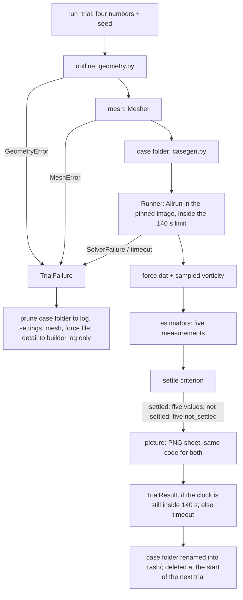

> **参考訳（日本語）** — 正本は英語版 [`.kiro/specs/wind-tunnel/design.md`](../../../.kiro/specs/wind-tunnel/design.md) です。内容が食い違う場合は英語版が優先されます。Kiro はこのファイルを読みません。
> 原文 SHA-256: `4269d437cd3b1db567a0619bc461662704b7c0b621d7a6672245a24c2e405ce6`
# Design: wind-tunnel

要件 1-18 を対象とします。設定は `wind-tunnel/model/constants.toml`、`wind-tunnel/model/image-lock.toml` とケースのテンプレートから、読み込み時に読みます。ソルバー設定の値は 2 か所に書きません。まだ存在しない値は、`<not yet recorded>` のように山括弧で書いた目に見えるプレースホルダーで、それぞれを埋めるタスクがあります（`rules.md` 4、Honest）。結果ではなく最初の選択である値（メッシュサイズ、最初の時間刻み、色の上限）は、数値と「starting value（初期値）」であること、それを確認するタスクを述べるコメントつきで書きます。アダプター契約は `bench/src/bench/adapter.py`（`lab-bench` 設計 4）、アダプターの手本は `body-lab/adapter`（`body-lab` 設計 1-5）です。

## Overview

1 試行は、ソルバーの 1 回の実行です。アダプターは 4 つの数を、ボディの輪郭、メッシュ、OpenFOAM のケースにし、固定したダイジェストの Docker イメージで、実時間の上限のもとケースを 1 回実行し、力の履歴とサンプリングした渦度を読み、純関数で 5 つの計測を計算し、計測値と、時間順の渦度フレームの PNG 画像シートを 1 枚返します。何か問題があれば、固定の公開理由をもつ試行の失敗であり（要件 8）、作り上げた値は決して返しません。

「モデルは `lab/` から決して見えない」という規則を 1 か所で守るため、システムを 2 つのプロジェクトに分けます。

- `wind-tunnel/model/` はシステムそのものです: 数値、ケースのテンプレート、輪郭、Gmsh のレシピ、ソルバー出力のパーサー、力の履歴を 5 つの計測にする純関数と落ち着き基準。ベンチのコードは含みません。（推定器をアダプターでなくここに置くのは、ジオメトリと同じく、アダプターのコードだけを止める要件 9.9 の GIF ゲートより前に書いてテストするためです。Decision 14。）
- `wind-tunnel/adapter/` はシステムをベンチに接続します: 宣言、実行、画像、失敗の対応づけ、円柱チェック。ソルバーの数値は 1 つも持ちません。

選択のハイライト（詳細は後述）:

| 話題 | 選択 | 理由 |
|---|---|---|
| ストローハル数の推定器 | 細かい周波数格子での最小二乗による正弦波フィットを、黄金分割探索で精密化する。FFT は使わない | ビンの幅 1/70（0.17 の約 8%）よりずっと細かく分解できる。適応時間刻みの不均等な時刻でも使える（5.2） |
| ソルバーの出力 | 関数オブジェクトが実行中に `force.dat` とサンプリングした渦度を書く。読まれるフィールドのダンプも再構成もしない（ソルバーは最新の時間フォルダーだけを残す） | 実行が短く、ディスク使用が小さく、力と画像が同じ実行から来る |
| 画像 | PNG の画像シート 1 枚: 渦度の 6 フレームを 2 行 3 列に並べ、固定の色ランプ、numpy と `bench.pictures.encode_png`、Pillow なし | 色スケールが構成上すべての試行で同じ（9.1）。Dr. Kiro のファイルツールは 1 枚の静止画を届ける（GIF チェックは失敗した）。作図ライブラリも、文字も、メタデータもない。`body-lab` の画像と同じ形 |
| Docker | 固定したイメージの `docker run`。ケースフォルダーをバインドマウントし、`model/` の 1 つのスクリプト（`Allrun`）を使う | タイムアウトして kill するコマンドが 1 つ。イメージ内のコマンドはソルバー設定なので `model/` に置く（6.9） |
| 環境チェック | アダプターの構築時。スキャンは宣言だけを作る別のファクトリーを使う | `bench-scan` は Docker なしで動く必要がある（Kiro Web、公開） |
| Docker なしのテスト | 2 つの小さなプロトコルの背後に、偽のランナーと偽のメッシャー | 低速の 3 つのチェック以外は Kiro Web で動く |

## Architecture

```
wind-tunnel/
  README.md                       connection time, code size, circle check, limits (16, 17.4)
  numbers.md                      connection time (self-reported) and code size (16)
  circle-check.json               written by the circle check (15.5)
  form-knowledge-review.md        the reviewed list (12.3)
  count_lines.py                  writes the code size into numbers.md (16.2)
  extreme-runs.json               outcome and time of the 32 end-corner and near-end cases (17.6)
  model/                          uv project "wind-tunnel-model"; never visible from lab/
    pyproject.toml                depends on gmsh and numpy
    constants.toml                 every number of the solver setup (6.8, 6.9)
    image-lock.toml               image digest and image id, written by the digest task (7.1)
    case/                         OpenFOAM templates (*.in, placeholders @NAME@) and Allrun
    src/wind_tunnel_model/
      settings.py                 load and validate constants.toml; the Reynolds-number override
      geometry.py                 outline of the body from the four knobs (pure)
      input_rule.py               the corner rule: which corner values are accepted for an aspect (pure, 6.11)
      mesh.py                     Gmsh recipe: outline -> mesh file
      casegen.py                  templates -> case folder (pure text)
      solver_output.py            parse force.dat and sampled-vorticity files
      estimators.py               cd, cl_mean, cl_amp, strouhal, shedding (5)
      settle.py                   settle criterion (8.3)
    tests/
  adapter/                        uv project "wind-tunnel-adapter"
    pyproject.toml                depends on lab-bench (path), wind-tunnel-model (path), numpy
    scan_sources.toml             solver files and lab layout (13.5)
    src/wind_tunnel/
      declaration.py              knobs, measurements, told text, budget, goal (1, 3, 4, 11)
      adapter.py                  WindAdapter, scan_adapter, the run pipeline
      environment.py              Docker and image check, environment record (7)
      runner.py                   Runner protocol, DockerRunner (8.7, 10)
      failures.py                 failure kinds and fixed public reasons (8)
      picture.py                  vorticity -> colour -> picture sheet PNG (9)
      circle_check.py             the circle check and its record (15)
      told_set.py                 export of the told set (2)
    tests/                        ordinary tests (no Docker)
    tests/slow/                   slow local tests (Docker), marker `slow`
  lab/                            made by bench-make-lab (14.3)
```

ベンチに加わるのは、スキャン抽出器の新しいファイル 1 つ（セクション 9）と、ノブの `description` 項目（`lab-bench` 要件 18 とタスク 23-26。アダプターを書く前に終える）です。`body-lab` には触れません（14.4）。`spikes/` は使いません（14.5）。



## Components and Interfaces

### 1. Declaration and told set (Req 1, 2, 3, 4, 11)

`declaration.py` は、要件 3.2 と 4.2 が与える定数と `measured_by`・ノブの文から、1 つの `Declaration` を作ります。

- ノブ: `NumberKnob` が 4 つ。順序は `aspect`、`corner`、`splitter`、`angle` で、範囲は 3.1、ノブの文は 3.2 のとおり。文は `declaration.py` の定数です。テストはそれを要件 3.2 のテキストと比べます（spec ファイルがあるときはそこから読むので、両者はずれません。`.kiro/` がない場所では、目に見える理由つきでスキップ）。
- 計測: `cd`、`cl_mean`、`cl_amp`、`strouhal`、`shedding`。単位は `1`、種類は `scalar`。`strouhal` は未計測結果 `not_shedding` と `not_settled` を持ち、ほかの 4 つは `not_settled` を持ちます（4.5、Decision 25）。`NOT_SETTLED = "not_settled"` は `declaration.py` の定数で、アダプターも使います。
- `picture = "image/png"`、`budget = 24`、`fake = False`、`goal` は 11.2、`measured_by` は 4.2。「落ち着いた部分」とだけ言い、時刻には触れません（4.3）。最後に文が 1 つあります（4.5）: 流れが試行の中で落ち着かなかったとき、5 つのどれも計測されず、それぞれが未計測結果 `not_settled` になり、画像はそれでも返される（画像が何を示すかには触れない、要件 1.3）。これは、より長い試行なら落ち着くかどうかについて何も言わない。落ち着き規則の数は 1 つも入れません。文面では、文が許す所で "force" を単数形で使い、伝える集合のどの語も、ソルバーファイルが与える語と等しくならないようにします（13.8）。決めるのは 13.8 のテストで、避けられないものは要件 13.4 と 13.9 の道をたどります。
- **ノブの文は `description` 項目に入れます。** これは `lab-bench` 要件 18 が `NumberKnob` に加えるものです（選択肢 A、Decision 18）。ベンチはそれをツールの説明のノブの行に出力して記録し、ほかは何も読みません。文は要件 3.2 の 4 つで、`declaration.py` で定数から作ります。ただし `splitter` の文の板の厚さは `settings.body.thickness` から書式化し（`f"{t:g}"`、0.08）、数が 1 か所にだけ存在するようにします。各文は 800 文字以下（最長で約 450）で、改行を含みません。文面の設計と、各文の理由:
  - `aspect`、`corner`: 承認済みの文から変更なし。
  - `splitter`: 板が何で、どこにあるか（ボディの後ろ、流れから遠い側）。長さの数え方（板なしのボディの最後端から。後ろが半円のときも含め、すべての `corner` で明確に定まる）。ボディの長さ方向の中央を通る線上にあること。隙間なく付くこと。厚さ。0 の意味。
  - `angle`: 角度が何か。流れが +x に向かうこと（`measured_by` と同じ事実だが、ノブの文だけで完結するよう繰り返す）。0 の意味。回転の中心。板がボディと一緒に回ること。正の角度の向きを +y と -y で（`measured_by` が揚力にすでに使っている語）。
  - どの文も定義である。ノブが流れや計測に何をするかを述べる文はない。レビュー済みの一覧（要件 12）が、これを文ごとに記録する。
  - テストは、厚さを入れた 4 つの文を、spec ファイルから読んだ要件 3.2 と比べる（`.kiro/` がない所では見える理由つきでスキップ）。spec とコードがずれないようにするためである。
- 入力チェック: `WindAdapter.check_inputs(inputs) -> str | None`。`lab-bench` の任意のフック（要件 19）。`aspect` と `corner` で `input_rule.py`（セクション 2）の `corner_refusal` を呼び、ほかのノブは見ない。純関数なので、同じ入力には常に同じ答えを返す。`run_trial` も検証の中で同じ関数を呼び、拒否された `corner` に対して `InputRuleError` を送出するので、フックが呼ばれなかったときでも、拒否された値が走ることはない（フォールバックなし）。
- ファクトリーは 2 つ: `WindAdapter()`（環境をチェックする、セクション 6）と `scan_adapter()`（同じ宣言で、`run_trial` も、チェックもない）。`scan_sources.toml` は `scan_adapter` を `adapter` として挙げます。テストは、両者の宣言が等しいことを確かめます。したがってスキャンに Docker は要りません（13.5、14.4）。
- `told_set.py` にはコンソールコマンド `wind-tunnel-told-set --out PATH` があります。`scan_adapter().declaration()` に `bench.frontend.describe.declaration_text` を呼び、そのテキストを、末尾の改行だけ付けて書きます。パスは必須です（2.1-2.3）。テストは、出力を `describe.py` がツールの説明に入れるテキストと比べます（2.4）。

### 2. Geometry (Req 6.1-6.5, 6.10) in `wind_tunnel_model/geometry.py`

純関数 `outline(aspect, corner, splitter, angle, settings) -> Outline`。Gmsh は import しません。

- 回転前のボディの座標系: 長方形は x が [-a/2, a/2]、y が [-1/2, 1/2]、`a = aspect`。流れは +x 向きなので、後ろは +x 側です。
- 角の半径 `r = corner * min(1, a) / 2`（6.2）。直線部分は、長さ `side - 2r` が 0 より大きいとき残し、ちょうど 0 のとき省きます（`corner = 1` と短い辺。`a = 1` では 4 辺すべてが省かれ、輪郭は 4 つの四分円弧、つまり円になります）。`corner` と 2 のべき乗の浮動小数点の積は、ちょうど 0 になる場合を正確にします。
- 板（`splitter` > 0 のとき）: 厚さ `t` = 0.08（`constants.toml`）で、中心線上に（`splitter` の文で伝える）、`x = a/2 - t`（ボディの内側。丸めがどうでも隙間ができない）から `x = a/2 + s` まで。輪郭は和集合です: 後ろの直線部分（または円弧）は、板の上辺と下辺がそれと交わる所で切ります。交点は閉じた式で求めます: `t/2 <= 1/2 - r` のとき `x_c = a/2`（`a < 1` では `r <= 1/4` なので後ろは常に直線）、そうでなければ `x_c = a/2 - r + sqrt(r^2 - (t/2 - (1/2 - r))^2)`。板の内側の重なりに、独自の輪郭は要りません。
- 原点（長方形の中心）まわりに `angle` 度の回転。向きは要件 6.4 のとおり: 正の角度 `θ` は先端側（回転前の -x）を +y の向きに動かします。流れが +x、+y が上のとき、これは時計回りで、迎え角の正の向きとして通常のものです。行列では `(x, y) -> (x cos θ + y sin θ, -x sin θ + y cos θ)`。点 `(-a/2, 0)` は `(-(a/2) cos θ, (a/2) sin θ)` に移り、`θ > 0` では軸の上にあります。点 `(a/2, 0)` は軸の下に移ります。向きは `geometry.py` に、この行列の符号として 1 回だけ書きます。伝えるテキストとずれうる `rotation_sense` の設定はありません。向きは `angle` の文（要件 3.2）で伝え、性質 3 が固定します。この向きを選んだ理由: プロトタイプの向きで、ユーザーが確認済み（要件の Decision 19）。
- 出力: 順序づけられた閉じたプリミティブの並び（`Line(p, q)`、`Arc(p, centre, q)`）。端点は正確です。
- `GeometryError`（ノブの値と理由を持つ。ビルダー側だけ）: 部分の長さが負のとき、または `x_c` が定義できないとき。長さがちょうど 0 の部分はエラーではありません（要件 6.10）。ジオメトリは、短いという理由で部分を拒否しません。Decision 12（このルールのないジオメトリ）は維持し、ルールは `input_rule.py` に移りました（Decision 23）。
- `input_rule.py`（要件 6.11）: `corner_band(aspect, settings) -> (lo, hi)`、`corner_accepted`、`corner_refusal(aspect, corner, settings) -> str | None`。`h = min(1, aspect)` とすると、1 つのコーナーの弧は `(pi / 4) h c`、ボディの最も短い直線の辺は `h (1 - c)`。`lo = ceil(1000 * 4 min_arc / (pi h)) / 1000`、`hi = floor(1000 (1 - min_line / h)) / 1000`（千分の一への 1e-9 の許容は、ちょうどの境界の浮動小数点誤差を吸収する。例として 1 - 0.0025 / 0.5 = 0.995）。ちょうど 0 または 1 の `corner` は受け入れる。それ以外は `lo <= corner <= hi` のとき受け入れるので、メッセージが伝える範囲がテストされる範囲であり、ルールより広くなることはない。メッセージは `corner <c> is not accepted: corner must be 0, 1, or between <lo> and <hi> when aspect is <a>`。板とほかのすべてのノブは見ない。

### 3. Mesh (Req 6.8, 7.2) in `wind_tunnel_model/mesh.py`

- Gmsh の Python API、組み込みカーネル: 輪郭から点、線、`addCircleArc`。外側の長方形は 6.8 の領域（入口はボディの中心の 6 高さ前、出口は 18 後ろ、上下は 7。中心から測る。`constants.toml [domain]` と同じ値）。ボディを穴とする平面サーフェスが 1 つ。
- サイズ場: ボディの曲線からの距離としきい値の場（`size_body` から `size_far` へ増える）と、近い後流の箱の場（`size_wake`）。サイズは `<chosen in the mesh task, before the circle check is run>`。その後の変更は円柱チェックを変えるかもしれず、ユーザーが必要です（6.8）。
- z 方向に `depth`（`constants.toml`。単位奥行きあたりの力の単位、1）だけ 1 層押し出し、OpenFOAM が 2D のケースとして扱えるようにします。物理グループがパッチ `inlet`、`outlet`、`lateral`（上下）、`obstacle`、`frontAndBack` を与えます。名前は `constants.toml [patches]` にあり、レシピとテンプレートの両方が使います。どれも伝える集合の語にならないよう選んであります（13.8）。
- Gmsh の `.msh` ファイルとしてケースフォルダーに書きます。メッシュ生成は乱数シードを使いません。Gmsh のアルゴリズムの選択とスレッド数（1）は `constants.toml` で明示します（10.2）。
- インターフェース `Mesher.build(outline, settings, dest, *, timeout_s=None) -> None`、`MeshError(reason)`（および `MeshTimeout`）を送出します。`GmshMesher` が本物です。レシピを短命の子プロセス（`mesh_worker.py`）で実行し、ベンチのサーバーでは決して実行しません。Gmsh は、別のスレッドが初期化して終了した後に新しいスレッドで初期化されるとプロセスをクラッシュさせ、フロントエンドはアダプターの呼び出しを変わるワーカースレッドで実行するためです（Decision 30）。`FakeMesher` はテスト用に固定の小さなファイルを書きます。

### 4. Case and solver (Req 6.6, 6.8, 6.9, 10.1) in `model/case/` and `casegen.py`

`casegen.render_case(knobs, settings, dest)` は、すべてのテンプレートをコピーし、`@NAME@` を `NAME` という設定（float の `repr` で整形）に置き換え、ファイルをソート順に、`\n` 終端で書きます。プレースホルダーの値がない場合、または置換後にプレースホルダーが残った場合はエラーです。等しい入力での 2 回の呼び出しは、同一のバイト列を書きます（10.2）。

テンプレートの内容（名前は OpenFOAM のもの。値は `constants.toml` から）:

| File | Holds |
|---|---|
| `constant/transportProperties.in` | `nu = speed * height / reynolds` |
| `constant/turbulenceProperties.in` | laminar |
| `system/controlDict.in` | `pimpleFoam`、終了時刻 150、`maxCo` 0.8 の適応刻み、`maxDeltaT`（0.05 以下、セクション 5）、フィールド出力なし、下の関数オブジェクト |
| `system/fvSchemes.in`, `fvSolution.in` | 2 次精度の時間・対流スキーム（`backward`、`linearUpwind`）、外側修正 1 回の圧力・速度連成。選択は円柱チェックで確認する |
| `system/decomposeParDict.in` | 3 つの部分領域、方法 `simple`、分割数 (3 1 1)、固定のテキスト（10.1） |
| `system/changeDictionaryDict.in` | `gmshToFoam` の後で `frontAndBack` を `empty` にする |
| `0/U.in`, `0/p.in` | 入口の速さ `(speed 0 0)`、`lateral` は `slip`、`obstacle` は `noSlip`、出口の圧力 0 |
| `system/monitors.in` | `obstacle` 上の力の関数オブジェクト（密度 1、毎時間刻みで書く）と、渦度のサンプリング（下）。渦度のフィールドはサンプラーのために計算され、ディスクには書かれない（Decision 22） |
| `Allrun` | `set -e`、`gmshToFoam`、`changeDictionary`、`decomposePar`、`mpirun -np 3 pimpleFoam -parallel` |

- 上下の境界は brief で指定されていません（"walls 7 above and below"）。この設計は `slip` を取ります。受け入れられるかは円柱チェックが決めます（Decision 5）。
- 渦度のサンプリング: 関数オブジェクト `vorticity` と、画像の窓を覆う `cell_width * cell_height` 点の規則格子上の cloud `sets` サンプラー。raw テキストで、フレームの時刻（`end - (frames - 1 - k) * spacing`、k = 0..frames-1: 145、146、…、150）に書きます。格子点は `casegen` がケースに書きます（設定だけで決まります）。流体の外の点はサンプラーが返さず、画像はそれをボディのマスクとして読みます。出力はどちらもケースの `postProcessing/` に入ります。これは並列実行の集約された出力なので、`reconstructPar` は要りません。正確な綴りは、スモーク実行のタスクで確認します（停止条件 S5）。
- `Allrun` のイメージ内コマンドは、ほかの何かの 2 つ目の写しではありません: ソルバー設定です（6.9）。

### 5. Estimators and settle criterion (Req 4, 5, 8.3) in `model/estimators.py`, `settle.py`

入力は、落ち着いた部分（`t >= average_from`）の力の履歴 `(t, Fx, Fy)` で、時刻は不均等です。定数: `ESTIMATOR_MAX_DT = 0.05` は、1% の精度が示されるサンプル間隔の最大値です。`constants.toml` は読み込み時に `max_delta_t <= ESTIMATOR_MAX_DT` を確認されます。

- `cd = mean(Fx) / q`、`cl = Fy / q`、`q = 0.5 * rho * speed^2 * height * depth`（値は `constants.toml` の 1）（4.2、4.6）。平均は時間重みつきです（落ち着いた部分の台形則の積分を、その長さで割る）。
- `cl_mean` は `cl` の時間重みつき平均。`cl_amp = (max(cl) - min(cl)) / 2` はサンプルについて。
  平均は、周期の整数個ではなく、落ち着いた部分について取る。窓が周期の整数個を含むことはまれなので、残る端数の周期が平均を最大でも `amplitude / (pi * f * T)`（`f` は信号の周波数、`T` は落ち着いた部分の長さ）だけずらす。これは要件 5.4 の限界の一部である（要件の Decision 28）。
- `shedding = 1.0`（`cl_amp > 0.01` のとき）、そうでなければ `0.0`（4.2）。
- `strouhal`（`shedding` が 1 のときだけ）: 何も引かずに、`5 / T` から `1.0` までの周波数格子（刻み `1 / (10 T)`、`T` は落ち着いた部分の長さ）の各 `f` について、`a cos(2 pi f t) + b sin(2 pi f t) + c` を線形最小二乗でフィットして説明された分散を取り、最良の格子周波数を、隣り合う 2 つの格子刻みの中で、幅 1e-9 まで黄金分割探索で精密化します。`St = f * height / speed`。決定的で、乱数の出発点はありません。理由: `T = 70` では FFT の 1 ビンは `1/70 = 0.0143`、0.17 の 8%（5.2）。この推定器にはビンがありません。格子の開始 `5 / T` は、8.3 の 5 周期の規則を満たせる最低の周波数です。
- `shedding` が 0 のとき、アダプターは `strouhal` に `NotMeasured("not_shedding", "the lift does not oscillate: cl_amp is not above 0.01")` を返し、推定器は走らせません（4.4）。
- 要件 5.3 の精度の範囲: St は [0.08, 0.5]。下端は 5 周期の規則（0.0714）に余裕を持たせたもの。上端は、ボディが鈍い物体のとき予想される値の少なくとも 2 倍で、0.5 と `ESTIMATOR_MAX_DT` では 1 周期に 40 サンプルあります。5.3 と 5.4 の振幅は [0.011, 3]、平均は [-3, 3] です。5.4 の `cl_mean` の限界は、平均の 1% に `amplitude / (pi * f * T)` を足したものです。
- 落ち着き（8.3）、`settled(t, cd, cl, shedding, st) -> SettleResult(ok, reason)`: 落ち着いた部分を時間の中点で分けます。`|mean cd(first) - mean cd(second)| <= 0.02 * |mean cd(whole)|`。`|cl_amp(first) - cl_amp(second)| <= max(0.1 * cl_amp(whole), 0.002)`。`shedding` が 1 のとき、`st * speed / height * T >= 5`。比較は除算なしで書きます。理由は、失敗した基準を名指します。ただしアダプターはそれを使いません。結果にはそれを置く場所がないからです（Decision 25）。
- 基準が失敗したとき、`run_trial` は、5 つの値がすべて `NotMeasured("not_settled", "the flow had not settled within the trial")`（`adapter.py` の定数 `NOT_SETTLED_REASON`、固定のテキスト、数なし）である `TrialResult` を返します。`shedding` が 0 のときでも、`strouhal` は `not_shedding` ではなく `not_settled` です。

### 6. Environment and run (Req 7, 8.7, 10)

- `environment.check(settings)` は `WindAdapter.__init__` で走ります。Docker がなければ、最初の試行ではなくベンチサーバーの起動時に止まります。`docker version`、記録したダイジェストでのイメージの `docker image inspect`、Docker マシンの CPU 数の `docker info`（10.1 の 3 プロセス以上。さもないと `mpirun` が始められない）を実行します。失敗はそれぞれ `EnvironmentFailure` で、次のどれか、期待したもの、見つけたものを名指します: Docker に届かない、イメージがない、ダイジェストが違う、CPU が足りない。pull もほかのタグもしません（7.4）。
- - **ケースのマウントのプローブ**（7.7、Decision 26）。CPU のチェックの後、`_probe_case_mount` を 3 回実行します: `<case base>/mount-probe-<12 桁の 16 進数>`（毎回新しいランダムな名前）を作り、`render_case` でそこにケースを描き出し、`DockerRunner.command(folder)[:-1] + ["test", "-x", "/case/Allrun"]` を同じ `CommandFunction` で実行し、フォルダーを `trash/` に移します。最後に `trash/` を空にします。終了コード 0 だけが合格です。そうでなければ `EnvironmentFailure("case mount probe", ...)` で、フォルダーと出力の最後の 3 行を入れ、フォルダーは残ります。`check` には `case_base` パラメーター（既定: 記録のフォルダー）があり、`WindAdapter` が渡します。エラーはベンチサーバーが起動する前の構築時に送出されるので、Dr. Kiro には見えません。
- 次に、`bench-run/wind-tunnel/environment.jsonl`（git 管理外、ビルダー側）に JSON を 1 行追記します: イメージ名、ダイジェスト、イメージ ID、Gmsh のバージョン、numpy のバージョン、プラットフォーム。時刻は書かないので、ファイルは環境の関数になります（7.5）。封印された記録はこれを持たず、`measured_by` も触れません。
- イメージ: `opencfd/openfoam-default:2412`。`name@digest` として実行します。`constants.toml [image]` は `name` と `tag` を持ちます。ダイジェストとイメージ ID は `model/image-lock.toml` にあり、ダイジェストのタスクが走るまで存在しません。それがない間、`WindAdapter`（`scan_adapter` ではない）は「image lock missing」で失敗するので、プレースホルダーが値として読み込まれることはなく、Docker なしの部分はダイジェストを必要としません。ユーザーの Mac 上のタスクが、`docker image inspect` で両方を書きます（ダイジェストはイメージインデックスのもの。イメージ ID は arm64 ビルドのものなので、組でプラットフォームを固定します、7.1）。ダイジェストは作り上げません。
- `Runner` プロトコル: `run(case_dir, deadline) -> RunOutput(force_file, sample_files)`、`SolverFailure(kind, reason, detail)` を送出します。`DockerRunner` は `docker run --rm --name <case-name> --user <uid>:<gid> -v <case>:/case <name@digest> /case/Allrun` を `subprocess.run(..., timeout=remaining)` で実行します。`remaining = 140 s - (輪郭とメッシュで使った時間)`。上限は画像までのすべてを含む: ソルバーの段階の後で、アダプターはもう一度時計を確かめ（解析、推定器、落ち着き、渦度の解析、画像）、そのときに上限に達しているか過ぎている実行は、その部分が何を見つけたかにかかわらず `timeout` の失敗である（Decision 21）。タイムアウトでは `docker kill <case-name>` を実行し、`SolverFailure("timeout")` を送出します。ゼロでない終了、出力ファイルの欠落、非有限値は、`detail` にソルバーのログの最後の数行を入れた `SolverFailure` になります。イメージ内の正確な呼び出し（ユーザー ID、イメージのエントリーポイントがすでに環境を準備するか）は、スモーク実行のタスクで確認します（S5）。
- ケースフォルダー: `bench-run/wind-tunnel/<16 桁の 16 進数のシード>/`。アダプターが作ります。`bench-run/` は git 管理外です。フォルダー名は試行のシードをラベルとしてだけ使います（Decision 3）。すでにあるフォルダーは上書きせず失敗です。成功後は `bench-run/wind-tunnel/trash/` に直ちに名前を変えて移し（1 つのファイルシステム内の名前変更で、フォルダーの大きさによらない）、次の `run_trial` の開始時に、時計が始まる前に `empty_trash` で削除します（Decision 21）。削除できないゴミ箱は送出してセッションを止め、すでにゴミ箱にある名前はエラーです。失敗後は、ログ（`solver.log`）、設定（`system/`、`constant/`、`0/` のテキストファイル。`polyMesh` は除く）、メッシュファイル（`case.msh`）、力のファイル（`postProcessing/forces/**/force.dat`）に削り、`detail` に名前を入れます（10.5、10.6、Decision 20）。削りに失敗したときは、例外を捕まえず、セッションを止めます。
- `run_trial(inputs, seed)`: `inputs` がちょうど 4 つの名前と、範囲内の有限な数を持つことを確かめます（そうでなければ `ValueError`。ベンチがベンチ障害にします。何もクリップしません、3.4）。次に上の図の流れ。予期しない例外は捕まえません。
- レイノルズ数: `Settings.load()` は 150 を読みます。`Settings.with_reynolds(x)` はコピーを返し、`circle_check.py` だけが呼びます。テストは両プロジェクトの `src/` のファイルの構文木をたどり、それ以外のファイルがこれに触れていれば失敗します。`WindAdapter` はレイノルズ数の引数を取らないので、試行の入力も lab のファイルも、そこには届きません（6.7）。

### 7. Picture (Req 9) in `adapter/picture.py`

PNG の画像シート 1 枚で、`body-lab` の画像と同じ形です（`body-lab` 設計 4）。ウィンドウも OpenGL も作図ライブラリも使いません。シートは配列から作ります。

- 入力: 各フレームの時刻について、`cell_width * cell_height` 格子上でサンプリングした渦度 `omega_z` と、サンプラーが返さなかった点（ボディ）のマスク。
- フレームの時刻（モデルの `settings.py` の純関数 `frame_times(settings)`。ケース生成と画像が同じ一覧を使うため）: k = 0..frames-1 について `t_k = end - (frames - 1 - k) * spacing`。最後のフレームは実行の終わりで、時刻は増えます。初期値では 145、146、…、150。設定の読み込みは `t_0 < average_from`（9.3）と `frames != rows * columns` を拒否します。
- 色: `index = round(254 * (clip(omega, -L, L) + L) / (2 L))`（0..254 の整数）。`L` は `constants.toml` の `vorticity_limit`（タスク 14.4 で 32 回のゲートの実行から 5.0 に固定、Decision 24。9.5）。添字の色は、255 エントリーの RGB の固定の 1 つの表から取ります。黒でない青と赤、中央の白の 3 つの基準色の間を線形補間で `picture.py` が作る発散的なランプです。マスクされた点は、表にない固定の灰色 1 色です。表の出所は 1 つで、すべての試行で同じ表を使います（9.1）。
- セル: サンプリング格子がそのままセルなので、リサイズはしません。セルは表を引いて作る `cell_height * cell_width * 3` の `uint8` 配列です。
- シート: 隙間の色（黒。表にない）の配列に、セルを書き込みます。セル `k` は行 `k // columns`、列 `k % columns`（時間順、左から右、次に上から下）に置き、セルの間に `gap` ピクセル、外側にはなしです。大きさ: 幅 `columns * cell_width + (columns - 1) * gap`、高さ `rows * cell_height + (rows - 1) * gap`。提案の値では 1208 x 404。
- 符号化: 配列を RGB のタプルの行にして `bench.pictures.encode_png` で符号化します。補助チャンクは書きません。同じ入力は同じバイト列になります。文字は描きません。`bench.pictures.check_picture` をテストでそのバイト列に対して走らせます。
- 設定（9.4、`constants.toml [picture]`、**提案、ユーザーは設計の承認時に確認する**、Decision 16）: `rows = 2`、`columns = 3`、`frames = 6`、`spacing = 1.0`、`cell_width = 400`、`cell_height = 200`、`gap = 4`。窓は x が [-2.5, 9.5]、y が [-3, 3]（2 対 1、セルの形）。`vorticity_limit`。6 フレームを間隔 1.0 にする理由: ストローハル数約 0.17 での渦放出の 1 周期は約 6 時間単位なので、シートはほぼ 1 周期を覆います。振動しないボディはほぼ同じセルになります（9.11）。隙間の理由: 自由流の渦度はほぼ 0 で、表の中央の白で表されるので、隙間がないと 1 つのセルの右端と次のセルの左端がつながります。ユーザーが望むなら gap 0 も有効な設定です。
- 読み取れること: この大きさのシートを Dr. Kiro のファイルツールが届け、各セルが読み取れることは、仮定せずに確かめます。合成シートではタスク 7.1-7.2、本物のシートではタスク 14.5 です（9.7、9.10）。大きさは設定なので、失敗には別の値で応えられますが、ユーザーの決定があるときだけです（9.8）。
- ライブラリ: numpy だけ（アダプターの依存）と `bench.pictures`。Pillow は要りません: リサイズも GIF ライターもありません。matplotlib は使いません: 表、マスク、スケールは数行で、作図ライブラリは軸、フォント、メタデータを持ち込み、9.2 が禁じています。
- ノートブック: ノートブックの動く画像（シートのフレームを順に見せる）は、両方のラボについて 1 回、`lab-notebook` spec で決めます。ここでは何も準備しません。

### 8. Failures (Req 8)

`failures.py` が種類と、唯一の公開テキストを持ちます。種類は 2 つです。落ち着かない実行は失敗ではなく、結果です（4.5、Decision 25）ので、ここには種類がありません。

| Kind | Cause (builder side) | `public_reason` |
|---|---|---|
| `incomplete` | 発散、非有限、異常終了、出力の欠落や読めない出力、ジオメトリまたはメッシュのエラー | "the trial could not be completed" |
| `timeout` | 140 s の上限 | "the trial took too long" |

`detail` は、種類、原因、ノブの値、ケースフォルダー、ソルバーのログの末尾を持ちます。理由は入力に依存しません（8.5）。`lab/` には何も書きません（8.6）。再試行はありません（8.2）。タイムアウトは失敗であり、未計測結果ではありません（8.8）。

### 9. Blind scan extractors (Req 13) in `bench/src/bench/scan/foam_terms.py`

`terms.py` の `EXTRACTORS` に登録します。標準ライブラリのみ。

| Extractor | Source | Terms |
|---|---|---|
| `openfoam-dict` | 各 `case/**/*.in` | すべてのエントリーのキーワード、すべてのサブ辞書の名前、値であるすべての裸の語（スキーム、ソルバー、境界の種類、関数オブジェクトの名前）。数、スイッチ語 `yes no on off true false`、`FoamFile` ヘッダーのブロックは構文なので除く |
| `shell-words` | `case/Allrun` | コマンド名 |
| `toml-names` | `constants.toml` | キーと、名前に見える文字列の値（パッチ名、イメージ名とタグ） |
| `python-names` | `geometry.py`, `mesh.py`, `casegen.py`, `solver_output.py` | 関数、クラス、モジュールレベルの定数の名前。文字列リテラルは取らない |
- すべての抽出器は、2 つの固定のルールだけで、ほかのフィルターなしに、次を捨てる（Decisions の項目 29）: Python の予約語（`keyword.kwlist`、`keyword.softkwlist`）、Python の組み込み名（`dir(builtins)`）、1 文字の名前。リストは標準ライブラリのものである。

- 読めない、またはパースできないファイルは、ファイルと問題を名指す `ScanError` です（13.2）。テンプレートのプレースホルダー `@NAME@` は裸の語 `NAME` として読みます。
- ソースのファイル名と語幹は、既存のコードが terms に入れます（`lab-bench` の 11.1）。
- `scan_sources.toml` は、ソース、`body-lab` と同じ形の lab のレイアウト、そして `adapter = "wind_tunnel.adapter:scan_adapter"` を挙げます。
- 許可リストは `lab-bench` が作るままです: 宣言された名前（ノブ名、計測名、結果名）。ノブの文の語はほかのビルダーのテキストと同じようにスキャンされ、それらのために何も除かれません（要件 13.3）。テスト（13.8）は、本物の伝える集合と本物の導かれた語を作り、両者が出会えば失敗します。予想される問題は、OpenFOAM がキーワードとして使う普通の語です（たとえば `type`、`value`、`method`、`default`、`none`、`time`、そしてイメージ名の中の語 `default`）。解決の順序は要件 13.4 が定めます: ビルダーが選んだものは名前を変える。言い換える。ユーザーに尋ねる。除外リストの項目を提案する前に、抽出器の出力をユーザーのレビュー用に一覧にします（Open question D2）。

### 10. Circle check and numbers (Req 15, 16)

- `circle_check.py` にはコンソールコマンドがあります。`with_reynolds(100.0)` で設定を作り、円（`aspect` 1、`corner` 1、`splitter` 0、`angle` 0）を、本物のメッシャーとランナーで `run_trial` と同じパイプラインに通し、`strouhal` を得ます。`literature(re) = A / re + B + C * re`、A = -3.3265、B = 0.1816、C = 1.600e-4 と、15.4 の出典のテキストはモジュールの定数です。チェックは `abs(difference_percent) <= 5` のとき合格で、`difference_percent = 100 * (measured - literature) / literature` です。`wind-tunnel/circle-check.json` に `reynolds`、`measured`、`literature`、`constants`、`source`、`difference_percent`、`image_digest`、`passed` を書きます（15.5）。円が `strouhal` を与えない、または落ち着かない場合、チェックはその理由で失敗し、`passed = false` を書きます。
- `count_lines.py` は `wind-tunnel/adapter/` と `wind-tunnel/model/` の空行でもコメントでもない行を数え（ロックファイル、仮想環境、キャッシュは除く）、テストファイルは別の行に挙げ、`numbers.md` のコード量の部分を書き換えます。接続時間はユーザーが入力します（16.1）。数値ができるまで、ファイルは `<not yet measured>` を保持します（16.3）。
- レビュー済みの一覧は `wind-tunnel/form-knowledge-review.md` です: Dr. Kiro が読めるテキストごとに 1 行、"reviewed, no form knowledge" と、誰がレビューしたか（12.3）。

## Data Models

`constants.toml`（model。各行の読み手は `settings.py` だけで、キーの欠落、余分、プレースホルダーで失敗します）:

| Section | Keys | Source of the value |
|---|---|---|
| `[flow]` | `reynolds`, `speed`, `height`, `depth`, `density` | 150（brief）、1、1、1、1 |
| `[body]` | `thickness`, `min_arc`, `min_line` | 0.08（decisions）、0.0314 と 0.0025（コーナーのルール、Decision 23。データは `spikes/timing/extreme-v2-summary.md`、マージン 115 s） |
| `[domain]` | `ahead`, `behind`, `above_below` | 6、18、7（brief） |
| `[time]` | `end`, `average_from`, `max_co`, `max_delta_t`, `initial_delta_t` | 150、80、0.8（brief）、0.05（推定器の上限）、スモーク実行のタスクが確認する初期値 |
| `[mesh]` | `size_body`, `size_far`, `size_wake`, `wake_length`, `algorithm`, `threads` | メッシュのタスクがセル数から選び、スモーク実行が確認する初期値。algorithm と threads は設定 |
| `[run]` | `processes`, `timeout_s`, `decomposition` | 3、140、`simple (3 1 1)` |
| `[image]` | `name`, `tag` | brief（ダイジェストとイメージ ID は `image-lock.toml`） |
| `[patches]` | 5 つの名前 | 選んだもの。伝える集合の語はなし |
| `[picture]` | `rows`, `columns`, `frames`, `spacing`, `cell_width`, `cell_height`, `gap`, `window`, `vorticity_limit` | セクション 7（配置はユーザーが確認するまで提案、Decision 16）。`vorticity_limit` は初期値で、極端な実行のタスクで観測した範囲から置き換えた後に固定する（9.5） |

そのほかの記録:

- `Outline`: `Line` と `Arc` の点の組の、順序づけられた閉じたタプル。`GeometryError(reason, knobs)`。
- `ForceSeries`: `t`、`fx`、`fy`。同じ長さの `numpy` 配列で、落ち着いた部分だけ、有限。
- `SolverFailure(kind, reason, detail)`、`FailureKind`: `incomplete`、`timeout`（落ち着かなかった実行は失敗ではなく結果、Decision 25）。
- `SettleResult(ok, reason)`。
- `environment.jsonl` の 1 行: `{image, digest, image_id, gmsh, numpy, platform}`。
- `circle-check.json`: セクション 10。
- 力のファイル: 1 行に、括弧なしの 10 個の素の数: `time`、`total_x total_y total_z`、`pressure_x pressure_y pressure_z`、`viscous_x viscous_y viscous_z`（タスク 14.1 で確認）。`#` で始まる行はコメント。読むのは total だけ。

## Correctness Properties

*A property is a characteristic or behavior that should hold true across all valid executions of a system-essentially, a formal statement about what the system should do. Properties serve as the bridge between human-readable specifications and machine-verifiable correctness guarantees.*

性質は `hypothesis`（それぞれ 100 例以上、ベンチのテストと同じプロファイル）でテストし、Docker、OpenFOAM、ディスプレイは要りません。性質 1-3 と 13 は Gmsh も要りません。

### Property 1: Outline is closed and valid for every knob value

For all `aspect` in [0.5, 3], `corner` in [0, 1], `splitter` in [0, 3], `angle` in [0, 15]（両端を含む）、the outline is a closed, continuous loop in which no straight piece has length zero. ジオメトリは短い部分を拒否しない。コーナーのルールは Property 17 である。

**Validates: Requirements 3.3, 6.10**

### Property 2: Corner radius follows the definition

For all `aspect` below and above 1 and all `corner`, every corner arc has radius `corner * min(1, aspect) / 2`; the straight piece along the shorter side has length `shorter - 2r`, and is absent exactly when that is zero; for `splitter` 0 the area of the outline equals `aspect - (4 - pi) r^2` within 1e-5; the height of the unrotated outline is 1.

**Validates: Requirements 6.1, 6.2**

### Property 3: Plate and rotation

For all knob values, the outline has a plate exactly when `splitter` > 0, the plate is `thickness` thick, reaches `a/2 + splitter` before rotation, and the union has no gap; rotation by `angle` preserves every piece length and the distance of every endpoint from the origin, `angle` 0 is the identity, and for `angle` > 0 the front end of the body (the point at `-a/2` on the centre line before rotation) has a positive y and the back end of the body without the plate (the point at `+a/2`) has a negative y, as the `angle` text tells.

**Validates: Requirements 3.6, 6.3, 6.4**

### Property 4: Strouhal accuracy

For all sinusoidal lift signals with St in [0.08, 0.5], any mean in [-3, 3], any amplitude in [0.011, 3], any phase, sampled over 70 time units with uneven intervals not above `ESTIMATOR_MAX_DT`, the estimated `strouhal` is within 1% of St.

**Validates: Requirements 5.2, 5.3**

### Property 5: Amplitude and mean accuracy

For all such signals, and for amplitude 0, `cl_amp` is within 1% of the amplitude (absolute 1e-6 at 0) and `cl_mean` is within 1% of the mean plus `amplitude / (pi * f * T)` (absolute 1e-6 when amplitude and mean are 0), with `f` the signal frequency and `T` the length of the settled part.

**Validates: Requirements 5.4**

### Property 6: Shedding flag and the absent Strouhal number

For all force series, `shedding` is 1 exactly when the estimated `cl_amp` is above 0.01; the estimator gives no Strouhal number exactly when `shedding` is 0 and gives one exactly when `shedding` is 1. (The adapter turns the absent number into the `not_shedding` outcome, which Property 10 and an example test cover.)

**Validates: Requirements 4.4, 4.5, 5.5**

### Property 7: Estimators are deterministic and shift-invariant

For all force series, two evaluations give bit-equal results, and shifting all times by a constant changes none of the five measurements.

**Validates: Requirements 5.1, 5.6**

### Property 8: Settle criterion

For all stationary synthetic series (constant `cd` with noise below 1%, sinusoidal lift with at least 5 periods in the window) the criterion says settled; for all series where a ramp makes the mean `cd` of the halves differ by more than 2%, or the amplitude of the halves differ by more than 10% and 0.002, or an oscillating series has fewer than 5 periods, it says not settled; scaling `cd` by a positive constant does not change the outcome.

**Validates: Requirements 8.3**

### Property 9: Failure mapping

For all failure causes (solver failure kinds, geometry error, mesh error, non-finite value, timeout) and all knob values, the `TrialFailure` has one of the two fixed public reasons, the reason is the same for the same kind whatever the inputs, it has no term of a fixed list of solver words, and the `detail` holds the cause.

**Validates: Requirements 8.1, 8.4, 8.5, 8.8**

### Property 10: Result contract and seed independence

For all in-range knob values and two seeds, `run_trial` with the fake mesher and fake runner returns a result that passes `bench.adapter.check_result` for the declaration, and the two results are equal. This holds for a run that settles and for a run that does not: in the second case all five values are `not_settled` and the picture is a PNG sheet.

**Validates: Requirements 3.3, 3.4, 4.5, 8.3, 10.2, 17.1**

### Property 11: Case generation is deterministic and complete

For all knob values and Reynolds numbers in a range, `render_case` writes identical bytes when called twice, leaves no `@` placeholder, and writes a viscosity equal to `speed * height / reynolds`.

**Validates: Requirements 6.6, 6.7, 10.1, 10.2**

### Property 12: Force file round trip

For all force series with finite values and increasing times, parsing the text that a test-side writer produces from the series gives back the series (within the printed precision), and a file with a non-finite value or no rows is refused.

**Validates: Requirements 8.1**

### Property 13: Told set export equals the declaration

For all declarations accepted by `check_declaration` (generated with knob texts), the exported document equals the text `describe.declaration_text` builds for the tool descriptions, is byte-identical on two calls, and contains no file name, path, version or session value.

**Validates: Requirements 1.1, 2.1, 2.2, 2.3, 2.4**

### Property 14: Picture sheet mapping and file

For all vorticity fields, all limits `L` and all valid layout settings, the colour index is non-decreasing in the value and clipped to 0..254; a masked point has the fixed mask colour, which no index has; the sheet has the size `columns * cell_width + (columns - 1) * gap` by `rows * cell_height + (rows - 1) * gap`; cell `k` holds frame `k` (read back with a test-side decoder, so frame order is left to right and then top to bottom); the gap pixels have the gap colour; the same input gives the same bytes; the bytes pass `bench.pictures.check_picture` for `image/png` and hold no chunk other than the image data.

**Validates: Requirements 9.1, 9.2, 9.3, 9.4**

### Property 15: Planted solver terms are found

For all terms planted from each kind of solver source (an OpenFOAM keyword, a patch name, a function-object name, a script name), the scan finds the term in builder-level text and ignores it in Dr. Kiro-level text; an unreadable source file is an error.

**Validates: Requirements 13.1, 13.2, 13.7**

### Property 16: Frame times follow the settings

For all settings with `rows`, `columns`, `spacing` > 0, `end` and `average_from` that the loader accepts, the frame times are `frames = rows * columns` numbers in strictly increasing order, the last equals `end`, consecutive times differ by `spacing`, and the first is not before `average_from`; settings whose first frame would be before `average_from`, or with `frames != rows * columns`, are refused naming the key.

**Validates: Requirements 9.3, 9.4**
### Property 17: Corner rule
For all `aspect` in [0.5, 3] and `corner` in [0, 1] (ends included): the answer of `corner_refusal` is the same on two calls; a `corner` of 0 or 1 is accepted; an accepted `corner` gives a corner arc of at least `min_arc` and a straight side of at least `min_line` (up to a relative 1e-9); a refused `corner` lies outside the band told in its message, and either breaks the rule or lies within one thousandth of the band's end; the message holds both ends of the band。例が計測データを固定する: aspect 1.75 と corner 0.04（弧 0.031416）、および aspect 0.5 と corner 0.995（直線の辺 0.0025）は受け入れられる。aspect 0.5 と corner 0.07（弧 0.02749）、および aspect 1.75 と corner 0.998（直線の辺 0.002）は拒否される。アダプターの `check_inputs` は `splitter` と `angle` がどうであっても同じ答えを返し、拒否された `corner` が `run_trial` に届けば送出する。
**Validates: Requirements 3.3, 6.11**

## Error Handling

| Situation | Outcome | Where it is seen |
|---|---|---|
| Docker、イメージ、ダイジェスト、CPU のどれかが違う | 構築時の `EnvironmentFailure`。ベンチサーバーは起動しない | ビルダー |
| ジオメトリまたはメッシュが作れない | `TrialFailure` `incomplete` | Dr. Kiro は固定の理由を見る。ビルダーはノブの値を見る |
| ソルバーの異常終了、非有限値、出力の欠落 | `TrialFailure` `incomplete` | 同上 |
| 140 s 超過 | コンテナを kill、`TrialFailure` `timeout` | 同上 |
| 落ち着き基準を満たさない | 失敗ではない: 5 つの計測すべてが `not_settled` の `TrialResult` と画像 | Dr. Kiro は結果を見る。それについての予測は `not-checkable` |
| 結果が契約を破る | `check_result` によるベンチ障害 | ビルダー |
| `constants.toml` にプレースホルダーが残る、キーがない | 読み込み時のエラー | ビルダー |
| アダプターのプログラムエラー | 例外。固定のテキストのベンチ障害 | ビルダー |

`TrialFailure` はセッションを止めます（`lab-bench` 2.7 と 11.3）。これらのどれも、再試行も修復もされません。落ち着かない実行はセッションを止めません（Decision 25）。

## Testing Strategy

性質に基づくテストは、純粋な部分に当てはまります: ジオメトリ、推定器、落ち着き基準、失敗の対応づけ、ケースの生成、パース、伝える集合の書き出し、画像の写像、抽出器。Docker、ソルバー、Gmsh の出力の質、円柱チェック、形の知識のレビューには当てはまりません。これらは例によるテスト、低速のローカルテスト、レビュー済みの一覧を使います。

| Kind | Tests | Runs where |
|---|---|---|
| Properties 1-17 | `hypothesis`、各 1 つのテスト、`Feature: wind-tunnel, Property N` のタグ | Kiro Web とローカル |
| Examples | 宣言が `check_declaration` を通る。両ファクトリーが等しい宣言を与える。ノブの文が要件 3.2 と等しい。本物のファイルでの 13.8 の重なりチェック。レイノルズ数 100 での円柱の文献値が 1e-6 以内で 0.164335 で、帯が 0.1561 から 0.1726。`max_delta_t <= ESTIMATOR_MAX_DT`。レイノルズ数の上書きのたどり | Kiro Web とローカル |
| Gmsh | ノブの範囲の角でのメッシャーが、5 つの名前つきグループを持つメッシュファイルを与える。`needs_gmsh` を付け、Gmsh が import できない場所では目に見える理由つきでスキップ（タスクがまず Kiro Web でこれを確かめる。`body-lab` が描画でそうしたように） | Gmsh が import できる場所 |
| Slow (marker `slow`、既定では除外、Docker) | 円柱チェック（15）。同じ入力 2 回で同一の計測と画像（10.4）。本物のシートでのシート読み取りチェック（9.10、ビルダーが実行し、`spikes/sheet/results.md` に記録）。16 の端のコーナーの実行と 16 の端に近い実行。`extreme-runs.json` に書き、6.11 の拒否と 17.6 の停止を伴う（115 s を超える実行も止める） | ローカルの Mac のみ |
| Review | `form-knowledge-review.md`（12.3） | 読んで |

通常のスイートは `FakeMesher` と `FakeRunner` を使います。`FakeRunner` は既知の正弦波から合成した `force.dat` と渦度ファイルを書くので、`run_trial` は Docker なしで端から端までテストされます。

## Requirements coverage

| Part | Requirements |
|---|---|
| `declaration.py`, `told_set.py`, the knob `description` field (`lab-bench` 18) | 1, 2, 3, 4.1-4.4, 11 |
| `geometry.py` | 3.3, 6.1-6.5, 6.10 |
| `input_rule.py`, `WindAdapter.check_inputs` (`lab-bench` 19) | 3.3, 6.11, 17.2, 17.6 |
| `mesh.py`, `casegen.py`, `model/case/`, `constants.toml` | 6.6-6.9, 9.5, 10.1 |
| `environment.py`, `runner.py` | 7, 8.7, 8.8, 10.3, 10.5, 10.6 |
| `estimators.py`, `settle.py` | 4.2-4.6, 5, 8.3 |
| `failures.py` | 8.1-8.6 |
| `picture.py`, `settings.py` の `frame_times` | 9.1-9.6, 9.10, 9.11 |
| `foam_terms.py`, `scan_sources.toml` | 13 |
| `circle_check.py`, `count_lines.py`, `numbers.md` | 15, 16 |
| `form-knowledge-review.md` | 12 |
| `lab/`, the install steps in `README.md` | 14.3, 17.3 |
| 極端なケースと端に近いケース、`extreme-runs.json`、停止 | 17.2, 17.6, 18.5, 13.9 |
| Tests | 5, 8, 10.4, 13.7, 17.1, 17.2 |
| Order of work (tasks): sheet reading gate first (9.7-9.9), hands-on steps last (18.3); the seal check and commit (task 18) are the builder's, after the user's session (Decision 39) | 9.7-9.10, 17.3, 18 |
| Case mount probe in `environment.py` | 7.7 |

## What would make me stop and ask

- S1. `lab-bench` のタスク 23-26 が終わっていない、またはそれらの後で body-lab の golden ファイルが違う（タスク 1.1 が確認する）。
- S2. シート読み取りチェック（`spikes/sheet/results.md`）がない、失敗、または本物のシートでエージェントがシートを説明できない（9.8-9.10）。
- S3. 抽出器とノブの `description` 項目以外の `lab-bench` の変更（14.2）、または `lab-bench` spec との衝突。
- S4. 円柱チェックを実行した後で変えなければならないメッシュまたはソルバーの設定（6.8）。5% の外の円柱チェック（15.7）。1 つの入力の 2 回の実行が違う（10.4）。140 s より遅い実行、または 900 s に収まらない 6 回の実行（8.7）。端のコーナーと端に近い 32 の実行のうち、拒否されず、タイムアウト、メッシュの失敗、失敗、落ち着かない、または 115 s を超えるもの（17.2、17.6）。
- S5. スモーク実行で確認できない OpenFOAM の綴り、イメージ内のコマンド、Docker のオプション（たとえば関数オブジェクトの時間窓、サンプラーの出力の配置、コンテナ内のユーザー ID）。
- S6. ソルバーファイルから導かれた語が、伝える集合やビルダーのテキストと衝突し、名前の変更や言い換えで避けられない場合: ユーザーへの根拠つきの提案とし、ユーザーが承認するまで除外リストには決して加えない（13.4、13.9）。
- S7. 実行を失敗させる、または上限を超えさせる `corner` または `splitter` の端に近い値: 数値を報告する。ユーザーが、ベンチのルール、範囲を狭める、リスクの受け入れ、から選ぶ（17.6）。
- S8. 事前チェックがブラインドスキャンで許されないと言う画像や数値を、維持したいという希望。

## Decisions

この設計でビルダーが決めたことです。要件は変えません。

1. **2 つのプロジェクト。** `model/` は、ジオメトリ、Gmsh のレシピ、パーサーを持つ uv プロジェクトで、アダプターはそれにパスで依存します。要件 7.2 は Gmsh がアダプター自身の uv プロジェクトから来ると言いますが、ここではモデルのプロジェクトを通して来て、アダプターの `uv.lock` にロックされます。Gmsh のレシピがモデルの一部だからです（13.5 はそれをジオメトリスクリプトと呼ぶ）。ユーザーが Gmsh をアダプターで宣言したいなら、レシピをアダプターに移し、抽出器がそこで読みます。
2. **ストローハル数は周波数格子上の最小二乗で。** 補間つきの FFT ではない（セクション 5）。
3. **ケースフォルダーは試行のシードで名づける。** 契約はアダプターにセッションや試行の ID を渡さず、シードはその両方の関数だからです（`lab-bench` 6.3）。要件 10.2 はアダプターがシードを使わないと言います。これはラベルとしてだけで、性質 10 が、結果がそれに依存しないことを示します。カウンターと入力のハッシュのほうがよければ、そう言ってください。
4. **環境チェックは構築時。スキャンには 2 つ目のファクトリー**（セクション 1）。
5. **上下の境界は `slip`、2 次精度のスキーム、単純分割 (3 1 1)。** brief は固定していません。これらは最初の選択で、円柱チェックが判断します。チェックの後の変更にはユーザーが必要です。
6. **渦度は実行の中でサンプリング。** 関数オブジェクトで。フィールドの出力も `reconstructPar` もなし。
7. **画像は numpy と `bench.pictures.encode_png` だけ。** 固定の 1 つの色の表。6 フレームの PNG シート 1 枚（配置は Decision 16）。
8. **パッチ名は `inlet`、`outlet`、`lateral`、`obstacle`、`frontAndBack`。** どれも伝える集合の語ではない。
9. **Docker マシンの CPU のチェック。** 7.3 に加えて。

10. **推定器と落ち着き基準は `model/` に置く**（Decision 14）。
11. **イメージのダイジェストとイメージ ID は `model/image-lock.toml` に置く。** ダイジェストのタスクが書く。`constants.toml` が、ローダーが拒否しなければならないプレースホルダーを持たないようにするため。
12. **ジオメトリは短い部分を拒否しない。**（端に近い実行を計測するまで、`min_edge` は 0.0 だった。今はコーナーのルール、Decision 23 に置き換わり、実行の前に入力に適用される。）端に近い距離（範囲の 0.001 と 0.01）はビルダーの提案で、ユーザーが承認した。
13. **stop-list の提案**は、OpenFOAM のキーワードについて、書面の提案つきの停止である（要件 13.9）。ビルダーは先に自分の識別子を改名し、言い換える。
14. **角度の符号。** 正の角度は先端側を +y の向きに動かす（流れが +x、+y が上のとき時計回り。プロトタイプと同じで、ユーザーが確認済み）。`geometry.py` に 1 回だけ書く。推定器は `model/` に置くので、アダプターのコードを止めるシート読み取りゲート（要件 9.9）より前に書かれる。
15. **`splitter` の文の板の厚さは `constants.toml` から書式化する。** もう一度手で書かない。
16. **画像シートの配置: 提案、ユーザーは設計の承認時に確認する。** PNG 1 枚、6 フレームを 2 行 3 列、各セル 400 x 200、フレームは t = 145、…、150（間隔 1.0、設定）、黒の固定の 4 ピクセルの隙間で、シートは 1208 x 404（隙間 0 なら 1200 x 400）。理由: セクション 7。サンプリング格子がセルと同じなので、リサイズはしない。Dr. Kiro への読み取りやすさは確かめる（9.7、9.10）のであって、主張しない。
17. **Pillow なし。** GIF ライターとリサイズだけが使い道だった。シートは `bench.pictures.encode_png` で符号化する。
18. **ノートブックの動く画像**は両方のラボについての `lab-notebook` の決定である（要件の Decision 25）。この設計は何も準備しない。
19. **タスク 14.1 で確認または変更した綴り（スモーク実行、イメージ `opencfd/openfoam-default:2412`、arm64）。** イメージのエントリーポイントはどのコマンドもホームディレクトリで始め、`-w` を無視し、`mpirun` は root としての実行を拒否する。そのためコマンドは `docker run --rm --name <case-name> --user <uid>:<gid> -v <case>:/case <name@digest> /case/Allrun` で、`Allrun` は `cd /case` で始まる。constant フォルダーのファイルは `turbulenceProperties`（v2412 は `momentumTransport` を読まない）。力のファイルは、1 行に括弧なしの 10 個の素の数を持つ。ソルバーはフレーム間隔ごとに書く（`adjustableRunTime`、`purgeWrite 1`）ので、サンプラーのフレームがちょうど 145〜150 に落ちる。これがないと最初のフレームは 144.997 で書かれた。初期のメッシュの大きさは遅すぎた（`size_body` 0.02、`size_wake` 0.08 で 1 回の実行に 310 s）。今は 0.04 と 0.16 である（円柱 1 回の実行で 102 s）。タスク 14.2 の円柱チェックはまだ実行していないので、これは許される（要件 6.8）。
20. **失敗した実行のケースフォルダーは削る**（ユーザーの決定）。残すのはログ、設定、メッシュファイル、力のファイルだけで、processor フォルダー、時間ディレクトリ、サンプルの出力、メッシュフォルダーは、ケースフォルダーがある失敗のすべての経路で呼ばれる `prune_case_folder` が削除する。理由: 残した失敗のケースフォルダーは 4.6〜8.3 GB だった。削りに失敗したら送出してセッションを止める（フォールバックなし）。要件の Decision 31。
21. **140 s の上限はメッシュ、ソルバー、後処理を含み、削除はその外**（ユーザーの決定、タスク 14.4）。`run_trial` は、ソルバーの後の作業の後で、もう一度期限を確かめる。成功した実行のケースフォルダーは `trash/` に名前を変えて移し、次の試行の開始時に、時計が始まる前に削除する。理由: 5 GB のフォルダーの削除を計測すると約 15 s かかり、これが 1 回の 900 s の呼び出しの 6 回の実行に数えられてしまう（要件 8.7）。選択: 削除は次の試行自身の呼び出しの中で行うので、バックグラウンドのプロセスはなく、削除の失敗は前景で送出される。ゴミ箱は、各試行の前に空にされるので、最大 1 つのフォルダーを持つ。最後の実行のフォルダーは、次の試行までゴミ箱に残る。出力を減らした（Decision 22）ので約 54 MB である。要件の Decision 32。
22. **ソルバーの出力はアダプターが読むものに減らす**（ユーザーの決定、選択肢 3(b)、タスク 14.4）。渦度の関数オブジェクトには `writeFields no` を与えていたが、これはそのオブジェクトのキーワードではなく無視され、フィールドは各ステップで各 processor の時間フォルダーに書かれていた（processor あたり約 12 400 ファイルと 1.6 GB）。今は `writeControl none` を持つ: サンプラーのために計算され、書かれない。力のファイルとサンプリングした渦度（1 フレーム 80 000 点、6 フレーム）は変わらない。計測、レイノルズ数 150 の円柱: 1 回の実行あたり 4.90 GB から 54 MB へ、`processor*` フォルダーは残らない。主張ではなく示した: 円柱と、`aspect=1.5, corner=0.5, splitter=1.0, angle=10.0`（シード 0、同じマシンと同じイメージのダイジェスト）で、5 つの測定値、画像のバイト列、力のファイルのハッシュは、前後でバイト単位で同一（`spikes/timing/reference-before.json`、`reference-after.json`、`reference.py compare`）。要件の Decision 33。

23. **ジオメトリの外のコーナーのルール**（ユーザーの決定、タスク 14.4 ステージ 3b。要件の Decisions 34 と 35）。マージンのルールは、宣言した範囲の中での最悪の実時間 115 s で、angle の範囲は [0, 15]。単一の `min_edge` は `min_arc` = 0.0314（最も短いコーナーの弧）と `min_line` = 0.0025（ボディの最も短い直線の辺）に置き換わる。データ（`spikes/timing/extreme-v2-summary.md`）が 2 つの限界を 1 桁離しているためである。1 つの値では、高い側を必要より約 12 倍多く拒否するか、上限に達する弧を受け入れてしまう。どちらも板には適用しない。拒否は `wind_tunnel_model/input_rule.py` にある `aspect` と `corner` の純関数で、`WindAdapter.check_inputs`（実験のどの試行よりも前に、予算を使わずに）と、拒否された corner に対して送出する `run_trial` から、もう一度呼ばれる。選択: ジオメトリには置かない。ジオメトリはどんなノブの値でもボディを描くもので、ルールはこのマシンでのソルバーの限界だからである。メッセージは Dr. Kiro の言葉の 1 行である。範囲は 3 桁に内側へ丸められ、その範囲がテストされる。

24. **色の上限は 5.0 に固定**（タスク 14.4、要件 9.5。要件の Decision 36）。事前に決めたルール: 32 のゲートケースのうち落ち着いた実行について、6 フレームでの渦度の絶対値の実行ごとの 99 パーセンタイルの最大値を、整数に切り上げる。落ち着いた 29 回の実行（32 ケースのうち 3 つはコーナーのルールで拒否された）は、最大 4.5979（aspect 3、corner 0、splitter 3、angle 15）を与えたので、L = 5。渦度の絶対値の実行ごとの最大値は最大 54.5 なので、ボディの近くのいくつかの点は色を飽和させるが、これは 99 パーセンタイルから決めた上限の意図したものである。

25. **試行の中で落ち着かない流れは、失敗ではなく結果である**（ユーザーの決定。要件の Decision 37）。`not_settled` の失敗の種類は取り除かれ、`failures.py` の種類は 2 つになる。`_evaluate` では、落ち着きの判定を使う前に画像シートを描くので、コードの経路は同じである。判定が ok でないとき、5 つの値は `NotMeasured("not_settled", NOT_SETTLED_REASON)` になり（5 つすべての計測に宣言し、`strouhal` には `not_shedding` も残す）、ケースフォルダーは落ち着いた実行のものと同じく `trash/` に行く。時間切れのチェックはこれまでどおり先に来る: 遅れた実行は、何を見つけたかにかかわらず時間切れである。理由: 失敗はセッションを終わらせる。ランダムな 30 点のうち 2 点が落ち着かなかった。落ち着かないことは試料についての発見である。ベンチは未計測値についての予測をすでに `not-checkable` と判定する。`bench/` は変わらない（その契約チェックは 5 つの未計測値を受け入れる）。コスト: 落ち着きの規則が失敗したことはもうログに残らない。結果にはビルダー側の詳細の項目がないからである。
26. **環境チェックにケースのマウントのプローブ**（要件の Decision 38）。理由: 計測パスの 5 回の実行がすぐに終了コード 127 で終わり、その再現（`spikes/timing/env-127.md`）で、削除した直後に同じフォルダー名をもう一度作ると、コンテナがマウントを見ないことが分かった（1000 回中 84 回）。新しい名前では 0 回（1000 回中）だった。セッションは新しい名前を使うので、ランナーはそのままにする。プローブも新しい名前を使い、障害を自分で起こさない。これはマウントがまったく見えない場合を捕まえる。コスト: 起動時に約 1 秒（コンテナの起動 3 回）。
27. **`measured_by` は画像を説明しない**（要件の Decision 40）。落ち着かない流れについての文は、画像が返されることを述べ、何を示すかには触れない（要件 1.3）。

28. **`gmsh.initialize(interruptible=False)`**（要件の Decision 41）。代替案: メッシュをメインスレッドで実行する（フロントエンドを変える必要があるが、`lab-bench` は 1 つのアプリケーションのためにそれを許さない）、または自分でシグナルハンドラーを設定する（利点なし）。`interruptible=False` では Gmsh はハンドラーを作らず、出力はバイト単位で同一である。呼び出しは引き続きフロントエンドのロックで直列化されるので、Gmsh のグローバル状態が 2 つのスレッドから同時に使われることはない。
29. **除外リストの単語とリハーサル**（要件の Decision 42）。`application` と `image` を除外リストに追加する。スキャンのコードは変わらない。リハーサルは pytest のテストではなくスクリプトである。MCP クライアント、アダプター、Docker を 1 つの Python で必要とし、それを持つのはインストール済みのツールだけだからである。Kiro CLI と同じく、インストール済みのコマンドを使う。
30. **メッシュは子プロセスで作る**（要件の Decision 43）。代替案: Gmsh をベンチのプロセスに置いたままフロントエンドを固定の 1 スレッドに変える（`lab-bench` は 1 つのアプリケーションのためにそれを許さない）、または長命のメッシュプロセスを 1 つ保つ（状態が増え、クラッシュ後の再起動はフォールバックになる）。選択: メッシュ 1 つにつき短命の子を 1 つ使う。Gmsh は常に新しいインタープリターのメインスレッドで始まり、クラッシュは子だけを終わらせる。コスト: 実行ごとの Python インタープリターの起動 1 回と Gmsh の import で、数分かかる実行に比べれば小さい。`GmshMesher.build` は、実行の残り時間をタイムアウト（`MeshTimeout`）として子に渡す。Decision 28 の `interruptible=False` の呼び出しは残す（メインスレッドでは害がない）。クラッシュしたセッションのケースフォルダーはディスクに残る。アダプターは残ったフォルダーを削除も改名もしない（`create_case_folder` は `FileExistsError` を送出する）。ビルダーが再開の前にそれを脇へ移す。
31. **ベンチ自身の文の掃引**（要件の Decision 44）。代替案: Dr. Kiro に届く文字列だけをスキャンする（構文のリストが必要で、文が動くと古くなる）、または `_finish` で指摘を捕まえて拒否に変える（フォールバックであり、その語がビルダーから見えなくなる）。選択: 多めにスキャンする側に倒した 1 つの除外規則（docstring、辞書のキー、添字、比較の被演算子、正規表現の引数を除くすべての文字列）と、指摘ごとに stop list か言い換えを使い、ベンチのどの文も語のせいでセッションを終わらせないようにする。テストは各アプリケーション自身のテストに置く。それぞれが自分のスキャン元を必要とするためである（`wind-tunnel/adapter`、`body-lab/adapter`）。収集の部分は `bench/tests/message_sweep.py` で共有する。ベンチは、スキャンを減らす方向には変えない。
## Open questions

1 つが未解決だが、タスクの妨げにはならない: ユーザーはこの設計の承認時に、Decision 16 のシートの配置（提案）を確認する。結果依存の 2 つの質問（ほぼ縮退したノブの値、OpenFOAM のキーワードの stop-list の語）は、停止つきの手続きとして受け入れられた: 要件 17.6 と要件 13.9、Decision 12 と 13。計算領域は、ユーザーの決定どおり、伝えないままである。
